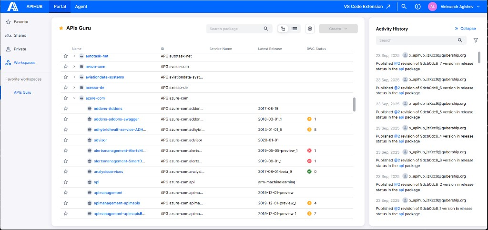
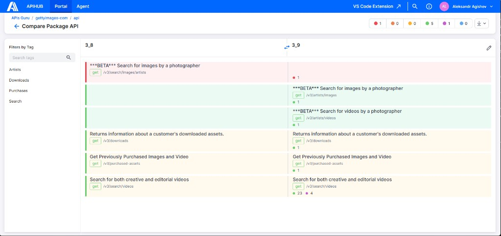
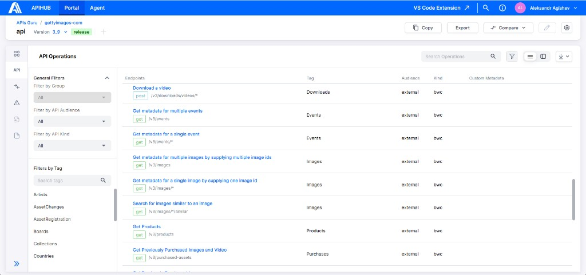
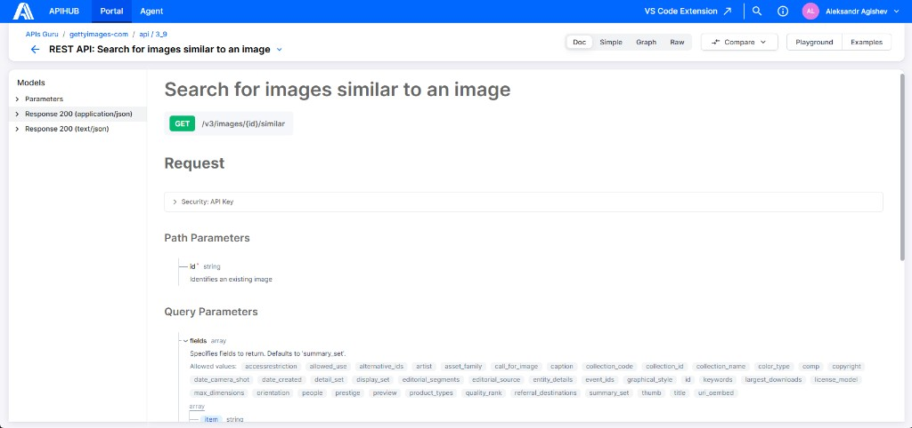

# Qubership APIHUB

[](https://github.com/Netcracker/qubership-apihub/actions/workflows/ci.yml?query=branch%3Adevelop)
[](https://github.com/Netcracker/qubership-apihub/releases/latest)

Qubership APIHUB is Netcracker's API registry and Dev Portal. It turns scattered OpenAPI, GraphQL, AsyncAPI, and
related specifications into one catalog, with versioning, comparison, linting, and optional discovery in Kubernetes
clusters.

This repository holds the source of every component, its deployment assets, and its documentation.

| | |
|--|--|
| All sites | [netcracker.github.io/qubership-apihub](https://netcracker.github.io/qubership-apihub/) |
| Landing | [Use cases, feature tour, and releases](https://netcracker.github.io/qubership-apihub/landing/) |
| Documentation | [Guides, architecture, and reference](https://netcracker.github.io/qubership-apihub/docs/) |
| Releases | [GitHub releases](https://github.com/Netcracker/qubership-apihub/releases) |
| Storybooks | [Component stories](https://netcracker.github.io/qubership-apihub/storybook/) |
| ERD | [Database diagram](https://netcracker.github.io/qubership-apihub/erd/) |

APIHUB normalizes, diffs, and classifies API changes (breaking or safe), publishes from CI/CD, lints on publish, and
supports SAML, OIDC, LDAP, RBAC, and API keys. The [landing](https://netcracker.github.io/qubership-apihub/landing/)
has the full feature tour.

## Screenshots

The Portal UI: catalog, version comparison, interactive documentation, and operation lists.

| Workspace & governance | Compare package versions |
|:-:|:-:|
|  |  |
| *Workspaces: searchable package tree, latest releases, **BWC** signals, and audit trail.* | *Compare releases: color-coded breaking vs safe changes across operations.* |

| API operations | Endpoint documentation |
|:-:|:-:|
|  |  |
| *Per-version operation index with filters and export/compare actions.* | *Rich **Doc** view for a single operation, with parameters and schemas.* |

## Architecture at a glance


| Layer | Role |
|-------|------|
| **Portal UI** | React SPAs (Portal and Agents) behind nginx: the entry point for users and operators. |
| **API Registry** | Go backend: REST API, auth, packages and versions, build orchestration, MCP and AI chat hooks. |
| **Builder** | NestJS workers run the TypeScript processing stack (normalize, diff, changelog, export). |
| **Java task consumer** | Java workers that take the build tasks the NestJS builder does not handle. |
| **Extensions** | API Linter (Spectral, AI review, scoring) and the Agents backend for remote discovery agents. |
| **Agent** | Go service in a customer cluster that discovers APIs and reports them to the Agents backend. |

Read the [architecture overview](docs/architecture/overview.md) for the full picture, or the
[C4 diagrams](https://netcracker.github.io/qubership-apihub/landing/docs/architecture/c4/) on the landing.

## Repository layout

| Folder | Content |
|--------|---------|
| [`backend/`](backend/README.md) | Go services (`portal-backend`, `api-linter-service`, `agents-backend`, `agent`, `test-service`, `commons-go`), the Java task consumer, and `libraries-backend` |
| [`frontend/`](frontend/README.md) | The UI (Portal and Agents SPAs), the builder (`build-task-consumer`), and the TypeScript libraries |
| [`tests/`](tests/README.md) | End-to-end suites: Newman collections (`postman-collections`) and Playwright tests (`ui-tests`) |
| [`deploy/`](deploy/README.md) | The Helm chart, the local Kubernetes quickstart, and the Docker Compose stacks |
| [`docs/`](docs/README.md) | Installation, administration, user guide, architecture, design items, and the developer guide |
| [`tools/`](tools/README.md) | Release scripts, CI helpers, and Nx plugins |
| `sites/` | Sources of the landing and of the documentation site |
| `.github/` | Workflows, CODEOWNERS, and Dependabot configuration |

## Where the repositories went

APIHUB used to live in separate repositories. Each one is now a folder of this repository, and its releases keep a
tag prefix. The product release uses a bare `X.Y.Z` tag.

| Old repository | Monorepo path | Tag prefix |
|----------------|---------------|------------|
| `qubership-apihub` | `/`, with `deploy/helm-templates` and `deploy/docker-compose` | none (`X.Y.Z`) |
| `qubership-apihub-backend` | [`backend/portal-backend`](backend/portal-backend/) | `portal-backend/` |
| `qubership-api-linter-service` | [`backend/api-linter-service`](backend/api-linter-service/) | `api-linter-service/` |
| `qubership-apihub-agent` | [`backend/agent`](backend/agent/) | `agent/` |
| `qubership-apihub-agents-backend` | [`backend/agents-backend`](backend/agents-backend/) | `agents-backend/` |
| `qubership-apihub-test-service` | [`backend/test-service`](backend/test-service/) | `test-service/` |
| `qubership-apihub-commons-go` | [`backend/commons-go`](backend/commons-go/) | `commons-go/` |
| `qubership-apihub-libraries-backend` | [`backend/libraries-backend`](backend/libraries-backend/) | `libraries-backend/` |
| `qubership-apihub-java-task-consumer` | [`backend/java-task-consumer`](backend/java-task-consumer/) | `java-task-consumer/` |
| `qubership-apihub-ui` | [`frontend/ui`](frontend/ui/) | `ui/` |
| `qubership-apihub-build-task-consumer` | [`frontend/build-task-consumer`](frontend/build-task-consumer/) | `build-task-consumer/` |
| 13 TypeScript libraries (`api-diff`, `api-doc-viewer`, `api-processor`, `api-unifier`, `api-visitor`, `apispec-view`, `class-view`, `compatibility-suites`, `ddlapi`, `graphapi`, `http-spec`, `json-crawl`, `rest-playground`) | `frontend/<name>` | `<name>/` |
| `qubership-apihub-ui-tests` | [`tests/ui-tests`](tests/ui-tests/) | `ui-tests/` |
| `qubership-apihub-postman-collections` | [`tests/postman-collections`](tests/postman-collections/) | `postman-collections/` |
| `qubership-apihub-jest-chrome-in-docker-environment` | [`tools/jest-chrome-in-docker-environment`](tools/jest-chrome-in-docker-environment/) | `jest-chrome-in-docker-environment/` |
| The landing site (`netcracker.github.io`, `sites/apihub`) | [`sites/landing`](sites/landing/) | none |
| The three wikis | [`docs/`](docs/README.md) | none |

## Run it

You need Podman with the compose plugin (Docker Compose works too). From the repository root:

```bash
cd deploy/docker-compose/apihub-generic
sed -i 's/:dev$/:latest/' docker-compose.yml
sh generate_env_and_up_compose.sh
```

The script prints a generated admin login and password and starts the stack with the released images. Open
<http://localhost:8081/login> and sign in. The script rewrites the config files in place, so run `git restore .` in the
folder before you commit. See the [installation guide](docs/installation-guide.md) for Helm and production settings.

## Build it

Install Node 24, pnpm, Go, Java 21, and Maven 3.9 or newer. Every Nx command needs Java and Maven, even for
TypeScript work. The [getting started guide](docs/development/getting-started.md) lists the versions and the Windows
notes.

```bash
pnpm install
pnpm exec nx run-many -t build
```

The [local run guide](docs/development/local-run.md) shows how to build the container images and start the stack
with them.

## Contribute

Read [`CONTRIBUTING.md`](CONTRIBUTING.md), then start with the [developer guide](docs/development/README.md). It
covers the workstation setup, the workflow, building and testing, debugging, CI, and AI assistants.

## License and security

APIHUB is licensed under the [Apache License 2.0](LICENSE). Report vulnerabilities as described in
[`SECURITY.md`](SECURITY.md). Participation is governed by the [Code of Conduct](CODE-OF-CONDUCT.md).
