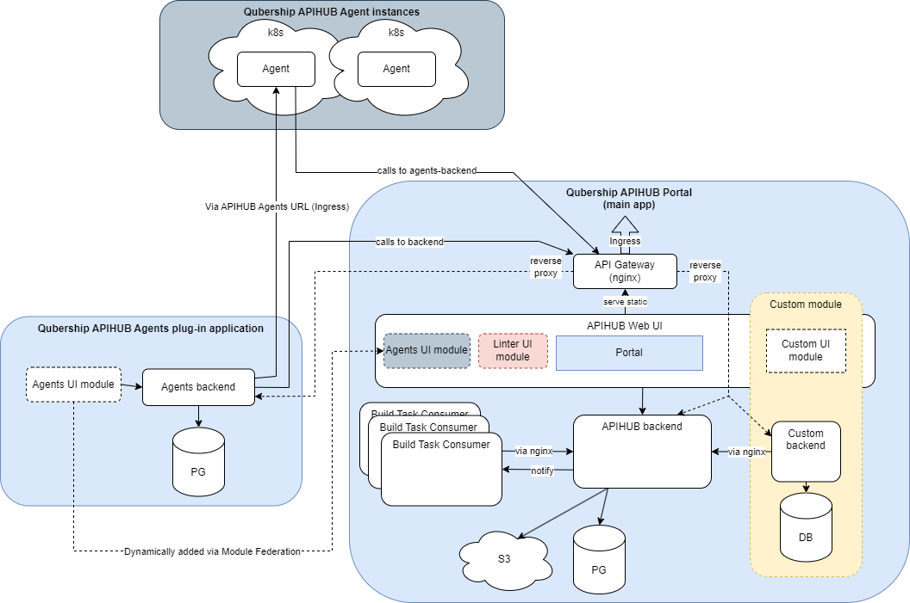

# APIHUB agents backend

The agents backend is a Go service that manages [APIHUB agent](../agent/README.md) instances: it registers agents,
runs service discovery, keeps snapshots of what they find, and checks namespace security. It uses PostgreSQL. It is an
optional plug-in for APIHUB and does nothing without it. The module ships the image
`qubership-apihub-agents-backend`; its presence enables the **Agents** tab in the web UI.

It is one of the extension services next to the backend; see the
[architecture overview](../../docs/architecture/overview.md).

## Build, test, and lint

The Nx project is `agents-backend` (tag `lang:go`). Run from the repository root:

```bash
pnpm exec nx run agents-backend:build
pnpm exec nx run agents-backend:test
pnpm exec nx run agents-backend:lint
```

To build the image, see [Build and test: Images](../../docs/development/build-and-test.md#images); on Windows,
`build_docker_image.cmd` does the same.

## Run and debug locally

The generic Compose stack starts the service with the rest of the product; see
[Run APIHUB locally](../../docs/development/local-run.md). To run it from the IDE, copy
[`config.template.yaml`](config.template.yaml) to a folder as `config.yaml`, set the database, and start
`main.go` from this folder. Breakpoints and the config folder variable:
[Debugging: Go service](../../docs/development/debugging.md#go-service).

## Configuration

The service loads parameters from `config.yaml`. The format, the defaults, and examples are in
[`config.template.yaml`](config.template.yaml). By default it looks for `config.yaml` in the working directory; set
`AGENTS_BACKEND_CONFIG_FOLDER` to use another directory.

The remaining environment-only settings are:

- `AGENTS_BACKEND_CONFIG_FOLDER`: the directory that contains `config.yaml`; defaults to `.`.
- `LOG_LEVEL`: the initial log level; defaults to `info` when empty or invalid. A system administrator can change it at
  runtime with `/api/v1/debug/logs/setLevel`.

For a deployment, the Helm values section is `qubershipApihubAgentsBackend`. The
[installation guide](../../docs/installation-guide.md) and the
[configuration reference](../../docs/configuration-reference.md) describe it.

## API specifications

The OpenAPI files are in [`docs/api/`](docs/api/): [`Agents-Backend-API.yaml`](docs/api/Agents-Backend-API.yaml), its
[internal variant](docs/api/Agents-Backend-API_internal.yaml), and [`Admin-API.yaml`](docs/api/Admin-API.yaml).

## Further reading



- [Agent](../agent/README.md): the service this one manages
- [Agent user guide](../../docs/user-guide/agent.md)
