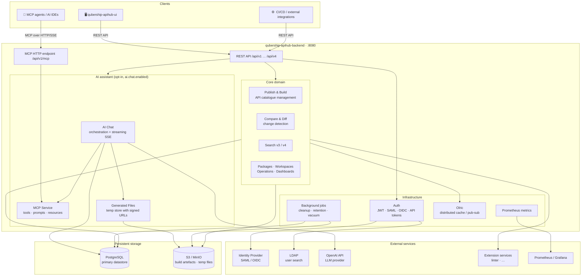

# APIHUB backend

The backend (API Registry) is the main Go service of APIHUB. It implements the core business logic, exposes the REST
API that the UI and external integrations use, and hosts the optional AI assistant and the MCP endpoint. It stores data
in PostgreSQL and, optionally, in S3 or MinIO. The module ships the image `qubership-apihub-backend`.

It is the center of the product: the UI, the builder, the extension services, and the agents all talk to it. See the
[architecture overview](../../docs/architecture/overview.md) for the whole picture.

## Architecture overview



## Key capabilities

| Area | Description |
|---|---|
| **API catalogue** | Publish, version, and browse OpenAPI, AsyncAPI, GraphQL, JSON Schema, and DDLAPI specifications and Markdown files |
| **Change detection** | Compare any two versions; generate detailed breaking-change reports |
| **Search** | Full-text and structured search across operations and schemas (v3 / v4 API) |
| **Access control** | Role-based permissions; local users + external IdP (SAML / OIDC) + API tokens |
| **AI assistant** | Streaming chat backed by OpenAI; IDS document generation via MCP tools |
| **MCP endpoint** | Model Context Protocol server exposing APIHub data to AI agents and IDEs |
| **Observability** | Prometheus metrics, structured logging, per-turn correlation IDs |

## Build, test, and lint

The Nx project is `portal-backend` (tag `lang:go`). Run from the repository root:

```bash
pnpm exec nx run portal-backend:build
pnpm exec nx run portal-backend:test
pnpm exec nx run portal-backend:lint
```

`build` writes the binary to `dist/backend/portal-backend`. To build the image, see
[Build and test: Images](../../docs/development/build-and-test.md#images); on Windows with Podman,
`build_docker_image.cmd` in this folder does the same. Set up the tools first:
[Getting started](../../docs/development/getting-started.md).

## Run and debug locally

The shortest path is the generic Compose stack, which runs the backend with the UI, the builder, the linter, and
PostgreSQL: [Run APIHUB locally](../../docs/development/local-run.md#compose-with-published-images). To run the backend
from the IDE with the rest in Compose, follow
[Backend from the IDE](../../docs/development/local-run.md#backend-from-the-ide-the-rest-in-compose). Start `main.go`
with this folder as the working directory, because the migrations and the static assets are found relative to it.
Breakpoints, Delve, and the traps of a local run:
[Debugging: Go service](../../docs/development/debugging.md#go-service) and [Running and probing](docs/running-and-probing.md).

## Configuration

The backend reads `config.yaml` from the folder that `APIHUB_CONFIG_FOLDER` names (default: the working directory).
[`config.template.yaml`](config.template.yaml) lists every key with its description and default; the deployment view is
in the [configuration reference](../../docs/configuration-reference.md).

Notable sections:

| Section | Purpose |
|---|---|
| `database` | PostgreSQL connection |
| `security` | JWT keys, external IdP (SAML / OIDC), LDAP, allowed origins |
| `s3Storage` | Optional S3 / MinIO for build artefacts |
| `olric` | Distributed in-process cache; `local` mode for single-node |
| `ai.chat` | AI assistant kill-switch, OpenAI key/model, retention settings |
| `monitoring` | Prometheus application metrics (HTTP, build queue, AI chat) |
| `cleanup` | Cron schedules for revision, comparison, and soft-deleted data GC |

## API specifications

The OpenAPI files are in [`docs/api/`](docs/api/): [`APIHUB_API.yaml`](docs/api/APIHUB_API.yaml), the
[admin API](<docs/api/Admin API.yaml>), and two internal variants. The Postman collections that test them are in
[`tests/postman-collections`](../../tests/postman-collections/README.md); the AI chat collection is
[`docs/postman/AI_Chat_API.postman_collection.json`](docs/postman/AI_Chat_API.postman_collection.json).

## Further reading

The [module documentation index](docs/README.md) lists the development guide, the API files, and links to the
administration guides, the design documents, and the security model.
