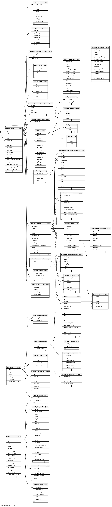
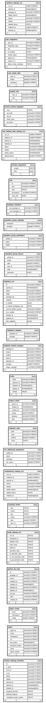

# APIHUB Backend database structure (ERD)

  * [Relationships tables](#relationships-tables)
  * [Orphans tables](#orphans-tables)
  * [Appendix: how to generate dynamic document](#appendix-how-to-generate-dynamic-document)
    + [Run SchemaSpy from `jar` distribution (on Windows)](#run-schemaspy-from-jar-distribution-on-windows)

This article depicts tables and relationships in APIHUB Backend database.

This article contains static pictures for reference.

Interactive document can be found here: [ERD on GitHub pages](https://netcracker.github.io/qubership-apihub/pages/erd/index.html)

## Relationships tables



## Orphans tables



## Appendix: how to generate dynamic document

The following tool is used: [SchemaSpy](https://schemaspy.org/), [GitHub](https://github.com/schemaspy/schemaspy)

### Run SchemaSpy from `jar` distribution (on Windows)

Software prerequisites: 
- JRE

Steps:

1. Download jar file from [Release v6.2.4](https://github.com/schemaspy/schemaspy/releases/tag/v6.2.4)
2. Download PG JDBC driver from [Release 42.7.7](https://jdbc.postgresql.org/download/postgresql-42.7.7.jar)
3. Put both jars to same folder

You need PG with APIHUB Backend database up and running. For example you could set up APIHUB via docker-compose or in local k8s cluster and make port-forward.

Let's imagine PG is available on localhost:5432

Just execute the following command:

```CMD
java -jar schemaspy-6.2.4.jar ^
  -t pgsql ^
  -dp postgresql-42.7.7.jar ^
  -host localhost ^
  -port 5432 ^
  -db apihub_backend ^
  -u postgres ^
  -p postgres ^
  -s public ^
  -o erd ^
  -vizjs ^
  -norows ^
  -noimplied
```

Results will be placed in `./erd`