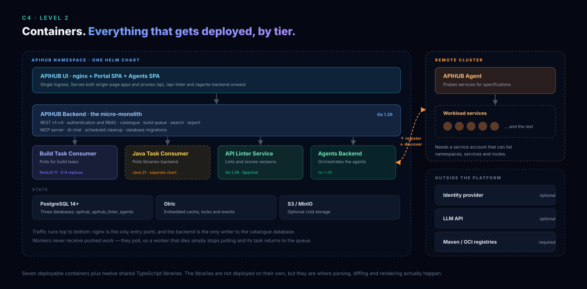

# APIHUB system architecture

## 1. System overview

APIHUB is an API management and registry platform. It stores, analyzes, compares, and documents API specifications and
contracts in one catalog. It supports OpenAPI and Swagger, GraphQL, AsyncAPI, DDLAPI database-schema contracts,
Markdown, Protobuf and gRPC stubs, and MCP catalog contracts. The backend also exposes a separate MCP server with
API-catalog tools for AI integrations.

APIHUB runs on Kubernetes. The repository holds the source of every component, so each component below maps to a
folder of the monorepo. The [landing site](https://netcracker.github.io/qubership-apihub/landing/) shows the same
system from other angles:

- [C4 diagrams](https://netcracker.github.io/qubership-apihub/landing/docs/architecture/c4/): context, containers, and
  deployment.
- [Flows](https://netcracker.github.io/qubership-apihub/landing/docs/architecture/flows/): publish, discovery, and AI
  review.
- [Capability map](https://netcracker.github.io/qubership-apihub/landing/docs/architecture/capability-map/): what each
  component contributes to each capability.

## 2. Containers



The Portal UI is the single entry point. Its nginx proxy routes `/api/*` to the API Registry, `/api-linter/*` to the
API Linter service, and `/agents-backend/*` to the Agents backend. Workers poll the API Registry for build tasks, and
the registry stores their results in PostgreSQL.

### 2.1 Layers

| Layer | Module | Language | Port | Role |
|-------|--------|----------|------|------|
| **Portal UI** | [`frontend/ui`](../../frontend/ui/) | TypeScript, React, nginx | 8080 | Two SPAs (Portal and Agents) behind an nginx reverse proxy: the entry point for users and operators. |
| **API Registry** | [`backend/portal-backend`](../../backend/portal-backend/) | Go | 8080 | Central micro-monolith: REST API, authentication, RBAC, packages and versions, build orchestration, MCP server, AI chat, cleanup jobs. |
| **Builder** | [`frontend/build-task-consumer`](../../frontend/build-task-consumer/) | TypeScript, NestJS | 3000 | Stateless workers that run the TypeScript processing stack: normalize, diff, changelog, export. |
| **Java task consumer** | [`backend/java-task-consumer`](../../backend/java-task-consumer/) | Java | none | Stateless workers that take the Java build tasks (jar-to-jar API diff and dependency-upgrade impact analysis) that `backend/libraries-backend` queues. |
| **Extension: API Linter** | [`backend/api-linter-service`](../../backend/api-linter-service/) | Go | 8080 | Lints API specifications with Spectral and AI engines; optional version quality scoring after a lint run. |
| **Extension: Agents backend** | [`backend/agents-backend`](../../backend/agents-backend/) | Go | 8080 | Manages agent instances, snapshots, and namespace security. |
| **Agent** | [`backend/agent`](../../backend/agent/) | Go | 8080 | Runs in a customer cluster, discovers APIs through pluggable runners, and reports them to the Agents backend. |

The shared infrastructure is PostgreSQL (separate databases per service), optional S3 or MinIO cold storage, and Olric
for the distributed cache and publish-subscribe events.

## 3. Data flow

### 3.1 Publish Flow (User uploads API spec)

```text
User → UI → Backend (POST /api/v2/packages/{id}/publish)
                ↓
        Backend creates build task in DB
                ↓
        Builder polls (POST /api/v2/builders/{builderId}/tasks)
                ↓
        Consumer receives ZIP (config + source files)
                ↓
        PackageVersionBuilder.run() via api-processor:
          1. Parse files → detect API or contract type (REST/GraphQL/AsyncAPI/DDL/MCP/Markdown/Unknown)
          2. Build documents (VersionDocument objects)
          3. Extract operations (per HTTP method / per GraphQL query)
          4. Normalize via api-unifier
          5. Compare with previous version via api-diff
          6. Generate changelog (classified diffs: breaking/non-breaking/risky)
          7. Package results as ZIP
                ↓
        Consumer sends results back (POST /api/v3/packages/{id}/publish/{publishId}/status)
                ↓
        Backend stores results in PostgreSQL
                ↓
        Backend publishes "version-published" event via Olric DTopic
                ↓
        API Linter receives event → fetches docs → runs Spectral/AI lint → stores results
```

### 3.2 Agent Discovery Flow

```text
Agent (in remote K8s cluster):
  1. Registers with Agents Backend on startup (heartbeat every ~30s)
  2. User triggers discovery via Agents UI
  3. Agent lists K8s namespaces/services
  4. For each service, runs all DiscoveryRunners in parallel:
     - REST runner: probes Swagger/OpenAPI endpoints
     - GraphQL runner: GraphQL introspection
     - AsyncAPI runner: AsyncAPI document endpoints
     - Markdown runner: Markdown document URLs
     - JSON Schema runner: JSON Schema URLs
  5. Returns discovered documents to Agents Backend
  6. User can create "snapshot" → Agents Backend packages specs → publishes to Backend
```

### 3.3 View/Compare Flow (User views API in UI)

```text
User → UI → Backend (GET /api/v2/packages/{id}/versions/{v}/{apiType}/operations)
                ↓
        Backend returns operations/documents from PostgreSQL
                ↓
        UI renders via web components:
          - <apispec-view> for full API documentation (OpenAPI/AsyncAPI)
          - <operation-view> for single operation detail
          - <diff-operation-view> for version comparison
          - <rest-playground> for interactive API testing
          - <class-view-component> for UML-style schema diagrams
          - JsonSchemaViewer / GraphQLOperationViewer for schema rendering
```

## 4. TypeScript library stack

The processing pipeline behind the builder and the UI is a layered stack of 13 TypeScript libraries in
[`frontend/`](../../frontend/README.md). `json-crawl` is the foundation. `api-unifier` normalizes specifications and
defines the `SpecType` union (`openapi-3.0`, `openapi-3.1`, `json-schema-04/06/07`, `asyncapi-3`, `graphapi`,
`ddlapi-1.0`). `api-diff` compares two normalized specifications and classifies each change. `api-processor`
orchestrates builds through `PackageVersionBuilder`, which registers one `ApiBuilder` per API type (REST, GraphQL,
AsyncAPI, DDL, MCP, text, unknown). `api-doc-viewer`, `apispec-view`, `rest-playground`, and `class-view` render the
results.

[Processing libraries](./processing-libraries.md) has the layer diagram, the dependency graph, and a catalog of every
library.

## 5. Supported API types

| API Type | Backend | Build Consumer | Agent Discovery | UI | Unifier | Diff | Model trees | Doc Viewer | Linter |
|----------|:-------:|:--------------:|:---------------:|:--:|:-------:|:----:|:----------:|:----------:|:------:|
| OpenAPI 3.0/3.1 | ✅ `rest` | ✅ `Rest` | ✅ REST runner | ✅ | ✅ | ✅ | ✅ (JSON Schema) | ✅ | ✅ Spectral+AI |
| Swagger 2.0 | ✅ (via conversion) | ✅ (→ OAS3) | ✅ | ✅ | (→ OAS3) | (→ OAS3) | ✅ | ✅ | ✅ Spectral+AI |
| GraphQL | ✅ `graphql` | ✅ `GraphQL` | ✅ GraphQL runner | ✅ | ✅ (graphapi) | ✅ | ✅ (GraphApi) | ✅ | ❌ |
| AsyncAPI | ✅ `asyncapi` | ✅ `Kafka` *(enum label; AsyncAPI build)* | ✅ AsyncAPI runner | ✅ | ✅ `asyncapi-3` | ✅ | ⚠️ partial vs REST | ✅ (apispec-view) | ✅ Spectral (+ scoring) |
| Protobuf/gRPC | ✅ `protobuf` | ✅ `gRPC` | ❌ | ❌ | ❌ | ❌ | ❌ | ❌ | ❌ |
| Markdown | — | ✅ `MD` | ✅ MD runner | ✅ viewer | — | — | — | — | — |
| **DDLAPI** | ✅ contracts | ✅ `ddlBuilder` | ❌ | ⚠️ contracts | ✅ `ddlapi-1.0` | ✅ | — | ✅ | ❌ |
| **MCP contracts** | ✅ contracts | ✅ `mcpBuilder` | ❌ | ✅ Contracts tab | ❌ (not a SpecType) | ❌ (not a SpecType) | — | raw/contract views | ❌ |

> MCP catalog contracts are distinct from the backend's MCP server. The server exposes APIHUB catalog tools to MCP
> clients; it is not a catalog document type.

## 6. Authentication and authorization

### Authentication Methods

- **Local Auth** (non-production): username/password → JWT
- **SAML 2.0**: Enterprise SSO via SAML identity providers
- **OIDC (OpenID Connect)**: OAuth2-based SSO
- **LDAP**: User directory sync
- **API Keys**: Service-to-service authentication
- **Personal Access Tokens (PATs)**: Developer automation
- **Cookie-based JWT**: Browser session management

### Authorization Model (RBAC)

- **System Admins**: Full system access
- **Package-level roles**: Viewer, Editor, Owner (per workspace/group/package)
- **Custom roles**: Configurable role definitions with granular permissions
- **API Key scopes**: Per-key permission grants

## 7. Deployment architecture

### Kubernetes (production)

- The Helm chart lives in [`deploy/helm-templates`](../../deploy/helm-templates/README.md).
- Every service runs as a Kubernetes Deployment with a Service.
- The nginx-based UI is the single ingress point.
- Each service exposes `/ready` and `/live` health endpoints.
- Production needs 2-11 CPU and 3-9 Gi RAM.
- Prometheus and Grafana dashboards are included.

### Docker Compose (development)

- The stacks live in [`deploy/docker-compose`](../../deploy/docker-compose/README.md). `apihub-generic` runs all
  services and PostgreSQL.
- `with-keycloak` adds a Keycloak server for SSO testing.

### Local Kubernetes quickstart (optional analytics)

- [`deploy/helm-templates/local-k8s-quickstart`](../../deploy/helm-templates/local-k8s-quickstart/README.md) can add an
  Apache Superset subchart for BI and analytics next to the stack.

For install steps see the [installation guide](../installation-guide.md); for every setting see the
[configuration reference](../configuration-reference.md).

### Infrastructure dependencies

| Component | Required | Purpose |
|-----------|----------|---------|
| PostgreSQL 14+ | **Yes** | Primary data store (separate databases per service) |
| S3 / MinIO | Optional | Cold storage for build results |
| Olric | Built-in | Distributed cache and publish-subscribe (LAN discovery in Kubernetes) |
| OpenAI API | Optional | AI-powered linting and chat |

## 8. Extension points for API and contract types

An API type represented by `SpecType` is normalized and usually diffed as a specification. **DDLAPI is such a type**:
its canonical value is `ddlapi-1.0`. MCP catalog data is deliberately different: it is a processor **contract type**
handled by `mcpBuilder`, not a classic `ApiType` or `SpecType`. The backend MCP server is a separate integration
endpoint.

### Contract types: MCP and DDL

`mcpBuilder` and `ddlBuilder` are registered through processor contract constants (`MCP_CONTRACT_TYPE` and
`DDL_CONTRACT_TYPE`). Their document types are persisted by backend document/contract models and rendered in the Portal
Contracts tab via `contract-types.ts`. DDL additionally has a DDLAPI processing and comparison pipeline; MCP catalog
contracts organize endpoint initialization, tools, resources, and prompts without becoming operation APIs.

### Adding another `SpecType`

The following roadmap describes adding another first-class specification type (for example, the earlier AsyncAPI
integration), rather than adding MCP as a `SpecType`.

### Layer 1: Format Definition

- Define the canonical source or intermediate format when required (for example, `graphapi` for GraphQL).

### Layer 2: Normalization (`frontend/api-unifier`)

1. Add the new value to `SpecType` in `src/spec-type.ts`
2. Add detection in `resolveSpec()` function
3. Create a dedicated normalization-rules module
4. Register in `RULES` map

### Layer 3: Diffing (`frontend/api-diff`)

1. Create a comparison module with rules, classification, and descriptions
2. Implement `CompareEngine` function
3. Register in `COMPARE_ENGINES_MAP`

### Layer 3b: Visitor (`frontend/api-visitor`)

1. Create an API-type walker and visitor
2. Define `CrawlRules` for the structure of the new type

### Layer 4: Model trees and viewers (`frontend/api-doc-viewer`)

1. Create a type-specific module in `next-data-model` with node kinds, types, and tree builders
2. Add normal and diff tree builders
3. Create React viewer components

### Layer 5: Processing (`frontend/api-processor`)

1. Create `src/apitypes/<type>/` with an `ApiBuilder`
2. Implement parser, document builder, operations builder, dumper
3. Register in `PackageVersionBuilder` constructor
4. Update `BuilderType` and `OperationsApiType` unions

### Layer 6: API Registry (`backend/portal-backend`)

1. Add the operation API type constant in `view/CommonOperation.go`
2. Update switch statements in `entity/OperationEntity.go`
3. Update search entity mappings
4. Update build result processing

### Layer 7: UI (`frontend/ui`)

1. Add the UI API-type constant in `shared/src/entities/api-types.ts`
2. Create an operation viewer component for the new type
3. Update `DocSpecView.tsx` to render it

### Layer 8: Agent discovery (`backend/agent`)

1. Create `api_type/<type>/discovery.go` implementing `DiscoveryRunner`
2. Register runner in `document_discovery.go`

### Layer 9: Linting (`backend/api-linter-service`)

1. Add the document/API type to the linter enum and configuration
2. Create or configure linter rules for the new type

### Layer 10: Builder (`frontend/build-task-consumer`)

1. Add the operation API type to the build-consumer schema where applicable
