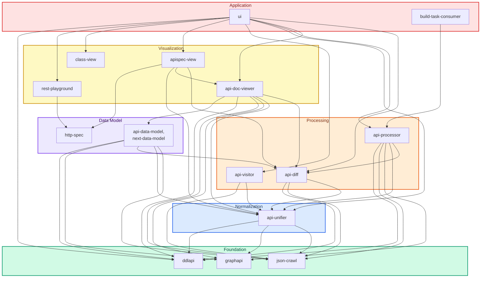
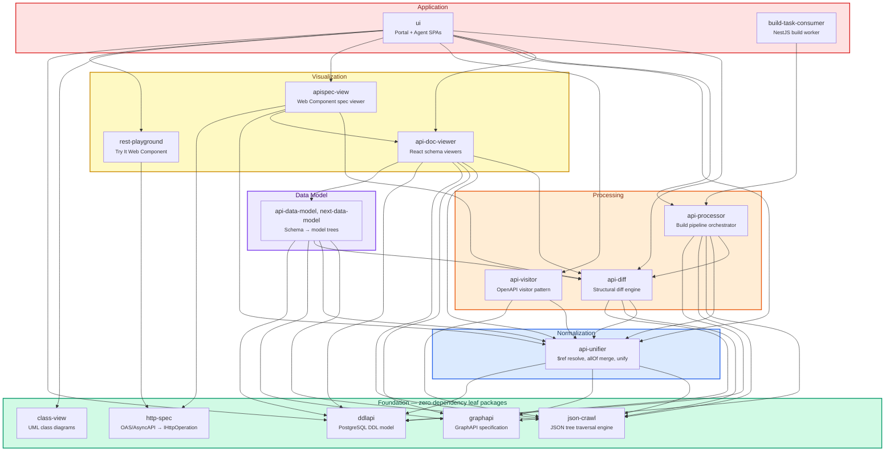
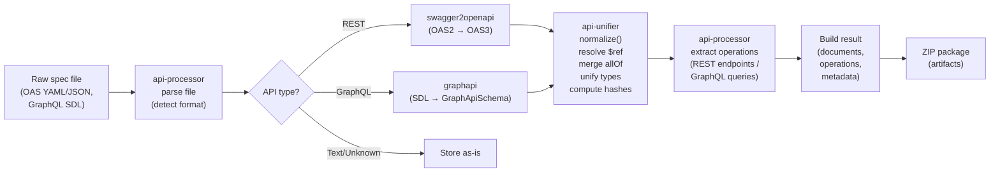
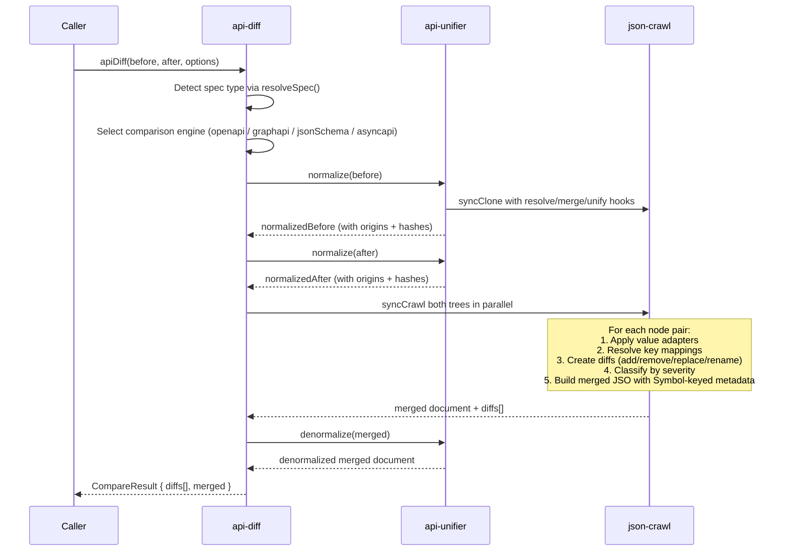
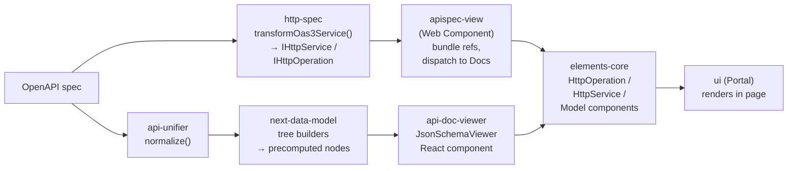
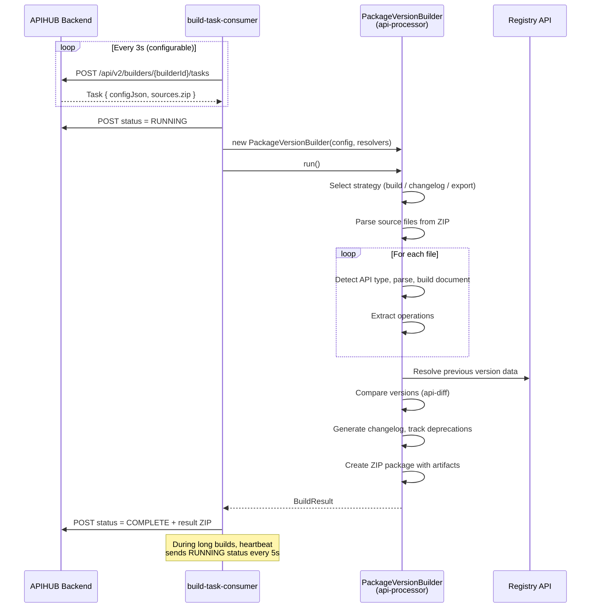

# Processing libraries

APIHUB manages the lifecycle of API specifications: teams store, browse, compare, validate, and publish API contracts in
one registry. The TypeScript side of that work is split into 13 libraries in [`frontend/`](../../frontend/README.md),
plus the builder (`frontend/build-task-consumer`) and the UI (`frontend/ui`) that consume them. The libraries are
organized into six layers. Together they cover the pipeline: parsing raw specification files (OpenAPI 2/3, AsyncAPI,
GraphQL, JSON Schema, DDL), normalizing them into a unified representation, computing structural diffs between versions,
transforming specs into renderable data models, and presenting interactive documentation with diff visualization and
live API testing.

This page is for contributors who change these libraries. It covers dependency relationships, data flow pipelines, key
design decisions, and a catalog of every library. Each library is a pnpm workspace project in the Nx graph, so
`pnpm exec nx show projects` lists them and `pnpm exec nx graph` draws the dependencies. For the system around them, see
the [architecture overview](./overview.md).

---

## 1. System overview

The libraries and applications are organized into six layers. Each layer builds on the ones below it, which gives a
clear dependency direction from foundation to application.

| Layer | Purpose | Modules |
|---|---|---|
| **Foundation** | Zero-dependency utilities for JSON traversal, GraphQL-to-JSON conversion, and DDL parsing | `json-crawl`, `graphapi`, `ddlapi` |
| **Normalization** | Resolves `$ref`, merges `allOf`, infers types, tracks value origins | `api-unifier` |
| **Processing** | Structural diff computation, OpenAPI visitor pattern, build pipeline orchestration | `api-diff`, `api-visitor`, `api-processor` |
| **Data Model** | Type systems and transformers that convert specs into renderable tree structures | `http-spec`, and the `api-data-model` and `next-data-model` packages of `api-doc-viewer` |
| **Visualization** | React components and Web Components for rendering documentation, diffs, diagrams, and live testing | `api-doc-viewer`, `apispec-view`, `class-view`, `rest-playground` |
| **Application** | End-user applications: the Portal/Agent UI and the build worker microservice | `ui`, `build-task-consumer` |

`compatibility-suites` is test data, not a layer: it holds the before-and-after cases that `api-diff`,
`api-doc-viewer`, and `apispec-view` use to test change classification.

---

## 2. Dependency graph

The following diagram shows only actual runtime dependencies between internal `@netcracker/qubership-apihub-*` packages,
read from each module's `package.json`. Arrows point from the dependent package to its dependency.

> **Reading the graph:** Five libraries have zero internal runtime dependencies and sit at the foundation: `json-crawl`,
> `graphapi`, `ddlapi`, `http-spec`, and `class-view`. The most depended-upon library is `json-crawl`, followed by
> `api-unifier`. The `ui` application sits at the top and consumes more than ten internal libraries.
> `compatibility-suites` is a development dependency only and is not drawn.

---

## 3. Library catalog

Modules are listed from foundation to application layer (bottom-up).

---

### json-crawl

**Module:** [`frontend/json-crawl`](../../frontend/json-crawl/) 
**Package:** `@netcracker/qubership-apihub-json-crawl`

A modified fork of [json-crawl](https://github.com/udamir/json-crawl) that provides synchronous and asynchronous
utilities for traversing, cloning, comparing, and transforming JSON objects as tree structures. It is the foundational
tree-walking engine used by nearly every other library in the system.

**Key responsibilities:**

- Depth-first traversal (`crawl`, `syncCrawl`) with customizable hook pipeline and flow control (skip/terminate)
- Breadth-first traversal (`breadthFirstTraverse`) with the same hook interface
- Deep cloning (`clone`, `syncClone`) with optional hook-based transformation
- In-place transformation (`transform`) via async traversal with node mutation
- Deep structural equality comparison (`equal`)
- Declarative rule engine (`CrawlRules`) with exact-key, wildcard, recursive wildcard, and prefix matching
- Iterative stack-based implementation (no call-stack overflow on deep trees)

**Depends on:** None (zero runtime dependencies)

**Used by:** `api-unifier`, `api-diff`, `api-visitor`, `api-processor`, `api-doc-viewer`

---

### graphapi

**Module:** [`frontend/graphapi`](../../frontend/graphapi/) 
**Package:** `@netcracker/qubership-apihub-graphapi`

Defines and implements the **GraphAPI Specification** — a JSON Schema-based representation of GraphQL APIs, analogous to
what OpenAPI is for REST. Converts between `GraphQLSchema` objects, introspection query results, and the GraphAPI JSON
format.

**Key responsibilities:**

- Convert `GraphQLSchema` to `GraphApiSchema` JSON document (`buildFromSchema`)
- Convert GraphQL introspection results to `GraphApiSchema` (`buildFromIntrospection`)
- Print `GraphApiSchema` back to GraphQL SDL text (`printGraphApi`)
- Full TypeScript type definitions for the GraphAPI document model
- Comprehensive runtime type guards for all GraphAPI node types
- Custom directive preservation from schema metadata

**Depends on:** None (zero runtime dependencies)

**Used by:** `api-unifier`, `api-processor`, `api-doc-viewer`, `ui`

---

### ddlapi

**Module:** [`frontend/ddlapi`](../../frontend/ddlapi/) 
**Package:** `@netcracker/qubership-apihub-ddlapi`

Parses PostgreSQL DDL into a driver-neutral, in-memory schema model (`Realm`, `Schema`, `Table`, `Column`, indexes,
foreign keys, constraints). It is a TypeScript port of the Atlas Go schema model with a PostgreSQL escape hatch for
dialect-specific details.

**Key responsibilities:**

- `buildFromDdl(ddl)` parses a DDL script into the schema model
- Typed factories to build the same model by hand
- Slices a multi-table DDL script into the minimal verbatim SQL relevant to each table

**Depends on:** None (zero runtime dependencies)

**Used by:** `api-unifier`, `api-diff`, `api-processor`, `api-doc-viewer`, `ui`

---

### compatibility-suites

**Module:** [`frontend/compatibility-suites`](../../frontend/compatibility-suites/) 
**Package:** `@netcracker/qubership-apihub-compatibility-suites`

A collection of before-and-after specification cases (OpenAPI, GraphQL, AsyncAPI) that pin down how changes are
classified. Each case reflects one change. It is test data and a generator, not a runtime library.

**Depends on:** None

**Used by:** `api-diff`, `api-doc-viewer`, and `apispec-view` (development only)

---

### http-spec

**Module:** [`frontend/http-spec`](../../frontend/http-spec/) 
**Package:** `@netcracker/qubership-apihub-http-spec`

A fork of [@stoplightio/http-spec](https://github.com/stoplightio/http-spec) that converts multiple API specification
formats into a unified intermediate AST based on `@stoplight/types` (`IHttpService` / `IHttpOperation`). Extended with
an `oas3WithMeta` variant that preserves diff metadata through the transformation pipeline.

**Key responsibilities:**

- OAS2 (Swagger), OAS3, Postman Collections, AsyncAPI to `IHttpService`/`IHttpOperation` conversion
- `oas3WithMeta` variant preserving diff metadata via symbol-keyed `keepProperties`
- Operation merging by path+method (`mergeOperations`)
- Deterministic stable ID generation via FNV-1a hashing
- JSON Schema conversion from OAS schema objects
- Sub-path exports for tree-shaking (`/oas2`, `/oas3`, `/oas3WithMeta`, `/postman`, `/asyncapi`)

**Depends on:** None (no internal `qubership-apihub-*` runtime dependencies)

**Used by:** `apispec-view`, `rest-playground`

---

### api-unifier

**Module:** [`frontend/api-unifier`](../../frontend/api-unifier/) 
**Package:** `@netcracker/qubership-apihub-api-unifier`

The normalization engine. Takes API specifications (OpenAPI 3.0/3.1, JSON Schema drafts 04/06/07, GraphAPI, AsyncAPI,
DDLAPI) and produces a fully resolved, self-contained representation suitable for diffing, hashing, and
programmatic comparison.

**Key responsibilities:**

- `$ref` resolution with cycle handling and origin tracking
- `allOf` merging with type-aware merge resolvers
- Type inference and default value unification
- Structural hash computation (MD5 via `object-hash`)
- Origins system — traces every output value back to its declaration path in the source
- Deprecated items calculation
- Spec-type auto-detection (`resolveSpec`)
- Cycle-safe cloning via three-state copy tracker
- Serialization/deserialization of cyclic JSON structures

**Depends on:** `json-crawl`, `graphapi`, `ddlapi`

**Used by:** `api-diff`, `api-visitor`, `api-processor`, `api-doc-viewer`, `apispec-view`, `ui`

---

### api-diff

**Module:** [`frontend/api-diff`](../../frontend/api-diff/) 
**Package:** `@netcracker/qubership-apihub-api-diff`

The structural diff engine. Computes differences between two versions of any supported API specification and produces a
merged document annotated with change metadata. Every change is classified by severity.

**Key responsibilities:**

- `apiDiff(before, after, options)` — main entry point for all spec types
- Merged document generation with diff metadata stored under Symbol keys
- Change classification: `breaking`, `non-breaking`, `risky`, `annotation`, `deprecated`, `unclassified`
- Human-readable template-based description generation for each diff
- Backward-compatibility scoping with reclassification support
- Pluggable rules engine for custom classification, comparison, and key mapping
- Cross-version OpenAPI comparison (3.0 vs 3.1)
- Covariant/contravariant classification (request parameters vs response fields)
- Evaluation caching for performance on cyclic/shared refs

**Depends on:** `api-unifier`, `json-crawl`, `ddlapi`

**Used by:** `api-processor`, `api-doc-viewer`, `apispec-view`, `ui`

---

### api-visitor

**Module:** [`frontend/api-visitor`](../../frontend/api-visitor/) 
**Package:** `@netcracker/qubership-apihub-api-visitor`

A type-safe Visitor-pattern walker for traversing normalized OpenAPI 3.0 specifications. Recursively walks the document
tree and invokes user-supplied `start`/`end` callback pairs at each structural node.

**Key responsibilities:**

- `OpenApiWalker` class with `walkPaths` and `walkPathsOnNormalizedSource`
- Start/end callback pairs for paths, HTTP methods, parameters, request bodies, responses, media types, schemas,
  combiners, headers
- Circular reference detection via visited-objects tracking
- Integrated normalization pipeline (can accept raw or pre-normalized specs)
- Origins metadata propagation through callbacks
- Declarative crawl rules (`openApiRules`) mapping JSON-pointer paths to visitor methods

**Depends on:** `api-unifier`, `json-crawl`

**Used by:** `ui`

---

### api-processor

**Module:** [`frontend/api-processor`](../../frontend/api-processor/) 
**Package:** `@netcracker/qubership-apihub-api-processor`

The core build pipeline engine. Processes raw API specification files into structured package-version build results with
operation extraction, version-to-version changelogs, deprecation tracking, and export artifacts.

**Key responsibilities:**

- `PackageVersionBuilder` — main orchestrator with `run()` and incremental `update()`
- Multi-format parsing: OpenAPI 2/3, GraphQL, AsyncAPI, DDL, MCP contracts, Markdown, unknown file types
- Operation extraction (REST endpoints, GraphQL queries/mutations/subscriptions)
- Version comparison and changelog generation with change severity classification
- Deprecation tracking across versions
- Export in multiple formats (YAML, JSON, HTML, GraphQL) with ZIP packaging
- Strategy pattern for build types (`build`, `changelog`, `export*` variants)
- Backward compatibility (BWC) checking with reclassification
- Resolver-based I/O boundary (no direct I/O — portable across browser and Node.js)
- API Builder plugin architecture (REST, GraphQL, AsyncAPI, DDL, MCP, text, unknown)

**Depends on:** `api-diff`, `api-unifier`, `graphapi`, `ddlapi`, `json-crawl`

**Used by:** `build-task-consumer`, `ui`

---

### class-view

**Module:** [`frontend/class-view`](../../frontend/class-view/) 
**Package:** `@netcracker/qubership-apihub-class-view`

An interactive UML-style class diagram visualization library. Renders API schema structures as navigable, zoomable graph
diagrams with automatic layout.

**Key responsibilities:**

- `<class-view-component>` Web Component (Custom Element)
- Automatic graph layout via ELK.js (Eclipse Layout Kernel) running in a Web Worker
- SVG rendering via D3.js with animated transitions on content changes
- Interactive selection, zoom/pan, and programmatic navigation (`navigateTo`)
- Content diffing/merging for efficient incremental rendering
- Customizable styling via shape/color functions
- Generic `DomainMeta` type system for consumer-defined metadata

**Depends on:** None (no internal `qubership-apihub-*` runtime dependencies)

**Used by:** `ui`

---

### api-doc-viewer

**Module:** [`frontend/api-doc-viewer`](../../frontend/api-doc-viewer/)

The module is a pnpm workspace of five packages. Only the viewer is published:

| Package | Path | Published | Purpose |
|---|---|---|---|
| `@netcracker/qubership-apihub-api-doc-viewer` | `packages/api-doc-viewer` | Yes | React viewers for JSON Schema, AsyncAPI, DDL API, JSO, and (legacy) GraphQL operations, with diff support |
| `@netcracker/qubership-apihub-next-data-model` | `packages/next-data-model` | No (private) | Tree builders, crawl rules, and diff aggregators that feed the viewers |
| `@netcracker/qubership-apihub-api-data-model` | `packages/api-data-model` | No (private) | Legacy model trees for the GraphQL viewers; a fork of [api-model-tree](https://github.com/udamir/api-model-tree) |
| `@netcracker/qubership-apihub-api-state-model` | `packages/api-state-model` | No (private) | Legacy UI state (expand/collapse, combiner selection, sorting) over the GraphQL model trees |
| `@netcracker/qubership-apihub-samples` | `packages/samples` | No (private) | Sample specifications for Storybook and tests |

The rendering pipeline is: raw schema, then a model tree (`next-data-model`, or `api-data-model` for GraphQL), then UI
state (`api-state-model`, GraphQL only), then React components (`api-doc-viewer`). The module's own
[README](../../frontend/api-doc-viewer/README.md) describes the active and legacy stacks.

**Key responsibilities:**

- `JsonSchemaViewer` / `JsonSchemaDiffsViewer` — JSON Schema rendering with diff support
- `GraphQLOperationViewer` / `GraphQLOperationDiffViewer` — GraphQL operation rendering (legacy stack)
- Display modes: `simple` (titles + types) and `detailed` (full annotations)
- Layout modes for diffs: `document`, `inline-diffs`, `side-by-side-diffs`
- Lazy tree building for performance (configurable `maxTreeLevel`)
- Change severity filtering
- View and data split: React components render precomputed tree nodes; diff aggregation and crawl logic stay in
  `next-data-model`

**Depends on:** `api-diff`, `api-unifier`, `graphapi`, `ddlapi`, `json-crawl`

**Used by:** `apispec-view`, `ui`

---

### apispec-view

**Module:** [`frontend/apispec-view`](../../frontend/apispec-view/)

The module is a pnpm workspace of seven packages. Only `elements` is published:

| Sub-package | npm name | Published | Purpose |
|---|---|---|---|
| `packages/elements` | `@netcracker/qubership-apihub-apispec-view` | Yes | Web Components for rendering full API documentation with diff view |
| `packages/elements-core` | `@netcracker/qubership-apihub-apispec-view-elements-core` | No (private) | Core UI: Docs viewer, layouts, HTTP operation/service views, TryIt panel |
| `packages/diff-elements-core` | `@netcracker/qubership-apihub-apispec-view-diff-elements-core` | No (private) | Diff-aware HTTP operation rendering with change highlighting |
| `packages/diff-block` | `@netcracker/qubership-apihub-apispec-view-diff-block` | No (private) | Low-level diff visualization primitives (side-by-side panels, color-coded indicators) |
| `packages/json-schema-viewer` | `@netcracker/qubership-apihub-apispec-view-json-schema-viewer` | No (private) | React component for interactive JSON Schema tree views |
| `packages/json-schema-diff-viewer` | `@netcracker/qubership-apihub-apispec-view-json-schema-diff-viewer` | No (private) | Diff-aware JSON Schema viewer using `api-diff` |
| `packages/samples` | `@netcracker/qubership-apihub-apispec-view-samples` | No (private) | Sample API descriptions for Storybook and tests |

This is a heavily customized fork of [@stoplightio/elements](https://github.com/stoplightio/elements), extended with
side-by-side API diff visualization.

**Key responsibilities:**

- Web Components: `<apispec-view>`, `<operation-view>`, `<diff-operation-view>`
- OpenAPI 2/3/3.1 and AsyncAPI rendering with sidebar, stacked, and partial layouts
- Color-coded diff severity indicators (breaking, non-breaking, deprecated, risky, annotation)
- Change severity filtering via React context
- Shadow DOM isolation for CSS-safe embedding
- Dual rendering paths: standard (`elements-core`) and diff (`diff-elements-core`)

**Depends on:** `api-diff`, `api-doc-viewer`, `api-unifier`, `http-spec` (development dependencies; the build bundles
them)

**Used by:** `ui`

---

### rest-playground

**Module:** [`frontend/rest-playground`](../../frontend/rest-playground/) 
**Package:** `@netcracker/qubership-apihub-rest-playground`

A fork of [@stoplightio/elements](https://github.com/stoplightio/elements) with the TryIt and Examples panels extracted
as standalone Web Components for interactive REST API testing.

**Key responsibilities:**

- `<rest-playground>` Web Component — full interactive "Try It" panel
- `<rest-examples>` Web Component — request/response examples viewer
- OpenAPI 2/3 parsing via `http-spec` into `IHttpOperation` models
- Authentication: API Key, Basic, Bearer, Digest, OAuth2
- Monaco Editor for request body editing
- `$ref` resolution, `allOf` merging, server variable expansion
- CORS proxy and mock server support
- HAR-format requests for code snippet generation via `httpsnippet`
- Jotai-based persistence of user inputs

**Depends on:** `http-spec` (development dependency; bundled)

**Used by:** `ui`

---

### build-task-consumer

**Module:** [`frontend/build-task-consumer`](../../frontend/build-task-consumer/) 
**Package:** `@netcracker/qubership-apihub-build-task-consumer`

A NestJS-based microservice deployed as a Docker container. Acts as a build worker that polls the APIHUB backend for
tasks, processes API packages using `api-processor`, and reports results.

**Key responsibilities:**

- Task polling on a configurable interval via RxJS reactive loop
- Delegates to `PackageVersionBuilder` from `api-processor` for all build work
- Reports build status (running/complete/error) with periodic heartbeat
- Supports build types: `build`, `changelog`, `exportVersion`, `exportRestDocument`, `exportRestOperationsGroup`, etc.
- Source file resolution from ZIP archives
- Resolver pattern — all external data fetched from registry via HTTP
- Single-task sequential processing per instance
- Retry logic with automatic retries (skipping on 400/404)

**Depends on:** `api-processor`

**Used by:** None (end-user deployment artifact)

---

### ui

**Module:** [`frontend/ui`](../../frontend/ui/)

The module is a pnpm workspace of three packages:

| Sub-package | npm name | Purpose |
|---|---|---|
| `packages/shared` | `@netcracker/qubership-apihub-ui-shared` | Shared component library (80+ components), entity types, hooks, MUI theme, utilities |
| `packages/portal` | `@netcracker/qubership-apihub-ui-portal` | Portal SPA — centralized API spec repository and management UI |
| `packages/agents` | `@netcracker/qubership-apihub-ui-agents` | Agent SPA — Kubernetes service discovery, API promotion |

**Key responsibilities:**

- **Portal:** Package/workspace/group management, API spec viewing, operation browsing, version diff comparison,
  backward compatibility checking, deprecation tracking, API quality linting (Spectral), REST Playground integration,
  document management, version publishing, system administration
- **Agent:** Agent/namespace selection, Kubernetes service discovery, snapshot management, API validation, version
  promotion, security reports
- **Shared:** 80+ reusable React components, domain entity types, custom hooks, MUI theme, specification viewers,
  changelog widget, login page

**Depends on:** `api-diff`, `api-doc-viewer`, `api-processor`, `api-unifier`, `api-visitor`, `apispec-view`,
`class-view`, `ddlapi`, `graphapi`, `json-crawl`, `rest-playground`

**Used by:** None (end-user deployment artifact)

---

## 4. Data Flow and Key Pipelines

### 4.1 API Spec Processing Pipeline

How a raw OpenAPI or GraphQL specification gets processed into a stored, queryable package version.

**Steps:**

1. `api-processor` receives source files and detects their format (OpenAPI 2/3, GraphQL, Markdown, unknown)
2. OpenAPI 2 specs are converted to 3.x via `swagger2openapi`; GraphQL SDL is converted to GraphAPI format via
   `graphapi`
3. `api-unifier` normalizes the spec: resolves `$ref` references (handling cycles), validates structure, merges `allOf`,
   infers types, attaches structural hashes and origin metadata
4. `api-processor` extracts individual API operations from the normalized document
5. The `BuildResult` (documents map, operations map, metadata) is packaged into a ZIP archive

### 4.2 API Diff Pipeline

How two versions of a specification are compared to produce a changelog.

**Key points:**

- Both specs are normalized independently before comparison to ensure structural alignment
- The crawl walks both trees simultaneously, using `CrawlRules` to match the spec structure
- Each diff is classified as `breaking`, `non-breaking`, `risky`, `annotation`, `deprecated`, or `unclassified`
- Classification is context-aware: adding a required request field is breaking; adding a response field is non-breaking
- The merged document preserves both before and after values with diff metadata under Symbol keys

### 4.3 Documentation Rendering Pipeline

How a specification is transformed into interactive UI components.

**Two parallel paths converge in the Portal UI:**

1. **Full operation/service view:** `http-spec` transforms the OAS document into `IHttpService`/`IHttpOperation` models,
   which `apispec-view` renders as complete API documentation (parameters, request body, responses, examples)
2. **Schema detail view:** `api-unifier` normalizes the schema, `next-data-model` builds a navigable tree with diff
   aggregates, and `api-doc-viewer` renders it as an interactive, collapsible property tree

For diff views, the same pipeline runs with diff-aware variants: the diff tree builders of `next-data-model`,
`JsonSchemaDiffsViewer`, `diff-elements-core`, and `DiffBlock` components that render side-by-side panels with
color-coded change severity. The GraphQL viewers still use the legacy `api-data-model` and `api-state-model` packages.

### 4.4 Build Task Pipeline

How `build-task-consumer` processes a build task end-to-end.

**Key details:**

- `build-task-consumer` is a stateless worker; it receives all data from the backend and writes all results back
- The `PackageVersionBuilder` uses resolver callbacks (provided by the consumer) to fetch external data on demand — it
  never performs I/O directly
- Build types include: full package builds, changelog-only computations, and various export formats
- Results are packaged as ZIP archives using `adm-zip` (Node.js environment)

---

## 5. Key Technical Decisions and Patterns

### Crawl-based traversal

`json-crawl` is the universal tree-walking engine. Nearly every library that needs to traverse, clone, or transform a
JSON-like structure delegates to `syncCrawl` or `syncClone` with a hook pipeline. This provides a single, well-tested
implementation for:

- Iterative (stack-based) traversal that avoids call-stack overflow
- Composable hooks executed in sequence per node
- Declarative `CrawlRules` that match paths in the JSON tree to control which branches to visit
- Exit hooks for post-children cleanup
- Cycle awareness delegated to consumer hooks

### Normalization before comparison

`api-unifier` always runs before `api-diff`. The normalization pipeline resolves all `$ref` references, merges `allOf`
combiners, infers default types, and attaches origin metadata. This ensures that the diff engine compares semantic
content rather than syntactic representation. Without this step, equivalent specs written differently (e.g., using
`$ref` vs inline, or `allOf` composition vs flat) would produce false positives.

### Web Components for embedding

Three visualization libraries expose Web Components as their primary interface: `apispec-view` (`<apispec-view>`,
`<operation-view>`, `<diff-operation-view>`), `class-view` (`<class-view-component>`), and `rest-playground`
(`<rest-playground>`, `<rest-examples>`). The `createElementClass` factory wraps React components as Custom Elements
with Shadow DOM, property/attribute bridging, and scoped style injection. This enables framework-agnostic embedding in
any web application.

### Multi-package modules

Three modules hold several packages each. They are pnpm workspaces inside the repository workspace, and Nx runs them:

| Module | Sub-packages | Reason |
|---|---|---|---|
| `frontend/api-doc-viewer` | `api-doc-viewer`, `next-data-model`, `api-data-model`, `api-state-model`, `samples` | Tight coupling between model, state, and view layers; only the viewer is published |
| `frontend/apispec-view` | `elements`, `elements-core`, `diff-elements-core`, `diff-block`, `json-schema-viewer`, `json-schema-diff-viewer`, `samples` | Fork of Stoplight Elements with parallel standard/diff rendering paths |
| `frontend/ui` | `shared`, `portal`, `agents` | Two SPAs sharing a common component/hook/theme library |

### Fork strategy

Three modules are forks of open-source Stoplight libraries:

| Module | Forked from | Key modifications |
|---|---|---|
| `frontend/http-spec` | `@stoplightio/http-spec` | Added `oas3WithMeta` variant for diff metadata preservation via `keepProperties` |
| `frontend/apispec-view` | `@stoplightio/elements` | Added full diff visualization system (diff-elements-core, diff-block, json-schema-diff-viewer) |
| `frontend/rest-playground` | `@stoplightio/elements` | Extracted TryIt and Examples panels as standalone Web Components |

Internal forked packages retain their original `@stoplight/*` names but are private workspace-only packages. Only the
`@netcracker/*` wrapper packages are published.

### GraphAPI specification

`graphapi` defines a custom JSON Schema-based format for describing GraphQL APIs. This allows GraphQL schemas to be
processed by the same JSON-based tooling pipeline (json-crawl, api-unifier, api-diff) as OpenAPI specs. Key design
choices:

- Kind-based discriminated unions (`type.kind` field) for polymorphism
- `$ref` references for component types (like OpenAPI's `#/components/schemas/...`)
- `nullable` boolean flag instead of GraphQL's `NonNull` wrapper — closer to JSON Schema semantics
- Bidirectional conversion: `GraphQLSchema`/`IntrospectionQuery` to GraphAPI to GraphQL SDL

---

## 6. Technology Stack

| Category | Technologies |
|---|---|
| **Language** | TypeScript (4.x - 5.x) across all modules |
| **UI framework** | React 17/18, MUI (Material UI) 5.x, Emotion (CSS-in-JS) |
| **CSS** | Tailwind CSS (`api-doc-viewer`), PostCSS, Autoprefixer |
| **State management** | TanStack React Query 4.x, Jotai (atomic state), React Router DOM 6.x |
| **Event systems** | RxJS (`build-task-consumer`, `ui`), ts-event-bus, mitt |
| **Visualization** | D3.js (`class-view`), ELK.js (graph layout), Monaco Editor (code editing) |
| **Web Components** | Custom Elements + Shadow DOM, `createElementClass` React-to-WC factory |
| **Build tools** | Vite (primary), Webpack (`apispec-view`, `rest-playground`), Rollup (`json-crawl`), pnpm workspaces and Nx |
| **Testing** | Jest, Vitest, Storybook, Puppeteer, jest-image-snapshot (visual regression) |
| **Backend** | NestJS 10.x (`build-task-consumer` only), Express (via NestJS) |
| **API spec processing** | `graphql` 16.x, `openapi-types`, `openapi3-ts`, `@stoplight/types`, `swagger2openapi`, `js-yaml`, `ajv` |
| **Hashing / equality** | `object-hash` (MD5), `fnv-plus` (FNV-1a), `fast-equals`, `flatted` (cyclic JSON) |
| **Packaging** | JSZip (browser), adm-zip (Node.js), Docker (Node.js 24 base image for `build-task-consumer`) |
| **Infrastructure** | pnpm workspaces, Nx, ESLint, Docker |

---

## 7. Getting started

### Conceptual prerequisites

Before diving into the code, ensure familiarity with:

- **JSON Schema** — `$ref` references, `allOf`/`oneOf`/`anyOf` combiners, type inference
- **OpenAPI 3.x** — paths, operations, parameters, request bodies, responses, components, security schemes
- **GraphQL** — schema definition language (SDL), types (objects, interfaces, enums, unions, input types), introspection
- **Tree traversal algorithms** — depth-first vs breadth-first, hook/visitor patterns

### Recommended reading order

Start at the foundation and work upward. The [getting started guide](../development/getting-started.md) sets up the
workstation, and the [build and test guide](../development/build-and-test.md) shows how to run a library:

1. **`json-crawl`** — Small codebase (~6 source files). Understand `syncCrawl`, the hook interface, and `CrawlRules`.
   Everything else builds on this.
2. **`graphapi`** — Learn the GraphAPI document format and how it bridges GraphQL into JSON-based tooling.
3. **`api-unifier`** — The normalization pipeline is the most complex single library. Focus on `normalize()` and the
   origins system. Understanding this is essential for working on diff or visualization.
4. **`api-diff`** — Study `apiDiff()` and the comparison pipeline. Pay attention to how `CrawlRules` drive the
   spec-type-specific comparison logic.
5. **`ddlapi`** — Learn the schema model that DDL contracts use. It is small and has no APIHUB dependencies.
6. **`http-spec`** — Understand how OAS documents are transformed into `IHttpOperation` models. Start with
   `transformOas3Operation`.
7. **`api-doc-viewer`** (start with `next-data-model`) → **`apispec-view`** → **`class-view`** →
   **`rest-playground`** — The visualization layer. Each can be studied independently.
8. **`api-processor`** → **`build-task-consumer`** — The build pipeline. `PackageVersionBuilder` ties together most of
   the libraries above.
9. **`ui`** — The end-user applications. Start from the `shared` package, then explore `portal` routes.

> **Tip:** The `json-crawl` and `api-unifier` libraries are foundational to understanding the entire system. Time spent
> understanding `CrawlRules`, the hook pipeline, and the normalization/origins system pays dividends when reading any
> downstream library.

### Suggested first tasks

- Run Storybook in `api-doc-viewer` or `apispec-view` to see the visualization components in isolation
- Write a small script that calls `apiDiff()` on two OpenAPI specs and inspect the `CompareResult`
- Trace how a single `$ref` is resolved through `api-unifier`'s normalization pipeline
- Read the `restApiBuilder` in `api-processor` to see how an OpenAPI file flows through parsing, operation extraction,
  and comparison
