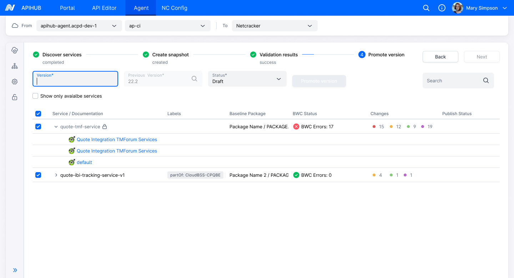
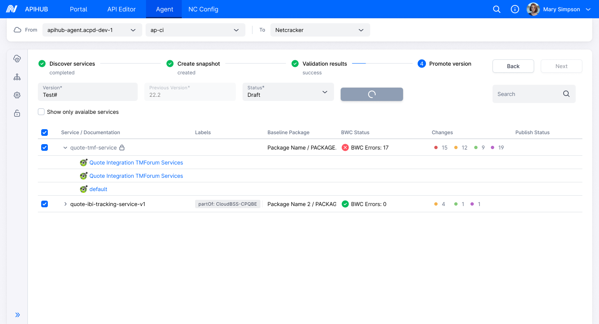
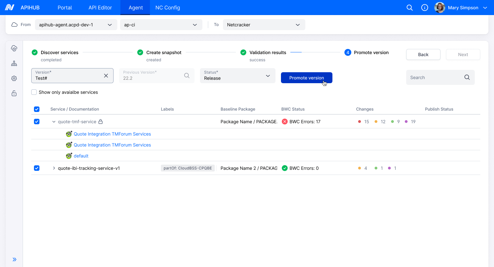
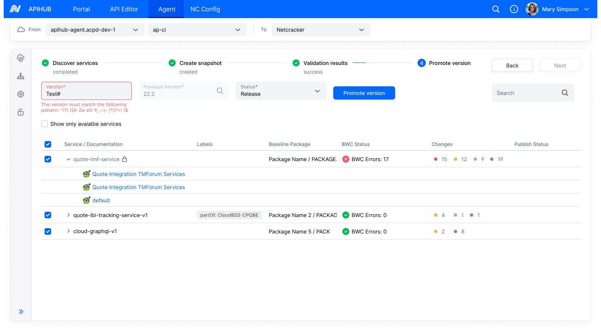
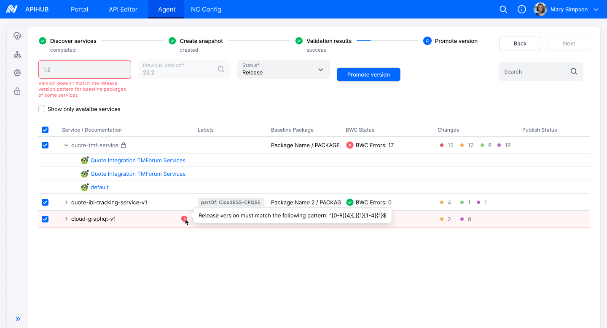

# DI-Agent-001 Version Validation

**Design Item ID**: DI-Agent-001  
**Design Item Name**: Version Validation  
**Related Design Items**: -  
**Related API**: 
  - System info (GET /api/v1/system/info)
  - Get package by Id (GET /api/v2/packages/{packageId})

**Revision History:**  

| Date           | Description                         |
| -------------- | ----------------------------------- |
|||

***

# Description
This design defines the validation behavior for the Version field in the Promote Version step in Agent. 

# Start Point
1. User navigates to APIHUB Portal → Agent

# Execution

# Execution

1. User navigates to Promote Version step
2. The system displays services for which a snapshot has been created and which have a baseline package in the portal.  
3. To promote a version, the user  
   1. Selects the required service(s)  
   2. Specifies the Version field  
   3. Reviews the predefined Previous Version (auto-filled from the baseline version set during create snapshot step)  
   4. Selects the Status (Draft or Release)  
   5. Clicks the **Promote Version** button.  
4. The system displays a loading icon on the **Promote Version** button.  
5. For status = Draft  
   1. The system validates the version field input against the Global Version Pattern.  
      1. If invalid:  
         1. The system display the error message below version field: "The version must match the following pattern: \<pattern>"  
         2. \<pattern> = Version Pattern from Global Settings.
      2. If valid:  
         1. The system proceeds to promote the version in the Portal.  
6. For status = Release  
   1. The system validates the version field input against the Global Version Pattern first.  
      1. If invalid:  
         1. The system displays the error message below version field: "The version must match the following pattern: \<pattern>"  
         2. \<pattern> = Version Pattern from Global Settings.  
      2. If valid: 
         1. The system validates the version field input against the Release Version Pattern of each selected service’s baseline package (if the pattern is present).  
         2. If a service’s baseline package has an empty Release Version Pattern, Package-level Release Version Pattern validation for that service is skipped.    
         3. When all selected services have the same non-empty Release Version Pattern:
            1. If validation fails:  
               1. The system displays the error message below Version field: "Release version must match the following pattern: \<pattern>"  
               2. \<pattern> = Common Release Version Pattern
            2. If validation passes:  
               1. The system proceed to promote the version in the Portal.  
         4. When selected services have different non-empty Release Version Patterns, or a mix of patterns and empty:  
            1. The system validates the Version field individually against each service's Release Version Pattern.  
            2. For services with empty Release Version Pattern, skip validation.
            3. If validation fails for any service:  
               1. The system displays the generic error message below Version field: ”Version doesn't match the release version pattern for baseline packages of some services”  
               2. For each failing service: 
                  1. The system display an info icon next to the service and on hover, the system display a tooltip:  
                     1. “Release version must match the following pattern: \<pattern>”
                     2. \<pattern> = Release Version Pattern of the respective service’s baseline package.  
            4. If validation passes for all services (or skipped where applicable):  
               1. The system proceeds to promote the version in the Portal.  
         5. When all selected services have an empty Release Version Pattern:  
            1. The system skips Release Version Pattern validation entirely.
            2. Since the Global Version Pattern already passed:
               1. Proceed to promote the version in the Portal.

# Security

User must have "manage" permission for the package to promote version in respective status.

# Mockups
**For Draft Status**

**For Release status**

