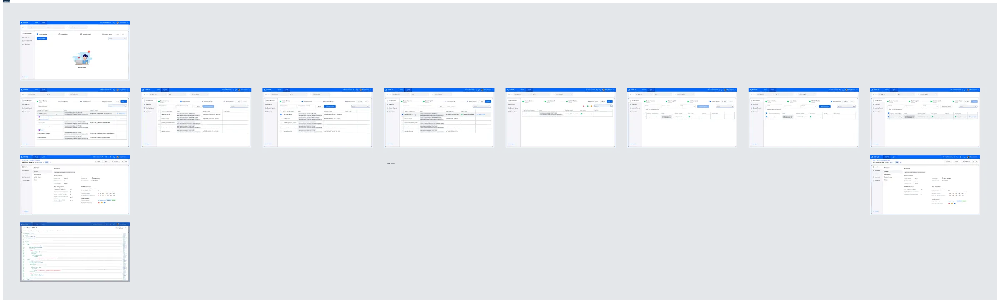

# DI-Agent-002 Cloud Services

**Design Item ID**: DI-Agent-002  
**Design Item Name**: Cloud Services  
**Related Design Items**:

- [DI-Agent-001 Version Validation](di-agent-001-version-validation.md)

**Related API:**

- Get agents (GET /api/v2/agents)
- Get namespaces (GET /api/v2/agents/{agentId}/namespaces)
- Run discovery (POST /api/v2/agents/{agentId}/namespaces/{namespace}/workspaces/{workspaceId}/discover)
- Get services (GET /api/v3/agents/{agentId}/namespaces/{namespace}/workspaces/{workspaceId}/services)
- Create snapshot (POST /api/v2/agents/{agentId}/namespaces/{namespace}/workspaces/{workspaceId}/snapshots)
- Promote version (POST /api/v2/agents/{agentId}/namespaces/{namespace}/workspaces/{workspaceId}/snapshots?promote=true)
- Get snapshot details (GET
  /api/v2/agents/{agentId}/namespaces/{namespace}/workspaces/{workspaceId}/snapshots/{version})
- Get spec (GET
  /api/v2/agents/{agentId}/namespaces/{namespace}/workspaces/{workspaceId}/services/{serviceId}/specs/{fileId})

**Revision History:**  

| Date           | Description                         |
| -------------- | ----------------------------------- |
|||

***

## Description

This design item defines the functionality of the APIHUB Agent Cloud Services page. The Agent allows users to discover
API documents from Kubernetes services, create snapshots, validate backward compatibility, and promote versions to the
APIHUB Portal.

### Start Point

1. The user navigates to APIHUB Portal → Agent.

### Execution

1. The system displays the Agent page with a toolbar at the top. The toolbar contains three selectors arranged as:
   **From** [Cloud] [Namespace] | **To** [Portal Workspace].
2. The user selects a cloud (agent) from the **Cloud** dropdown.
   1. The system displays a list of all registered agents. The user can type to search agents by name.
   2. The system loads the namespaces available for the selected agent.
3. The user selects a namespace from the **Namespace** dropdown.
   1. The system displays a list of all namespaces available in the selected agent. The user can type to search
      namespaces by name.
   2. The **Namespace** dropdown is disabled until an agent is selected in the **Cloud** dropdown.
4. The user selects a target workspace from the **Portal Workspace** dropdown.
   1. The system displays a list of portal workspaces available in APIHUB. The user can type to search workspaces by
      name.
   2. When the user selects a workspace, the system automatically triggers the discovery process for the selected
      namespace in the context of the selected workspace.

**To discover services:**

1. The system displays the **Discover Services** step. Initially, if no discovery process has been performed before in
   the selected namespace/workspace, the page is blank (no services displayed).
2. The user clicks the **Run Discovery** button.
3. The system starts the discovery process and displays a loading indicator on the button. The discovery process finds
   all Kubernetes services in the current namespace and API documents in each service.
4. When the discovery process is completed, the system displays a table with the following columns:
   - **Service / Documentation** column:
     - List of all discovered services.
     - If a service does not contain an API specification, the service is displayed as disabled.
     - If a service contains at least one specification, the service is enabled, and the user can expand it to view the
       API document(s) underneath.
   - **Labels** column: displays all labels discovered for the services.
   - **Baseline Package** column: displays the ID and name of the corresponding package in APIHUB, if any. The user can
     hover over a service row to reveal a **View Package** link that opens the package in APIHUB Portal.
5. If the user wants to re-run the discovery, the user clicks the **Restart Discovery** button (the button label changes
   from "Run Discovery" to "Restart Discovery" after a successful discovery). The system re-executes the discovery
   process and refreshes the results.

**To view API document:**

1. The user clicks on a discovered API document under a service.
2. The system opens the API document in a popup dialog. The behavior depends on the API type of the document:

#### OpenAPI documents

1. The system opens a specification viewer dialog with the document title as the header and metadata showing Cloud,
   Namespace, and Service.
2. Two view modes are available, toggled via the view mode switcher in the dialog header:
   - **Doc** — rendered interactive documentation view.
   - **Raw** — raw specification source with a navigation tree on the left side.

#### GraphQL documents

1. The system opens a **GraphQL Playground** dialog (based on GraphiQL — an in-browser interactive GraphQL IDE).
2. The dialog header contains:
   - Title: "GraphQL Playground".
   - Metadata line displaying: **Cloud**, **Namespace**, **Service**.
   - **Endpoint** — an editable text field (default value: `/api/graphql-server/graphql`). The user can change the
     endpoint to point to a different GraphQL server path.
   - **Schema** — a dropdown to select which schema to view and query against. If the service contains multiple GraphQL
     documents, the dropdown includes:
     - **\<Combined Schema\>** — a merged schema from all GraphQL documents of the service. If merging fails, this
       option is disabled with a tooltip: "Combined schema is not available due to problems with merging GraphQL
       schemas".
     - Individual schema options — one per each GraphQL document of the service.
     - If the service contains only one GraphQL document, only that single schema is available (no Combined Schema
       option).
3. The **Authenticate** section (collapsible, expanded by default if no auth token is stored):
   - The user expands the section by clicking the **Authenticate** toggle.
   - The system displays the following fields:
     - **Identity Provide URL** (required) — URL of the identity provider.
     - **Tenant** (required) — tenant name (default: `cloud-common`).
     - **Username** (required).
     - **Password** (required, masked by default; the user can toggle visibility using the eye icon).
   - The user fills in the fields and clicks the **Authenticate** button.
   - The system obtains an authentication token and stores it locally. The token is then used for subsequent GraphQL
     requests via the playground.
4. The main area of the dialog is the interactive GraphQL playground where the user can:
   - Write GraphQL queries in the left editor panel.
   - Execute queries by pressing the play button (or Ctrl+Enter).
   - View query results in the right panel.
   - Use keyboard shortcuts: Prettify query (Shift+Ctrl+P), Merge fragments (Shift+Ctrl+M), Auto Complete (Ctrl+Space).
   - Set variables and HTTP headers in the bottom panels (**Variables**, **Headers**).
5. The view mode toggler (Doc/Raw) is **not available** for GraphQL documents — only the interactive playground is
   shown.

#### AsyncAPI documents

1. The system opens a specification viewer dialog with the document title as the header and metadata showing Cloud,
   Namespace, and Service.
2. Only **Raw** view is available — the raw specification source is displayed. No view mode toggler is shown.

#### Markdown documents

1. The system opens a specification viewer dialog with rendered Markdown content. No view mode toggler is shown.

#### Other/Unsupported types

1. The system displays a "Preview is not available" message with a **Download** button allowing the user to save the
   file locally.

**To create snapshot:**

1. The user clicks the **Next** button after discovering services and documents. The system opens the **Create
   Snapshot** step.
2. The system displays a table containing services with API documents found in the previous step. Services without API
   documents are not displayed.
3. To create a snapshot, the user performs the following steps:
   1. The user selects the required services for which snapshots need to be created.
   2. The user fills in the **Snapshot Name** field. This name will be used to create a draft snapshot version in
      APIHUB. The snapshot can subsequently be deleted.
   3. The user fills in the **Baseline (Release Version)** field — APIHUB will compare the contracts of the selected
      Kubernetes services with this version of the reference data.
   4. The user clicks the **Create Snapshot** button.
4. The system creates the snapshot and displays the publishing status for each service for which a snapshot was created.
5. The user can hover over a service row to reveal a **View Snapshot** link. Clicking it opens the created snapshot in
   APIHUB Portal.
6. If the user needs to create another snapshot, the user clicks the **Reset** button and repeats steps 3.1–3.4 above.

**To see validation results:**

1. The user clicks the **Next** button after snapshot creation. The system opens the **Validation Results** step.
2. For each service for which a snapshot was created, the system displays a table with the following columns:
   - **Service / Documentation** — list of services and their API documents.
   - **Labels** — labels discovered for the services.
   - **Baseline Package** — the corresponding package in APIHUB.
   - **BWC Status** — backward compatibility status of the current snapshot relative to the baseline version:
     - "Baseline not found" (warning) — when the baseline package is not found in APIHUB.
     - "Baseline version not found" (warning) — when the baseline package exists but the specified baseline version is
       not found.
     - "Backward compatible" (success) — when there are no breaking changes.
     - "Backward incompatible" (error) — when there are breaking changes.
   - **Changes** — number of changes of each severity type in the current snapshot compared to the baseline version. The
     following severity types are displayed:
     - **Breaking** — changes that break backward compatibility (e.g., deleting an operation, adding a required
       parameter).
     - **Requires Attention** — changes that potentially may break backward compatibility depending on the client
       implementation. This category also includes breaking changes in operations annotated as no-BWC.
     - **Deprecated** — changes that annotate an operation, parameter, or schema as deprecated.
     - **Non-breaking** — changes that do not break backward compatibility (e.g., adding a new operation or optional
       parameter).
     - **Unclassified** — changes that cannot be classified as any of the other types.
     - **Annotation** — changes to API documentation that do not affect functionality (e.g., adding/changing
       descriptions or examples).
3. The user can click on the changes summary to open a detailed **Change View** dialog.
4. The user can hover over a service row to reveal a **View Changes** link. Clicking it opens the comparison of the
   current snapshot with the baseline version in APIHUB Portal to see changes in detail.
   - If a baseline version was not found for the service, the **View Changes** link is not available.

> **Note**: You may validate the BWC and store the API contracts in the promote operation only if the Baseline Package
> field is filled in for the service.

**To promote version:**

1. The user clicks the **Next** button in the Validation Results step. The system opens the **Promote Version** step.
2. The system displays only services for which a snapshot has been created and which have a baseline package in APIHUB.
3. The user can check the **Show only available services** checkbox to filter the table and display only services for
   which the user has the appropriate permissions to promote.
4. To promote a version, the user performs the following steps:
   1. The user selects the required service(s). The user cannot select a service if they do not have appropriate grants
      for the baseline package of the service.
   2. The user specifies the **Version** field — this will be the new version of the reference data in APIHUB.
      - For Release status, the version must match the format **YYYY.Q** (where YYYY is the year and Q is the quarter).
        If the format is invalid, the system displays an error message: "The release version must have the format:
        YYYY.Q, where YYYY is the year, Q is the quarter of the year".
      - See [DI-Agent-001 Version Validation](di-agent-001-version-validation.md) for detailed validation rules.
   3. The **Previous Version** field is pre-filled with the value of the baseline version specified during the snapshot
      creation step. This field is read-only.
   4. The user selects the **Status** field (Draft or Release) — this will be the status of the promoted (published)
      version in APIHUB.
   5. The user clicks the **Promote Version** button.
5. The system publishes the found API documents to APIHUB. All labels for promoted services are also published to APIHUB
   as version labels.
6. When the version is promoted, the system displays the publishing status. The user can hover over a service row to
   reveal a **View Version** link. Clicking it opens the published version in APIHUB Portal.
7. If the user needs to promote another version, the user clicks the **Re-promote Version** button (the button label
   changes from "Promote Version" to "Re-promote Version" after a successful promotion) and repeats steps 4.1–4.5 above.

## Mockups

