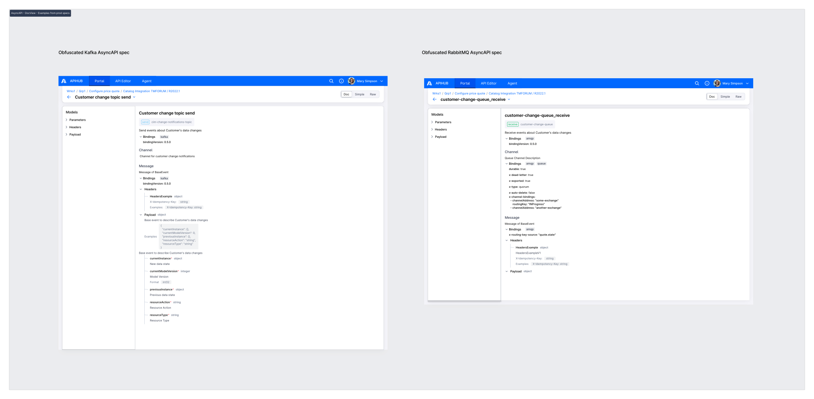

# AsyncAPI 3.0 - DocView

## Complete Table: All Root Elements and Their Fields in DocView

| Root Element | Location in DocView | Fields to Render | Required | Notes |
|--------------|-------------------|------------------|----------|-------|
| **Info** | Document Tab (not Operation DocView) | `title`<br>`version`<br>`description` (if present) | `title`: Yes<br>`version`: Yes<br>`description`: If present | Shown in Document Tab, same as OpenAPI. |
| **Operation** | Operation DocView - Header Section | `title`<br>`badge` (send/receive)<br>`description` (if present) | `title`: Yes<br>`action`: Yes<br>`description`: If present | Action displayed as badge (SEND/RECEIVE). |
| **Channel** | Operation DocView - Channel Section | `address` (machine-readable)<br>`description` | `address`: Yes<br>`description`: Yes (if present) | **Critical:** Use `address` (NOT channel ID, NOT channel title) - located in the "path" right from the method(send/receive). Description is mandatory for understanding channel purpose. |
| **Message** | Operation DocView - Message Section | `description`<br>`headers`<br>`payload` | `description`: Yes (if present)<br>`headers`: If present<br>`payload`: Yes | Description is mandatory. Headers and Payload rendered as separate objects (like OpenAPI). Headers may be empty but should be shown if present. |
| **Headers** | Operation DocView - Message Section → Headers | All properties (like OpenAPI) | All properties: If present | Render **one-to-one like OpenAPI** - same properties from JSON schema. |
| **Payload** | Operation DocView - Message Section → Payload | All properties (like OpenAPI)| All properties: If present | Render **one-to-one like OpenAPI** - same properties from JSON schema. |
| **Bindings** | Operation DocView - Operation Section<br>Operation DocView - Channel Section<br>Operation DocView - Message Section | All bindings properties:<br>- Protocol type (kafka/amqp)<br>- All custom extensions| Yes | Must be shown on all levels (operation, channel, message) even if identical.|
| **Custom Extensions** | Operation DocView - Channel/Message level | `x-dead-letter`<br>`x-exported`<br>`x-type`<br>`x-auto-delete`<br>`x-exclusive`<br>`x-channel-bindings`<br>`x-routing-key-source`<br>`x-non-bwc` | If present | See the "Custom extensions table" |

---

## Custom Extensions

| Custom Property | Format | Mandatory | Description |
|----------------|--------|-----------|-------------|
| `channels.<?>.x-non-bwc` | `boolean` | `no` | Mark that channel is not supported BWC policies |
| `operations.<?>.x-non-bwc` | `boolean` | `no` | Mark that operation is not supported BWC policies |
| `channels.<?>.bindings.amqp.queue.x-dead-letter` | `boolean` | `no` | Set to true for DLQ (Dead Letter Queue) |
| `channels.<?>.bindings.amqp.queue.x-exported` | `boolean` | `no` | BG functionality for exporting messages between RabbitMQ VHosts |
| `channels.<?>.bindings.amqp.exchange.x-exported` | `boolean` | `no` | BG functionality for exporting messages between RabbitMQ VHosts |
| `channels.<?>.bindings.amqp.queue.x-type` | `String` | `no` | quorum |
| `channels.<?>.bindings.amqp.exchange.x-dead-letter` | `boolean` | `no` | Set to true for DLX (Dead Letter Exchange) |
| `channels.<?>.bindings.amqp.queue.x-channel-bindings` | `Array of objects with the following fields:`<br>`• channelAddress - mandatory`<br>`• routingKey - optional` | `no` | List of relations between RabbitMQ Queue's and Exchanges or between Exchanges only.<br><br>**Example:**<br>```yaml<br>x-channel-bindings:<br>- { channelAddress: "quote_state_change_exchange_v1", routingKey: "IN_PROGRESS" }<br>- { channelAddress: "some-exchange-name" }<br>```<br><br>**Note:** Here `channelAddress` is a source channel for the message routing and the current channel is a destination. |
| `channels.<?>.bindings.amqp.exchange.x-channel-bindings` | `same as above` | `no` | `same as above` |
| `components.<?>.messages.<?>.bindings.amqp.x-routing-key-source` | `String` | `no` | Document what is used as routing-key when message is published.<br><br>**Example:** `quote.state` |

## Mockups


