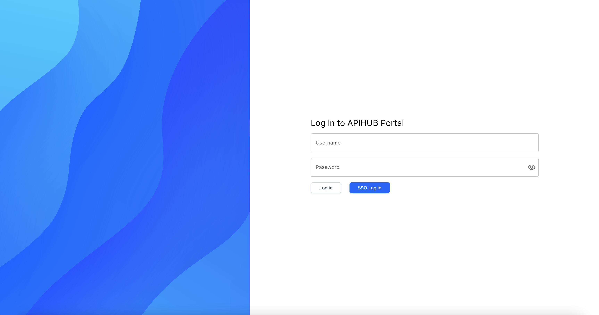

# DI-Portal-GF-001 Navigation to APIHUB (log in - log out)

**Design Item ID**: DI-Portal-GF-001  
**Design Item Name**: Navigation to APIHUB (log in / log out)  
**Related Design Items**: -  
**Related API**: 
  * SSO integration status ([GET /api/v1/system/configuration](../../../backend/portal-backend/docs/api/APIHUB_API.yaml))  
  * SAML authentication ([POST /api/v2/auth/saml](../../../backend/portal-backend/docs/api/APIHUB_API.yaml))  

**Revision History:**  

| Date           | Description                         |
| -------------- | ----------------------------------- |
|||

***
# Description
The functionality provides a user the ability to log in to Portal or log out from Portal.

# Workflow 1  
**Start Point**  
The functionality is available when user follows the APIHUB link.

**Execution**  
1. The user navigates to APIHUB.
2. The system automatically authenticate user via SAML SSO and opens the home page of APIHUB Portal. 
   * API for SAML authentication: [POST /api/v2/auth/saml](../../../backend/portal-backend/docs/api/APIHUB_API.yaml).

# Workflow 2  
**Start Point**  
The functionality is available when user clicks **Logout** in APIHUB.

**Execution**  
1. The system opens 'Log in to APIHUB Portal' page.  
2. User clicks **SSO Log In**.  
3. The system authenticate user via SAML SSO.  
   * API for SAML authentication: [POST /api/v2/auth/saml](../../../backend/portal-backend/docs/api/APIHUB_API.yaml).  

# Workflow 3 (for non-production env only)
**Start Point**  
1. The functionality is available when user clicks **Logout** in APIHUB.

**Execution**  
1. The system opens 'Log in to APIHUB Portal' page.
2. User specifies username and password (of internal APIHUB user) in appropriate fields.
   * When user specifies password, password is masked.
   * If user clicks eye icon, then the system shows password without mask. 
5. User clicks **Log in**.
6. The system authenticate user via basic authentication.  If user specifies incorrect login and/or password, the system shows the message 'Invalid credentials, please try again'

# Screen View
