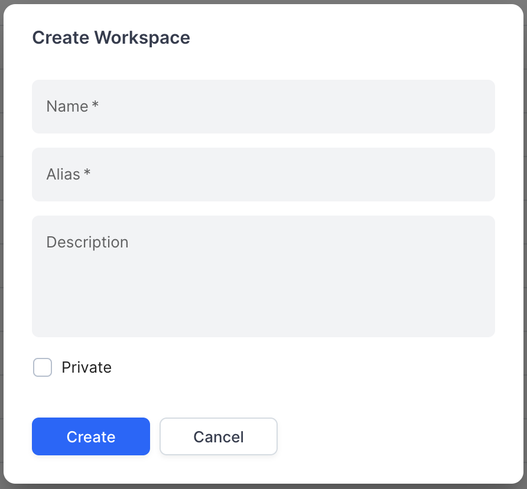

# DI-Portal-GF-002 Create Workspace

**Design Item ID**: DI-Portal-GF-002  
**Design Item Name**: Create Workspace  
**Related Design Items**: -  
**Related API**:

* Create a new package ([POST /api/v2/packages](../../../backend/portal-backend/docs/api/APIHUB_API.yaml))

**Revision History:**  

| Date           | Description                         |
| -------------- | ----------------------------------- |
|||

***

## Description

The functionality provides a sysadm user with the ability to create workspace.  
Workspace is first level grouping entity for groups, packages and dashboards. Workspace provides a logical separation
for different projects, teams, or departments within the organization. Workspace enables the grouping of related APIs
and provide a hierarchical structure for better organization and management.

## Start Point

1. Operation is initiated manually by sysadm from APIHUB Portal → Workspace tab.

## Execution

1. Sysadm clicks **Create** button. If user is not sysadm, then Create button will not be visible.
2. The system opens Create Workspace popup with the following fields:
   * Name - required field.
   * Alias - required field. Alias must be unique within parent group/workspace. If alias is not unique, the system
     shows the following message when user clicks Create button: "Alias "%s" is already reserved. Please use another
     alias.". Alias must be no longer than 10 characters.
   * Description - show summary of workspace.
   * Private - if checked, then package will be private and by default, will be visible to the current user only.
3. User clicks **Create** button.
4. The system creates new workspace.
   * API to create workspace - [POST /api/v2/packages](../../../backend/portal-backend/docs/api/APIHUB_API.yaml):  
     * kind = workspace
     * name = \<user input from Name field\>
     * alias = \<user input from Alias field\>
     * description = \<user input (if any) from Description field\>
     * defaultRole. If Private checkbox is selected, then defaultRole = none, otherwise defaultRole = viewer.

## Screen View

