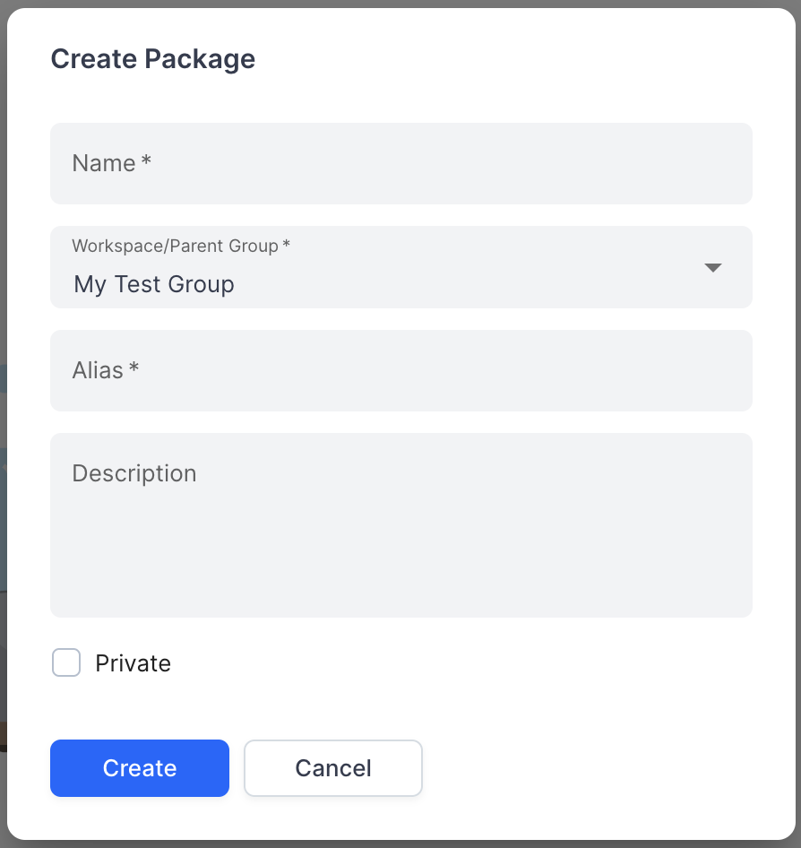

# DI-Portal-GF-004 Create Package

**Design Item ID**: DI-Portal-GF-004   
**Design Item Name**: Create Package
**Related Design Items**: -  
**Related API**: 
- Create a new package ([POST /api/v2/packages](../../../backend/portal-backend/docs/api/APIHUB_API.yaml))
- Get packages list ([GET /api/v2/packages](../../../backend/portal-backend/docs/api/APIHUB_API.yaml))

**Revision History:**  

| Date           | Description                         |
| -------------- | ----------------------------------- |
|||

***

# Description
The functionality provides user with the ability to create package.  
Package is package with kind = package. Package is versioning entity that can contain API documentation. Package can be created under workspace or group.

# Start Point
1. User navigates to APIHUB Portal → workspace, or
2. User navigates to APIHUB Portal → workspace → group

# Execution
1. User clicks **Create** →  **Package** button.
2. The system opens Create Package popup with the following fields:
   - Name - required field.
   - Workspace/Parent Group - required field. By default, the value equals to the current group/workspace. It is possible to select group only under current workspace.  
     - API to select group - [GET /api/v2/packages](../../../backend/portal-backend/docs/api/APIHUB_API.yaml):
       - kind = group
       - showAllDescendants = true
       - textFilter = <user input> if user searches group.
   - Alias - required field. Alias must be unique within parent group/workspace. If alias is not unique, the system shows the following message when user clicks Create button: "Alias "%s" is already reserved. Please use another alias."
   - Description - short summary for package.
   - Private - if checked, then package will be private and by default, will be visible to current user only.
2. User clicks **Create**.
3. The system creates new package.
   - API to create group - [POST /api/v2/packages](../../../backend/portal-backend/docs/api/APIHUB_API.yaml):
     - parentId = \<Id of workspace/group under which current package is created\>
     - kind = package
     - name = \<user input from Name field\>
     - alias = \<user input from Alias field\>
     - description = \<user input from Description field\>
     - defaultRole. If Private checkbox is selected, then defaultRole = none. Otherwise, defaultRole = viewer.
4. The system opens newly create package.

# Screen View

