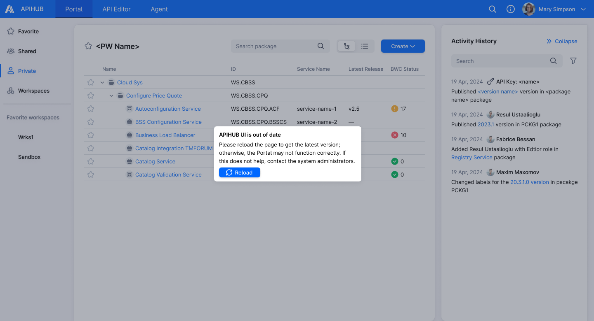
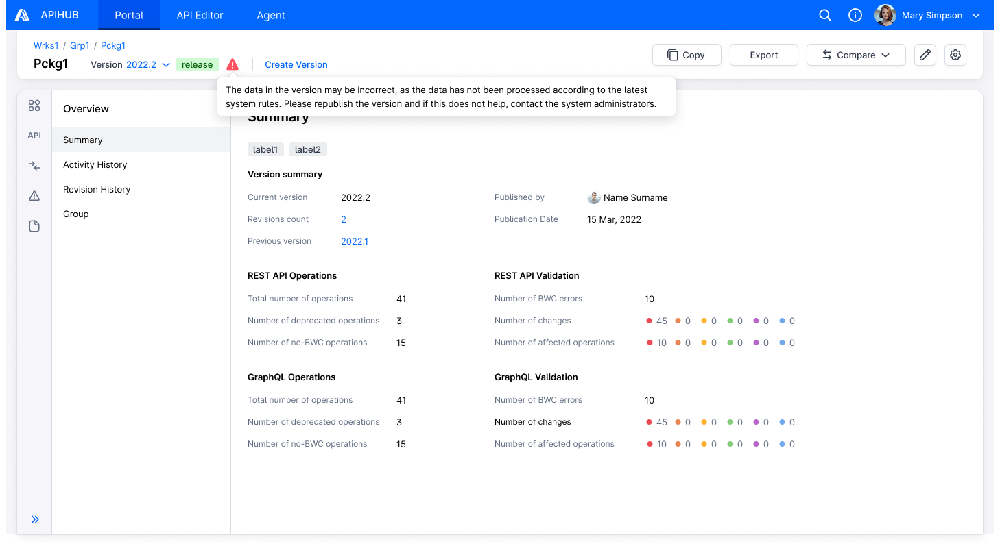
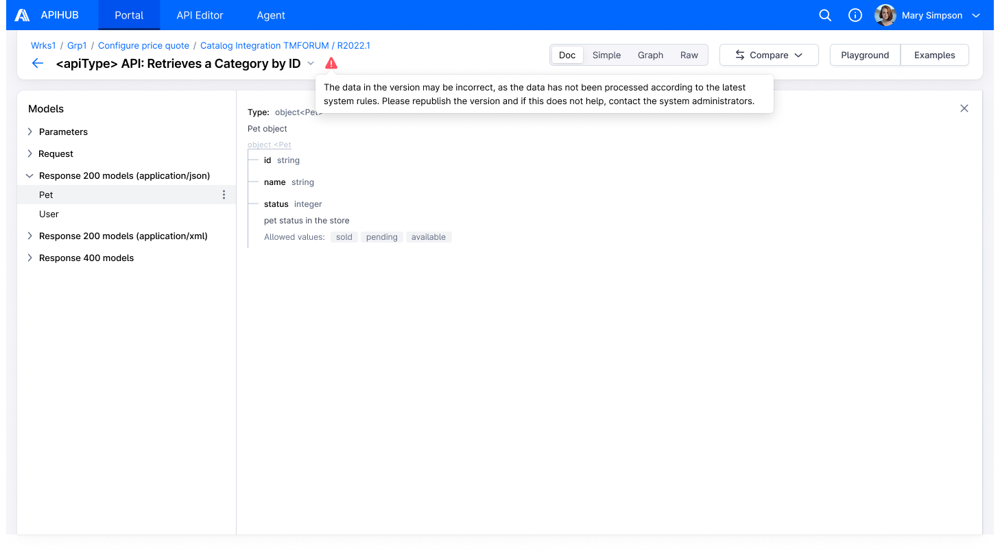
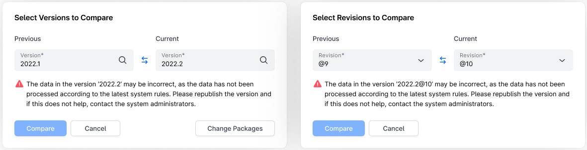
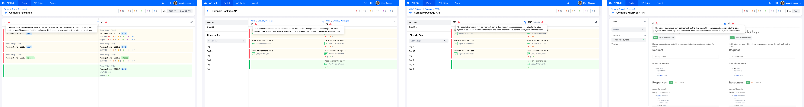
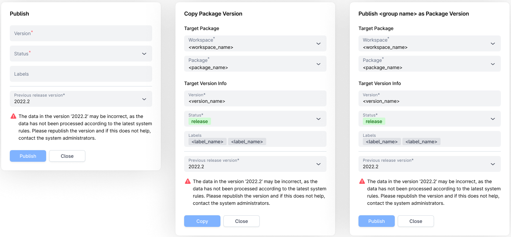
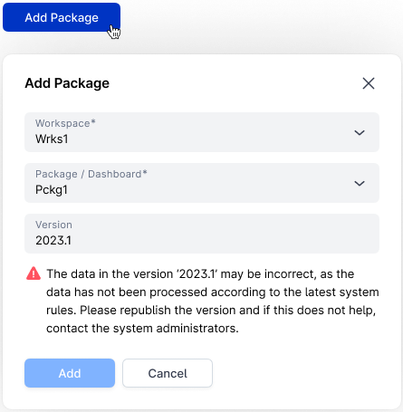

# DI-Portal-GF-009 Relevance of API-Processor Versions

**Design Item ID**: DI-Portal-GF-009  
**Design Item Name**: Relevance of API-Processor Versions  
**Related Design Items**:  
**Related API**:

- Get system info (GET /api/v1/system/info)
- Get package version content (GET /api/v3/packages/{packageId}/versions/{version})
- Get package versions list (GET /api/v3/packages/{packageId}/versions)

**Revision History:**  

| Date           | Description                         |
| -------------- | ----------------------------------- |
| 22.05.2025     | Initial version for <https://github.com/Netcracker/qubership-apihub/issues/229>, <https://github.com/Netcracker/qubership-apihub/issues/230>|

## Assumptions

1. The requirements are applicable to both packages and dashboards; further using the word package will mean both
   packages and dashboards.
2. Currently, there are cases when new api-processor version was released, but no migration was performed. So in this
   case api-processor version of built revision will not be the same as actual one. Therefore, it was decided to
   perform migration every time when new version of api-processor released.
3. Current story consider cases when downgrade of api-processor version is possible.
4. The requirements are applicable only to the state when migration is **not** running.

## Requirements

1. The system shall be able to check api-processor version on the client for relevance and shall be able to verify that
   the package version (revision) was built by the current version of the api-processor.
     1. The system shall perform these checks only if migration is not in progress.
          - API to check if migration is in progress - GET /api/v1/system/info:
              - if migrationInProgress = false, then migration is not currently in progress.
     2. Cases of api-processor versions mismatch see in "Cases with api-processor versions mismatch" section.
     3. API to get api-processor version with which package version was built:
          - in specific version - GET /api/v3/packages/{packageId}/versions/{version}.
          - in package versions list - GET /api/v3/packages/{packageId}/versions.
2. The system shall warn the user about problems if the current version of the api-processor on the client is not
   up-to-date or if the current version of the package was built by an out-of-date version of the api-processor.
     1. Appropriate locations where warning messages shall be displayed see in section "Locations where warning messages
        are displayed".

### Cases with api-processor versions mismatch

1. **Case 1 - up-to date frontend/backend, outdated build**:  
     revision api-processor version < client api-processor version.  

     **Warning message for version:** "The data in the version \<version> may be incorrect, as the data has not been
     processed according to the latest system rules. Please republish the version and if this does not help, contact the
     system administrators."

2. **Case 2 - downgraded frontend/backend, build from the future:**  
     revision api-processor version > client api-processor version.  

     **Warning message for version:** "The data in the version \<version> may be incorrect, please contact the system
     administrators."

3. **Case 3 - outdated frontend:**  
     client api-processor version is not up-to-date.

     **Warning message**: "Please reload the page to get the latest version; otherwise, the Portal may not function
     correctly. If this does not help, contact the system administrators."

### Locations where warning messages are displayed

1. Currently opened page.
     - Every time when the system requests GET api/v1/system/info, the system shall check if there is problem from case
       3 from the section "Cases with api-processor versions".
         - If client api-processor version is not up-to-date, the system shall show popup on the currently opened page
           with the message specified in case 3 in "Cases with api-processor versions".

     

2. Package version page including all tabs (overview, operations, etc.) and menu items (summary, activity history, etc.)
     - If current package version (revision) has problem from case 1 or case 2 from the section "Cases with
       api-processor versions", the system shall show warning icon with tooltip on hover.
         - Appropriate tooltip messages for case 1 or case 2 see in "Cases with api-processor versions".
             - in warning messages, \<version> = current version.

     

3. Operation's document view (for all available views - doc, simple, etc.)
     - If current package version (revision) has problem from case 1 or case 2 from the section "Cases with
       api-processor versions", the system shall show warning icon with tooltip on hover.
         - Appropriate tooltip messages for case 1 or case 2 see in "Cases with api-processor versions".
             - in warning messages, \<version> = current version.

     

4. "Select Versions to Compare" and "Select Revisions to Compare" popups:
     - If one of the selected version/revision has problem from case 1 or case 2 from the section "Cases with
       api-processor versions", the system shall show warning message and disable "Compare" button.
     - If both versions/revisions have api-processor versions problem, then warning message shall be displayed for
       version/revision from the "current" field.
     - Appropriate tooltip messages for case 1 or case 2 see in "Cases with api-processor versions".
         - in warning messages, \<version> = appropriate version selected in the popup.

     

5. "Compare Packages" (available in case of dashboards comparison only), "Compare Package API", "Compare \<apiType> API"
   (with comparison of operations content) pages:
     - If one of the compared version/revision has problem from case 1 or case 2 from the section "Cases with
       api-processor versions", the system shall show warning icon with tooltip on hover.
     - If both compared versions/revisions have the problem with api-processor versions, then the system shall show
       warning messages for each version/revision.
     - Appropriate tooltip messages for case 1 or case 2 see in "Cases with api-processor versions".
         - in warning messages, \<version> = appropriate compared version.

     

6. "Publish", "Copy Package Version", "Publish \<group name> as Package Version" popups:
     - If selected previous release version has problem from case 1 or case 2 from the section "Cases with api-processor
       versions", the system shall show warning message and disable "Publish"/"Copy" button.
         - Appropriate tooltip messages for case 1 or case 2 see in "Cases with api-processor versions".
             - in warning messages, \<version> = previous release version selected in the popup.

     

7. "Add package popup" popup (available for dashboards only)
     - If selected package version has problem from from case 1 or case 2 from the section "Cases with api-processor
       versions", the system shall show warning message and disable "Add" button:
         - Appropriate tooltip messages for case 1 or case 2 see in "Cases with api-processor versions".
             - in warning messages, \<version> = version selected in the popup.

     
