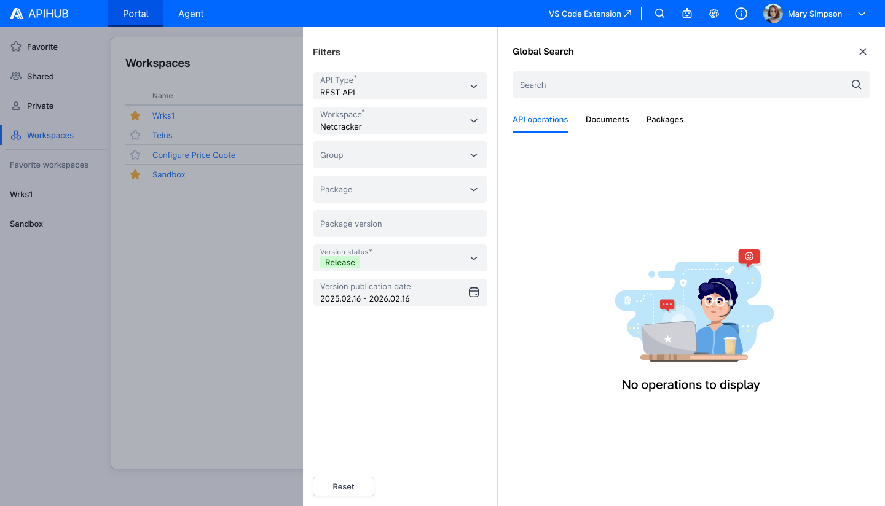

# **Global Search \- Design Document**

## **Summary**

Global Search allows users to find API operations, documents, and packages across the entire APIHUB portal by entering a text query.

### **Search Levels**

Global Search supports three search levels:

* **operations** \- find individual API operations (e.g., GET /billing/accounts, query getUser)  
* **packages** \- find packages by name or description  
* **documents** \- find API specification documents

## **How Global Search Works**

### **High-Level Flow**

Global Search works in two stages:

**At build/publish time:** the builder (API Processor) generates a **search text** for each operation. There are two options: either a plain text summary of the operation's key data (name, description, parameters, types, etc.), or the full operation data (e.g., the complete OpenAPI spec for REST). When the build result is published, the backend extracts this search text and indexes it using PostgreSQL full-text search. The operation title is always appended to the search text to ensure operations are findable by name.

**At search time:** the user enters a query in the UI. The backend matches this query against the indexed search texts and returns results ranked by relevance \- operations with more and better matches appear first.

## **API v4 Search Endpoint**

* POST /api/v4/search/{searchLevel} \- where searchLevel is operations, packages, or documents  
* The previous POST /api/v3/search/{searchLevel} is **deprecated**  
* Feature flag useLegacySearch is returned in GET /api/v1/system/info → featureFlags.useLegacySearch (same endpoint as today). When false (default), the UI uses v4 search.

### **UI Form → API Parameters**

The search form has filters: workspace, group, package, version, status, publication date, and (for operations) API type with optional scope/methods/operation types.

**v3** (operationParams present):

* packageIds \- from workspace, group, or package selection (whichever is selected)  
* versions \- from version filter  
* statuses \- array (e.g. \["release", "draft"\])  
* creationDateInterval \- from publication date range  
* operationParams \- only when "Search only" is checked and API type is selected:  
  * apiType \- REST / GraphQL  
  * scope \- request, response, argument, property, annotation  
  * detailedScope \- for REST: properties, annotation, examples  
  * methods \- for REST: GET, POST, etc.  
  * operationTypes \- for GraphQL: query, mutation, subscription

**v4** (simplified):

* workspace \- required; top-level workspace ID only. **Default value:** configurable in backend; returned in GET /api/v2/system/configuration as defaultWorkspaceId. The frontend already fetches this config at app load, so no additional request is needed.  
* packageIds \- optional; from Group or Package selection (to narrow search within workspace). Empty \= search whole workspace  
* versions \- from version filter  
* status \- single value (e.g. "release")  
* creationDateInterval \- from publication date range  
* apiType \- required; REST / GraphQL / AsyncAPI  
* operationParams, scope, methods, operationTypes \- removed; search always uses full indexed text

## **The search Object in Build Result**

Each operation in the build result (operations.json) contains a search object that tells the backend where to get the search text:

{  
  "operationId": "query-getUser",  
  "title": "getUser",  
  "apiType": "graphql",  
  "search": {  
    "useOperationDataAsSearchText": false,  
    "searchTextFilePath": "search/query-getUser.txt"  
  }  
}

| Field | Default | Description |
| :---- | :---- | :---- |
| useOperationDataAsSearchText | true | When true or omitted, the operation's existing data file is used as search text |
| searchTextFilePath | \- | Path to a custom search text file in the archive. Required when useOperationDataAsSearchText is false |

**The backend is API-type agnostic** \- it does not know or care whether the operation is REST, GraphQL, or AsyncAPI. It only reads the search flags and gets the text from the appropriate source. The builder is responsible for setting the correct flags per API type.

## **Search Text by API Type**

### **REST**

**Search text source:** the operation's existing data file (operationData) \- a single-operation OpenAPI spec in JSON format.

search: { useOperationDataAsSearchText: true }

The builder already generates a mini-OpenAPI document per REST operation containing paths, parameters, schemas, descriptions, examples, etc. This full JSON is used as search text. **Everything in the spec is searchable** \- path names, parameter names, schema properties, descriptions, enum values, response codes, and more.

### **AsyncAPI**

**Search text source:** the operation's existing data file \- same approach as REST.

search: { useOperationDataAsSearchText: true }

The builder generates a per-operation spec for AsyncAPI operations, and the backend uses it as search text.

### **GraphQL**

**Search text source:** a dedicated lightweight text file generated by the builder.

search: {  
  useOperationDataAsSearchText: false,  
  searchTextFilePath: "search/query-getPaymentMethodCore.txt"  
}

#### **Why GraphQL is different**

GraphQL operations don't have operationData like REST/AsyncAPI. A single-operation GraphQL spec includes all referenced types (inlined), which makes it nearly as large as the full schema. Storing and indexing the full spec per operation would be:

* **Expensive** \- the schema can be hundreds of KB per operation  
* **Redundant** \- most types are shared across operations, so search results would all look the same  
* **Slow** \- recursive traversal of large schemas is prohibitively expensive at build time

#### **What is extracted (top-level data only)**

| Data | Example |
| :---- | :---- |
| Operation name | getPaymentMethodCore |
| Description | The operation allows get a Payment Method |
| Argument names | id, includeDeleteEntities |
| Argument base types | String, Boolean |
| Return base type | PaymentMethodCore |

**Operation type** (query, mutation, subscription) is **not** included in the search text.

#### **Example**

For a GraphQL operation:

type Query {  
  """The operation allows get a Payment Method"""  
  getPaymentMethodCore(  
    id: String  
    includeDeleteEntities: Boolean  
  ): PaymentMethodCore  
}

The generated search text file would contain:

getPaymentMethodCore The operation allows get a Payment Method id String includeDeleteEntities Boolean PaymentMethodCore

#### **What is and isn't searchable**

**Searchable:**

* Operation name (e.g., "getPaymentMethodCore")  
* Description text (e.g., "payment method")  
* Argument names (e.g., "includeDeleteEntities")  
* Return type name (e.g., "PaymentMethodCore")

**Not searchable:**

* Nested field names (e.g., "zipCode" inside a type) \- shared across most operations, no differentiation value  
* Enum values \- shared types used across many operations  
* Deeply nested types \- appear in most operations; indexing them provides no search benefit

### **Summary**

|  | Rest | AsyncAPI | GQL |
| :---- | :---- | :---- | :---- |
| useOperationDataAsSearchText | true | true | false |
| Search text source | operationData (OpenAPI JSON) | operationData | Dedicated text file |
| Content indexed | Full single-operation spec | Full single-operation spec | Operation name, description, args, return type |
| Builder changes | Add search object | Add search object | Add search object \+ generate text files |

**Migration from v3**

The migration to v4 search includes the following changes:

1. **New search index** \- a unified full-text search index replaces the old per-scope tables  
2. **Backfill** \- existing REST and AsyncAPI operations are automatically migrated to the new index; GraphQL operations will be indexed when they are next published with the updated builder  
3. **Scope cleanup** \- the old multi-scope search system (request, response, annotation, etc.) is removed; only the all scope is preserved for backward compatibility  
4. **Deprecation** \- the v3 endpoint remains available but is marked as deprecated

## Mockups

