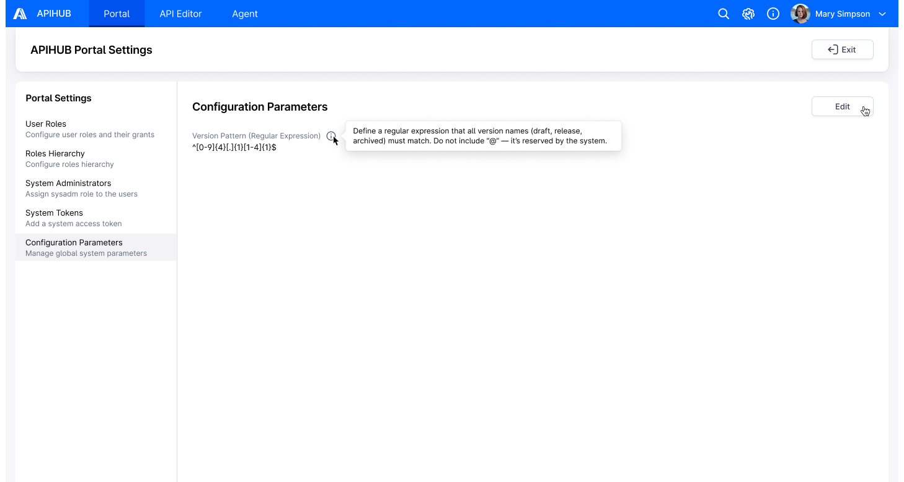
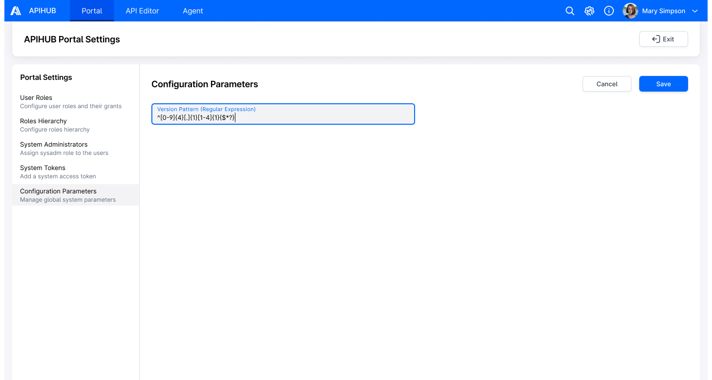
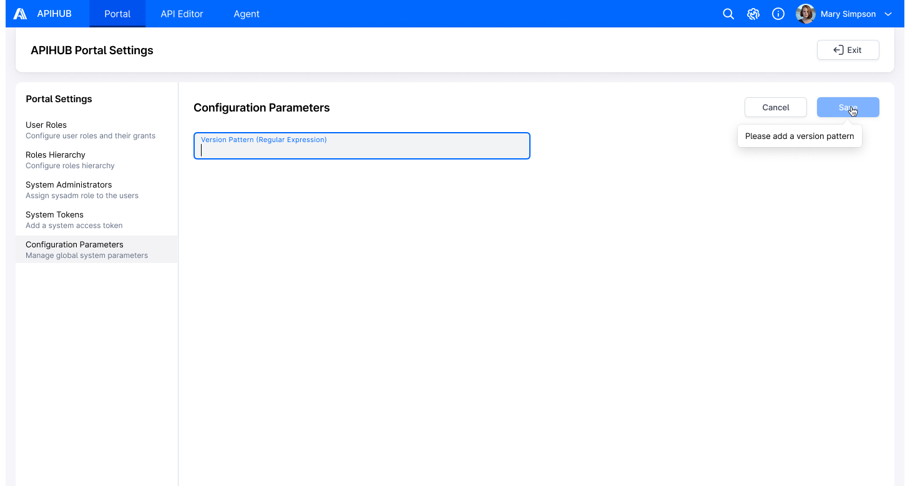
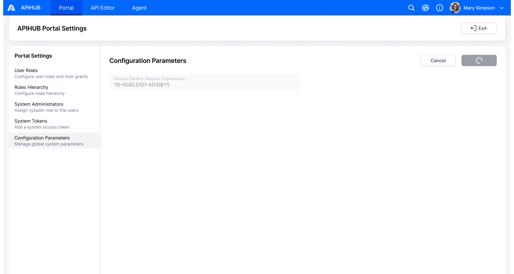
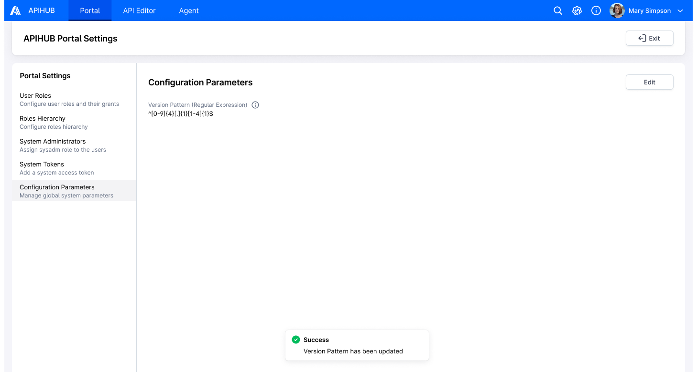
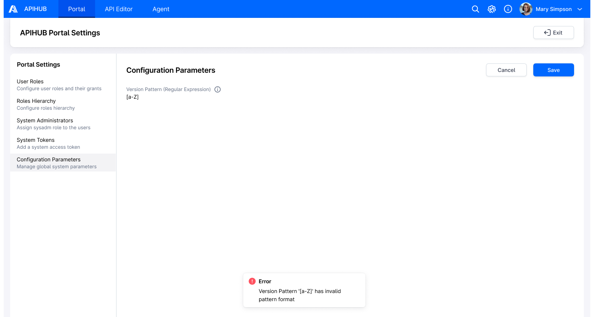
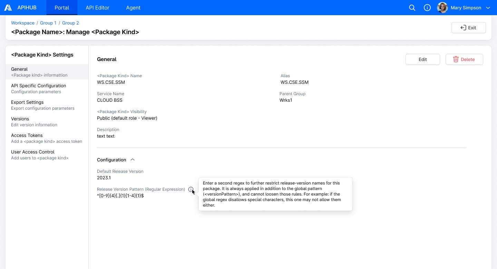
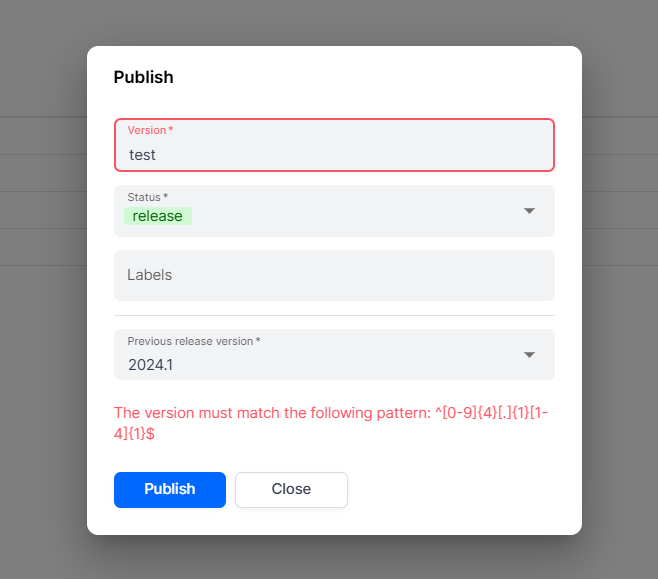
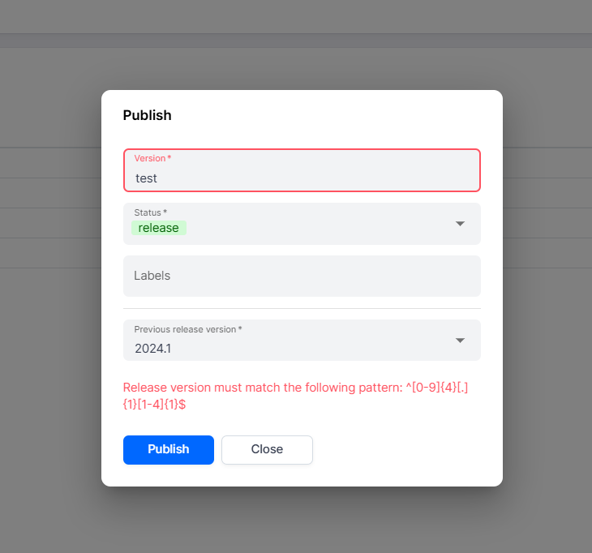

# DI-Portal-GS-006 Version Validation

**Design Item ID**: DI-Portal-GS-006  
**Design Item Name**: Version Validation  
**Related Design Items**: -  
**Related API**:

- System info (GET /api/v1/system/info)
- Update global configuration parameters (PATCH /api/v1/globalConfiguration)

**Revision History:**  

| Date           | Description                         |
| -------------- | ----------------------------------- |
|||

***

## Description

This feature allows a system administrator to configure a global regular expression (regex) pattern (versionPattern)
that enforces naming conventions for all package versions across the system, regardless of their status (draft, release,
or archived). The configured global pattern applies system-wide and serves as a baseline for validating all package
versions.

When a user creates a package version, the system validates the version against the global version pattern to ensure
compliance. For versions in release status, the system additionally enforces package-level regex pattern
(releaseVersionPattern) if defined, which can only further restrict the global pattern but cannot override or relax it.

## Start Point

1. APIHUB → Global Setting

## Execution

1. User clicks Configuration Parameters tab in Portal settings.  
2. The system opens Configuration Parameters page, which displays the current global version pattern in the Version
   Pattern field.  
   1. API to show version pattern – GET /api/v1/system/info  
3. If no pattern is configured, the system applies and displays the default version pattern based on the following
   rules:  
   1. Allowed characters: uppercase letters A–Z, lowercase letters a–z, digits 0–9, underscore (_), period (.), tilde
      (~), hyphen (-), and space.  
   2. The version name must not start or end with a space character.  
   3. The version name must include at least one non-space character.  
4. User hovers over the **info** icon near the Version Pattern field.  
   1. The system displays a tooltip with the message: "Define a regular expression that all version names (draft,
      release, archived) must match. Do not include “@” — it’s reserved by the system."
5. User clicks **Edit** button.  
   1. The Version Pattern field becomes editable.  
   2. The **Edit** button is replaced with **Cancel** and **Save** buttons.
   3. If the user clicks the **Cancel** button:  
      - The Version Pattern field reverts to its previously saved value.  
      - Any unsaved changes are discarded.  
      - The field becomes read-only.  
      - The **Save** and **Cancel** buttons are replaced with the **Edit** button.  
   4. The **Save** button is displayed in a disabled state if the Version Pattern field is empty.  
   5. On hover over the disabled **Save** button, the system displays a tooltip with the message: "Please add a version
      pattern"  
   6. The **Save** button is enabled only when the Version Pattern field contains a value.  
   7. User enters a custom regex pattern into the Version Pattern field and clicks **Save** button; the system display a
      loading icon on the **Save** button.  
   8. The system validates the entered regex pattern by attempting to compile it.  
       1. If the regex pattern is invalid (fails to compile), the system rejects the input and displays the error
          message: "Version Pattern \<pattern> has invalid pattern format" (where \<pattern> = the invalid version
          pattern value defined in Global Settings)  
       2. The invalid pattern is not saved.  
       3. If the regex pattern is valid, the system proceeds to step 6.  
6. The system updates the value of Version Pattern field
    1. API to update version pattern – PATCH /api/v1/globalConfiguration  
       1. VersionPattern = value from Version Pattern field  
7. The new pattern only affects the validation logic for future version names during the release process; it does not
   impact existing version names or other stored data.
8. Upon successful update:  
   1. The system display a success notification: “Version Pattern has been updated”  
   2. The Version Pattern field becomes read-only again.  
   3. The **Save** and **Cancel** buttons are replaced with the **Edit** button.
9. User clicks the **Exit** button in the subheader.  
   1. The system returns the user to the previously visited page.

### UI Fields and Error Handling for Version Pattern Validation

This section outlines where the Version Pattern validation is enforced in the UI and how error messaging is handled.

#### Affected UI Fields

The global version pattern is validated against the following UI input fields:

| UI Location                                  | Field                                |
|---------------------------------------------|--------------------------------------|
| Copy Package Version Popup                  | Version field                        |
| Copy Dashboard Version Popup                | Version field                        |
| Publish Popup (Package & Dashboard)         | Version field                        |
| Publish Group as Package Version            | Target Version Info section → Version field |
| Agent → Create Snapshot Step                | Snapshot Name field                  |
| Agent → Promote Version Step                | Version field                        |
| Agent → Automation Tab                      | Snapshot Name field                  |
| VS Code Plugin (Qubership APIHUB Extension) | PUBLISH TO APIHUB section → Version field    |

#### Validation Rules

- The system applies Global Version Pattern validation to all version statuses: Draft, Release, and Archived.
- For versions in Release status:
  - The system enforces both the Global Version Pattern and the Package-level Release Version Pattern (if defined).
  - If the Package-level Release Version Pattern is not defined (i.e., empty), only the Global Version Pattern is
    enforced.
- The Global version pattern serves as the baseline constraint.
- The Package-level release version pattern may apply stricter rules but cannot relax or override the global version
  pattern.
- If the global version pattern disallows specific characters or structures, the package-level release version pattern
  cannot reintroduce or permit them.

#### Error Message

If the user input does not match the applicable regex pattern, the system shall display one of the following error
messages:

- For global version pattern validation failures: "The version must match the following pattern: `<pattern>`"

- For release version pattern validation failures (Release status only): "Release version must match the following
  pattern: `<pattern>`"

The `<pattern>` placeholder is dynamically substituted based on the below validation logic.

#### Error Message Logic

##### For Release Status Versions

- If Global Version Pattern validation fails:  
  `<pattern>` = Version Pattern from Global Settings.
- If Global validation passes, but Package-level Release Version Pattern validation fails:  
  `<pattern>` = Package-level Release Version Pattern.

##### For Draft and Archived Status Versions

- `<pattern>` = Version Pattern from Global Settings.

## Security

Only users with the System Administrator role are authorized to configure and update the global version pattern
(versionPattern).

## Mockups

