# DI-Portal-OPVIEW-001 REST Operation Schema Rendering in Doc View

**Design Item ID**: DI‐Portal‐OPVIEW‐001  
**Design Item Name**: REST Operation Schema Rendering in Doc View  
**Related Design Items**:  
**Related API**: -  
**Revision History:**

| Date | Description |
| ---- | ----------- |
|      |             |

---

APIHUB doc view allows a user with the ability to view content of REST operation in user friendly and interactive way. Current page dedicated to the schema rendering of REST operations for OAS 3.0.

# property name, title, type, format

## name
The property name is displayed in bold, followed by the type.

## type and format of scalar
- If property is reference to components.schemas, it will be displayed in the same way as if it were inline.
If the referenced schema has title it is displayed in angle brackets.
  ```yaml
  properties:
    inHouseManufacturer:
      type: object
      title: InHouse Manufacturer
      properties:
        id:
          type: string
        name:
          type: string
  ```
   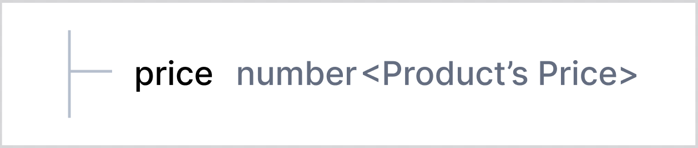

- If the referenced schema does not have title, then referenced schema key is displayed in angle brackets.
  ```yaml
  properties:
    price:
      $ref: "#/components/schemas/Price"
  components:
    schemas:
      Price:
        type: number
  ```
  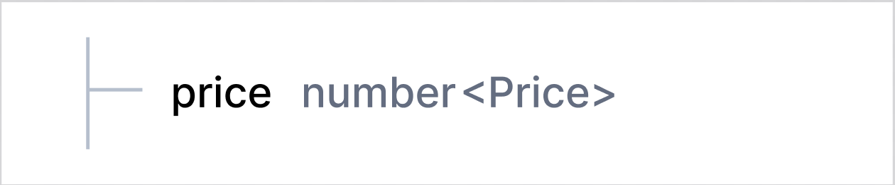

- If a scalar property has defined format, it is displayed in angle brackets next to the type. In this case neither schema title nor schema key is displayed if property is reference to components.schemas
  ```yaml
  properties:
    price:
      $ref: "#/components/schemas/Price"
  components:
    schemas:
      Price:
        type: number
      format: float
  ```
    

  ===

  ```yaml
  properties:
    price:
      type: number
      format: float
  ```
  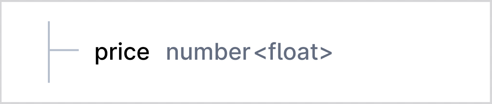

---

## object type

If property with object type has title, it will be displayed in angle brackets. If object property contains nested properties, a chevron icon appears before the property name to collapse or expand (collapsed by default) the section with child properties.

```yaml
properties:
  inHouseManufacturer:
    type: object
    title: InHouse Manufacturer
    properties:
      id:
        type: string
      name:
        type: string
```
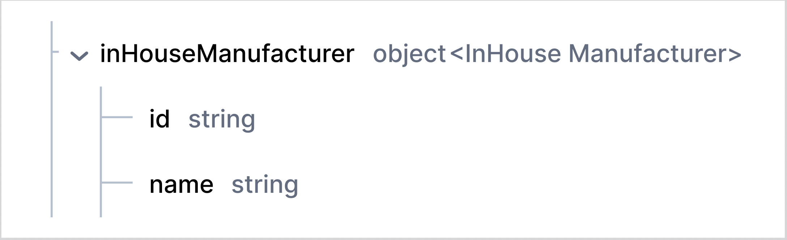


If property is reference to components.schemas, it will be displayed in the same way as if it were inline. If the referenced schema has title it will be displayed in angle brackets.

```yaml
properties:
  referencedManufacturer:
    $ref: "#/components/schemas/Manufacturer"
components:
  schemas:
    Manufacturer:
      type: object
      title: Manufacturer22
      properties:
        name:
          type: string
        address:
          type: object
          title: Address33
          properties:
            street:
              type: string
```

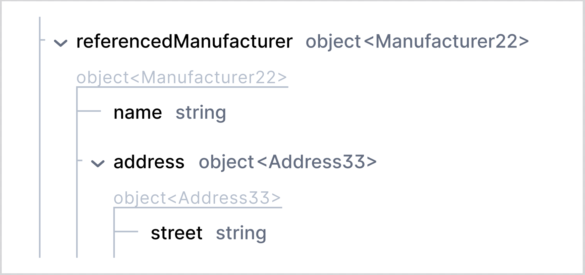

However, If the referenced schema does not have title, then referenced schema key will be displayed in angle brackets.

```yaml
properties:
  referencedManufacturer:
    $ref: "#/components/schemas/Manufacturer"
components:
  schemas:
    Manufacturer:
      type: object
      properties:
        name:
          type: string
        address:
          type: object
          properties:
            street:
              type: string
```

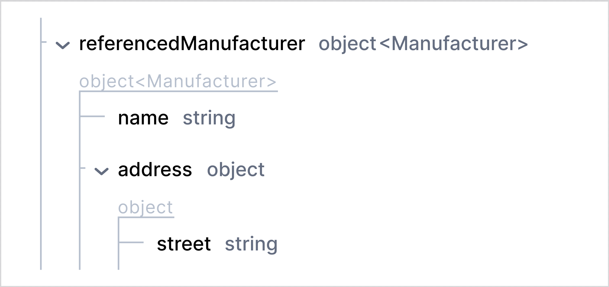

---

## array

Property with array type has chevron before the property name to collapse or expand (collapsed by default) the section with array items (for information about items, see "items" section)

```yaml
properties:
  tags:
    type: array
    items:
      type: string
```

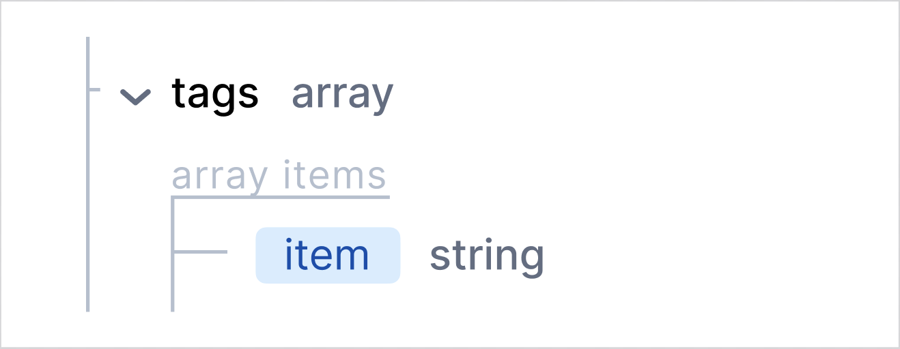

---

# scalar's specific attributes

## minimum/maximum and exclusiveMinimum/exclusiveMaximum

Minimum and maximum values are displayed as "Value range" under property name. Each value (minimum/maximum) and its corresponding condition represented in separate chips.

```yaml
properties:
  price:
    type: integer
    format: int32
    minimum: 1
    exclusiveMinimum: true
    maximum: 100
    exclusiveMaximum: true
```

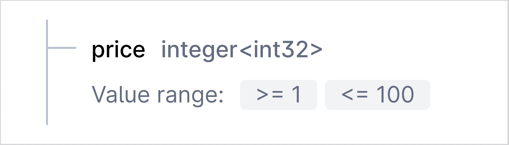

If exclusiveMinimum/exclusiveMaximum is true, appropriate chips with minimum/maximum values will show "<" or ">" signs.

If exclusiveMinimum/exclusiveMaximum is not specified in specification or specified with "false" value, appropriate chips with minimum/maximum values will show "<=" or ">=" signs.

```yaml
properties:
  price:
    type: integer
    format: int32
    minimum: 1
    exclusiveMinimum: true
    maximum: 100
    exclusiveMaximum: true
```


---

## multipleOf

The multipleOf value is displayed as "Value multipleOf," with the specific value shown in a separate chip.

```yaml
properties:
  price:
    type: number
    multipleOf: 2
```


---

## pattern

The pattern value is displayed as "Value pattern," with the regular expression shown in a separate chip.

```yaml
properties:
  text:
    type: number
    pattern: ^[A-Za-z0-9_]+$
```

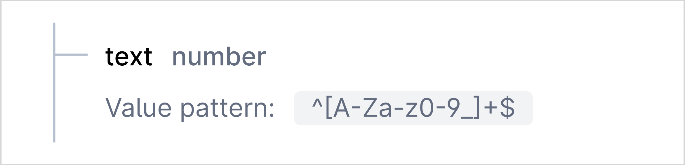

---

## minLength/maxLength

The minLength and maxLength values are displayed next to the "Value Length" label, with each value is shown with its respective condition in separate chips.

```yaml
properties:
  text:
    type: string
    minLength: 5
    maxLength: 20
```

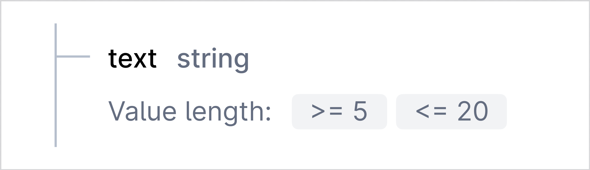

---

# nullable

By default, nullable is false and doc view does not display default value of this attribute even if it is explicitly specified.

if "nullable: true" is specified, then null value is displayed next to schema/property type.

```yaml
properties:
  money:
    type: object
    nullable: true
    properties:
      value:
        type: string
        description: A value of money in selected currency (unit).
        nullable: true
```

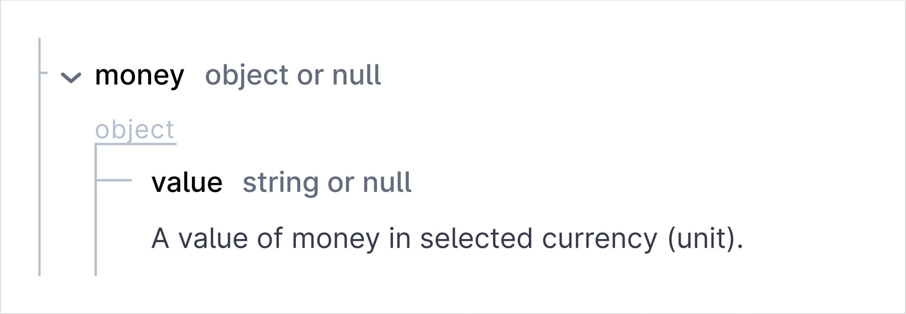

If there is oneOf/anyOf combiner and one of the subschema is nullable, then only when selecting such subschema "or null will be displayed"

```yaml
properties:
  paymentMethod:
    oneOf:
      - $ref: "#/components/schemas/Card"
      - $ref: "#/components/schemas/PayPal"

components:
schemas:
  PayPal:
    type: object
    nullable: true
    properties:
      payAccount:
        type: string
  Card:
    type: object
    properties:
      cardNumber:
        type: string
```

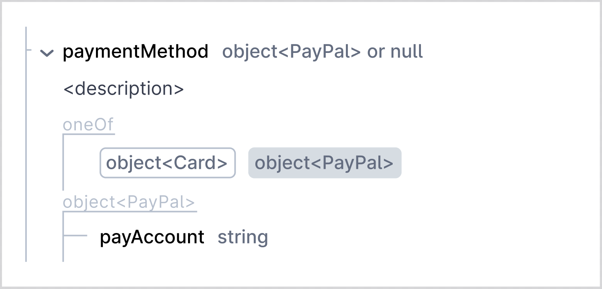
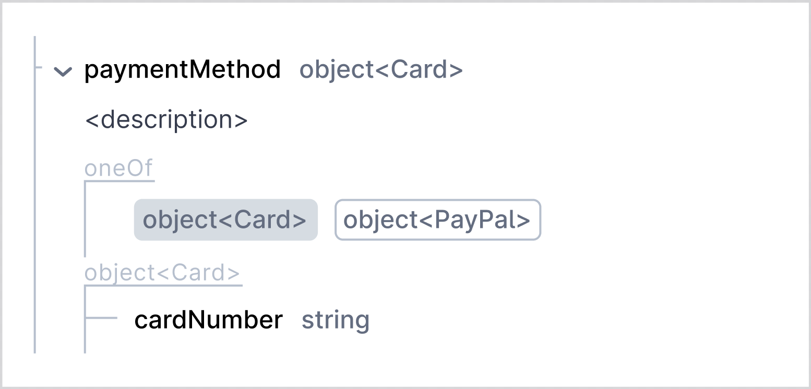


---

# description

Description of the property is displayed below the property name and type.

```yaml
properties:
  id:
    type: number
    format: float
    description: The unique identifier of the user.
```

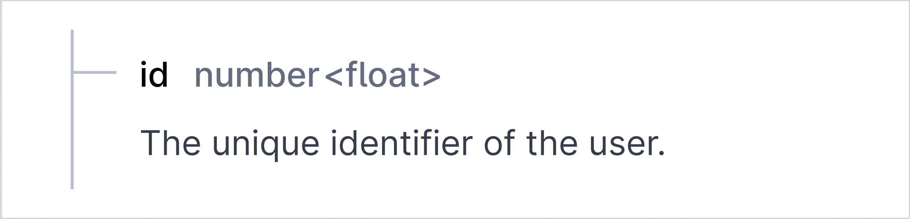

---

# enums

List of enums values is displayed as "Allowed values". Each enum value is displayed in separate chip.

**Example 1:**

```yaml
properties:
  color:
    type: string
    enum:
      - black
      - white
      - red
```

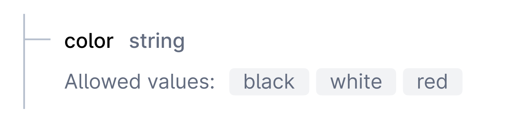

---

# default

The default value is displayed with the label "Default" followed by the value in a chip format.

```yaml
properties:
  color:
    type: string
    enum:
      - black
      - white
      - red
```


# example

The keyword Examples is displayed in new line, and its value is shown in separate chip next to it.

**Example 1:**

```yaml
properties:
  userId:
    type: string
    example: abc123
```


**Example 2:**

```yaml
properties:
  tags:
    type: array
    items:
      type: string
      example: ["tag1", "tag2", "tag3"]
```

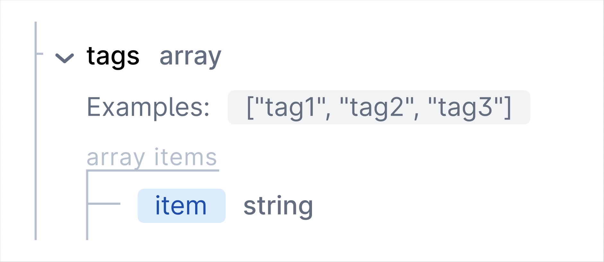

---

# required

The required properties are marked with an asterisk (\*) next to the property name.

```yaml
properties:
  user:
    type: object
    properties:
      id:
        type: integer
      name:
        type: string
    required:
      - id
```

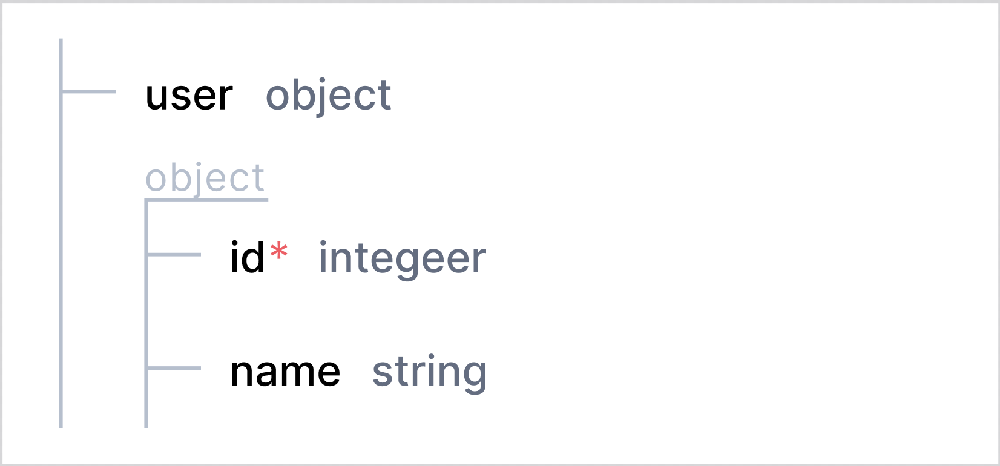

---

# deprecated

When property is marked as deprecated, it is indicated with an orange "deprecated" badge next to property type

**Example 1:**

```yaml
properties:
  user:
    type: object
    properties:
      id:
        type: integer
      oldName:
        type: string
        deprecated: true
      name:
        type: string
    required:
      - id
```

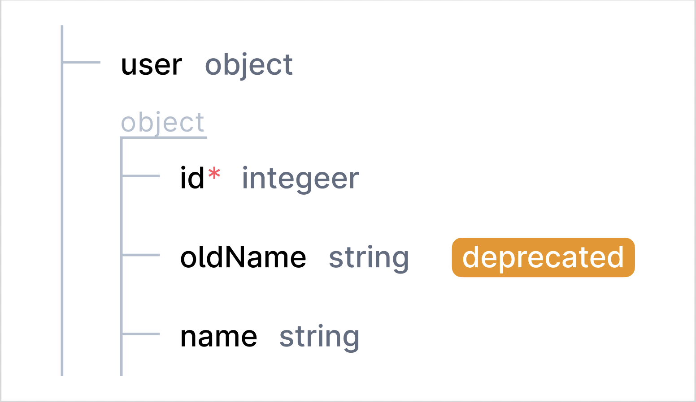

**Example 2:**

```yaml
properties:
  tags:
    type: array
    deprecated: true
    items:
      type: string
```

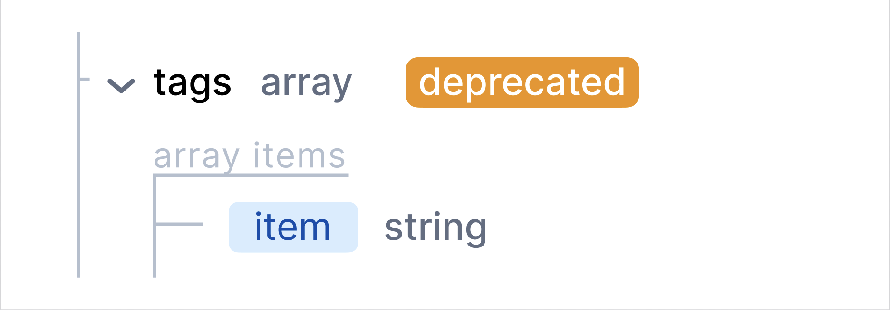

---

# circular references

The circular references is rendered by recursively displaying the same object structure within itself. In the UI, this results in the object being nested within itself repeatedly; each level of the object is expanded to show the same properties. Property with circular reference has special icon next to it.

```yaml
schema:
  $ref: "#/components/schemas/Category"

components:
  schemas:
    Category:
      type: object
      properties:
        id:
          type: string
          description: Unique identifier for the category
        name:
          type: string
        subcategory:
          $ref: "#/components/schemas/Category"
          description: Subcategory under this category
```

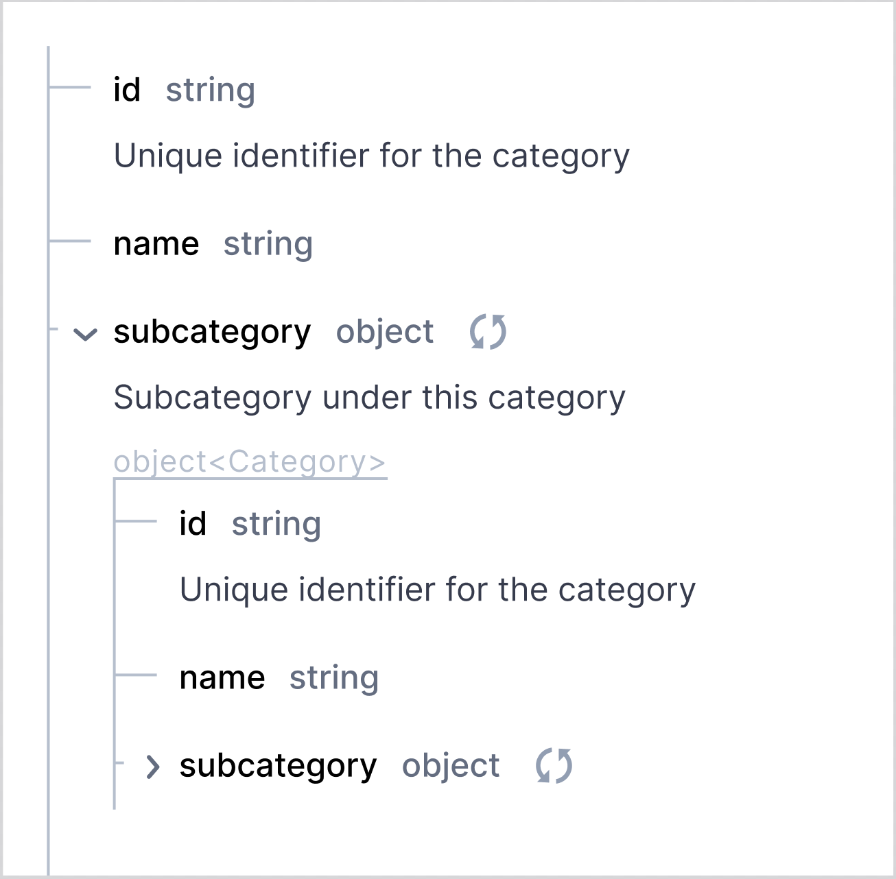
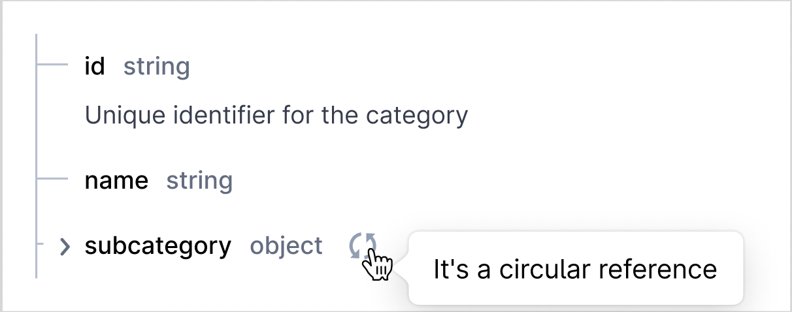


---

# readOnly/writeOnly

Default value of readOnly/writeOnly is "false" and doc view does not display default value of this attribute even if it is explicitly specified for the schema/property.

- when readOnly is "true", it is displayed as "read-only" blue badge next to the property type, indicating that this field is only available in responses and should not be sent in requests.
- when writeOnly is "true", it is displayed as "write-only" blue badge next to the property type, indicating that this field is only available in requests and will not be returned in responses.

```yaml
type: object
properties:
  id:
    type: integer
    readOnly: true
  password:
    type: string
    writeOnly: true
  name:
    type: string
```

---

# descriminator

APIHUB does not support descriminator.

---

# array's specific attributes

---

## items

Array items info is displayed as separate chip with "item" text to denote the element type within the array. Type of the array items is displayed next to the item chip. All other information about items is displayed in the same way as general properties. If items of array is array or object, then chevron will be displayed before the item chip.

**Example 1:**

```yaml
properties:
  tags:
    type: array
    items:
      type: string
```

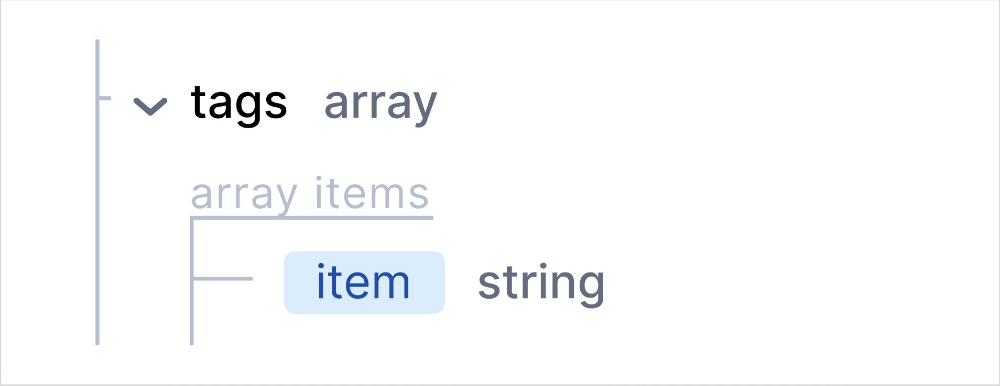

**Example 2:**

```yaml
properties:
  pets:
    type: array
    items:
      $ref: "#/components/schemas/Pet"

components:
  schemas:
    Pet:
      name:
        type: string
      color:
        type: string
```

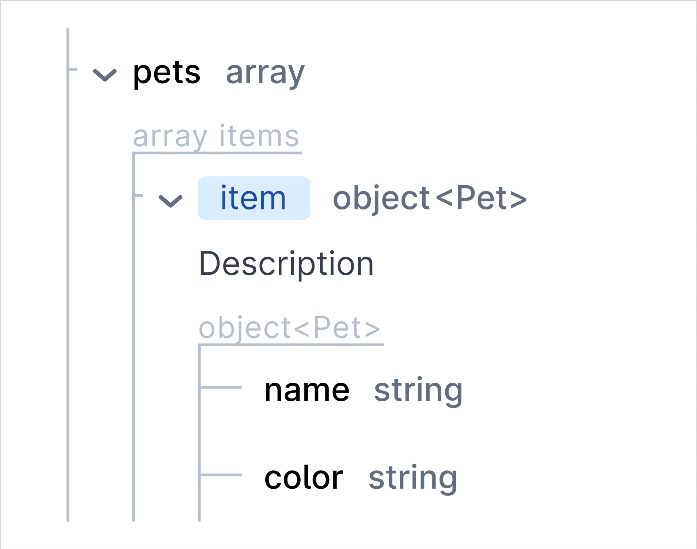

===

---

## minItems/maxItems

The minItems/maxItems values are displayed together as "Items count" with values in separate chips.

```yaml
properties:
  tags:
    type: array
    items:
      type: string
    minItems: 2
    maxItems: 5
```

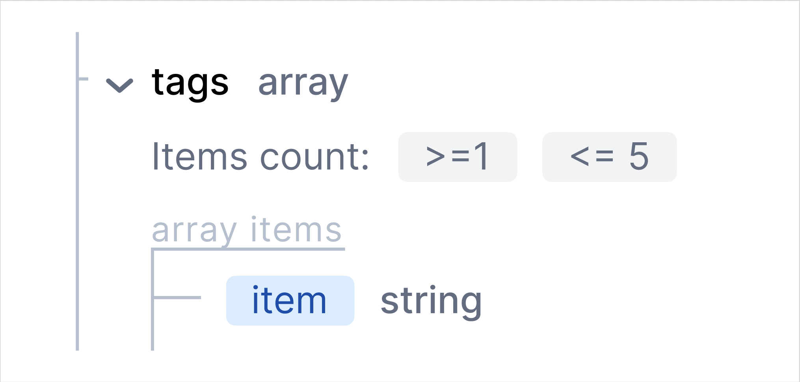

---

## uniqueItems

Default value of "uniqueItems" is false and doc view does not display default value of this attribute even if it is explicitly specified for the schema/property.

"uniqueItems: true" for array property is displayed as "Unique items" with "true" value in a chip.

```yaml
properties:
  tags:
    type: array
    items:
      type: string
    uniqueItems: true
```

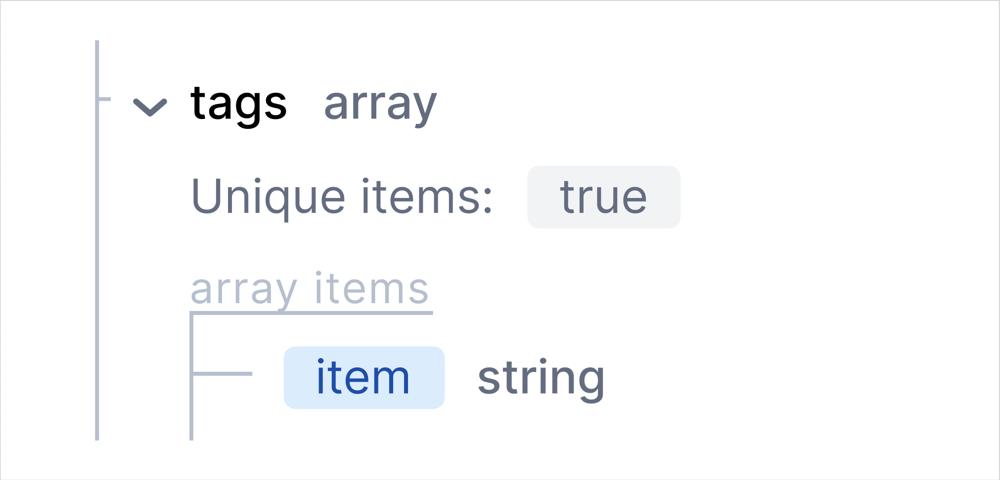

---

# objects specific attributes

## allOf

The UI combines schemas with allOf by displaying all the attributes and/or properties from the subschemas together.

```yaml
properties:
  error:
    allOf:
    - type: object
      description: Basic error model
      required:
      - message
      - code
      properties:
        message:
          type: string
        code:
          type: integer
          minimum: 100
          maximum: 600
    - type: object
      required:
      - rootCause
      properties:
        rootCause:
          type: string
```
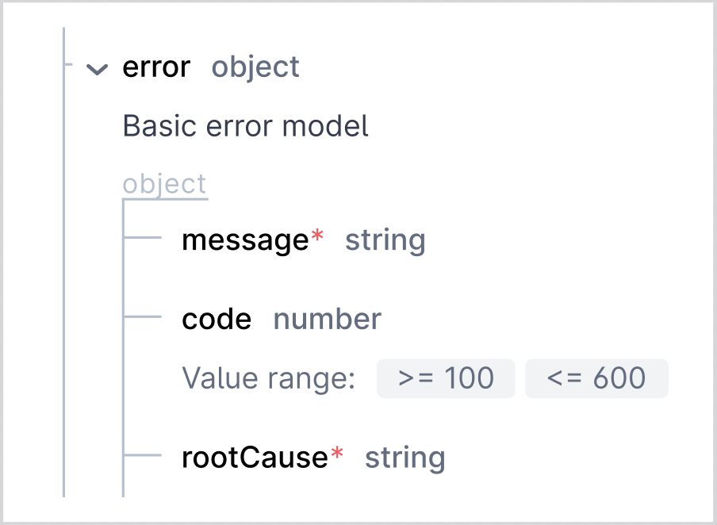

If subschemas contain the same attributes with different values, the resulting (combined) schema will contain the attribute with the value of the schema specified last. In the example below 1st subschema has description with value "descr1" and 2nd subschema - with value "descr2", so the result schema will contain description with value "descr2".

```yaml
properties:
  error:
    allOf:
    - type: object
      description: descr1
      required:
      - message
      - code
      properties:
        message:
          type: string
        code:
          type: integer
          minimum: 100
          maximum: 600
    - type: object
      description: descr2
      required:
      - rootCause
      properties:
        rootCause:
          type: string
```
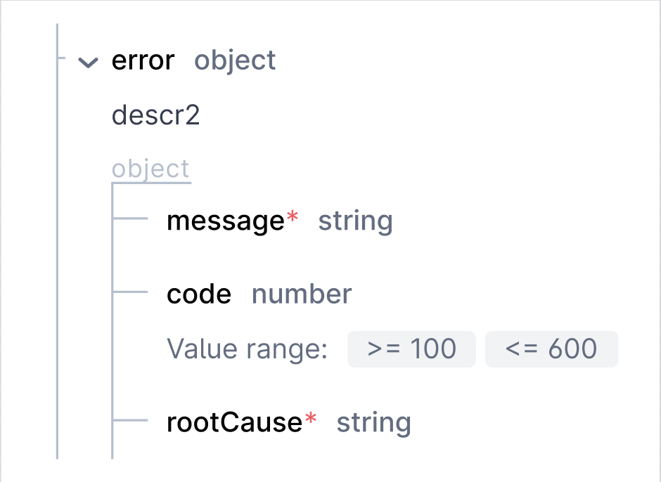

---

## anyOf, oneOf

- anyOf
  - The anyOf is rendered as multiple schemas, where the UI indicates that one or more of these must apply. In the UI, this is shown under the variant section, with multiple potential objects displayed under "anyOf".
- oneOf
  - The oneOf is rendered similarly to anyOf, but with an indication that exactly one of the options must apply. In the UI, this is labeled as "oneOf" under the variant section, with the possible exclusive attributes shown.

```yaml
type: object
description: An item variant using allOf, anyOf, oneOf, and not
allOf: # AllOf: Combines multiple schemas that must all apply
  - type: object
    properties:
      type:
        type: string
        enum: [simple, complex]
        description: Type of variant
anyOf: # AnyOf: One of the following schemas must apply
  - type: object
    properties:
      simpleAttribute:
        type: string
        description: A simple attribute
  - type: object
    properties:
      complexAttribute:
        type: object
        properties:
          detail:
            type: string
            description: A detailed description
oneOf: # OneOf: Exactly one of the following schemas must apply
  - type: object
    properties:
      exclusiveAttribute:
        type: string
        description: Exclusive attribute
```

---

## not

APIHUB does not support "not" keyword.

---

## minProperties/maxProperties

minProperties/maxProperties are displayed as "Properties count". Value of minProperties and maxProperties are displayed in separate chips.

```yaml
properties:
  entities:
    type: object
    properties:
      id:
        type: integer
      name:
        type: string
      description:
        type: string
    minProperties: 2
    maxProperties: 5
```

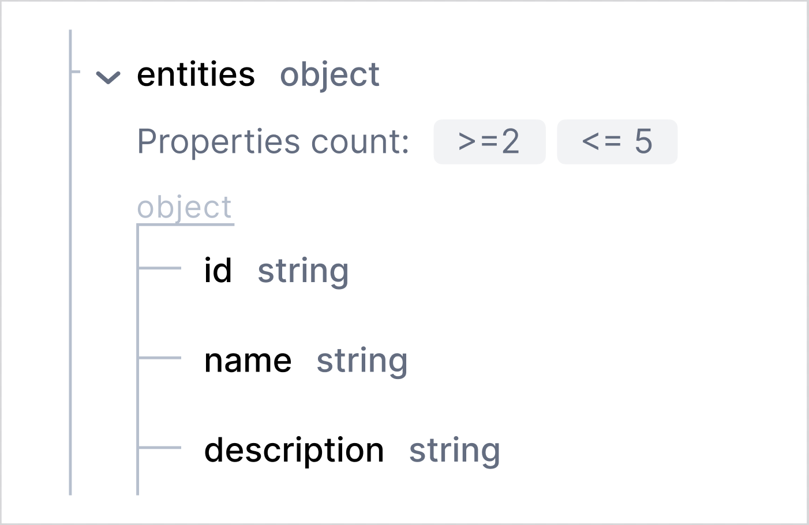

---

## additionalProperties

Default value of "additionalProperties" is true and doc view does not display default value of this attribute even if it is explicitly specified for the schema/property.

The following records are equivalent and all of them mean that additionalProperties = true (which is default value, i.e. no information about additionalProperties is displayed in all of the options below)

**Example 1:**

```yaml
properties:
  prop1: # option 1
    type: object
  prop2: # option 2
    type: object
    additionalProperties: true
  prop3: # option 3
    type: object
    additionalProperties: {}
```
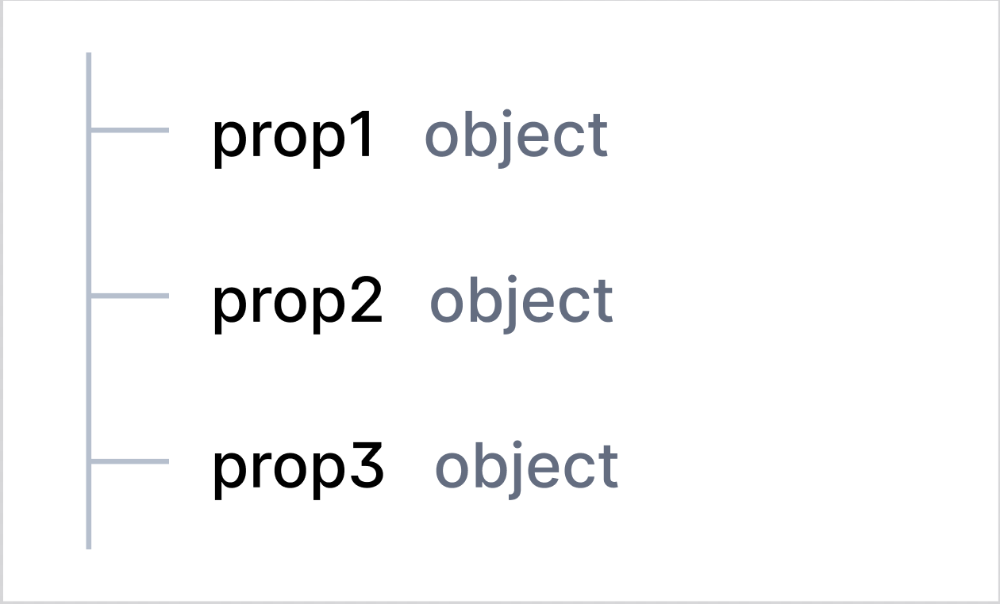

If additionalProperty is false, then "no additional properties" badge will be displayed after all properties of current object.

**Example 2:**

```yaml
properties:
  customerAccount:
    type: object
    additionalProperties: false
```

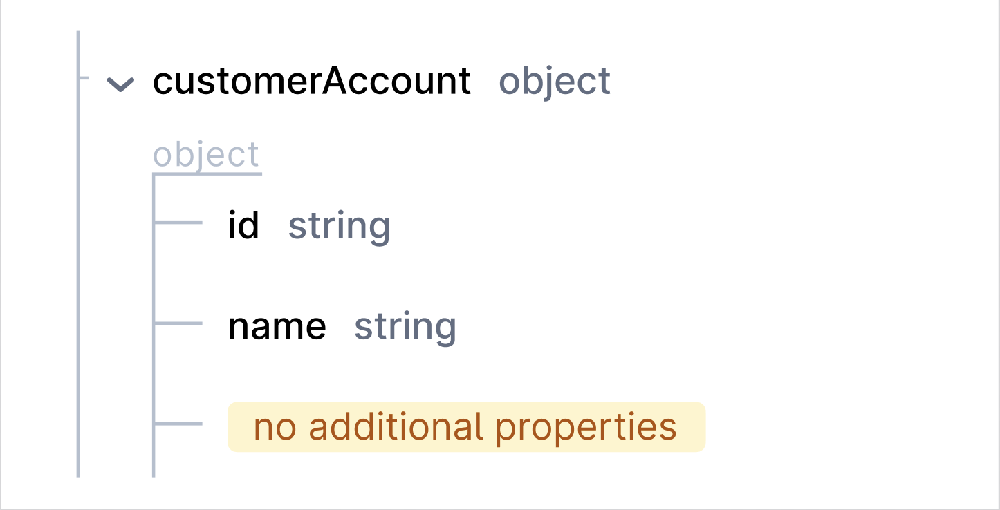

If additionalProperty is non-boolean schema, then it will be displayed as all other schemas with addition badge "additionalProperty" in the beginning.

**Example 3:**

```yaml
properties:
  customerAccount:
    type: object
    properties:
      id:
        type: string
      name:
        type: string
    additionalProperties:
      type: string
```

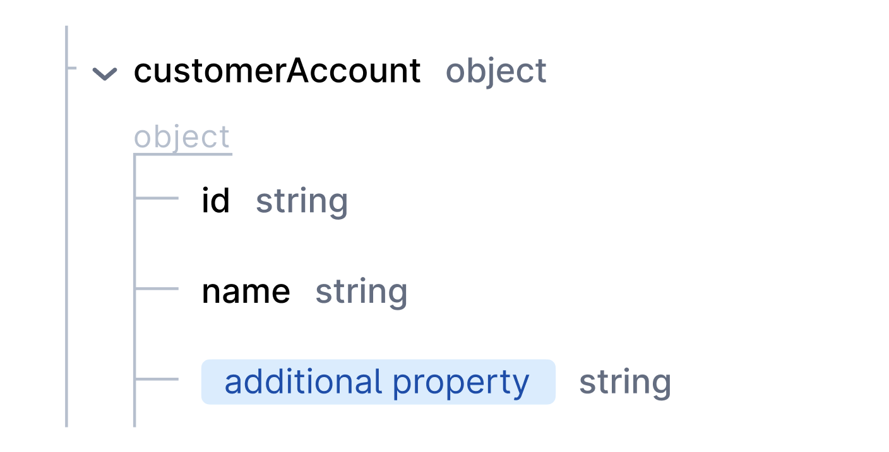

**Example 4:**

```yaml
properties:
  customerAccount:
  type: object
  properties:
    id:
      type: string
   name:
      type: string
  additionalProperties:
    type: object
    title: legalAddress
    properties:
      address:
        type: string
```

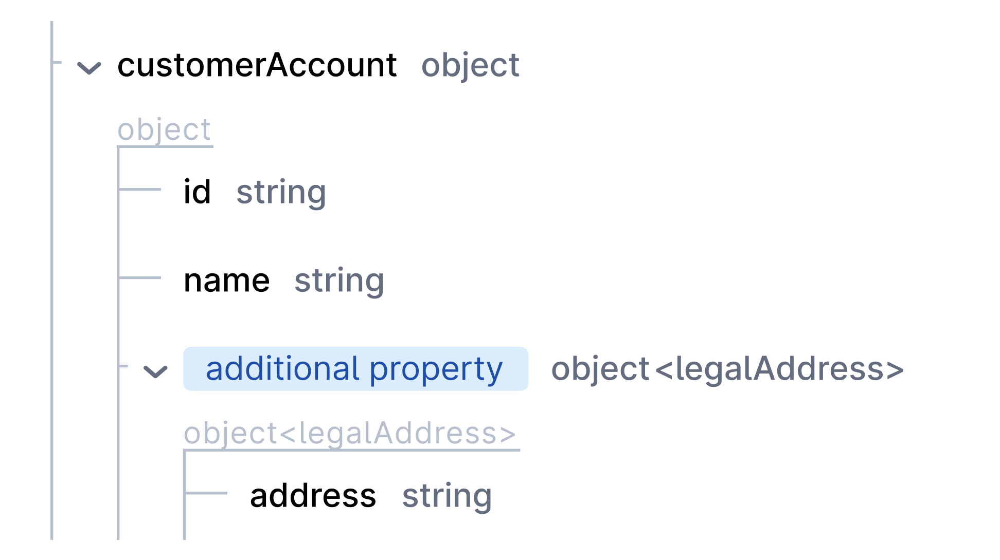
