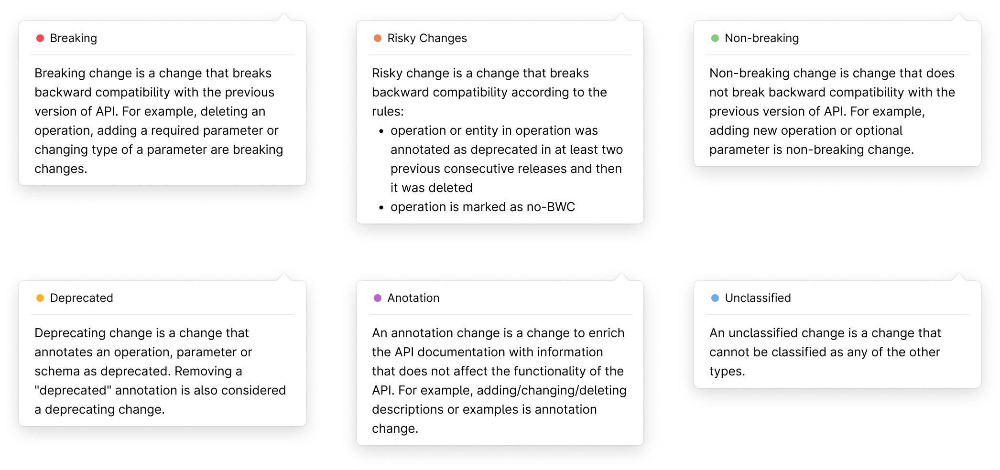
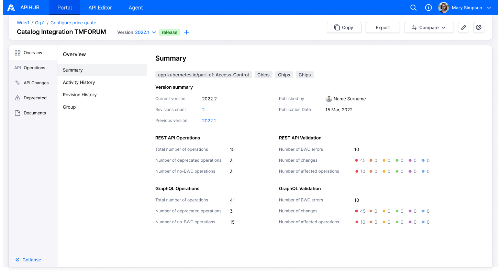

# DI-Portal-PKGVER-001 Version Summary

**Design Item ID**: DI-Portal-PKGVER-001  
**Design Item Name**: Version Summary  
**Related Design Items**: -  
**Related API**: 
  - Get package version content (GET /api/v3/packages/{packageId}/versions/{version})

**Revision History:**  

| Date           | Description                         |
| -------------- | ----------------------------------- |
|||

***

# Description
The functionality provides a user with the ability to view aggregated information of the package version.

# Start Point
1. User navigates to APIHUB Portal → workspace → group → package version → Overview tab

# Execution
1. User clicks Summary menu in package version.
2. The system opens version summary page, that contains aggregated information on the contents of the selected package version 
   - API to show summary info - GET /api/v3/packages/{packageId}/versions/{version}
     - packageId = \<current package Id\>
     - version = \<current package version>
     - includeSummary = true
3. User hovers over any change type in Number of changes field.
4. The system shows tooltip with description of the change type.  
  

5. User hovers over any change type in Number of affected operations field.
6. The system shows tooltip with description of the change type.

**The following information is displayed on version summary page:**

Version summary:
- Current version - name of the current version
- Revisions count - number of revisions of the version, i.e. how many times version was republished (value is a link to the revision history table).
- Previous version - previous release version
- Publication date - date when version was published
- Published by - user who published version  

<API Type> API Operations (section is shown for each API type available in the version):
- Total number of operations
- Number of deprecated operations
- Number of no-BWC operations
- Number of operations for internal audience / Number of operations for unknown audience - see info about these parameters in [DI‐Portal‐COE‐001: API Audience (x‐api‐audience)](https://github.com/Netcracker/qubership-apihub/wiki/DI%E2%80%90Portal%E2%80%90COE%E2%80%90001-API-Audience-(x%E2%80%90api%E2%80%90audience))

<API Type> API Validation (section is shown for each API type available in the version):
- Number of BWC errors - number of breaking changes compared to specified previous version
- Changes - number of changes of each severity type
- Number of affected operations - shows for each API type how many operations have breaking changes, semi-breaking changes, deprecated changes, non-breaking changes, and annotation changes.

# Mockups

