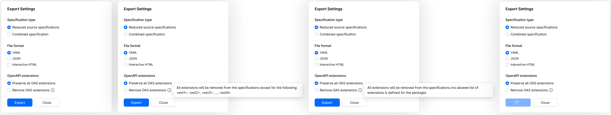

# DI-Portal-PKGVER-005 Export Operations Group (reduced source specifications)

**Design Item ID**: DI-Portal-PKGVER-005  
**Design Item Name**: Export Operations Group (reduced source specifications)  
**Related Design Items**:
  - [DI‐Portal‐PKGVER‐009: Operations Group](di-portal-pkgver-009-list-of-operations-groups.md)

**Related API**: 
  - Async export of version, document or operations group (POST /api/v1/export)
  - Get status of async export (GET /api/v1/export/{exportId}/status)

**Revision History:**  
| Date           | Description                         |
| -------------- | ----------------------------------- |
|14.03.2025      | export redesign, export OAS specifications without OAS extensions (https://github.com/Netcracker/qubership-apihub/issues/73, https://github.com/Netcracker/qubership-apihub/issues/65)|

***

# Description
User can download operations included into operations group (with API type = REST) and in the result receive OpenAPI specification with these operations. There are two options of downloading operations group - reduced source specifications and combined specification (see info about combined specification in [Download Operations Group (combined specification)]()).  
Reduced source specifications option allows the user to obtain the source specifications, which contain only those operations that are included in the exported group.  
For example, package version contains two OpenAPI specifications:  
- specification A contains 3 operations: GET /pets, POST /pet, Delete /pet/{Id}  
- specification B contains 2 operations: GET /users, GET /users/{username}

User creates a group where includes the following operations: GET /pets, POST /pet, GET /users. If user exports this operations group with reduced source specifications option in the result there will be two files: specification A - that contains only GET /pets and POST /pet, and specification B - that contains only GET /users.

Note: Functionality is applicable for both packages and dashboards. Further on this page, the term "package" will mean both package and dashboard until otherwise stated.

# Start Point
User navigates to APIHUB Portal → workspace → group → package version → Groups tab

# Execution

1. In Groups tab, the user hovers over groups with REST API type, clicks **Export** button.
2. The system opens Export Settings popup.
3. User hovers over info icon near Remove OAS extensions option.
4. The system shows tooltip: 
   - if there is least one allowed OAS extension defined on the package: "All extensions will be removed from the specifications except for the following: \<ext 1>, \<ext 2>, ..., \<ext N>".
     - in tooltip the system shows only unique list of extensions.
   - if there is no OAS extension defined on the package "All extensions will be removed from the specifications because no allowed list of extensions is defined for the package."
   - ===
   - API to get allowed list of OAS extensions for tooltip: GET /api/v1/packages/{packageId}/exportConfig
The system:
5. User selects "Reduced source specifications" option, required format and any OAS extensions option and clicks Export. 
6. The system exports the operations: 
   - API to export version:
     - start export process - POST /api/v1/export. 
       - packageId = \<current package id>
       - version = \<current version>
       - groupName = \<current group name>
       - operationsSpecTransformation = reducedSourceSpecifications
       - removeOasExtensions:
         - true if user selected "Remove OAS extensions" option
         - false if user selected "Preserve all OAS extensions" option
       - format = \<format selected by the user>
     - get export status / resulting file - GET /api/v1/export/{exportId}/status:
       - exportId = \<export process id returned in POST /api/v1/export>

The result of export:
1. if format = html, then the resulting file is ZIP file with the following files:
   - reduced sources OpenAPI specification files in HTML format.
   - index.html file which shows table of contents.
   - ls.html file with legal statement
   - resources folder with corporatelogo.png and style.css
2. if format = yaml, then the resulting file is ZIP file with the following files:
   - reduced sources OpenAPI specification files in yaml format.
3. if format = json, then the resulting file is ZIP file with the following files:
   - reduced sources OpenAPI specification files in json format.
4. if operations group is from dashboard, then each OAS files must have "packageId" prefix in file name, i.e. <packageId>_<filename>.html (related issue https://github.com/Netcracker/qubership-apihub/issues/22 ).
5. if multiple files have the same name, a postfix " N" will be added, where N is 1, 2, 3, etc., for each duplicate file name.

# Security
The user must have read permission for the package to export operations group.

# Mockup
