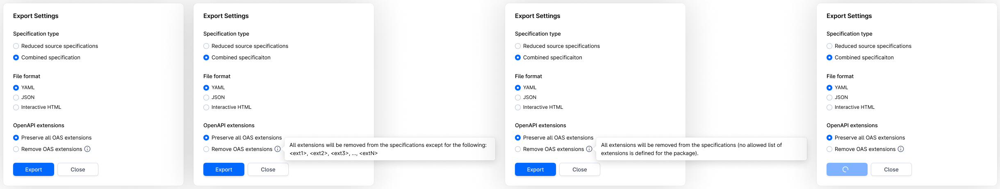

# DI-Portal-PKGVER-006 Export Operations Group (combined specification)

**Design Item ID**: DI-Portal-PKGVER-006  
**Design Item Name**: Export Operations Group (combined specification)  
**Related Design Items**:
  - [DI‐Portal‐PKGVER‐009: Operations Group](https://github.com/Netcracker/qubership-apihub/wiki/DI%E2%80%90Portal%E2%80%90PKGVER%E2%80%90009-Operations-Group)

**Related API**: 
  - Async export of version, document or operations group (POST /api/v1/export)
  - Get status of async export (GET /api/v1/export/{exportId}/status)

**Revision History:**  
| Date           | Description                         |
| -------------- | ----------------------------------- |
|14.03.2025      | export redesign, export OAS specifications without OAS extensions (https://github.com/Netcracker/qubership-apihub/issues/73, https://github.com/Netcracker/qubership-apihub/issues/65)|

***

# Description
User can download operations included into operations group (with API type = REST) and in the result receive OpenAPI specification with these operations. There are two options of downloading operations group - reduced source specifications (see info about reduced source specification in [DI‐Portal‐PKGVER‐005: Export Operations Group (reduced source specifications)](https://github.com/Netcracker/qubership-apihub/wiki/DI%E2%80%90Portal%E2%80%90PKGVER%E2%80%90005-Export-Operations-Group-(reduced-source-specifications)) and combined specification.  
The combined specifications option allows the user to obtain a single OpenAPI specification that merges all operations from the selected operations group into one OpenAPI specification, including all relevant paths, components, and reusable elements from the source specifications.  
For example, suppose you have a package version that contains two OpenAPI specifications:  
- Specification A contains three operations:
  - GET /pets
  - POST /pet
  - DELETE /pet/{Id}
- Specification B contains two operations:
  - GET /users
  - GET /users/{username}

The user creates a group that includes the following operations:
- GET /pets
- POST /pet
- GET /users

After exporting the operations group with the combined specification option, the result will be a single OpenAPI file that includes all the selected operations, such as:
- GET /pets
- POST /pet
- GET /users

This file will consolidate operations from both Specification A and Specification B into one OpenAPI specification.

# Start Point
1. User navigates to APIHUB Portal → workspace → group → package version → Groups tab

# Execution
1. In Groups tab, the user hovers over groups with REST API type, clicks **Export** button.
2. The system opens Export Settings popup.
3. User hovers over info icon near Remove OAS extensions option.
4. The system shows tooltip: 
   - if there is least one allowed OAS extension defined on the package: "All extensions will be removed from the specifications except for the following: \<ext 1>, \<ext 2>, ..., \<ext N>".
     - in tooltip the system shows only unique list of extensions.
   - if there is no OAS extension defined on the package "All extensions will be removed from the specifications because no allowed list of extensions is defined for the package."
   - ===
   - API to get allowed list of OAS extensions for tooltip: GET /api/v1/packages/{packageId}/exportConfig
The system:
5. User selects "Combined specification" option.
6. User selects required format and any OAS extensions option and clicks **Export**. 
7. The system exports the operations. 
   - API to export version:
     - start export process - POST /api/v1/export 
       - packageId = \<current package id>
       - version = \<current version>
       - groupName = \<current group name>
       - operationsSpecTransformation = combinedSpecification
       - removeOasExtensions:
         - true if user selected "Remove OAS extensions" option
         - false if user selected "Preserve all OAS extensions" option
         - format = \<format selected by the user>
     - get export status / resulting file - GET /api/v1/export/{exportId}/status:
       - exportId = \<export process id returned in POST /api/v1/export>

The result of the export:
1. if format = html, then the resulting file is ZIP file with the following files:
   - merged OpenAPI specification file in HTML format
   - index.html file which shows table of contents.
   - ls.html file with legal statement
   - resources folder with corporatelogo.png and style.css
2. if format = yaml then the resulting file is merged OpenAPI specification file in yaml format.
3. if format = json then the resulting file is merged OpenAPI specification file in json format.

***

Operations group with REST API type can contain OpenAPI specification template. The OpenAPI specification template is the template that will be used when downloading the combined specification. The following information will be taken from the template, if specified, and applied to the combined specification:
- info: title, version, and description of the API specification
- servers
- externalDocs
- security and securitySchemes  

The template must be a valid JSON or YAML file, have an OpenAPI 3.0 structure and version openapi version 3.0 or 3.0.x (e.g., openapi: 3.0); otherwise   else the exporting operations group with combined specification option and with such template will be failed.  

If the OpenAPI export template is not in the correct format or structure, the system will return the error message: "OpenAPI export template is incorrect. Template must have JSON or YAML format and have structure of OpenAPI specification. Please fix OpenAPI export template and try again."

**Merging rules:**
1. **R1:**
   - OAS field: openapi
   - Rule: All source specifications must have the same OpenAPI version down to the last character (openapi version from template will be ignored).
   - Example: 
     - valid: 
       - openapi: 3.0.1 & openapi: 3.0.1
     - invalid:
       - openapi: 3.0.1 & openapi: 3.0.2
       - openapi: 3.0 & openapi: 3.0.1
   - Error message: The combined specification cannot be downloaded because there are source specifications with different OpenAPl versions. Please resolve the conflicts in source specifications, republish them and try again. You can also download reduced source specifications and merge operations manually.
2. **R2:**
   - OAS field: info
   - Rule: 'info' section will not be merged from source specifications. If group has template, then 'info' section will be taken from this template. If group does not have template or template does not have 'info.title' and/or 'info.version' fields, then combined specification will have:
     - info.title = <operation group name>
     - info.version = <package/dashboard version>
   - Error message: -
   - Examples:  

_Source spec 1:_
```yaml
openapi: 3.0
info:  
    title: Spec1
    summary: This spec1 about some things.
    description: This specs describes this and that.
```
_Source spec 2:_
```yaml
openapi: 3.0
info:  
    title: Spec2
    summary: This spec2 about some things.
    contact:
        name: Contact me
        url: https://www.example.com/support
```

**Example 1: There is template**  
Template:
```yaml
openapi: 3.0.1
info:  
    title: Sample Pet Store App
    summary: A pet store manager.
    description: This is a sample server for a pet store.
    termsOfService: https://example.com/terms/
    contact:
        name: API Support
        url: https://www.example.com/support
        email: support@example.com
    license:
        name: Apache 2.0
        url: https://www.apache.org/licenses/LICENSE-2.0.html
    version: 1.0.1
```
Combined specification:
```yaml
openapi: 3.0
info:  
    title: Sample Pet Store App
    summary: A pet store manager.
    description: This is a sample server for a pet store.
    termsOfService: https://example.com/terms/
    contact:
        name: API Support
        url: https://www.example.com/support
        email: support@example.com
    license:
        name: Apache 2.0
        url: https://www.apache.org/licenses/LICENSE-2.0.html
    version: 1.0.1
```
===  
**Example 2: There is template without no title and version:**  
Template:  
```yaml
openapi: 3.0.1
info:  
    summary: A pet store manager.
    description: This is a sample server for a pet store.
    termsOfService: https://example.com/terms/
    contact:
        name: API Support
        url: https://www.example.com/support
        email: support@example.com
```
Combined specification:
```yaml
openapi: 3.0
info:  
    title: <group name>
    summary: A pet store manager.
    description: This is a sample server for a pet store.
    termsOfService: https://example.com/terms/
    contact:
        name: API Support
        url: https://www.example.com/support
        email: support@example.com
    license:
        name: Apache 2.0
        url: https://www.apache.org/licenses/LICENSE-2.0.html
    version: <package/dashboard version>
```
===  
**Example 3: No template**  
Combined specification:
```yaml
openapi: 3.0
info:  
    title: <group name>
    version: <package/dashboard version>
```
1. **R3:**
   - OAS field: externalDocs
   - Rule: If group has template, then combined section will contain externalDocs section from template. If there is no template or template does not have externalDocs section, then system check that externalDocs in source specification are equal:
     - if they are equal, then combined specification will have this externalDocs.
     - if they are different, then combined specification will not have externalDocs.
   - Error message: -
   - Examples:

**Example 1. There is template:**
Template
```yaml
openapi: 3.0.3
info: ...
externalDocs:
   url: https://example.com
   description: Use this link to get more info
```

Source specification 1
```yaml
openapi: 3.0
info:
externalDocs:
   url: https://swagger.io/
```

Source specification 2
```yaml
openapi: 3.0
info:
externalDocs:
   url: https://wikipedia.ord
   description: text text
```

Combined specification
```yaml
openapi: 3.0
info: ...
externalDocs:
   url: https://example.com
   description: Use this link to get more info
``` 
===  
**Example 2. No template (or template does not have externalDocs section) and different externalDocs:**  

Source specification 1
```yaml
openapi: 3.0
info:
externalDocs:
   url: https://swagger.io/
```

Source specification 2
```yaml
openapi: 3.0
info:
externalDocs:
   url: https://wikipedia.ord
   description: text text
```

Combined specification (does not have externalDocs)
```yaml
openapi: 3.0
info: ...
```
===  
**Example 3. No template (or template does not have externalDocs section) and equal externalDocs:**
Source specification 1
```yaml
openapi: 3.0
info:
externalDocs:
   url: https://wikipedia.ord
   description: text text
```

Source specification 2
```yaml
openapi: 3.0
info:
externalDocs:
   url: https://wikipedia.ord
   description: text text
```

Combined specification
```yaml
openapi: 3.0
info:
externalDocs:
   url: https://wikipedia.ord
   description: text text
```

4. **R4:**
   - OAS field: servers
   - Rule: If there is template, then combined specification will have servers section with servers only from template. If there is no template or template does not have servers section, then system check that server sections are equal in source specifications:
     - if they are equal, then combined specification will have this server sections
     - if they are different, then return error message.
   - Error message: Unable to merge \<json path\>. Two or more specifications from the following list has different content for it: \<Specification Title 1\>, \<Specification Title 2\>,... , \<Spec Title N\>. Please resolve the conflicts in source specification, republish them and try again. You can also download reduced source specifications and merge operations manually.
5. **R5:**
   - OAS field: security
   - Rule: If there is template and template has security, then combined specification will have security section with security only from template. If there is no template or template does not have security, then system check that security sections are equal in source specifications:
     - if they are equal, then combined specification will have this security sections
     - if they are different, then return error message.
   - Error message: Unable to merge \<json path\>. Two or more specifications from the following list has different content for it: \<Specification Title 1\>, \<Specification Title 2\>,... , \<Spec Title N\>. Please resolve the conflicts in source specification, republish them and try again. You can also download reduced source specifications and merge operations manually.
6. **R6:**
   - OAS field: components.schemas
   - Rule: if source specifications has components.schemas with the same schema key, then content of these schemas must be equal; otherwise return error message.
   - Error message: Unable to merge \<json path\>. Two or more specifications from the following list has different content for it: \<Specification Title 1\>, \<Specification Title 2\>,... , \<Spec Title N\>. Please resolve the conflicts in source specification, republish them and try again. You can also download reduced source specifications and merge operations manually.
7. **R7:**
   - OAS field: components.responses
   - Rule: if source specifications has components.responses with the same response key, then content of these responses must be equal; otherwise return error message.
   - Error message: Unable to merge <json path>. Two or more specifications from the following list has different content for it: \<Specification Title 1\>, \<Specification Title 2\>,... , \<Spec Title N\>. Please resolve the conflicts in source specification, republish them and try again. You can also download reduced source specifications and merge operations manually.
8. **R8:**
   - OAS field: components.examples
   - Rule: if source specifications has components.examples with the same example key, then content of these examples must be equal; otherwise return error message.
   - Error message: Unable to merge \<json path\>. Two or more specifications from the following list has different content for it: \<Specification Title 1\>, \<Specification Title 2\>,... , \<Spec Title N\>. Please resolve the conflicts in source specification, republish them and try again. You can also download reduced source specifications and merge operations manually.
9. **R9:**
   - OAS field: components.headers 
   - Rule: if source specifications has components.headers with the same header key, then content of these headers must be equal; otherwise return error message.
   - Error message: Unable to merge \<json path\>. Two or more specifications from the following list has different content for it: \<Specification Title 1\>, \<Specification Title 2\>,... , \<Spec Title N\>. Please resolve the conflicts in source specification, republish them and try again. You can also download reduced source specifications and merge operations manually.
10. **R10:**
   - OAS field: components.links
   - Rule: if source specifications has components.links with the same link key, then content of these links must be equal; otherwise return error message.
   - Error message: Unable to merge \<json path\>. Two or more specifications from the following list has different content for it: \<Specification Title 1\>, \<Specification Title 2\>,... , \<Spec Title N\>. Please resolve the conflicts in source specification, republish them and try again. You can also download reduced source specifications and merge operations manually.
11. **R11:**
   - OAS field: components.securitySchemes
   - Rule: merge securitySchemes from all source specification and template. If source specifications and/or template has components.parameters with the same security scheme key, then content of these security schemes must be equal; otherwise return error message.
   - Error message: Unable to merge \<json path\>. Two or more specifications from the following list has different content for it: \<Specification Title 1\>, \<Specification Title 2\>,... , \<Spec Title N\>. Please resolve the conflicts in source specification, republish them and try again. You can also download reduced source specifications and merge operations manually.
12. **R12:**
   - OAS field: components.parameters
   - Rule: if source specifications has components.parameters with the same parameter key, then content of these parameters must be equal; otherwise return error message.
   - Error message: Unable to merge \<json path\>. Two or more specifications from the following list has different content for it: \<Specification Title 1\>, \<Specification Title 2\>,... , \<Spec Title N\>. Please resolve the conflicts in source specification, republish them and try again. You can also download reduced source specifications and merge operations manually.
13. **R13:**
   - OAS field: components.requestBodies
   - Rule: if source specifications has components.requestBodies with the same request body key, then content of these request bodies must be equal; otherwise return error message.
   - Error message: Unable to merge \<json path\>. Two or more specifications from the following list has different content for it: \<Specification Title 1\>, \<Specification Title 2\>,... , \<Spec Title N\>.  Please resolve the conflicts in source specification, republish them and try again. You can also download reduced source specifications and merge operations manually.
14. **R14:**
   - OAS field: paths.[path]
   - Rule: if source specifications has the same paths, then content of these paths must be equal.   
**Warning:** The described rule implies that CRUD operations within the same path are included in one source specification. I.e., for example, if one source spec has /api/v1/users path and POST method and another spec has /api/v1/users path and GET method, then merge of this path is impossible and the system will return error message.
   - Error message: Unable to merge \<json path\>. Two or more specifications from the following list has different content for it: \<Specification Title 1\>, <\Specification Title 2\>,... , \<Spec Title N\>. Please resolve the conflicts in source specification, republish them and try again. You can also download reduced source specifications and merge operations manually.

# Security
The user must have read permission for the package to export operations group.

# Mockups
