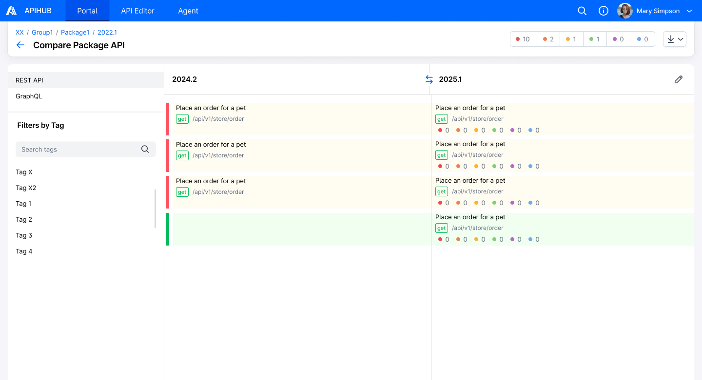
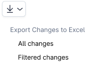

# DI-Portal-PKGVER-020 Export of discrepancy analysis results for arbitrary package versions in Excel

**Design Item ID**: DI-Portal-PKGVER-020  
**Design Item Name**: Export of discrepancy analysis results for arbitrary package versions in Excel  
**Related Design Items**: -  
**Related API**:

- Export API changes to xlsx file (GET /api/v3/packages/{packageId}/versions/{version}/{apiType}/export/changes)

**Revision History:**  

| Date           | Description                         |
| -------------- | ----------------------------------- |
|||

***

## Description  

This functionality allows users to export a list of all REST/GraphQL operations that have changed between different
versions or revisions within the same package.

## Start Point  

1. User navigates to APIHUB Portal → workspace → package version→ compare versions/revisions
2. User navigates to APIHUB Portal → workspace → group → package version→ compare versions/revisions

## Execution

1. User clicks **[Export]** button.  
2. The system displays two options to export the list of changed operations to Excel:  
   - All changes - all changed operations from the current package version will be exported.  
   - Filtered changes - only currently displayed (filtered) changes will be exported.  
3. User selects the required option.  
4. The system exports the list of changed operations to an Excel file.  
   - API to export operations to xlsx file - GET
     /api/v3/packages/{packageId}/versions/{version}/{apiType}/export/changes  
     - No query parameters are required if all changed operations will be exported.  
     - If exporting filtered changes, then query parameters and their usage are the same as in change filtering.  

## Security

User must have "read" permission for the package to export the list of changed operations to an Excel file.

## Mockups

