# DI-Portal-PKGVER-022 OpenAPI Document Overview

**Design Item ID**: DI-Portal-PKGVER-022  
**Design Item Name**: OpenAPI Document Overview  
**Related Design Items**:

- [List of Documents](di-portal-pkgver-016-list-of-documents.md)

**Related API**:

- Get document details (GET /api/v3/packages/{packageId}/versions/{version}/documents/{slug})

**Revision History:**  

| Date           | Description                         |
| -------------- | ----------------------------------- |
|||

***

## Description

The functionality allows the user to see an overview information of OpenAPI specification.

## Start Point

1. User navigates to APIHUB Portal → workspace → group → package version -> documents tab.

## Execution

1. User selects OpenAPI document.
2. The system shows the following information:
   - title from info.title field of specification
   - version from info.version field of specification
   - document labels
   - contact information from info.contact object of specification
   - license information from info.license object of specification
   - term of service information from info.termsOfService field of specification
   - info about external documentation from externalDocs object of specification
   - description (rendered Markdown) from info.description field of specification
   - ===
   - API to show document overview:
     - GET /api/v3/packages/{packageId}/versions/{version}/documents/{slug}

**Contact object:**

  1. if all 3 fields `name`, `url` and 'email' are specified, then display:
    - \<name field value>: \<url field value> | Email: \<email field value>  
      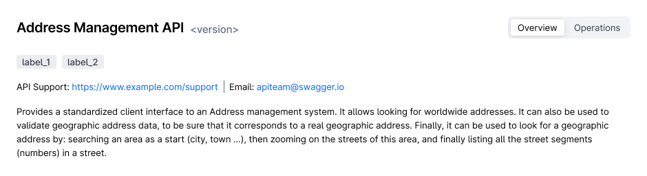
  2. if only `name` field is specified, then display nothing.
  3. if only `url` field is specified, then display:
    - URL: \<url field value>
      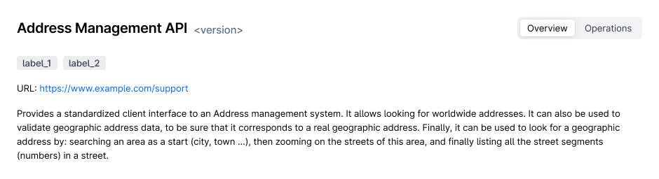
  4. if only 'email' field is specified, then display:
    - Email: \<email field value>
      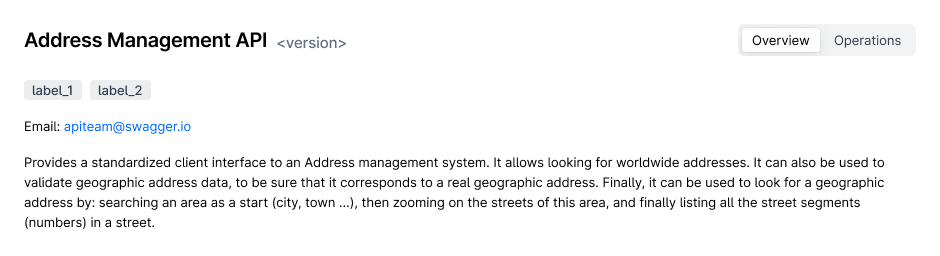

  5. if `name` and `url` fields are specified, then display:
    - \<name field value>: \<url field value>  
      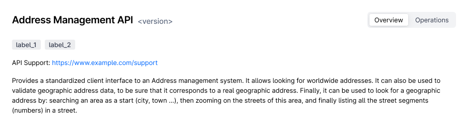

  6. if `name` and 'email' fields are specified, then display:
    - \<name field value>: \<email field value>  
      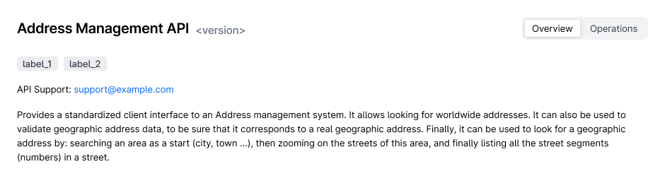

  7. if `url` and 'email' fields are specified, then display:
    - URL: \<url field value> | \<Email>: \<email field value>  
      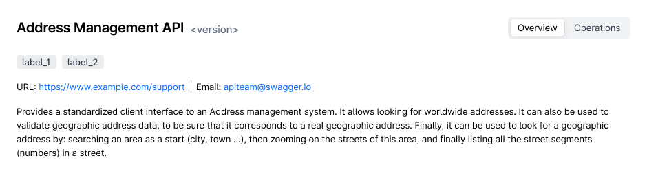

**License object:**

1. if `name` and `url` fields are specified, then display
   - License: \<name field value> with link to URL field value  
     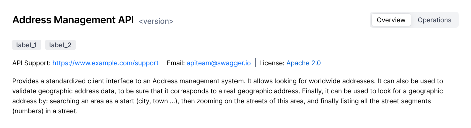
2. if only `name` field is specified then display:
   - License: \<name field value>  
     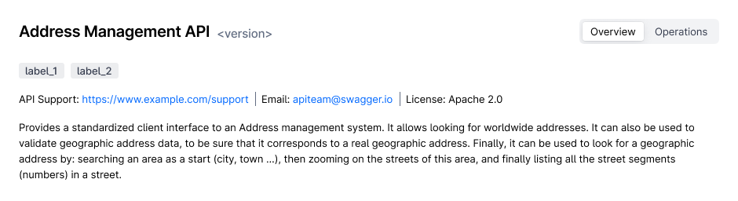
3. if only `url` field is specified - incorrect case, since name is required field in OpenAPI. Ignore license object in
   this case.

**termsOfService field:**

1. if termsOfService field is specified, then display:
   - Term of service (with link to termsOfService field value)  
     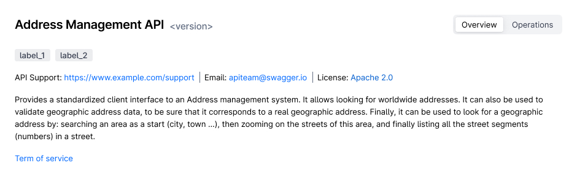

**externalDocs:**

1. if `name` and `url` fields are specified, then display:
   - \<name field value> (with link to URL field value)  
     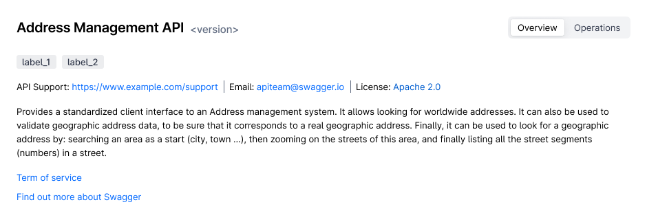
2. if only `url` field is specified, then display:
   - \<URL field value> (with link to URL field value)
     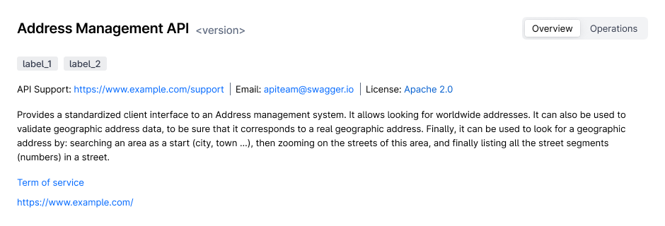
3. if only `name` field is specified - incorrect case, since URL is required field in OpenAPI. Ignore externalDocs
   object in this case.

## Security

OpenAPI document overview is available for all users, which have "read" permission for the appropriate package.

## Screen View

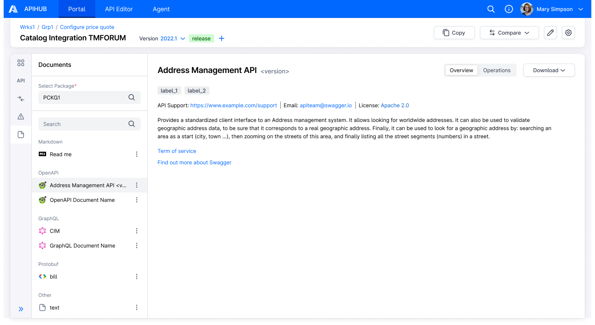
