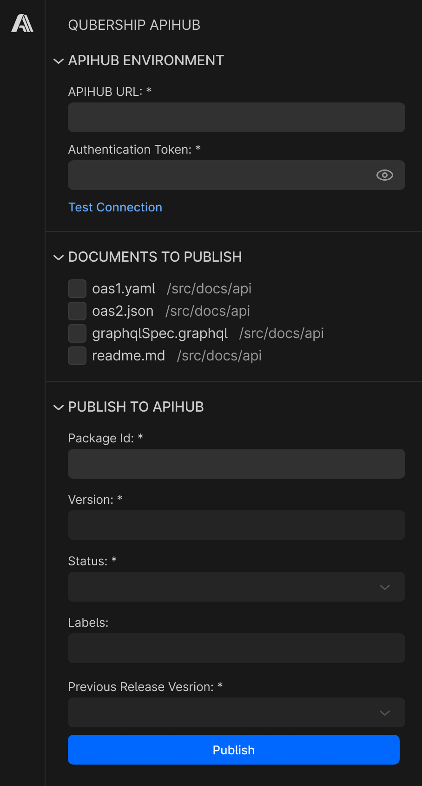
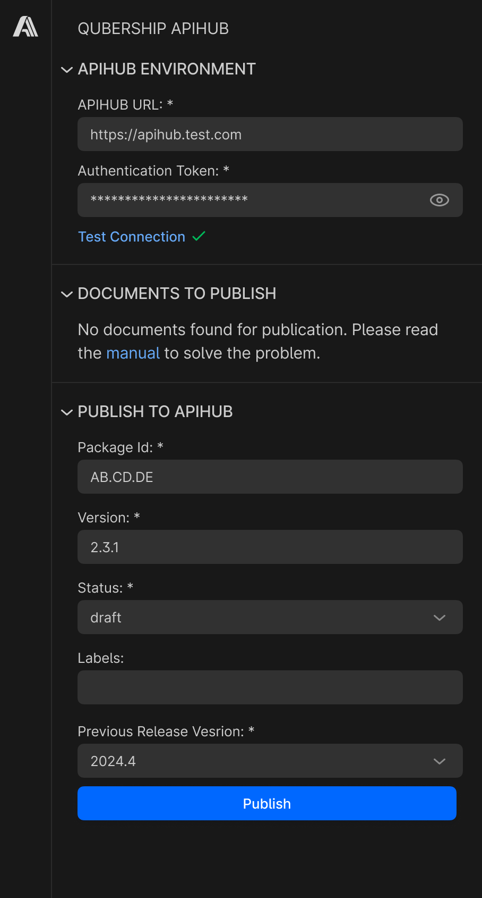
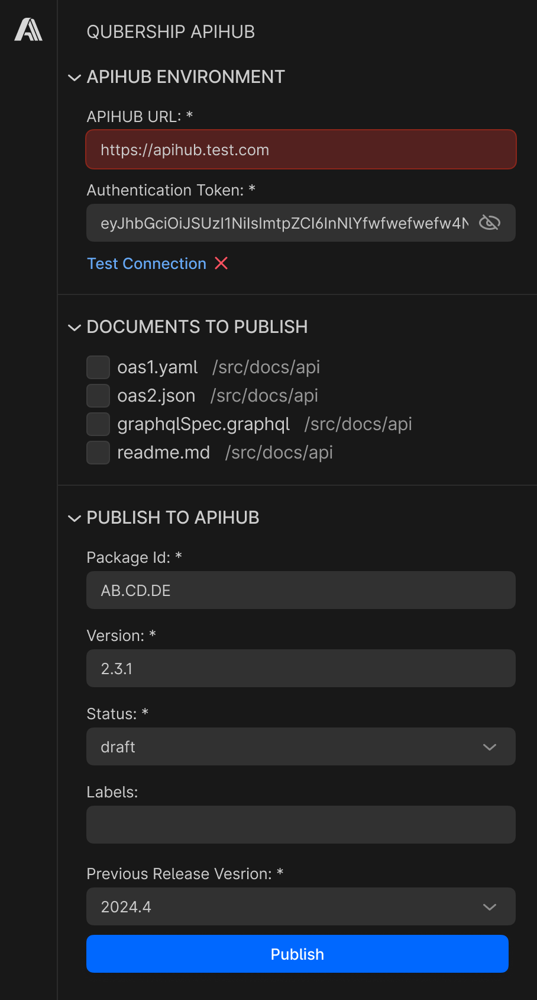
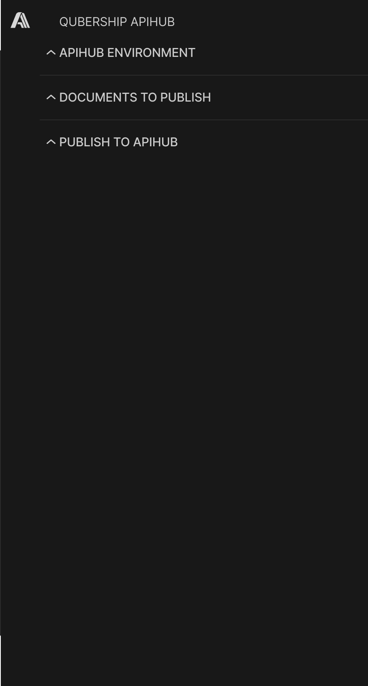

# Publish to Portal from VS Code

**Design Item ID**: DI-Portal-VCE-001  
**Design Item Name**: Publish to Portal from VS Code  
**Related Design Items**: -  
**Related API**: 
  * Publish package version via upload (POST /api/v2/packages/{packageId}/publish)  
  * Get publish process status (GET /api/v2/packages/{packageId}/publish/{publishId}/status) 

**Revision History**

| Date       | Description     | Issue                                                                 |
|------------|-----------------|------------------------------------------------------------------------|
| 2025-05-20 | Initial version | [#1](https://github.com/Netcracker/qubership-apihub-vscode/issues/1) |


***
# Requirements
1. VS Code Extension that publishes file(s) to APIHUB Portal shall be provided.
2. Extension shall be available via activity bar.
3. If extension is selected in activity bar, the following shall be displayed in primary sidebar:
   1. APIHUB ENVIRONMENT section:
      1. section shall be expandable/collapsible.
      2. If all fields in this section are filled, then the section is collapsed by default.
      3. If at least one field in the section is empty, then the section is expanded by default.
      4. the following fields shall be present in the section:
         1. APIHUB URL - required field
         2. Authentication Token - required field
            1. by default, the value in this field shall be masked.
            2. the system shall provide the ability to unmask/mask value in the field
      5. Values of APIHUB URL and Authentication Token shall be persisted in extension.
      6. the system shall provide the ability to test connection, i.e. check that information about URL and token are correct.
         1. the system shall check it by sending GET /api/v1/system/info request to the specified server with specified token.
            1. if no response - it means the server is incorrect
            2. if 401 unauthorized response - it means token is incorrect
   2. DOCUMENTS TO PUBLISH section:
      1. section shall be expandable/collapsible.
      2. by default section shall be expanded.
      3. section shall display the following files that are currently opened in VS Code Explorer:
         1. files with yaml or yml extension which have “openapi:” field
         2. files with json extension which have “openapi:” field
         3. files with gql or graphql extension
         4. files from config file (see req#4).
      4. for each file, the system should show the path to the file if the file is not in the root folder.
      5. the system shall sort files by path, and within each path, files shall be sorted by name (alphabetically).
      6. user shall be able to select one or multiple files in the section.
      7. all files listed in the config file shall be preselected by default.
      8. if there is no config file (e.g. during first opening), then all files shall be preselected by default.
      9. states of the files (checked/unchecked) shall be persisted within the current work session with VS Code.
   3.  PUBLISH TO APIHUB section:
       1.  section shall be expandable/collapsible.
       2.  by default section shall be expanded.
       3.  the following fields shall be present in the section:
           1.  Package Id
               1.  required field
               2.  field is free text input field without search feature (because of vs code limitations)
               3.  when user specifies the package id, the system shall validate that such package exist
               4.  API to get list of available packages - GET /api/v2/packages:
                   1.  kind = packages
               5. package id shall be persisted in the config file (see req#4).
               6. if the config file has information about package id, Package field shall be predefined with this value.
            2. Version
               1. required field
               2. if status from status field is “release”, then the system shall validate the version matches regular expression of current package
                  1. API to get regular expression - GET /api/v2/packages/{packageId} (releaseVersionPattern)
               3. only the following characters are allowed in the version field: A-Za-z0-9_.~- and space.
                  1. If the user enters a prohibited character, the system shall highlight an error in this field.
            3. Status. Dropdown field with the following values:
               1. draft
               2. release
               3. archived
            4. Labels
               1. multi-value field
               2. if a user specified version in the version field that already exists, then the system shall pre-fill the field with labels from the latest revision of this version.
            5. Previous Release Version
               1. required field with dropdown and with the ability to search version
               2. API to get list of available release versions - GET /api/v3/packages/{packageId}/versions:
                  1. status = release
                  2. textFilter = user’s input to search required version
         1. Values of version, status, labels and previous release version fields shall be persisted within the current work session with VS Code.
         2. Version, status, labels and previous release version fields shall be disabled until package id is not specified with the correct value.
         3. section shall display the Publish button that initiates publication of selected files.
4. Extension shall be able to work with config file:
   1. config file must be located in the root of the project.
   2. config file name must be “.apihub-config.yaml”
   3. config file is a file with the following info (see example after all reqs):
      1. version - string; initial version will be 1.0
      2. packageId - string;  see req. 3.iii.c.a.b.
      3. files - array of string; i.e. list of files (paths) that will be published to Portal.
   4. user can specify in the config file path to the file (other than listed in points 1-3 of requirement 3.ii.c.) to include this file into publication.
      1. if the user specifies such a file in the config, and then makes a publication without this file; then after publication this file will not be available neither in the config file nor in UI (because of req 4.iii.c.).
5. If user clicks Publish button, but at least one of the following fields are not filled, the system shall not publish version:
   1. APIHUB URL
   2. Authentication Token
   3. Package
   4. Version
   5. Status
6. If a user clicks the Publish button but no file is selected, the system shall show an error message that at least one file must be selected.
   1. the files that are selected in the primary sidebar shall have publish = true in build config.
   2. the files which are not directly selected (but to which selected files have references) shall be included in the publication process and shall have publish = false in build config.
   3. hierarchy of files with folders shall be preserved in publication.
7. The system shall disable the Publish button while the publication process is in progress.
   1. The system shall enable the Publish button once publication status is complete or error.
8. While the publish process is in progress, the extension shall show the Status Bar item with the loading icon (with spin animation) with the following text: Publication to APIHUB Portal.
9. If a version is successfully published, the extension shall show information notification with the following text: "Package version was successfully published in APIHUB Portal”. Notification shall have a "Check it out" button that shall be a link to the published package version.
10. If during publication there is at least one OpenAPI specification with an invalid reference (defined via $ref), then publication will be failed.
11. If version publication failed, the extension shall show error notification with the error message.


Example of “.apihub-config.yaml”.
```yaml
version: 1.0
pacakgeId: WS.GRP.PCKG1
files:
 - /src/docs/api/some_file_1.docx
 - /src/docs/api/some_file_2.md

```

# Mockups






 


