# Autonomous agent: architecture

How the AI Autonomous agent works, flow by flow, as it was built. The [design](./design.md) and the
[plan](./plan.md) describe the intentions; this page describes the code on the branch of the last phase. The
[technical details](./technical-details.md) list every script, call, and file. The guide for people who use the agent is
[AI Autonomous agent](../../development/autonomous-agent.md).

## Contents

- [The pieces](#the-pieces)
- [The jobs of the agent workflow](#the-jobs-of-the-agent-workflow)
- [Where the state lives](#where-the-state-lives)
- [The phase of an issue](#the-phase-of-an-issue)
- [Flow A: review](#flow-a-review)
- [Flow B: analysis](#flow-b-analysis)
- [Flow C: implementation](#flow-c-implementation)
- [Flow C: the CI loop](#flow-c-the-ci-loop)
- [Flow D: commands](#flow-d-commands)
- [Execution levels](#execution-levels)
- [Weekly report](#weekly-report)
- [Where a person steps in](#where-a-person-steps-in)

## The pieces

The agent is three GitHub Actions workflows, a set of Node.js scripts, and seven opencode roles. GitHub events start the
workflows. A script reads GitHub, builds the prompt input, runs `opencode run --agent <role>` when it needs a model,
checks the answer against a JSON contract, and writes the result back to GitHub. The model never gets a GitHub token:
every write is a script.

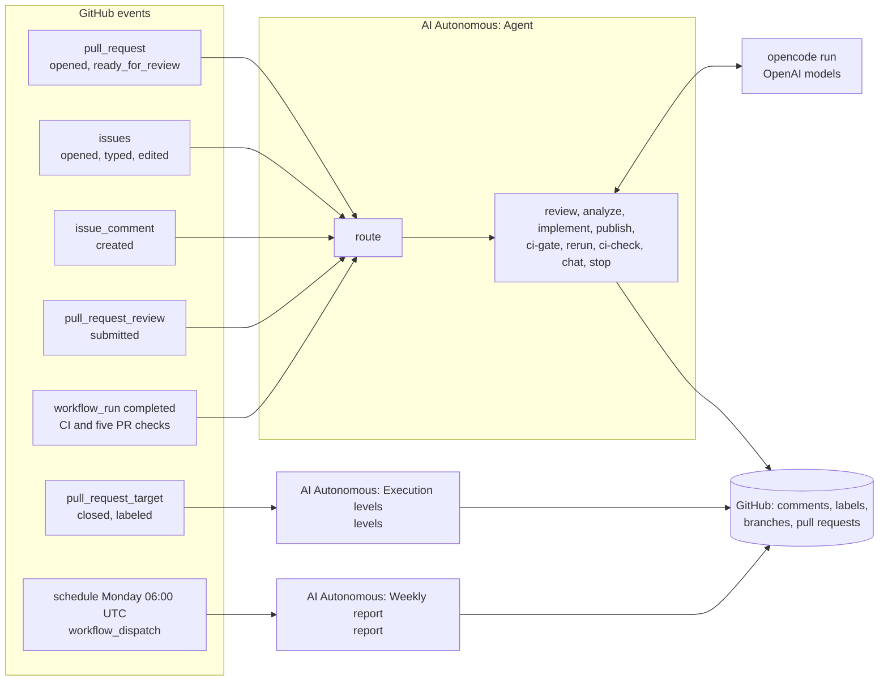

| Layer | Where | What it does |
|---|---|---|
| Workflows | `.github/workflows/ai-autonomous-*.yml` | Triggers, permissions, tokens, checkouts, one job per action |
| Scripts | `tools/agent/*.js` | One script per job: `route`, `review`, `analyze`, `implement`, `ci-gate`, `ci-check`, `chat`, `levels`, `report` |
| Library | `tools/agent/lib/` | GitHub client, state comment, opencode runner, contracts, cost records, logging |
| Roles | `tools/agent/opencode/agents/*.md` | What each model call may do: steps, permissions, output contract |
| Playbooks | `agent-packages/apihub-autonomous-agent/` | Skills that tell a role how to do its work in this repository |

The roles and the models that play them by default (the variables are in
[the technical details](./technical-details.md#openai-models)):

| Role | Flow | Model variable | Default | Edits files |
|---|---|---|---|---|
| `pr-reviewer` | A | `AGENT_MODEL_REVIEW` | `openai/gpt-6-luna:max` | no |
| `verifier` | A | `AGENT_MODEL_VERIFY` | `openai/gpt-6.1-sol:medium` | no |
| `analyst` | B, C | `AGENT_MODEL_LIGHT` | `openai/gpt-6-luna:medium` | no |
| `implementer` | C | `AGENT_MODEL_IMPLEMENT` | `openai/gpt-6.1-sol:high` | yes |
| `self-reviewer` | C | `AGENT_MODEL_REVIEW` | `openai/gpt-6-luna:max` | no |
| `assistant` | D | `AGENT_MODEL_LIGHT` | `openai/gpt-6-luna:medium` | no |
| `ci-triager` | D | `AGENT_MODEL_TRIAGE` | `openai/gpt-6.1-sol:medium` | no |

The rule behind the choice: a better model writes, a different and cheaper one reviews. `lib/config.js` refuses to
start when `AGENT_MODEL_IMPLEMENT` and `AGENT_MODEL_REVIEW` name the same model.

Two switches guard every run. `AGENT_ENABLED` must be `true`, or every script exits without acting. `AGENT_DRY_RUN`
must be exactly `false` for the agent to write to GitHub; otherwise each script writes what it would post to the job
summary. `AGENT_ALLOWED_ACTORS`, while set, limits the agent to the people it names.

## The jobs of the agent workflow

`ai-autonomous-agent.yml` has one entry job, `route`, and one job per action. `route` reads the event and the state,
decides, and passes the decision on as job outputs. Exactly one of the other jobs runs, except `implement` and
`publish`, which run as a pair, and `ci-gate`, which can hand over to that pair in the same run.

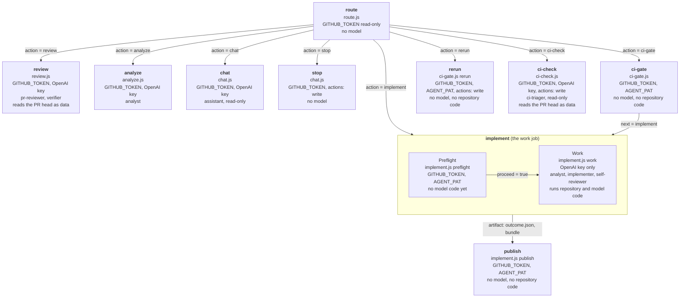

| Job | Runs when | Token and secrets | Model | Code it checks out | Concurrency group |
|---|---|---|---|---|---|
| `route` | every event that passes the `if` filter | `GITHUB_TOKEN` (read) | none | `tools/agent` of the default branch | none |
| `review` | `action == 'review'` | `GITHUB_TOKEN`, `OPENAI_API_KEY` | `pr-reviewer`, `verifier` | the pull request head as data; trusted tools and instructions in `.agent-tools/` | `ai-autonomous-<number>` |
| `analyze` | `action == 'analyze'` | `GITHUB_TOKEN`, `OPENAI_API_KEY` | `analyst` | the default branch | `ai-autonomous-<number>` |
| `ci-gate` | `action == 'ci-gate'` | `GITHUB_TOKEN`, `AGENT_PAT` | none | `tools/agent` | `ai-autonomous-<number>` |
| `implement` | `action == 'implement'` or `ci-gate` says `next == 'implement'` | preflight: `GITHUB_TOKEN`, `AGENT_PAT`; work: `OPENAI_API_KEY` only | `analyst`, `implementer`, `self-reviewer` | the default branch, then the agent's branch | `ai-autonomous-<number>` |
| `rerun` | `action == 'rerun'` | `GITHUB_TOKEN` (`actions: write`, `checks: read`, `statuses: read`), `AGENT_PAT` | none | `tools/agent` of the default branch | `ai-autonomous-<number>` |
| `ci-check` | `action == 'ci-check'` | `GITHUB_TOKEN` (`actions: write`, `checks: read`, `statuses: read`), `OPENAI_API_KEY` | `ci-triager` when CI is red | the default branch; a pull request head as a ref, never checked out | `ai-autonomous-ci-check-<number>` |
| `publish` | `implement` set `proceed == 'true'` | `GITHUB_TOKEN` (`actions: write`, `checks: read`, `statuses: read`), `AGENT_PAT` | none | `tools/agent` of the default branch | `ai-autonomous-<number>` |
| `stop` | `action == 'stop'` | `GITHUB_TOKEN` | none | `tools/agent` of the default branch | none, on purpose |
| `chat` | `action == 'chat'` | `GITHUB_TOKEN`, `OPENAI_API_KEY` | `assistant` for a question | the default branch; a pull request head as a ref, never checked out | `ai-autonomous-chat-<number>` |

Three rules hold for every job:

- **The tools are trusted code.** The scripts, the opencode config, the roles, the skills, the rules, and the
  `AGENTS.md` files always come from the default branch, or, for a `pull_request` event, from the pull request of this
  repository. A pull request from a fork never changes the tools that review it.
- **A step that runs repository code or model-written code has no GitHub token.** The work step of `implement` holds
  the OpenAI key only. The `review`, `analyze`, `chat`, and `ci-check` steps hold `GITHUB_TOKEN` and the OpenAI key
  together, but their roles cannot edit files or run anything but read-only commands, and `lib/opencode.js` starts
  opencode without `GITHUB_TOKEN`, `GH_TOKEN`, `AGENT_PAT`, and the `ACTIONS_*` variables. No checkout keeps a token
  (`persist-credentials: false`).
- **One job per number at a time.** The jobs that write the state comment of an issue or a pull request share the
  group `ai-autonomous-<number>`. `chat` and `ci-check` have their own groups and merge the cost records on write;
  `stop` has none, so a stop never waits behind another job.

## Where the state lives

Runners keep nothing. The agent keeps its memory where people already look.

| Store | Holds | Read by |
|---|---|---|
| The state comment | one comment by `github-actions[bot]` per issue and per pull request: a status for people and a hidden JSON block | every script |
| Labels | `ai:*` (suitability, execution level) and `agent:*` (outcome) | `route`, the scripts, people, the weekly report |
| The pull request marker | `<!-- ai-autonomous-agent issue=<N> -->` in the body of the agent's pull request | `route`, `chat`, `levels`, `report` |
| The branch | the commits of every attempt | `implement`, people |
| Artifacts | prompt inputs, opencode events, answers, `outcome.json`, the Git bundle | `publish` (the bundle and the outcome only), people for debugging |

`route` trusts a pull request as the agent's only when the marker and the state comment of the issue name each other.
The state comment counts only when `github-actions[bot]` wrote it. The schema is in
[the technical details](./technical-details.md#state-comment).

| Label | Set on | By | When |
|---|---|---|---|
| `ai:suitable`, `ai:unsuitable` | issue | `analyze`, `implement` (analysis) | after an analysis, unless a person set one of them |
| `agent:needs-human` | issue, pull request | `analyze`, `publish`, `ci-gate`; removed by `rerun`, `publish` (after an `unrelated` rerun), and `stop` | the agent waits for a person |
| `agent:completed` | issue, pull request | `ci-gate` | CI is green on the agent's pull request |
| `agent:pr-reviewed` | pull request | `review` | after a review is published |
| `ai:l1-executor` | pull request | `ci-gate` | CI is green on the agent's pull request |
| `ai:l0-assistant` ... `ai:l3-autonomous` | issue | `levels` | copied from the merged pull requests that close the issue |

## The phase of an issue

The field `phase` of the issue state says what the agent does with the issue. A pull request state has no phase of its
own: the agent's pull request follows the phase of its issue.

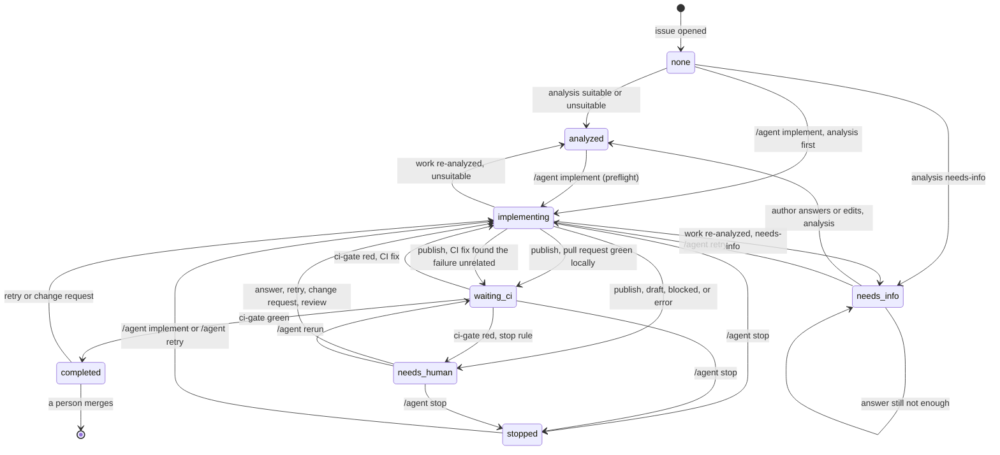

The diagram writes `needs-info`, `waiting-ci`, and `needs-human` with underscores, because Mermaid state names take no
hyphens. The values in the state are:

| `phase` | Meaning | Written by |
|---|---|---|
| `null` | no analysis or attempt yet | `lib/state.js` (`emptyIssueState`) |
| `analyzed` | the analysis said `suitable` or `unsuitable` | `analyze.js`, `implement.js publish` |
| `needs-info` | the analysis asked the author questions | `analyze.js`, `implement.js publish` |
| `implementing` | an attempt runs; `implementing` names its run, actor, and kind | `implement.js preflight`, `ci-gate.js` |
| `waiting-ci` | the attempt pushed a commit whose local checks and self-review passed, a CI fix reran the checks as `unrelated`, or `/agent rerun` ran; CI decides | `implement.js publish`, `ci-gate.js rerun` |
| `needs-human` | the agent handed over: draft, block, error, or the stop rule | `implement.js publish`, `ci-gate.js` |
| `completed` | CI is green; a person reviews and merges | `ci-gate.js` |
| `stopped` | a person stopped the work | `chat.js` (the `stop` job) |

Three details matter when you read a state:

- An attempt counts as running only for 120 minutes after `implementing.at` (`BUSY_MS` in `implement.js`). A state
  left in `implementing` by a lost run does not block the next command forever.
- `/agent analyze` writes `analyzed` or `needs-info` from any phase. See
  [Known gaps and risks](./handover.md#known-gaps-and-risks).
- `stopped` is written by the `stop` job while the attempt may still run. The `publish` job of that run sees
  `phase == 'stopped'` with its own run in `implementing.run`, records the cost and a `stopped` attempt, and writes
  nothing else.

## Flow A: review

**Trigger.** A pull request opens outside draft, or leaves draft for the first time (`route` reads the pull request
state and skips one that has a review). Then on demand, with `/agent review [notes]` from a person with write access,
also on a pull request from a fork. Dependabot pull requests are never reviewed: the workflow `if` drops their events,
and `route` refuses `/agent review` on them.

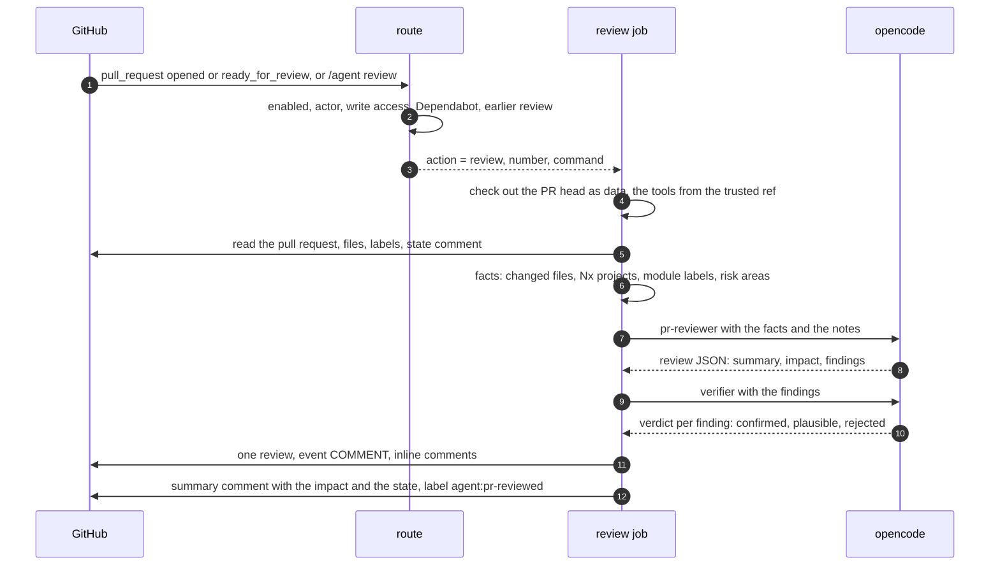

**Decisions.** A rejected finding is dropped. A `plausible` one is kept and marked "plausible, not confirmed". A
finding without a line goes to the summary comment. When a model call fails, the summary comment says so and the
person comments `/agent review` again.

**State.** The pull request state gets a record in `reviews` and the cost records. **Labels:** `agent:pr-reviewed`.
**A person** reads the review; the agent never approves or requests changes.

## Flow B: analysis

**Trigger.** A `Bug` or `Task` issue is opened or gets its type (`issues` `opened`, `typed`), unless a person already
set `ai:suitable` or `ai:unsuitable`. Again when the issue waits for information (`phase == 'needs-info'`) and its
author comments or edits it, at most `AGENT_MAX_ANALYSES` times (default 5). Any time on `/agent analyze`, which the
limit does not count.

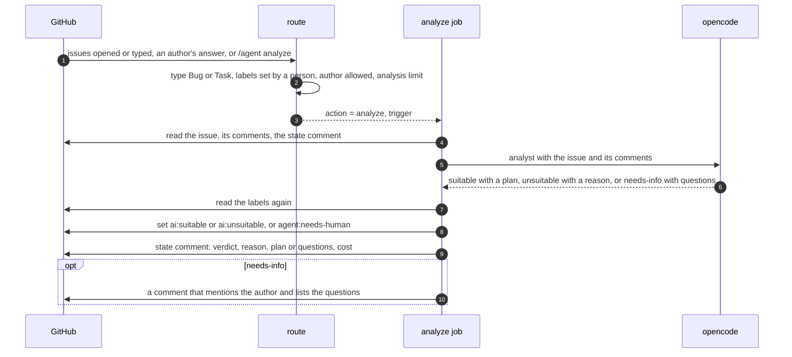

**Decisions.** The labels are read again after the model call, so a label that a person set during the run wins. The
agent changes only an `ai:*` label it set itself (`analysis.labelSetBy == 'agent'`). A failed call records the cost
and a `failed` entry in `analyses` and keeps the earlier verdict.

**State.** `phase` becomes `analyzed` or `needs-info`; `analysis` holds the verdict, the reason, the plan or the
questions, and `issueUpdatedAt`; `analyses` grows by one. **A person** decides: the analysis never starts an
implementation.

## Flow C: implementation

**Trigger.** `/agent implement [force] [notes]` or `/agent fix` on an issue. Also the steering commands of
[Flow D](#flow-d-commands) that start an attempt (`kind` `human` or `review`), and the CI gate (`kind` `ci-fix`).

One attempt runs in two jobs. The work job runs code the model wrote, so it holds no GitHub token; the publish job
holds the tokens and runs no model and no repository code.

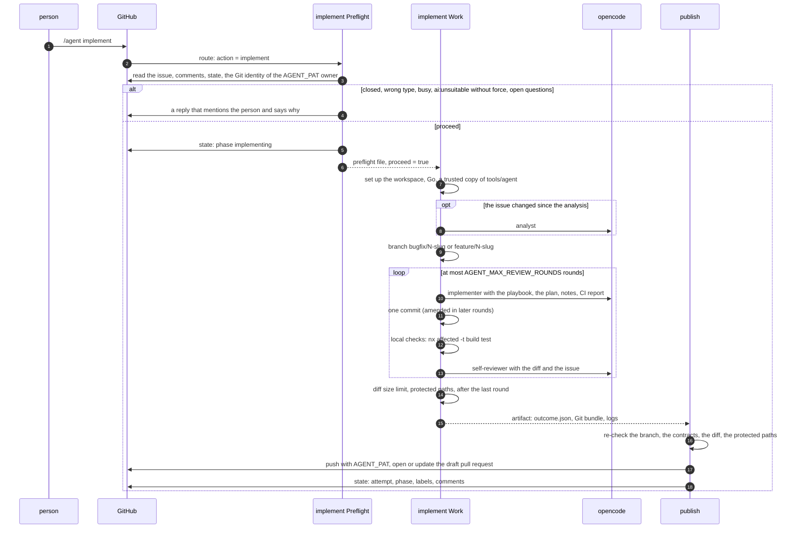

**Decisions.**

| Condition | Outcome |
|---|---|
| The issue is closed, or not a `Bug` or `Task` | refused in the preflight |
| An attempt runs (less than 120 minutes old) | refused in the preflight |
| `ai:unsuitable` without `force` | refused; `force` starts it and records `forced: true` |
| The analysis has open questions | refused, unless a person steers (`kind` `human` or `review`) |
| The issue changed since the analysis | the work step runs the analyst first; `needs-info` or `unsuitable` stops the run |
| The implementer reports that it cannot continue, or no change | `blocked`, nothing pushed |
| The diff of the whole pull request is above the limit (`Bug` 20 files or 600 lines, `Task` 30 or 1,000), measured after the last round and again in `publish` | `blocked`, nothing pushed |
| The diff touches a protected path (`.github/workflows/`, `.claude/`, `.cursor/`, `tools/agent/`, `agent-packages/`, any `AGENTS.md` or `CLAUDE.md`) | `blocked`, nothing pushed |
| Local checks and self-review pass | pull request as a draft, `phase` `waiting-ci` |
| Anything else after a push | draft pull request, `agent:needs-human`, `phase` `needs-human` |
| The work job left no outcome | `publish` records the failure and the costs it finds, `agent:needs-human` |

**State.** `implementing` while it runs; then `branch`, `pr`, `playbook`, `forced`, and one record in `attempts`.
**Labels:** `ai:suitable` or `ai:unsuitable` when the work step re-analyzed; `agent:needs-human` when the result is not
green. **A person** reads the draft; only the CI gate marks it ready, and only a person merges it.

## Flow C: the CI loop

**Trigger.** `workflow_run` `completed` of `CI`, `Lint: Code base`, `PR: Title`, `PR: Commit messages`,
`Lint: Markdown links`, or `PR: CLA`. `route` acts only when the head branch belongs to an open pull request of the
agent from this repository, the head commit is the one the run finished for, and the issue is in `waiting-ci`.

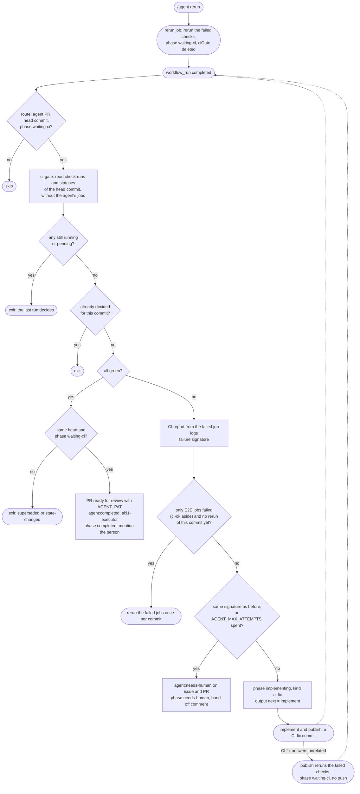

**Decisions.** The gate decides once per commit and writes `ciGate` with the commit. Right before it writes, it reads
the pull request and the state again: a newer head means `superseded`, another phase means `state-changed`, and the
gate writes nothing. The budget counts the attempts of kind `initial` and `ci-fix` from the index `budgetFrom`, which
a person's attempt moves to the end of the list.

**The free rerun.** The verdict check `ci-ok` fails together with E2E, so the gate ignores it when it asks whether only
E2E jobs failed. The budget is one rerun per head commit (`e2eRerun: { sha, count }`).

**Hand-offs.** The stop rule and a blocked CI fix write the failed checks (at most five), the first error line, the
reason, and two ways on: `/agent rerun` for a failure the change does not cause, and `/agent retry` with guidance.

**State.** The last attempt gets `result` `ci-green` or `ci-red` and the `signature`; `lastCiReport`, `ciGate`, and
`e2eRerun` are written. **A person** reviews the green pull request, or answers the hand-off.

## Flow D: commands

A command is a comment whose first non-empty line starts with `/agent`. `route` parses it with `lib/commands.js`,
checks the person, and picks the job.

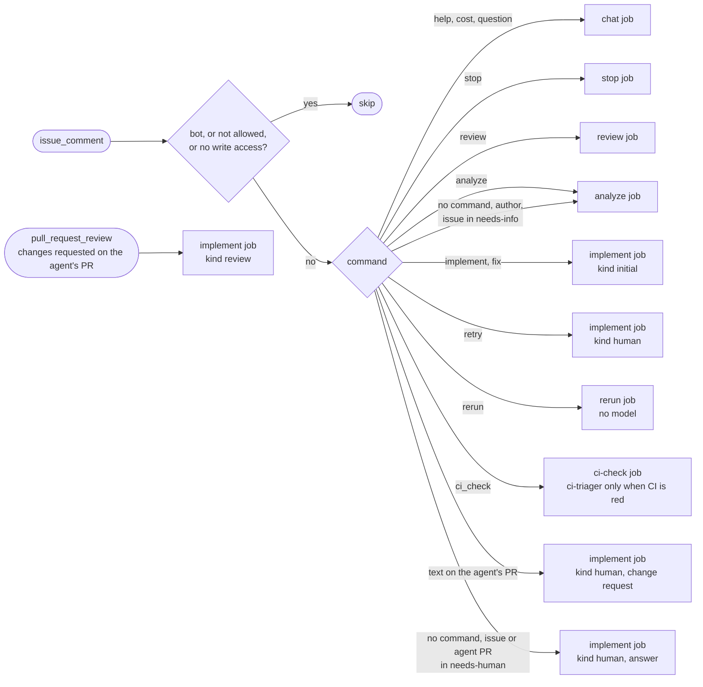

| Command | Job | Model | Writes |
|---|---|---|---|
| `/agent`, `/agent help` | `chat` | none | a reply with the commands that work there |
| `/agent cost` | `chat` | none | a reply with the cost table |
| `/agent <question>` | `chat` | `assistant` | a reply; the cost record in the state |
| `/agent stop` | `stop` | none | `phase` `stopped`, the cancelled run, no `agent:needs-human`, a reply |
| `/agent retry [notes]` | `implement` | the Flow C roles | a new attempt with a fresh CI budget |
| `/agent rerun [notes]` | `rerun` | none | `phase` `waiting-ci`, `ciGate` deleted, an entry in `reruns`, no `agent:needs-human`; the failed checks run again; no attempt |
| `/agent ci_check [notes]` | `ci-check` | `ci-triager`, only when CI is red | a reply with the verdict, the cause, and the places to fix; the cost record and a `ciChecks` entry on the pull request; a rerun of the failed jobs for a flaky or infrastructure failure, and, on the agent's pull request in `needs-human` or `waiting-ci`, the same state change as `/agent rerun` |
| `/agent <text>` on the agent's pull request | `implement` | the Flow C roles | one attempt on its branch |
| a review with change requests | `implement` | the Flow C roles | one attempt; a reply in each thread the implementer saw |
| `/agent review [notes]` | `review` | Flow A | a review |
| `/agent analyze` | `analyze` | `analyst` | an analysis |
| `/agent implement [force] [notes]`, `/agent fix` | `implement` | the Flow C roles | an attempt |

The `implement`, `rerun`, `ci-check`, `chat`, and `stop` jobs react to the comment with an eyes emoji when they start,
then with a rocket or a confused face; `review` and `analyze` add no reaction. The replies mention the person who
asked and defuse every other mention.

### The CI check

`/agent ci_check` works on any pull request of the repository, also one from a fork, and finds the root cause of a red
CI. The `ci-check` job reads the checks of the head commit and calls the `ci-triager` only when CI is red.

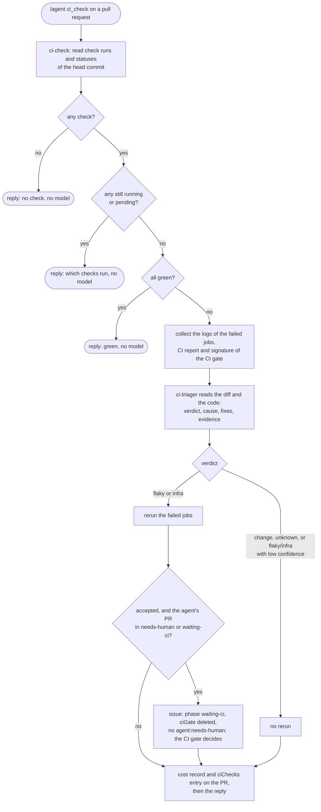

The job fetches the head of the pull request under `refs/remotes/pull/<number>/head` and never checks it out. The CI
report is the output of the code under test, so it reaches the model inside an `<untrusted>` block. The rerun comes
before every write, as in `/agent rerun`: when GitHub rejects it, nothing else changes. The cost of the call is written
to the state of the pull request also when the call or its contract fails; the issue state is read again right before
the hand-back to the CI gate, so a `/agent stop` or a new attempt in the meantime wins.

## Execution levels

`AI Autonomous: Execution levels` copies the level of a merged pull request to the issues it closes. It uses no model.

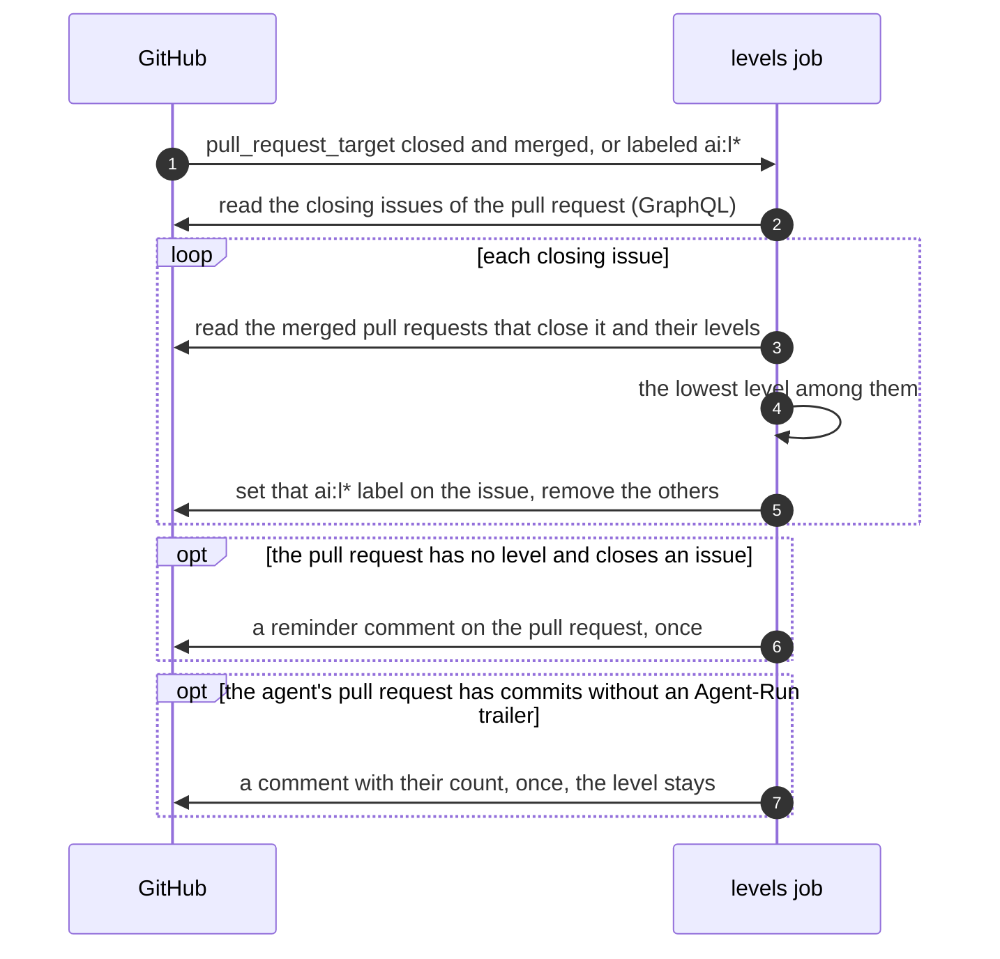

`pull_request_target` gives a write token also for a pull request from a fork; the job checks out the base branch and
runs no code of the pull request. **A person** sets the level on the pull request; the `labeled` event copies it.

## Weekly report

`AI Autonomous: Weekly report` runs on Mondays at 06:00 UTC and on demand with a `days` input. It uses no model.

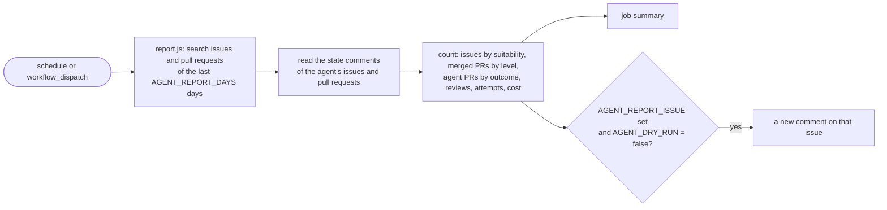

## Where a person steps in

| Moment | What the person does | What the agent does next |
|---|---|---|
| A review is posted | reads it, fixes the pull request, or asks `/agent review` again | nothing until asked |
| The analysis asks questions | answers in a comment or edits the issue | analyzes again |
| An issue is `ai:suitable` | decides with `/agent implement` | one attempt |
| An issue is `ai:unsuitable` | sets another label, or comments `/agent implement force` | one forced attempt |
| A draft or a block (`agent:needs-human`) | answers in a comment, `/agent retry`, or takes over | one attempt with the comment as guidance |
| The stop rule hands over | the same, or `/agent rerun` when the failure is not the change | one attempt with a fresh CI budget, or the failed checks run again |
| CI is green (`agent:completed`) | reviews, asks changes in a review or with `/agent <text>`, merges | one attempt per review or comment |
| CI is red and the cause is unclear | `/agent ci_check` | the triager names the root cause; a flaky or infrastructure failure is rerun |
| Anything | `/agent stop` | stops at once |
| A pull request is merged | checks or sets the `ai:l*` level | copies it to the issues |
