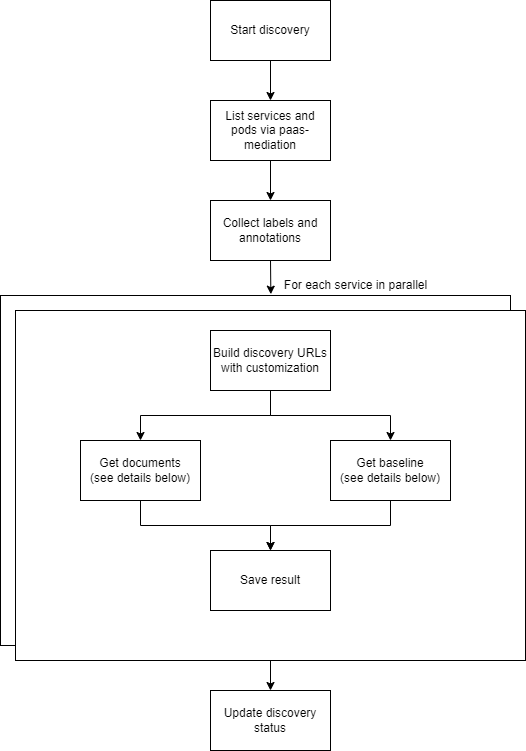
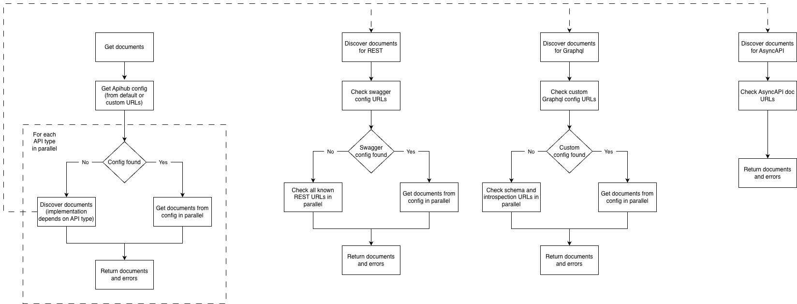
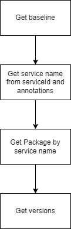

# Make a service discoverable by the APIHUB agent

The APIHUB agent finds the API specifications of your services in a Kubernetes cluster and publishes them to APIHUB.
This page describes the endpoints a service must expose, so that the agent discovers its specifications, and how
to change the default URLs.

## How the agent discovers specifications

The agent is a Kubernetes microservice that requires the Cluster View role. The role lets the agent query REST
endpoints of any service in any namespace. To limit the agent to a particular namespace, give it a custom role for
that namespace.

Someone starts the discovery through the agent API for one namespace. The agent then:

1. Retrieves the list of all services in the namespace from the Kubernetes API.
2. Queries several REST endpoints of each service, in parallel.
3. Downloads the API specification files it finds.



## Contract endpoints for discovery

All discovery URLs are configurable in `config.yaml`. The values below are the built-in defaults.

### APIHUB config

The agent first checks whether the service exposes an APIHUB config. If it finds none, it runs discovery for each
supported API type.

Default APIHUB config URL:

- `/v3/api-docs/apihub-swagger-config`

The [APIHUB config format](#apihub-config-format) is described below.

### OpenAPI

The agent looks for Swagger configuration files first. A service that provides several OpenAPI files usually has one.

Default OpenAPI config URLs:

- `/v3/api-docs/swagger-config`
- `/swagger-resources`

If the agent finds no config files, it checks the default document URLs for OpenAPI files directly:

- `/q/openapi`
- `/v3/api-docs`
- `/v2/api-docs`
- `/swagger-ui/swagger.json`

### GraphQL and AsyncAPI

GraphQL and AsyncAPI have no built-in default URLs. Configure them, or declare these API types in the APIHUB config.

### Discovery algorithm



Notes:

- If a service exposes both configuration files and default document URLs, the agent discovers only the contents of
  the configuration files.
- The agent requests the configured paths as they are. The base path of the URLs above must have no prefix:
  - Correct: `https://<service name>.<namespace>:8080/v3/api-docs`
  - Incorrect: `https://<service name>.<namespace>:8080/<service prefix>/v3/api-docs`
- The endpoints must be available without authentication.

## APIHUB config format

Use the APIHUB config to expose files that are not in a supported specification format, or to declare several
specifications of different types. The format follows the Swagger config, with one added field, `type`.

The config has two keys:

- `configUrl`: the URL of the config itself.
- `urls`: an array of `url` objects.

A `url` object has these fields:

- `url`: the relative path to the file. The agent requests the file by this path.
- `name`: a human-readable file name (a short summary).
- `type`: one of the supported types.

Supported types:

- `openapi-3-1`: OpenAPI 3.1 specification
- `openapi-3-0`: OpenAPI 3.0 specification
- `openapi-2-0`: OpenAPI 2.0 (Swagger) specification
- `asyncapi-3-0`: AsyncAPI 3.0 specification
- `graphql`: GraphQL
- `introspection`: GraphQL introspection result
- `json-schema`: JSON Schema
- `markdown`: Markdown document
- `unknown`: any other file

To enable it:

1. Add an endpoint to the service at `/v3/api-docs/apihub-swagger-config`, or at a custom path.
2. Make the endpoint return JSON in the format above.
3. Run discovery in the APIHUB agent and check that all required files are exposed.

Example response:

```json
{
    "configUrl": "/v3/api-docs/apihub-swagger-config",
    "urls": [
        {
            "url":"/v3/api-docs",
            "name":"Openapi specification",
            "type":"openapi-3-0"
        },
        {
            "url":"/v3/api-docs/admin",
            "name":"Openapi specification for admin operations",
            "x-api-kind":"no-BWC",
            "type":"openapi-3-0"
        },
        {
            "url":"/v3/api-docs/asyncapi",
            "name":"AsyncAPI specification",
            "type":"asyncapi-3-0"
        },
        {
            "url":"/v3/api-docs/doc1md",
            "name":"Service documentation",
            "x-api-kind":"no-BWC",
            "type": "markdown"
        },
        {
            "url":"/v3/api-docs/doc2md",
            "name":"Service documentation 2",
            "x-api-kind":"no-BWC",
            "type": "markdown"
        }
    ]
}
```

## Configure the discovery URLs

Set the discovery URLs in the agent's `config.yaml`. The agent's
[`config.template.yaml`](../../backend/agent/config.template.yaml) lists every option.

The structure for discovery URLs:

```yaml
discovery:
  urls:
    openapi:
      config-urls:
        - /v3/api-docs/swagger-config
      doc-urls:
        - /v3/api-docs
    graphql:
      config-urls:
        - /api/graphql-server/schema/domains
      doc-urls:
        - /api/graphql-server/schema
    apihub-config:
      config-urls:
        - /v3/api-docs/apihub-swagger-config
    asyncapi:
      doc-urls:
        - /v3/api-docs/asyncapi
```

## Find the baseline version

To find the baseline for a discovered service, the agent takes the service name from the service ID and annotations,
looks up the package by that name, and then gets the package versions.


