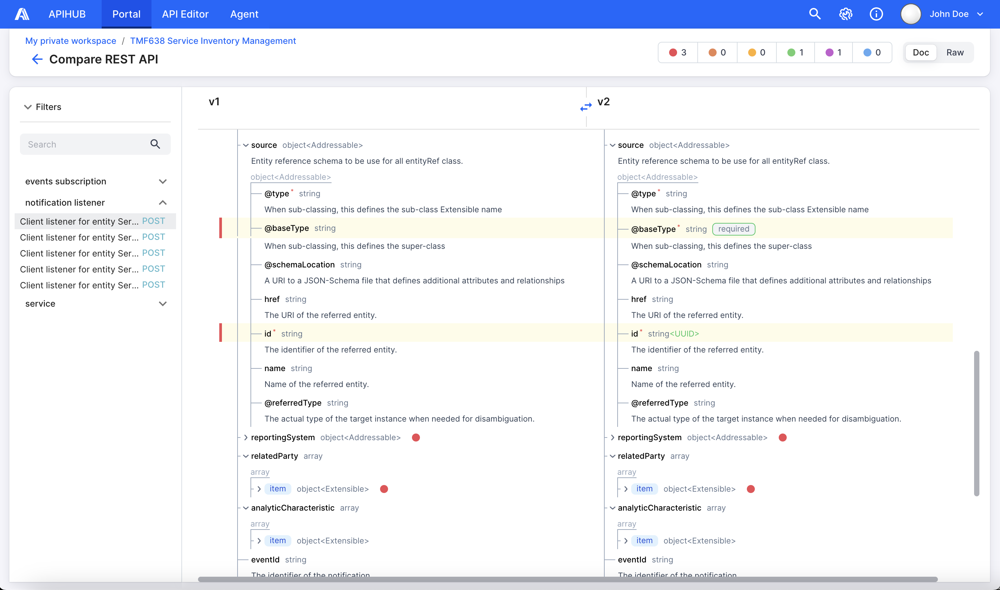

# APIHUB UI

<picture>
  <source media="(prefers-color-scheme: dark)" srcset="./docs/img/dark_mode_icon.svg">
  
</picture>

The UI is the web front end of APIHUB: two React single-page applications, the **Portal** and the **Agents** app, and
the components they share. The module ships the image `qubership-apihub-ui`, which serves both applications behind
nginx and proxies `/api` to the backend.

- **Portal** is the central repository for API specifications. You upload specifications, Markdown files, and other
  artifacts; view them in a readable form; compare versions; check backward compatibility; and track deprecated
  entities. The Portal works with the API types the product supports: OpenAPI (Swagger 2.0, 3.0, and 3.1), GraphQL
  schemas and introspections, AsyncAPI, JSON Schema, DDLAPI database contracts, and Markdown. The exact versions are
  those of the [processing libraries](../../docs/architecture/processing-libraries.md).
- **Agents** is the web interface of the runtime agent that runs in Kubernetes. It discovers the API documentation
  endpoints of the cluster's services, makes snapshots of the discovered specifications, validates changes, and
  promotes specifications to the Portal.



The UI is the entry point of the product and talks to the backend and the extension services; see the
[architecture overview](../../docs/architecture/overview.md).

## Build, test, and lint

The workspace has these Nx projects: `ui-portal`, `ui-agents`, `ui-shared` (shared components and Storybook), and
`ui-root`. Run from the repository root:

```bash
pnpm exec nx run ui-portal:build
pnpm exec nx run ui-agents:build
pnpm exec nx run ui-shared:test
pnpm exec nx run ui-portal:test:server
pnpm exec nx run ui-portal:lint:check
```

`ui-shared` has no `build` target. The Portal build runs `tsc` and `vite build` with a large heap, and Nx builds the
libraries it uses first, so a cold build takes a while. Install once at the repository root with `pnpm install`; never
run `npm install` here. See [Getting started](../../docs/development/getting-started.md) and
[Build and test](../../docs/development/build-and-test.md).

## Run and debug locally

The default setup is proxy mode: Vite serves the Portal from your sources with hot reload and forwards `/api` to a
running APIHUB.

```bash
pnpm exec nx build ui-portal
cd frontend/ui/packages/portal
pnpm dev:proxy
```

Set `proxyServer` in `packages/portal/vite.config.ts` first. The steps, the Agents app, the MSW mocks, and the
deprecated Express mock server are in
[Run APIHUB locally: UI proxy mode](../../docs/development/local-run.md#ui-proxy-mode),
[`docs/dev/local-development.md`](docs/dev/local-development.md), [`docs/dev/msw-mocks.md`](docs/dev/msw-mocks.md), and
[Debugging: UI against a backend](../../docs/development/debugging.md#ui-against-a-backend). The Storybook of the shared
components starts with `pnpm exec nx run ui-shared:storybook`.

## Configuration

The image reads environment variables, not a config file. nginx proxies to `APIHUB_BACKEND_ADDRESS`,
`APIHUB_NC_SERVICE_ADDRESS`, `API_LINTER_SERVICE_ADDRESS`, and `APIHUB_AGENTS_BACKEND_ADDRESS`, and uses
`DNS_RESOLVERS`; [`nginx/nginx.conf.template`](nginx/nginx.conf.template) is the template. The
[configuration reference](../../docs/configuration-reference.md) describes the values per deployment. The proxy targets
of the dev servers are constants in `vite.config.ts`.

## Further reading

- [Developer guides](docs/dev/index.md): coding guidelines, local development, the mock server, and the AI assistant
  streaming notes
- [Portal user guide](../../docs/user-guide/portal.md) and [Agent user guide](../../docs/user-guide/agent.md)
- [Contributing](../../CONTRIBUTING.md)
