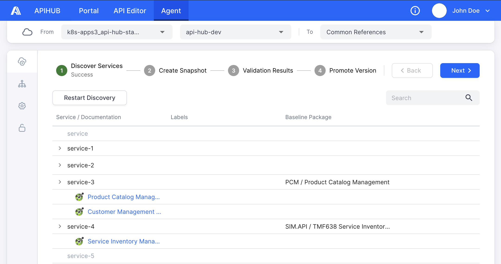

# APIHUB UI

<picture>
  <source media="(prefers-color-scheme: dark)" srcset="./docs/img/dark_mode_icon.svg">
  
</picture>

APIHUB is a comprehensive solution designed to achieve the following goals:

- Increase quality and completeness of API documentation.
- Provide a single point of truth for API documentation.
- Enable an API design-first approach.
- Automate API backward compatibility validation and integrate with CI process.

APIHUB consists of two main components:

- Portal
- Agent

**Portal** is centralized repository for storing and managing API specification. Portal allows you to:

- Upload API specifications, Markdown files and any other artifacts related to API.
- View API specifications and Markdown files in human-readable format.
- Compare API.
- Check backward compatibility of API.
- Track deprecated entities from API specifications.

Currently, Portal allows working with OpenAPI specification with versions 2.0 and 3.0, and GraphQL specifications and introspections of release October 2021.

For more information about Portal, please see the [user guide](../../docs/user-guide/portal.md).

**Agent** is web-based interface to work with a runtime agent. Runtime agent is an application that runs within the Kubernetes environment. It allows you to discover exposed API documentation endpoints from services running on Kubernetes. Additionally, Agent provides the ability to make snapshots of discovered API specifications, validate API changes and promote API to Portal.

For more information about Agent, please see the [user guide](../../docs/user-guide/agent.md).

## Documentation

- **Developers:** [Developer guides](./docs/dev/index.md)
- **Portal users:** [Portal User Guide](../../docs/user-guide/portal.md)
- **Agent users:** [Agent User Guide](../../docs/user-guide/agent.md)

[Contributing](../../CONTRIBUTING.md)
