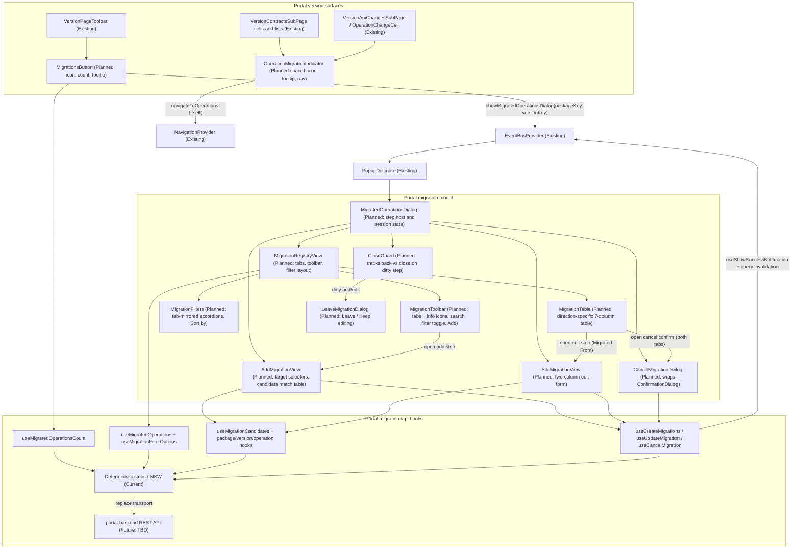

# Operations Migrations Tracking

| | |
| --- | --- |
| **Design Item ID** | [APIHUB-13621](https://tms.netcracker.com/browse/APIHUB-13621) |
| **Design Item Name** | Operations Migrations Tracking |
| **Related Design Items** | TBD |
| **Related API** | TBD. Query and mutation hooks use client-side deterministic stubs or MSW handlers until backend contracts are defined. |
| **Revision History** | 18.11.2026: Initial version. 19.11.2026: Applied review decisions, clarified the read-only main dialog, and added the component diagram. 27.11.2026: Merged business design (`APIHUB-13621`), mapped entities and Portal UI surfaces across the registry, Add/Edit/Cancel flows, and API Contracts/API Changes marks, resolved answered questions, and added open questions. |

---

## Summary

Add manual operations migrations tracking to Portal so package teams can record when an operation removed or deprecated
in a package version moved to another package, optionally map the target operation, and explain why. Surface each
migration in three places: a package-wide `Migrated Operations` registry dialog opened from the `Migrations` button in
`VersionPageToolbar` (with `Migrated From` and `Migrated To` tabs, search, filters, sorting, bulk `Add Migration`,
`Edit Migration`, and `Cancel Migration`), inline migration marks next to operations in `API Contracts`, and inline
migration marks next to changed operations in `API Changes`. APIHUB stores and displays user-authored records without
auto-detecting moves or altering comparison severity, so a removed operation remains breaking.

## Assumptions

- Migrations are registered manually; APIHUB never infers or performs a move automatically.
- Registering a migration does not alter change severity: a removed operation remains breaking in comparisons.
- One source operation corresponds to at most one migration record (`1:1` per source operation). Bulk registration in
  `Add Migration` can submit multiple source operations at once, creating an independent record with its own optional
  target operation and mandatory comment for each selected row.
- A migration cannot split one source operation across two target operations, whereas multiple source operations may
  point to the same target operation (`N:1`).
- Each record is stored on the `sourceVersion` of the source package in which the operation was removed or deprecated.
- Inline migration marks appear only on the exact package version associated with the migration side (`sourceVersion` or
  `targetVersion`), whereas the `Migrated Operations` dialog is a package-wide registry covering all versions of the
  current package.
- `Target Package`, `Target Version`, and `Comment` are mandatory on every record. `Target Endpoint` is optional so a
  record can still direct consumers to the target package and version when a business-process change leaves no direct
  endpoint equivalent.
- `Target Version` may be any `release` or `draft` version of the target package, including versions published with
  errors via tolerant publication.
- Migrations are registered and viewed within a single workspace. Permissions reuse workspace/package roles without a
  separate migration permission model; concrete `PackagePermission` gates are tracked in OQ-1.
- `MigrationsButton` renders in `VersionPageToolbar` immediately before `Copy` for packages (`PACKAGE_KIND`), excluded
  on dashboards (`DASHBOARD_KIND`). Subpage visibility scope is tracked in OQ-1.
- `MigratedOperationsDialog` hosts three internal views (`registry`, `add`, `edit`) inside a wide modal container. The
  `registry` view is read-only: tabs, search, filters, sorting, and filter-panel visibility never mark state dirty.
- Only `AddMigrationView` and `EditMigrationView` own editable form state and can trigger `LeaveMigrationDialog`. The
  header back arrow returns to `registry`, whereas the top-right close button (`×`) closes `MigratedOperationsDialog`
  completely and returns the user to the underlying Portal tab.
- When `MigratedOperationsDialog` opens, `Migrated From` is active, `Filter by This Package Version` is pre-selected to
  the current route `versionId`, other filters start at `All`, the filter sidebar is hidden with all accordions
  expanded, and `Sort by` defaults to `Newest first`. Custom search and filter selections persist across tab switches
  while the dialog stays open and reset when the dialog closes (directional filter mapping in OQ-5).
- Date-range filtering reuses `react-multi-date-picker` in range mode with a MUI `TextField` and `CalendarIcon`.
- Search and filter changes update controls immediately and recalculate queries after `DEFAULT_DEBOUNCE` (500ms).
- `Last Modified` timestamps render in UTC `MMM DD, YYYY` format with a two-digit day via a dedicated `dayjs.utc`
  formatter instead of `FormattedDate` (which converts to local time).
- Backend persistence and REST contracts remain `TBD`. Query and mutation hooks encapsulate deterministic client-side
  stubs (or MSW handlers) so replacing `queryFn`/`mutationFn` with `portalRequestJson` leaves UI components unchanged.
- Figma links were copied semantically from the business design without opening external frames; exact dialog dimensions
  and visual details not stated in prose remain in Open Questions.

## Domain Concepts

| Business Concept | UI / TypeScript Mapping | Description |
| --- | --- | --- |
| Migration | `OperationMigration` (`OperationMigrationDto`) | User-created record stating that one removed or deprecated operation of a source package version moved to a target package version, with an optional target operation and mandatory comment. |
| Source version | `sourcePackage.versionKey` (`VersionKey`) | Version of the source package where the operation was removed or deprecated and on which the migration record is stored. |
| Source endpoint | `sourceOperation` (`OperationData`) | Mandatory operation that moved away; carries title, API type, method/action/type, path/channel, and `deprecated` flag. |
| Target package | `targetPackage.packageKey` (`PackageKey`) | Mandatory package within the same workspace to which the capability moved. |
| Target version | `targetPackage.versionKey` (`VersionKey`) | Mandatory `release` or `draft` version of the target package selected when the record is saved; does not auto-advance when newer target versions are published. |
| Target endpoint | `targetOperation` (`OperationData \| undefined`) | Optional counterpart operation in `targetVersion`. Empty when no direct operation equivalent exists. |
| Comment | `comment` (`string`) | Mandatory migration reason stored per record; truncated with ellipsis in table cells and shown in full on hover. |
| Outgoing migration (`Migrated From` tab) | `MigrationDirection = 'from'` (`MIGRATED_FROM_TAB`) | Record created in the current package. Shown on `Migrated From`, where both `Edit migration` and `Cancel migration` are available. |
| Incoming migration (`Migrated To` tab) | `MigrationDirection = 'to'` (`MIGRATED_TO_TAB`) | Record created in another package that targets the current package. Shown on `Migrated To`, where `Cancel migration` is available and `Edit migration` is omitted. |
| Migrations counter | `useMigratedOperationsCount` (`number`) | Total migration records (`Migrated From` plus `Migrated To`) associated with the currently selected package version in `VersionPageToolbar`. |
| Inline migration mark | `OperationMigrationSummary` / `OperationMigrationIndicator` | Migration icon rendered after the operation title (and after `DeprecatedBadge` when present) in `API Contracts` and `API Changes`, with a rich tooltip and `_self` click navigation to `API Contracts`. |
| `All` / `Yes` / `No` deprecated filter | `DeprecatedFilterValue = 'all' \| 'yes' \| 'no'` | `General Filters` select option in `MigrationFilters`; defaults to `'all'`. Target operation column scope is tracked in OQ-8. |
| `Newest first` / `Oldest first` | `MigrationSortOrder = 'desc' \| 'asc'` | Sorts registry rows by `lastModifiedAt` descending (default) or ascending. |
| Dirty migration view | `isDirty` in `AddMigrationView` or `EditMigrationView` | Unsaved edits in the active add or edit step that arm `LeaveMigrationDialog` on back-arrow or close-button dismissal. |

### Migration Matching Status (`Status Migration`)

Evaluated per candidate source operation in `AddMigrationView` once both `Target Package` and `Target Version` are
selected:

| Business Value | UI Enum (`MigrationMatchStatus`) | Description |
| --- | --- | --- |
| `Matched Automatically` | `'matched-automatically'` | An operation with the same API type, path, and method exists in `targetVersion` and is pre-filled into `Target Endpoints`. |
| `Mapped Manually` | `'mapped-manually'` | The user manually selected a target operation from `targetVersion` in the `Target Endpoints` cell. |
| `No Matching Operation` | `'no-matching-operation'` | No operation with the same API type, path, and method exists in `targetVersion`; `Target Endpoints` shows the `Select endpoint` placeholder and the row remains valid to save without a target operation. |

## Component Design

Status: **planned**; existing host mechanisms and new Portal/shared components are distinguished in node labels.

### Component locations and responsibilities

| Component | Status and host location | Responsibility |
| --- | --- | --- |
| `VersionPageToolbar` | Existing: `frontend/ui/packages/portal/src/routes/root/PortalPage/VersionPage/VersionPageToolbar.tsx` | Hosts `MigrationsButton` immediately before `CopyPackageVersionButton` for `PACKAGE_KIND` versions. |
| `MigrationsButton` | Planned: `VersionPage/MigrationsButton.tsx` | Renders `MigrationIcon`, combined version count, `"Migrated Operations"` tooltip, and dispatches `showMigratedOperationsDialog`. |
| `MigrationIcon` and `CancelMigrationIcon` | Planned: `frontend/ui/packages/shared/src/icons/` | Render the migration indicator and cancel-migration SVG assets; reuse existing `EditIcon`, `InfoContextIcon`, `FilterIcon`, `CloseIcon`, and `ArrowBackIcon`. |
| `OperationMigrationIndicator` | Planned: `frontend/ui/packages/shared/src/components/Operations/OperationMigrationIndicator.tsx` | Shared icon button placed next to `DeprecatedBadge` in `OperationTitleWithMeta` (for `API Contracts`) and `OperationChangeCell` (for `API Changes`), rendering the 3-line tooltip and `_self` link to `API Contracts`. |
| `OperationMigrationDto` and shared summary types | Planned: `frontend/ui/packages/shared/src/entities/operation-migrations.ts` and `packages/portal/src/entities/operation-migrations.ts` | Define wire `Dto` types, UI `OperationMigration`, `MigrationMatchStatus`, and `OperationMigrationSummary` used by shared cells and Portal views. |
| `EventBusProvider` and `PopupDelegate` | Existing: `packages/portal/src/routes/EventBusProvider.tsx`, `packages/shared/src/components/PopupDelegate.tsx` | Transport `showMigratedOperationsDialog({ packageKey, versionKey })` and mount `MigratedOperationsDialog` only while open. |
| `MigratedOperationsDialog` | Planned: `VersionPage/MigratedOperationsDialog/MigratedOperationsDialog.tsx` | Owns modal step state (`registry`, `add`, `edit`), session-scoped tab/filter state, and `CloseGuard` routing between `back` and `close`. |
| `MigrationToolbar` | Planned: `VersionPage/MigratedOperationsDialog/MigrationToolbar.tsx` | Renders `Migrated From` and `Migrated To` tabs with `InfoContextIcon` tooltips, `SearchBar`, `FilterButton`, and `Add Migration`. |
| `MigrationFilters` | Planned: `VersionPage/MigratedOperationsDialog/MigrationFilters.tsx` | Renders tab-mirrored accordions (`Migrated From`, `Migrated To`, `General Filters`) and `Sort by` radio group with `All`-prefixed record options and 500ms debounced updates. |
| `MigrationTable` | Planned: `VersionPage/MigratedOperationsDialog/MigrationTable.tsx` | Renders direction-specific seven-column TanStack Table (`Endpoints`, package/version columns, counterpart endpoint, `Comment`, `Last Modified`, `Manage`), skeletons, and tab/filter-aware `Placeholder` states. |
| `AddMigrationView` | Planned: `VersionPage/MigratedOperationsDialog/AddMigrationView/` | Implements Step 2: back/close header, read-only source fields, searchable `Target Package` (`OptionItem`), `Target Version` (`VersionStatusChip` + `VersionErrorIndicator`), `Search by Source Endpoints`, 5-column matching table with hoverable cell controls, and `Add` submission. |
| `EditMigrationView` | Planned: `VersionPage/MigratedOperationsDialog/EditMigrationView.tsx` | Implements UC 11: back/close header, two-column form (`Endpoints` disabled, searchable clearable `Target Endpoint`, mandatory `Target Package`, `Target Version`, and `Comment`), dependent clearing, and `Save` submission. |
| `CancelMigrationDialog` | Planned: `VersionPage/MigratedOperationsDialog/CancelMigrationDialog.tsx` | Wraps shared `ConfirmationDialog` for `"Cancel Migration?"` on both tabs and triggers `useCancelMigration`. |
| `LeaveMigrationDialog` | Planned: `VersionPage/MigratedOperationsDialog/LeaveMigrationDialog.tsx` | Confirms `"Leave without saving?"` with `Leave` and `Keep editing` when dismissing a dirty `AddMigrationView` or `EditMigrationView`. |
| Migration `/api` hooks | Planned: `VersionPage/MigratedOperationsDialog/api/` | Encapsulate React Query keys, cache invalidation, and transport (deterministic stubs/MSW now; `portalRequestJson` later) with no UI or notification side effects inside `/api`. |

## Use Cases

### Step 1: Viewing migrations

#### Use Case 1: Open the Migrated Operations registry from the version toolbar

The `Migrations` button in the package version header displays the migration count for the currently open version and
opens the package-wide `Migrated Operations` modal dialog.

| Description | UI (Mockup) | API / Logic |
| --- | --- | --- |
| Render an outlined `Migrations` button with `MigrationIcon` and a counter to the left of `Copy` in `VersionPageToolbar` for packages (`isPackage`). The counter equals the sum of `Migrated From` and `Migrated To` records for the current `versionId`. | [API Contracts 1.0](https://www.figma.com/design/Yh7cjYj1FpHeDWt1hYMAkT/-APIHUB--Tasks?node-id=7706-430350&t=f7ZvXE9scygjDbSD-1), [API Changes 1.0](https://www.figma.com/design/Yh7cjYj1FpHeDWt1hYMAkT/-APIHUB--Tasks?node-id=7706-452660&t=f7ZvXE9scygjDbSD-1) | Query `useMigratedOperationsCount(packageId, versionId)`. Wrap the button in MUI `Tooltip` with text `"Migrated Operations"`. |
| Open `Migrated Operations` as a wide modal dialog when the user clicks `Migrations`. Mount the dialog via `PopupDelegate` only while open so closing resets session state. | [API Contracts 1.0](https://www.figma.com/design/Yh7cjYj1FpHeDWt1hYMAkT/-APIHUB--Tasks?node-id=7706-430350&t=f7ZvXE9scygjDbSD-1), [API Changes 1.0](https://www.figma.com/design/Yh7cjYj1FpHeDWt1hYMAkT/-APIHUB--Tasks?node-id=7706-452660&t=f7ZvXE9scygjDbSD-1) | Dispatch `showMigratedOperationsDialog({ packageKey: packageId, versionKey: versionId })` via `EventBusProvider`. |
| Select the `Migrated From` tab by default when `Migrated Operations` opens. | [API Contracts 1.1](https://www.figma.com/design/Yh7cjYj1FpHeDWt1hYMAkT/-APIHUB--Tasks?node-id=7706-430372&t=f7ZvXE9scygjDbSD-1), [API Changes 1.1](https://www.figma.com/design/Yh7cjYj1FpHeDWt1hYMAkT/-APIHUB--Tasks?node-id=7625-67834&t=f7ZvXE9scygjDbSD-1) | Initialize `direction = 'from'` in `MigratedOperationsDialog` local state; tab changes do not mutate the route. |
| Initialize `Filter by This Package Version` to the `versionId` from which the user opened the dialog so the table initially shows that version's migrations; allow changing or selecting `All` to view migrations across all versions of the package. | [API Contracts 1.1](https://www.figma.com/design/Yh7cjYj1FpHeDWt1hYMAkT/-APIHUB--Tasks?node-id=7706-430372&t=f7ZvXE9scygjDbSD-1), [API Changes 1.1](https://www.figma.com/design/Yh7cjYj1FpHeDWt1hYMAkT/-APIHUB--Tasks?node-id=7625-67834&t=f7ZvXE9scygjDbSD-1) | Normalize `versionId` with `getSplittedVersionKey` and seed `thisPackageVersion = versionKey` in filter form defaults. |
| Sort records by `lastModifiedAt` descending on open, with `Newest first` selected in `Sort by`. | [Filters Migrated From](https://www.figma.com/design/Yh7cjYj1FpHeDWt1hYMAkT/-APIHUB--Tasks?node-id=7962-574737&t=f7ZvXE9scygjDbSD-1) | Default `sortOrder = 'desc'` in filter state and pass it to `useMigratedOperations`. |
| Close `Migrated Operations` immediately on title `CloseIcon`, backdrop click, or `Escape` while on the read-only `registry` step. | [API Contracts 1.1](https://www.figma.com/design/Yh7cjYj1FpHeDWt1hYMAkT/-APIHUB--Tasks?node-id=7706-430372&t=f7ZvXE9scygjDbSD-1) | Route all dismissals through `CloseGuard`; `registry` state is never dirty. |

#### Use Case 2: View outgoing migrations on the Migrated From tab

The `Migrated From` tab lists outgoing migration records created in the current package (one row per record and source
operation).

| Description | UI (Mockup) | API / Logic |
| --- | --- | --- |
| Render an info icon in the `Migrated From` tab label (visible regardless of active tab) with tooltip `"Operations that were removed or deprecated in this package and registered as migrated to another package."` | [API Contracts 1.1](https://www.figma.com/design/Yh7cjYj1FpHeDWt1hYMAkT/-APIHUB--Tasks?node-id=7706-430372&t=f7ZvXE9scygjDbSD-1), [API Changes 1.1](https://www.figma.com/design/Yh7cjYj1FpHeDWt1hYMAkT/-APIHUB--Tasks?node-id=7625-67834&t=f7ZvXE9scygjDbSD-1) | Reuse `InfoContextIcon` and MUI `Tooltip` inside the `Tab` label. |
| Render seven columns in order: `Endpoints`, `Migrated From`, `Migrated To`, `Target Endpoints`, `Comment`, `Last Modified`, and `Manage`. Show row skeletons during initial load. | [API Contracts 1.1](https://www.figma.com/design/Yh7cjYj1FpHeDWt1hYMAkT/-APIHUB--Tasks?node-id=7706-430372&t=f7ZvXE9scygjDbSD-1), [API Changes 1.1](https://www.figma.com/design/Yh7cjYj1FpHeDWt1hYMAkT/-APIHUB--Tasks?node-id=7625-67834&t=f7ZvXE9scygjDbSD-1) | Build with TanStack Table, `CustomTableHeadCell`, `ColumnDelimiter`, and `DEFAULT_NUMBER_SKELETON_ROWS`. |
| `Endpoints`: render `sourceOperation` with title, `DeprecatedBadge` when deprecated, and API-type method/action chip plus path/channel. | [API Contracts 1.1](https://www.figma.com/design/Yh7cjYj1FpHeDWt1hYMAkT/-APIHUB--Tasks?node-id=7706-430372&t=f7ZvXE9scygjDbSD-1), [API Changes 1.1](https://www.figma.com/design/Yh7cjYj1FpHeDWt1hYMAkT/-APIHUB--Tasks?node-id=7625-67834&t=f7ZvXE9scygjDbSD-1) | Reuse `OperationTitleWithMeta` (`deprecated={sourceOperation.deprecated}`). Link target details remain in OQ-7. |
| `Migrated From`: render the current package and the `sourceVersion` on which the record is stored. | [API Contracts 1.1](https://www.figma.com/design/Yh7cjYj1FpHeDWt1hYMAkT/-APIHUB--Tasks?node-id=7706-430372&t=f7ZvXE9scygjDbSD-1), [API Changes 1.1](https://www.figma.com/design/Yh7cjYj1FpHeDWt1hYMAkT/-APIHUB--Tasks?node-id=7625-67834&t=f7ZvXE9scygjDbSD-1) | Bind `record.sourcePackage`; exact display and link behavior remain in OQ-6. |
| `Migrated To`: render the `targetPackage` and the static `targetVersion` chosen when the record was saved. | [API Contracts 1.1](https://www.figma.com/design/Yh7cjYj1FpHeDWt1hYMAkT/-APIHUB--Tasks?node-id=7706-430372&t=f7ZvXE9scygjDbSD-1), [API Changes 1.1](https://www.figma.com/design/Yh7cjYj1FpHeDWt1hYMAkT/-APIHUB--Tasks?node-id=7625-67834&t=f7ZvXE9scygjDbSD-1) | Bind `record.targetPackage`; exact display and link behavior remain in OQ-6. |
| `Target Endpoints`: render `targetOperation` with `OperationTitleWithMeta` when present, or an empty cell when `targetOperation` is absent. | [API Contracts 1.1](https://www.figma.com/design/Yh7cjYj1FpHeDWt1hYMAkT/-APIHUB--Tasks?node-id=7706-430372&t=f7ZvXE9scygjDbSD-1), [API Changes 1.1](https://www.figma.com/design/Yh7cjYj1FpHeDWt1hYMAkT/-APIHUB--Tasks?node-id=7625-67834&t=f7ZvXE9scygjDbSD-1) | Guard on `record.targetOperation`; render `null` when undefined. |
| `Comment`: truncate overflowing text with ellipsis and display the full comment in a hover tooltip. | [API Contracts 1.1](https://www.figma.com/design/Yh7cjYj1FpHeDWt1hYMAkT/-APIHUB--Tasks?node-id=7706-430372&t=f7ZvXE9scygjDbSD-1), [API Changes 1.1](https://www.figma.com/design/Yh7cjYj1FpHeDWt1hYMAkT/-APIHUB--Tasks?node-id=7625-67834&t=f7ZvXE9scygjDbSD-1) | Reuse `TextWithOverflowTooltip` with `tooltipText={record.comment}`. |
| `Last Modified`: show UTC date (`MMM DD, YYYY`) on the first line and the modifier's display name in secondary (`text.secondary`) color on the second line, falling back to `-` when absent. | [API Contracts 1.1](https://www.figma.com/design/Yh7cjYj1FpHeDWt1hYMAkT/-APIHUB--Tasks?node-id=7706-430372&t=f7ZvXE9scygjDbSD-1), [API Changes 1.1](https://www.figma.com/design/Yh7cjYj1FpHeDWt1hYMAkT/-APIHUB--Tasks?node-id=7625-67834&t=f7ZvXE9scygjDbSD-1) | Format with `dayjs.utc(lastModifiedAt).format('MMM DD, YYYY')`; do not use local-time `FormattedDate`. |
| `Manage`: render `Cancel migration` (`CancelMigrationIcon`, tooltip `"Cancel migration"`) and `Edit migration` (`EditIcon`, tooltip `"Edit migration"`) icon buttons. | [API Contracts 1.1](https://www.figma.com/design/Yh7cjYj1FpHeDWt1hYMAkT/-APIHUB--Tasks?node-id=7706-430372&t=f7ZvXE9scygjDbSD-1), [API Changes 1.1](https://www.figma.com/design/Yh7cjYj1FpHeDWt1hYMAkT/-APIHUB--Tasks?node-id=7625-67834&t=f7ZvXE9scygjDbSD-1) | Clicking `Edit migration` transitions `MigratedOperationsDialog` to `edit` step (UC 11); clicking `Cancel migration` opens `CancelMigrationDialog` (UC 12). Icon order is tracked in OQ-21. |
| Empty states: show shared `Placeholder` with `"No migrations"` and subtitle `"Use Add Migration to register an endpoint that moved to another package."` when the tab has no records; show `"No migrations"` alone when search or filters exclude all records. | [API Changes 2.3 (from)](https://www.figma.com/design/Yh7cjYj1FpHeDWt1hYMAkT/-APIHUB--Tasks?node-id=7652-208450&t=f7ZvXE9scygjDbSD-1) | Compose `Placeholder.message` from primary and secondary `Typography` nodes based on whether non-default search/filters are active (initial version-filter nuance in OQ-11). |

#### Use Case 3: View incoming migrations on the Migrated To tab

The `Migrated To` tab lists incoming migration records created in other packages that point to the current package.

| Description | UI (Mockup) | API / Logic |
| --- | --- | --- |
| Render an info icon in the `Migrated To` tab label (visible regardless of active tab) with tooltip `"Operations of other packages that were registered as migrated into this package."` | [API Changes 1.2](https://www.figma.com/design/Yh7cjYj1FpHeDWt1hYMAkT/-APIHUB--Tasks?node-id=7741-491503&t=f7ZvXE9scygjDbSD-1) | Reuse `InfoContextIcon` and MUI `Tooltip` inside the `Migrated To` `Tab` label. |
| Switch to `Migrated To` and query incoming records (`direction = 'to'`) for the active version/filter criteria. | [API Changes 1.2](https://www.figma.com/design/Yh7cjYj1FpHeDWt1hYMAkT/-APIHUB--Tasks?node-id=7741-491503&t=f7ZvXE9scygjDbSD-1) | Include `direction` in the `useMigratedOperations` query key so each tab owns independent loading, empty, and row states. |
| Render seven columns in incoming order: `Endpoints` (optional `targetOperation` in this package; empty when absent), `Migrated To` (this package and `targetVersion`), `Migrated From` (`sourcePackage` and `sourceVersion`), `Source Endpoints` (`sourceOperation`), `Comment`, `Last Modified`, and `Manage`. | [API Changes 1.2](https://www.figma.com/design/Yh7cjYj1FpHeDWt1hYMAkT/-APIHUB--Tasks?node-id=7741-491503&t=f7ZvXE9scygjDbSD-1) | Select the `'to'` column definition array in `MigrationTable` so the current package's endpoint and version stay in columns 1 and 2. |
| `Manage`: render `Cancel migration` (`CancelMigrationIcon`, tooltip `"Cancel migration"`) only; omit `Edit migration`. | [API Changes 1.2](https://www.figma.com/design/Yh7cjYj1FpHeDWt1hYMAkT/-APIHUB--Tasks?node-id=7741-491503&t=f7ZvXE9scygjDbSD-1) | Incoming migrations cannot be edited from the target package; cancellation deletes the shared record (UC 12). |
| Empty states: show `"No migrations"` and subtitle `"Records appear here when another package registers a migration into this one."` when the tab holds no records; show `"No migrations"` alone when search or filters match nothing. | [API Changes 2.3 (to)](https://www.figma.com/design/Yh7cjYj1FpHeDWt1hYMAkT/-APIHUB--Tasks?node-id=7947-569417&t=f7ZvXE9scygjDbSD-1) | Reuse `Placeholder` with direction-specific secondary copy when unfiltered. |

#### Use Case 4: Search, filter, and sort migrations

The toolbar and collapsible left filter panel narrow and sort the active tab's records without marking any state dirty.

| Description | UI (Mockup) | API / Logic |
| --- | --- | --- |
| Render `SearchBar` (placeholder `"Search by Endpoints or Comment"`), the filter toggle icon button (tooltip `"Show/Hide filter panel"`), and `Add Migration` on the right side of `MigrationToolbar`. | [API Contracts 1.1](https://www.figma.com/design/Yh7cjYj1FpHeDWt1hYMAkT/-APIHUB--Tasks?node-id=7706-430372&t=f7ZvXE9scygjDbSD-1), [API Changes 1.1](https://www.figma.com/design/Yh7cjYj1FpHeDWt1hYMAkT/-APIHUB--Tasks?node-id=7625-67834&t=f7ZvXE9scygjDbSD-1) | Debounce search input by 500ms (`DEFAULT_DEBOUNCE`). Availability of `Add Migration` on `Migrated To` is tracked in OQ-21. |
| Match search queries case-insensitively by substring against both endpoint columns of the active tab (`title`, `method`/action, `path`/channel) and `Comment`, excluding package, version, status, and date. Preserve the search string when switching tabs. | [API Contracts 1.1](https://www.figma.com/design/Yh7cjYj1FpHeDWt1hYMAkT/-APIHUB--Tasks?node-id=7706-430372&t=f7ZvXE9scygjDbSD-1), [API Changes 1.1](https://www.figma.com/design/Yh7cjYj1FpHeDWt1hYMAkT/-APIHUB--Tasks?node-id=7625-67834&t=f7ZvXE9scygjDbSD-1) | Pass `textFilter` to `useMigratedOperations`; stubs/MSW implement this exact predicate now and `portal-backend` will enforce it server-side. |
| Toggle the left filter panel inside the modal body, shrinking the table width when visible and keeping applied filter values active while hidden. | [API Changes 1.3](https://www.figma.com/design/Yh7cjYj1FpHeDWt1hYMAkT/-APIHUB--Tasks?node-id=7741-493463&t=f7ZvXE9scygjDbSD-1) | Reuse `FilterButton` / `LayoutWithSidebar` styling; toggling visibility never resets filter values. |
| Render four collapsible/grouped sections whose first two sections mirror the active tab: active-tab section first (`Filter by This Package Version`), opposite-tab section second, `General Filters` third, and `Sort by` fourth. Allow collapsing and expanding accordion headers via their caret. | [Filters Migrated From](https://www.figma.com/design/Yh7cjYj1FpHeDWt1hYMAkT/-APIHUB--Tasks?node-id=7962-574737&t=f7ZvXE9scygjDbSD-1), [Filters Migrated To](https://www.figma.com/design/Yh7cjYj1FpHeDWt1hYMAkT/-APIHUB--Tasks?node-id=7962-574868&t=f7ZvXE9scygjDbSD-1) | On `Migrated From`: 1) `Migrated From` (`Filter by This Package Version`), 2) `Migrated To` (`Filter by Target Package`, `Filter by Target Version`). On `Migrated To`: 1) `Migrated To` (`Filter by This Package Version`), 2) `Migrated From` (`Filter by Source Package`, `Filter by Source Version`). |
| Populate every Package and Version dropdown in `MigrationFilters` with `All` as the first option, followed by the packages or versions present in the records of the active tab. Open `Filter by This Package Version` set to the entry `versionId` and counterpart package/version fields set to `All`. | [API Contracts 1.2](https://www.figma.com/design/Yh7cjYj1FpHeDWt1hYMAkT/-APIHUB--Tasks?node-id=7706-451044&t=f7ZvXE9scygjDbSD-1), [Filters Migrated From](https://www.figma.com/design/Yh7cjYj1FpHeDWt1hYMAkT/-APIHUB--Tasks?node-id=7962-574737&t=f7ZvXE9scygjDbSD-1), [Filters Migrated To](https://www.figma.com/design/Yh7cjYj1FpHeDWt1hYMAkT/-APIHUB--Tasks?node-id=7962-574868&t=f7ZvXE9scygjDbSD-1), [API Changes 1.3](https://www.figma.com/design/Yh7cjYj1FpHeDWt1hYMAkT/-APIHUB--Tasks?node-id=7741-493463&t=f7ZvXE9scygjDbSD-1) | Supply options via `useMigrationFilterOptions(packageId, direction)`. Preserve custom filter selections across tab switches during the open session and reset on modal close (OQ-5). |
| Render `General Filters` identically on both tabs: `Filter by Last Modified` (`DatePicker` single date or range, default `All`) and `Filter by Deprecated` (`Select` with `All`, `Yes`, `No`, default `All`). | [Filters Migrated From](https://www.figma.com/design/Yh7cjYj1FpHeDWt1hYMAkT/-APIHUB--Tasks?node-id=7962-574737&t=f7ZvXE9scygjDbSD-1), [Filters Migrated To](https://www.figma.com/design/Yh7cjYj1FpHeDWt1hYMAkT/-APIHUB--Tasks?node-id=7962-574868&t=f7ZvXE9scygjDbSD-1) | Convert single selected date to equal start/end bounds and ranges to `[startDate, endDate]`. Boundary timezone and deprecated column target remain in OQ-12 and OQ-8. |
| Render `Sort by` with radio buttons `Newest first` (default) and `Oldest first`. Apply all filter, search, and sort criteria together (`AND`) after 500ms debounce, resetting pagination and showing single-line `"No migrations"` when nothing matches. | [Filters Migrated From](https://www.figma.com/design/Yh7cjYj1FpHeDWt1hYMAkT/-APIHUB--Tasks?node-id=7962-574737&t=f7ZvXE9scygjDbSD-1), [Filters Migrated To](https://www.figma.com/design/Yh7cjYj1FpHeDWt1hYMAkT/-APIHUB--Tasks?node-id=7962-574868&t=f7ZvXE9scygjDbSD-1), [API Contracts 1.2](https://www.figma.com/design/Yh7cjYj1FpHeDWt1hYMAkT/-APIHUB--Tasks?node-id=7706-451044&t=f7ZvXE9scygjDbSD-1) | Watch `react-hook-form` values with `useDebounce` (`SearchFilters.tsx` pattern). Truncate `Comment` cells with full hover tooltip. |

#### Use Case 5: View and follow the migration mark in API Contracts

Operations in `API Contracts` that carry a migration record for the viewed package version display an inline migration
indicator next to the operation title.

| Description | UI (Mockup) | API / Logic |
| --- | --- | --- |
| Render `OperationMigrationIndicator` (`MigrationIcon`) to the right of the operation title and after `DeprecatedBadge` in `API Contracts` when the operation has migration metadata on this version. | [API Contracts 1.0](https://www.figma.com/design/Yh7cjYj1FpHeDWt1hYMAkT/-APIHUB--Tasks?node-id=7706-430350&t=f7ZvXE9scygjDbSD-1) | Extend `OperationTitleWithMeta` (and `AsyncApiTableCell`) with optional `migration?: OperationMigrationSummary` so `OperationTable` and `OperationListWithPreview` render the indicator consistently. Scope across preview/doc views and deprecated outgoing operations is tracked in OQ-19. |
| Show a three-line tooltip on hover: `"Migrated From: {package} - {version}"`, `"Last Modified: {date} - {author}"`, and `"Comment: {comment}"`. | [API Contracts 1.0](https://www.figma.com/design/Yh7cjYj1FpHeDWt1hYMAkT/-APIHUB--Tasks?node-id=7706-430350&t=f7ZvXE9scygjDbSD-1) | Format `{date}` with the shared UTC `MMM DD, YYYY` helper and stop click propagation so row selection does not swallow icon clicks. |
| Navigate in the current browser tab (`_self`) to the counterpart operation's doc view in `API Contracts` when the user clicks the migration icon. | — | Build link via `getOperationsPath({ packageKey, versionKey, apiType, operationKey })` in `NavigationProvider`. Fallback when the source operation was removed in `sourceVersion` is tracked in OQ-7 and OQ-19. |

#### Use Case 6: View and follow the migration mark in API Changes

Changed operations in `API Changes` that carry a migration record display the inline migration indicator on the change
row without changing the diff severity.

| Description | UI (Mockup) | API / Logic |
| --- | --- | --- |
| Render `OperationMigrationIndicator` after the operation title in `OperationChangeCell` (`ChangesViewWidget`) when the compared operation carries a migration record. Keep breaking/non-breaking severity unchanged. | [API Changes 1.0](https://www.figma.com/design/Yh7cjYj1FpHeDWt1hYMAkT/-APIHUB--Tasks?node-id=7706-452660&t=f7ZvXE9scygjDbSD-1) | Pass `migration` summary from changelog items into `OperationTitleWithMeta` inside `OperationChangeCell.tsx`. |
| Show a three-line hover tooltip reading `"Migrated To: {package} - {version}"` for an operation removed in this version and `"Migrated From: {package} - {version}"` for an operation added in this version, followed by `"Last Modified: {date} - {author}"` and `"Comment: {comment}"`. | [API Changes 1.0](https://www.figma.com/design/Yh7cjYj1FpHeDWt1hYMAkT/-APIHUB--Tasks?node-id=7706-452660&t=f7ZvXE9scygjDbSD-1) | Derive label prefix from migration direction (`'to'` on removed source operation, `'from'` on added target operation). Newly deprecated operations and multi-source targets remain in OQ-19. |
| Navigate in the current browser tab (`_self`) to the counterpart endpoint in `API Contracts` of the package and version named in the tooltip (`targetOperation` for removed rows, `sourceOperation` for added rows). | — | Call `getOperationsPath` for the counterpart operation; fallback when `targetOperation` is empty or `sourceOperation` was removed is tracked in OQ-7. |

### Step 2: Adding migrations

#### Use Case 7: Open Add Migration, select target package and version, and guard unsaved changes

Clicking `Add Migration` from the `Migrated From` tab transitions the modal to `AddMigrationView` to choose a target
package and version before loading candidate source operations.

| Description | UI (Mockup) | API / Logic |
| --- | --- | --- |
| Switch `MigratedOperationsDialog` to `AddMigrationView` with a left back arrow (`ArrowBackIcon`), title `Add Migration`, top-right close button (`CloseIcon`), toolbar (`Source Package`, `Source Version`, `Target Package`, `Target Version`, `Search by Source Endpoints`), table area, and footer `Add` button. | [API Changes 4.0](https://www.figma.com/design/Yh7cjYj1FpHeDWt1hYMAkT/-APIHUB--Tasks?node-id=7650-203472&t=f7ZvXE9scygjDbSD-1) | Pre-fill read-only `Source Package` (`currentPackage.name`) and `Source Version` (route `versionKey`). |
| Start with only **Target Package** (required) enabled; keep **Target Version** (required), `Search by Source Endpoints`, and `Add` disabled until prerequisites are met. | [API Changes 4.0](https://www.figma.com/design/Yh7cjYj1FpHeDWt1hYMAkT/-APIHUB--Tasks?node-id=7650-203472&t=f7ZvXE9scygjDbSD-1) | Disable dependent controls declaratively from `selectedTargetPackage` and `selectedTargetVersion`. |
| Render **Target Package** (required) as a searchable `Autocomplete` of workspace packages showing each package's display name and ID. | [API Changes 4.1](https://www.figma.com/design/Yh7cjYj1FpHeDWt1hYMAkT/-APIHUB--Tasks?node-id=7654-215272&t=f7ZvXE9scygjDbSD-1) | Reuse `OptionItem` (`title={name}`, `subtitle={key}`) and `disableAutocompleteSearch` with debounced server/stub filtering via `useMigrationTargetPackages`. |
| Enable **Target Version** (required) once a target package is selected; list `release` and `draft` versions with `VersionStatusChip` labels and render the red `VersionErrorIndicator` on versions published with tolerant-publication errors. | [API Changes 4.1](https://www.figma.com/design/Yh7cjYj1FpHeDWt1hYMAkT/-APIHUB--Tasks?node-id=7654-215272&t=f7ZvXE9scygjDbSD-1), [API Changes 4.2](https://www.figma.com/design/Yh7cjYj1FpHeDWt1hYMAkT/-APIHUB--Tasks?node-id=7654-354694&t=f7ZvXE9scygjDbSD-1) | Load versions via `useMigrationTargetVersions(targetPackageKey)`. Clear `targetVersion` and candidate edits if `targetPackage` changes. |
| Load removed and deprecated candidate operations of `sourceVersion` matched against `targetVersion` and enable `Search by Source Endpoints` as soon as `Target Version` is selected. Keep `Add` disabled until row selection and comment rules (UC 10) pass. | [API Changes 4.0](https://www.figma.com/design/Yh7cjYj1FpHeDWt1hYMAkT/-APIHUB--Tasks?node-id=7650-203472&t=f7ZvXE9scygjDbSD-1), [API Changes 4.3](https://www.figma.com/design/Yh7cjYj1FpHeDWt1hYMAkT/-APIHUB--Tasks?node-id=7654-356345&t=f7ZvXE9scygjDbSD-1) | Enable `useMigrationCandidates(packageId, versionId, targetPackageKey, targetVersionKey)` only when both target keys exist. |
| Show `Placeholder` with `"No endpoints"` and subtitle `"Select a Target Package and Target Version to view available endpoints and start migration."` until both target fields are selected (including while the `Target Version` menu is open). Show `"No endpoints"` alone when search matches no candidates. | [API Changes 4.0](https://www.figma.com/design/Yh7cjYj1FpHeDWt1hYMAkT/-APIHUB--Tasks?node-id=7650-203472&t=f7ZvXE9scygjDbSD-1), [API Changes 4.1](https://www.figma.com/design/Yh7cjYj1FpHeDWt1hYMAkT/-APIHUB--Tasks?node-id=7654-215272&t=f7ZvXE9scygjDbSD-1), [API Changes 4.2](https://www.figma.com/design/Yh7cjYj1FpHeDWt1hYMAkT/-APIHUB--Tasks?node-id=7654-354694&t=f7ZvXE9scygjDbSD-1) | Switch placeholder copy on `hasTargetSelection` vs. non-empty `sourceSearchQuery`. |
| Return to `MigrationRegistryView` on back-arrow click, or close `MigratedOperationsDialog` completely on top-right `CloseIcon` click. | [API Changes 4.0](https://www.figma.com/design/Yh7cjYj1FpHeDWt1hYMAkT/-APIHUB--Tasks?node-id=7650-203472&t=f7ZvXE9scygjDbSD-1) | Pass pending dismissal target (`'back'` or `'close'`) into `CloseGuard`. |
| Open `LeaveMigrationDialog` (`"Leave without saving?"`, text `"The changes you made will be lost."`, buttons `Leave` and `Keep editing`) when dismissing a dirty `AddMigrationView`. `Keep editing` stays on `AddMigrationView`; `Leave` discards unsaved edits and executes the pending `'back'` or `'close'` transition. | [API Changes 4.9](https://www.figma.com/design/Yh7cjYj1FpHeDWt1hYMAkT/-APIHUB--Tasks?node-id=7947-572216&t=f7ZvXE9scygjDbSD-1) | Reuse `DialogForm` / `ConfirmationDialog` layout; exact dirty trigger details in `AddMigrationView` are tracked in OQ-15. |

#### Use Case 8: Select source operations and review automatic matching

Once target package and version are chosen, `AddMigrationView` displays candidate source operations and their matching
status against the target version.

| Description | UI (Mockup) | API / Logic |
| --- | --- | --- |
| Render five columns: selection checkbox, `Source Endpoints`, `Target Endpoints`, `Comment`, and `Status Migration`. | [API Changes 4.3](https://www.figma.com/design/Yh7cjYj1FpHeDWt1hYMAkT/-APIHUB--Tasks?node-id=7654-356345&t=f7ZvXE9scygjDbSD-1) | Build with TanStack Table; key rows by `sourceOperation.operationKey`. |
| Populate rows with the removed and deprecated operations of `sourceVersion` (excluding already migrated operations), showing `DeprecatedBadge` on deprecated endpoints. | [API Changes 4.3](https://www.figma.com/design/Yh7cjYj1FpHeDWt1hYMAkT/-APIHUB--Tasks?node-id=7654-356345&t=f7ZvXE9scygjDbSD-1) | Render `Source Endpoints` with `OperationTitleWithMeta`. Removal baseline and non-REST matching rules remain in OQ-20. |
| Compute or display `Status Migration` by matching API type, path, and method against `targetVersion`: pre-fill matching target endpoint with `Matched Automatically`, or leave `Select endpoint` placeholder with `No Matching Operation` when none matches. | [API Changes 4.3](https://www.figma.com/design/Yh7cjYj1FpHeDWt1hYMAkT/-APIHUB--Tasks?node-id=7654-356345&t=f7ZvXE9scygjDbSD-1), [API Changes 4.8](https://www.figma.com/design/Yh7cjYj1FpHeDWt1hYMAkT/-APIHUB--Tasks?node-id=7878-560824&t=f7ZvXE9scygjDbSD-1) | Store per-row draft state `{ checked, targetOperation, matchStatus, comment }` seeded from the candidate response. |
| Reveal interactive field affordances in `Target Endpoints` and `Comment` cells when hovering or focusing a row. | [API Changes 4.3](https://www.figma.com/design/Yh7cjYj1FpHeDWt1hYMAkT/-APIHUB--Tasks?node-id=7654-356345&t=f7ZvXE9scygjDbSD-1), [API Changes 4.6](https://www.figma.com/design/Yh7cjYj1FpHeDWt1hYMAkT/-APIHUB--Tasks?node-id=7766-511275&t=f7ZvXE9scygjDbSD-1) | Follow Portal table row hover conventions (`hoverable` / `:focus-within`) so active dropdowns and inputs stay mounted while focused. |
| Support select-all and indeterminate states on the header checkbox across visible candidate rows. | [API Changes 4.4](https://www.figma.com/design/Yh7cjYj1FpHeDWt1hYMAkT/-APIHUB--Tasks?node-id=7656-103771&t=f7ZvXE9scygjDbSD-1), [API Changes 4.8](https://www.figma.com/design/Yh7cjYj1FpHeDWt1hYMAkT/-APIHUB--Tasks?node-id=7878-560824&t=f7ZvXE9scygjDbSD-1) | Mirror `EditOperationGroupContentDialog/OperationList.tsx` (`checked` and `indeterminate` props on MUI `Checkbox`). |
| Filter rows via `Search by Source Endpoints` (500ms debounce) and render single-line `"No endpoints"` when no source endpoint matches. | [API Changes 4.0](https://www.figma.com/design/Yh7cjYj1FpHeDWt1hYMAkT/-APIHUB--Tasks?node-id=7650-203472&t=f7ZvXE9scygjDbSD-1) | Pass debounced search query to candidate filtering without discarding edits made on unchecked/hidden rows. |

#### Use Case 9: Map a target endpoint manually

Users can manually select or override a target operation in `AddMigrationView`, or leave `Target Endpoints` empty.

| Description | UI (Mockup) | API / Logic |
| --- | --- | --- |
| Open a searchable dropdown of `targetVersion` operations when clicking `Select endpoint` (or an existing target endpoint) in `Target Endpoints`, rendering each option with operation title, method/action chip, path/channel, and `DeprecatedBadge` where applicable. | [API Changes 4.6](https://www.figma.com/design/Yh7cjYj1FpHeDWt1hYMAkT/-APIHUB--Tasks?node-id=7766-511275&t=f7ZvXE9scygjDbSD-1) | Query target operations via `useMigrationTargetOperations(targetPackageKey, targetVersionKey, textFilter)` and render options with `OperationTitleWithMeta`. |
| Update the row's `Status Migration` to `Mapped Manually` when the user chooses a target operation manually. | [API Changes 4.7](https://www.figma.com/design/Yh7cjYj1FpHeDWt1hYMAkT/-APIHUB--Tasks?node-id=7766-512741&t=f7ZvXE9scygjDbSD-1), [API Changes 4.8](https://www.figma.com/design/Yh7cjYj1FpHeDWt1hYMAkT/-APIHUB--Tasks?node-id=7878-560824&t=f7ZvXE9scygjDbSD-1) | Set `matchStatus = 'mapped-manually'` in row draft state; clearing behavior is tracked in OQ-20. |
| Allow saving a checked row whose `Target Endpoints` cell remains empty (`No Matching Operation`). | [API Changes 4.4](https://www.figma.com/design/Yh7cjYj1FpHeDWt1hYMAkT/-APIHUB--Tasks?node-id=7656-103771&t=f7ZvXE9scygjDbSD-1) | Omit `targetOperationKey` in the create payload when `targetOperation` is undefined. |

#### Use Case 10: Enter migration reasons and save new records

Every checked row requires its own comment before `Add` submits the batch and updates the candidate list.

| Description | UI (Mockup) | API / Logic |
| --- | --- | --- |
| Require **Comment** (required) on every checked row, displaying placeholder `"Enter migration reason"` when empty and truncating long text to cell width when not editing. | [API Changes 4.4](https://www.figma.com/design/Yh7cjYj1FpHeDWt1hYMAkT/-APIHUB--Tasks?node-id=7656-103771&t=f7ZvXE9scygjDbSD-1), [API Changes 4.8](https://www.figma.com/design/Yh7cjYj1FpHeDWt1hYMAkT/-APIHUB--Tasks?node-id=7878-560824&t=f7ZvXE9scygjDbSD-1) | Validate `comment.trim().length > 0` for each checked row. |
| Enable `Add` only when at least one row is checked and every checked row has a non-empty `Comment`. | [API Changes 4.7](https://www.figma.com/design/Yh7cjYj1FpHeDWt1hYMAkT/-APIHUB--Tasks?node-id=7766-512741&t=f7ZvXE9scygjDbSD-1), [API Changes 4.8](https://www.figma.com/design/Yh7cjYj1FpHeDWt1hYMAkT/-APIHUB--Tasks?node-id=7878-560824&t=f7ZvXE9scygjDbSD-1) | Compute `canSubmit = checkedRows.length > 0 && checkedRows.every(r => r.comment.trim().length > 0)`. |
| Create one migration record per checked row when the user clicks `Add`, remove the saved source endpoints from the `AddMigrationView` candidate list, invalidate registry/count/operation queries, and show a success toast (`"Migration added"` with `"1 endpoint is marked as migrated to {package} {version}"` or `"{n} endpoints are marked as migrated to {package} {version}"`). | [API Changes 4.4](https://www.figma.com/design/Yh7cjYj1FpHeDWt1hYMAkT/-APIHUB--Tasks?node-id=7656-103771&t=f7ZvXE9scygjDbSD-1), [API Changes 4.5](https://www.figma.com/design/Yh7cjYj1FpHeDWt1hYMAkT/-APIHUB--Tasks?node-id=7766-508006&t=f7ZvXE9scygjDbSD-1) | Invoke `createMigrations` from `useCreateMigrations`, keep `AddMigrationView` open for remaining rows, and notify via `useShowSuccessNotification`. |

### Step 3: Managing existing migrations

#### Use Case 11: Edit an outgoing migration

Clicking `Edit migration` on a `Migrated From` row opens `EditMigrationView` to update the target package, version,
optional target endpoint, or comment of that single record.

| Description | UI (Mockup) | API / Logic |
| --- | --- | --- |
| Transition `MigratedOperationsDialog` from `Migrated From` (`Manage` -> `Edit migration`) to `EditMigrationView` with a back arrow, title `Edit Migration`, and top-right close button (`CloseIcon`). | [API Changes 3.0](https://www.figma.com/design/Yh7cjYj1FpHeDWt1hYMAkT/-APIHUB--Tasks?node-id=7652-209872&t=f7ZvXE9scygjDbSD-1), [API Changes 3.1](https://www.figma.com/design/Yh7cjYj1FpHeDWt1hYMAkT/-APIHUB--Tasks?node-id=7650-168973&t=f7ZvXE9scygjDbSD-1) | Seed `react-hook-form` default values from the selected `OperationMigration` record. |
| Lay out fields in two columns across two rows plus a full-width comment below: Row 1 `Endpoints` (disabled) and `Target Endpoint` (optional, searchable with search icon, clear button, and `OperationTitleWithMeta` options); Row 2 **Target Package** (required, searchable with package name + ID) and **Target Version** (required, `Release`/`Draft` `VersionStatusChip` + tolerant-publication `VersionErrorIndicator`); Row 3 **Comment** (required). | [API Changes 3.1](https://www.figma.com/design/Yh7cjYj1FpHeDWt1hYMAkT/-APIHUB--Tasks?node-id=7650-168973&t=f7ZvXE9scygjDbSD-1), [API Changes 3.2](https://www.figma.com/design/Yh7cjYj1FpHeDWt1hYMAkT/-APIHUB--Tasks?node-id=7653-211204&t=f7ZvXE9scygjDbSD-1), [API Changes 3.3](https://www.figma.com/design/Yh7cjYj1FpHeDWt1hYMAkT/-APIHUB--Tasks?node-id=7654-212283&t=f7ZvXE9scygjDbSD-1), [API Changes 3.4](https://www.figma.com/design/Yh7cjYj1FpHeDWt1hYMAkT/-APIHUB--Tasks?node-id=7654-213288&t=f7ZvXE9scygjDbSD-1) | Reuse `OptionItem`, `VersionStatusChip`, `VersionErrorIndicator`, and `useMigrationTargetOperations`. |
| Clear `Target Endpoint` whenever `Target Package` or `Target Version` changes (and clear `Target Version` when `Target Package` changes) so the user selects a valid target version and optional endpoint again. | — | Reset dependent fields in `onChange` handlers before re-evaluating form validity. |
| Keep `Save` disabled until form values differ from initial values (`isDirty`) and required fields (`Target Package`, `Target Version`, non-empty `Comment`) are valid. | [API Changes 3.1](https://www.figma.com/design/Yh7cjYj1FpHeDWt1hYMAkT/-APIHUB--Tasks?node-id=7650-168973&t=f7ZvXE9scygjDbSD-1), [API Changes 3.3](https://www.figma.com/design/Yh7cjYj1FpHeDWt1hYMAkT/-APIHUB--Tasks?node-id=7654-212283&t=f7ZvXE9scygjDbSD-1) | Disable `LoadingButton` while `!isDirty` or `!isValid`. |
| Save changes via `useUpdateMigration`, return to `MigrationRegistryView`, invalidate migration and operation queries, and show toast `"Migration updated"` with `"{endpoint} is marked as migrated to {package} {version}"`. | [API Changes 3.5](https://www.figma.com/design/Yh7cjYj1FpHeDWt1hYMAkT/-APIHUB--Tasks?node-id=7881-562747&t=f7ZvXE9scygjDbSD-1) | Trigger `useShowSuccessNotification` from the screen action callback on mutation success. |
| Return to `Migrated Operations` on back arrow or close the modal on top-right `CloseIcon`, prompting `LeaveMigrationDialog` (`"Leave without saving?"`, `"The changes you made will be lost."`, `Leave` / `Keep editing`) whenever `isDirty` is true. | [API Changes 3.2](https://www.figma.com/design/Yh7cjYj1FpHeDWt1hYMAkT/-APIHUB--Tasks?node-id=7653-211204&t=f7ZvXE9scygjDbSD-1) | Share `CloseGuard` and `LeaveMigrationDialog` with `AddMigrationView`. |

#### Use Case 12: Cancel a migration

Clicking `Cancel migration` on either `Migrated From` or `Migrated To` deletes the migration record for both the source
and target packages after confirmation.

| Description | UI (Mockup) | API / Logic |
| --- | --- | --- |
| Open `CancelMigrationDialog` from the `Cancel migration` icon button in `Manage` on either `Migrated From` or `Migrated To`. | [API Changes 2.0](https://www.figma.com/design/Yh7cjYj1FpHeDWt1hYMAkT/-APIHUB--Tasks?node-id=7652-207131&t=f7ZvXE9scygjDbSD-1), [API Changes 1.2](https://www.figma.com/design/Yh7cjYj1FpHeDWt1hYMAkT/-APIHUB--Tasks?node-id=7741-491503&t=f7ZvXE9scygjDbSD-1) | Pass the target `OperationMigration` record to `CancelMigrationDialog`. |
| Display confirmation title `"Cancel Migration?"`, message `"The endpoint will no longer be marked as migrated."`, primary button `Cancel Migration`, secondary button `Cancel`, and top-right `CloseIcon` (`Cancel` and `CloseIcon` close without changes). | [API Changes 2.1](https://www.figma.com/design/Yh7cjYj1FpHeDWt1hYMAkT/-APIHUB--Tasks?node-id=7881-566279&t=f7ZvXE9scygjDbSD-1) | Reuse shared `ConfirmationDialog` (`confirmButtonName="Cancel Migration"`). Confirm button color is tracked in OQ-21. |
| Delete the record on confirm, remove the row from the active tab (and from the counterpart package's tab), decrement the `Migrations` toolbar counter by one when the record belongs to the open `versionId`, remove inline marks in `API Contracts` and `API Changes`, and show toast `"Migration canceled"` with `"{endpoint} is no longer marked as migrated"`. | [API Changes 2.2](https://www.figma.com/design/Yh7cjYj1FpHeDWt1hYMAkT/-APIHUB--Tasks?node-id=7795-521297&t=f7ZvXE9scygjDbSD-1) | Execute `cancelMigration(record.id)` via `useCancelMigration`, invalidate count, registry, filter-options, candidate, operations, and changelog queries, and invoke `useShowSuccessNotification`. |
| Render the tab-specific two-line empty state (`"Use Add Migration..."` on `Migrated From`, `"Records appear here..."` on `Migrated To`) when canceling removes the last record on that tab. | [API Changes 2.3 (from)](https://www.figma.com/design/Yh7cjYj1FpHeDWt1hYMAkT/-APIHUB--Tasks?node-id=7652-208450&t=f7ZvXE9scygjDbSD-1), [API Changes 2.3 (to)](https://www.figma.com/design/Yh7cjYj1FpHeDWt1hYMAkT/-APIHUB--Tasks?node-id=7947-569417&t=f7ZvXE9scygjDbSD-1) | Handled automatically when the refetched active-tab dataset becomes empty. |

### Interface Texts and Tooltips

| Kind | Surface | Confirmed UI Text |
| --- | --- | --- |
| Toast | `Add Migration` saved | Title `"Migration added"`, message `"1 endpoint is marked as migrated to {package} {version}"` or `"{n} endpoints are marked as migrated to {package} {version}"` |
| Toast | `Edit Migration` saved | Title `"Migration updated"`, message `"{endpoint} is marked as migrated to {package} {version}"` |
| Toast | `Cancel Migration` confirmed | Title `"Migration canceled"`, message `"{endpoint} is no longer marked as migrated"` |
| Dialog | `Cancel Migration` (both tabs) | Title `"Cancel Migration?"`, text `"The endpoint will no longer be marked as migrated."`, buttons `Cancel Migration` and `Cancel` |
| Dialog | Unsaved leave (`Add` or `Edit`) | Title `"Leave without saving?"`, text `"The changes you made will be lost."`, buttons `Leave` and `Keep editing` |
| Empty state | `Migrated From` (no records) | `"No migrations"` and `"Use Add Migration to register an endpoint that moved to another package."` |
| Empty state | `Migrated To` (no records) | `"No migrations"` and `"Records appear here when another package registers a migration into this one."` |
| Empty state | `Migrated Operations` (filtered/searched empty) | `"No migrations"` (title only) |
| Empty state | `Add Migration` (target unselected) | `"No endpoints"` and `"Select a Target Package and Target Version to view available endpoints and start migration."` |
| Empty state | `Add Migration` (search empty) | `"No endpoints"` (title only) |
| Placeholder | Registry search / Add search / Target cell / Comment cell | `"Search by Endpoints or Comment"` / `"Search by Source Endpoints"` / `"Select endpoint"` / `"Enter migration reason"` |
| Tooltip | Version header button / Filter icon / Row icons | `"Migrated Operations"` / `"Show/Hide filter panel"` / `"Cancel migration"` / `"Edit migration"` |
| Tooltip | `Migrated From` and `Migrated To` tab info icons | `"Operations that were removed or deprecated in this package and registered as migrated to another package."` / `"Operations of other packages that were registered as migrated into this package."` |
| Tooltip | Inline mark (`API Contracts` and `API Changes`) | `"Migrated From: {package} - {version}"` (or `"Migrated To: {package} - {version}"` on removed rows in `API Changes`), `"Last Modified: {date} - {author}"`, `"Comment: {comment}"` |

### Client Data Model and API Hooks

`/api` hooks own HTTP/stub transport, serialization, and React Query keys/invalidation only; components and screen hooks
invoke named methods and pass typed success callbacks for notifications and view transitions.

| Hook | Inputs | Stub / MSW behavior | Future backend replacement |
| --- | --- | --- | --- |
| `useMigratedOperationsCount` | `packageKey`, `versionKey` | Returns combined `from + to` count for `versionKey` from in-memory stub store after simulated delay. | Call version migration count endpoint. |
| `useMigratedOperations` | `packageKey`, `direction`, `thisPackageVersion`, counterpart package/version, date range, `deprecated`, `textFilter`, `sortOrder`, pagination | Filters and sorts package-wide stub records by direction, active filters, case-insensitive endpoint/comment substring, and `lastModifiedAt`. | Call directional migration list endpoint. |
| `useMigrationFilterOptions` | `packageKey`, `direction` | Derives distinct `thisPackageVersions` and counterpart packages/versions from records of the active tab, prefixed with `All` in UI. | Call filter-options endpoint or read facets from list metadata. |
| `useMigrationCandidates` | `packageKey`, `versionKey`, `targetPackageKey`, `targetVersionKey`, `textFilter` | Returns unmigrated removed/deprecated operations of `versionKey` with computed `MigrationMatchStatus` and auto-matched `targetOperation`. | Call candidate-matching endpoint. |
| `useMigrationTargetPackages` / `useMigrationTargetVersions` / `useMigrationTargetOperations` | Workspace/package/version keys and debounced `textFilter` | Return workspace packages, `release`/`draft` versions (with `hasErrors`), and operations of `targetVersion`. | Reuse or extend `/api/v2/packages` and version/operation endpoints. |
| `useCreateMigrations` / `useUpdateMigration` / `useCancelMigration` | Typed create batch, update payload, or `migrationId` | Mutate in-memory stub store after simulated delay and invalidate count, list, filter-options, candidates, operations, and changelog queries. | Call `POST`, `PATCH`/`PUT`, and `DELETE` migration endpoints. |

Client-side `OperationMigration` fields (UI model, mapped from future `*Dto` wire types):

| Field | Type / Optionality | Contents |
| --- | --- | --- |
| `id` | `Key` (required) | Stable migration record identifier. |
| `sourcePackage` | `MigrationPackageRef` (required) | `packageKey`, `packageName`, `versionKey`, optional `status` and `hasErrors`. |
| `targetPackage` | `MigrationPackageRef` (required) | `packageKey`, `packageName`, `versionKey`, optional `status` and `hasErrors`. |
| `sourceOperation` | `OperationData` (required) | Normalized source operation with `operationKey`, `apiType`, `title`, method/action, path/channel, and `deprecated`. |
| `targetOperation` | `OperationData` (optional) | Normalized target operation when mapped; `undefined` when saved without a target endpoint. |
| `comment` | `string` (required) | Mandatory migration reason. |
| `lastModifiedAt` | `string` (required) | ISO-8601 timestamp formatted in UTC for table cells and inline tooltips, and used for date filtering and sorting. |
| `lastModifiedBy` | `{ id?: Key; name?: string }` (optional) | Modifier metadata; missing `name` renders `-`. |

### Acceptance Criteria

- `MigrationsButton` renders before `Copy` on package versions with `MigrationIcon`, the combined `Migrated From` and
  `Migrated To` count for the open version, and tooltip `"Migrated Operations"`.
- Clicking `Migrations` opens `MigratedOperationsDialog` on `Migrated From` with `Filter by This Package Version` set to
  the open version, other filters set to `All`, `Sort by` set to `Newest first`, and both tab info tooltips present.
- `Migrated From` and `Migrated To` render their respective seven-column schemas (including `Manage`), handle optional
  `targetOperation` as an empty cell, format `Last Modified` in UTC, and restrict `Edit migration` to `Migrated From`.
- Search (500ms debounce) matches active-tab endpoint columns and `Comment` case-insensitively; the filter panel mirrors
  the active tab, lists `All` plus active-tab record values, preserves custom filters across tab switches, and resets on
  modal close.
- Registry and `Add Migration` tables render all five confirmed empty-state variants and loading skeletons.
- `API Contracts` and `API Changes` render `OperationMigrationIndicator` with the confirmed three-line tooltip and
  `_self` navigation to `API Contracts` without changing diff severity.
- `Add Migration` enforces progressive enablement (`Target Package` -> `Target Version` -> candidate list and search ->
  checked rows with mandatory per-row `Comment` -> `Add`), displays `Matched Automatically`, `Mapped Manually`, or
  `No Matching Operation`, removes added rows from the list, and triggers the `"Migration added"` toast.
- `Edit Migration` pre-fills the two-column form, clears `Target Endpoint` when target package or version changes, keeps
  `Save` disabled until dirty and valid, returns to `Migrated Operations` on save, and shows `"Migration updated"`.
- `Cancel Migration` opens `"Cancel Migration?"` on both tabs, deletes the record, decrements the version counter when
  applicable, clears inline marks, and shows `"Migration canceled"`.
- Back arrow returns to `Migrated Operations` and top-right `×` closes the modal; either action opens
  `"Leave without saving?"` (`Leave` and `Keep editing`) only when `AddMigrationView` or `EditMigrationView` has unsaved
  edits.

## Backend

### Database

Database schema changes in `portal-backend` remain `TBD`. Persistence must store migration records keyed to the source
package version and source operation, reference the mandatory target package/version and optional target operation, keep
the mandatory comment and `lastModifiedAt`/`lastModifiedBy` audit fields, enforce uniqueness per source operation on a
source version, and expose fast lookups by both `(sourcePackageId, sourceVersion)` and
`(targetPackageId, targetVersion)`.

### API Contract Changes

Exact OpenAPI paths, HTTP methods, and DTO schemas in `backend/portal-backend/docs/api/APIHUB_API.yaml` remain `TBD`.
Replacing client stubs requires the following backend capabilities:

| Capability | Required behavior |
| --- | --- |
| Version migration count | Return combined `Migrated From + Migrated To` count for `(packageId, version)` in `VersionPageToolbar` (or embed it in version summary). |
| Package migration list and filter facets | Query outgoing (`from`) or incoming (`to`) records across a package with optional `thisPackageVersion`, counterpart package/version, `lastModified` interval, `deprecated`, case-insensitive endpoint/comment `textFilter`, `sortOrder`, pagination (OQ-13), and distinct active-tab package/version filter options. |
| Inline migration metadata on operations and changes | Enrich `API Contracts` operation list responses and `API Changes` changelog responses with `OperationMigrationSummary` so `OperationMigrationIndicator` renders without `N+1` requests. |
| `Add Migration` candidates and auto-matching | Return unmigrated removed and deprecated operations of `(sourcePackageId, sourceVersion)` matched against `(targetPackageId, targetVersion)` by API type, path, and method (OQ-20). |
| Workspace target lookups | Search workspace packages, list `release`/`draft` versions (including `hasErrors`), and search operations of a target version. |
| Create, update, and cancel mutations | Batch-create migration records from `Add Migration`, update a single outgoing record from `Edit Migration`, and delete a record from either package side (`Migrated From` or `Migrated To`). |

### Component: portal-backend

`portal-backend` implementation details remain `TBD`. The service will own workspace permission enforcement (OQ-1),
uniqueness of one migration record per `(sourcePackageId, sourceVersion, sourceOperationId)`, static binding to the
selected `targetVersion`, candidate computation against the version's comparison baseline, search/filter/sort execution,
and cross-package visibility and deletion within the workspace.

## Mockups

Figma task page:
[Operations Migrations Tracking](https://www.figma.com/design/Yh7cjYj1FpHeDWt1hYMAkT/-APIHUB--Tasks?node-id=7598-68977).
Per-step frame links appear in the Use Case tables above. Repository component references:

| Reference | Design relevance |
| --- | --- |
| [Version toolbar](../../packages/portal/src/routes/root/PortalPage/VersionPage/VersionPageToolbar.tsx) and [Copy version button](../../packages/portal/src/routes/root/PortalPage/VersionPage/CopyPackageVersionButton.tsx) | Outlined toolbar action placement before `Copy`, `isPackage` check, and `startIcon` pattern. |
| [Endpoint table cell](../../packages/portal/src/routes/root/PortalPage/VersionPage/OpenApiViewer/EndpointTableCell.tsx), [AsyncAPI table cell](../../packages/portal/src/routes/root/PortalPage/VersionPage/OpenApiViewer/AsyncApiTableCell.tsx), and [Clickable operation list](../../packages/shared/src/components/Operations/OperationWithMetaClickableList.tsx) | `API Contracts` operation title rows that host `OperationMigrationIndicator` (UC 5). |
| [Operation change cell](../../packages/shared/src/widgets/ChangesViewWidget/components/OperationChangeCell.tsx) | `API Changes` row cell that hosts `OperationMigrationIndicator` without altering severity (UC 6). |
| [Operation title with meta](../../packages/shared/src/components/Operations/OperationTitleWithMeta.tsx) | Shared operation title, `DeprecatedBadge`, method/action chip, path/channel subtitle, and `_self` `NavLink`. |
| [Navigation provider](../../packages/portal/src/routes/NavigationProvider.tsx) | `getOperationsPath` for `_self` navigation to `API Contracts` doc view. |
| [Edit operation group content popup](../../packages/portal/src/routes/root/PortalPage/VersionPage/VersionOverviewSubPage/EditOperationGroupContentDialog/internal/components/Popup.tsx) and [Operation list](../../packages/portal/src/routes/root/PortalPage/VersionPage/VersionOverviewSubPage/EditOperationGroupContentDialog/internal/components/OperationList.tsx) | Wide full-height dialog sizing and select-all / indeterminate `Checkbox` patterns for `Add Migration`. |
| [Confirmation dialog](../../packages/shared/src/components/ConfirmationDialog/ConfirmationDialog.tsx) and [Dialog form](../../packages/shared/src/components/DialogForm.tsx) | Modal frame and `"Cancel Migration?"` / `"Leave without saving?"` confirmation layout. |
| [Global search results](../../packages/portal/src/routes/root/BasePage/GlobalSearchPanel/SearchResults.tsx) and [Global search filters](../../packages/portal/src/routes/root/BasePage/GlobalSearchPanel/SearchFilters.tsx) | MUI `TabContext`, `OptionItem` (`name` + `key`), `VersionStatusChip`, `DatePicker`, and 500ms `useDebounce` watchers. |
| [Versions table](../../packages/shared/src/components/VersionsTable.tsx) and [Version error indicator](../../packages/shared/src/components/ErrorIndicators/VersionErrorIndicator.tsx) | Version list rendering with tolerant-publication red error marker for `Target Version`. |
| [Filter button](../../packages/shared/src/components/Buttons/FilterButton.tsx) and [Layout with sidebar](../../packages/shared/src/components/PageLayouts/LayoutWithSidebar.tsx) | Filter panel toggle button and collapsible left sidebar layout. |
| [Operation group table](../../packages/portal/src/routes/root/PortalPage/VersionPage/VersionOverviewSubPage/OperationGroupsCard/OperationGroupTable.tsx) | TanStack Table, skeletons, `TextWithOverflowTooltip`, and row action controls. |
| [Formatted date](../../packages/shared/src/components/FormattedDate.tsx) and [Placeholder](../../packages/shared/src/components/Placeholder/Placeholder.tsx) | Verified local-timezone `FormattedDate` behavior (requiring dedicated UTC formatting) and two-line `Placeholder` composition. |

## Resolved Review Decisions

- **OQ-1 (partial): Workspace permission model and `Migrated To` edit restriction.** Migrations are scoped to a single
  workspace using workspace-level roles without a separate permission model, and `Edit migration` is omitted on
  `Migrated To` for all users. Concrete `PackagePermission` flags and subpage visibility remain in OQ-1 below.
- **OQ-2 (partial): Counter semantics.** The `Migrations` button counter displays the sum of `Migrated From` and
  `Migrated To` migration records for the currently selected package version, independent of dialog filter edits, and
  decrements by one when a record of that version is canceled. Zero/loading/error button display remains in OQ-2 below.
- **OQ-4: Calendar library.** Use `react-multi-date-picker` with MUI `TextField`, consistent with existing Portal
  filters.
- **OQ-5 (partial): Session filter persistence and reset on close.** Custom search and filter selections are preserved
  when switching between `Migrated From` and `Migrated To` while the modal is open, and reset to defaults
  (`Migrated From` tab, `Filter by This Package Version` = entry version, other filters = `All`, `Newest first`) when
  closed. Directional filter mapping across tabs remains in OQ-5 below.
- **OQ-6 (partial): Direction and package/version column semantics.** `Migrated From` lists outgoing records stored on
  this package's `sourceVersion`; `Migrated To` lists incoming records from other packages targeting this package, with
  columns reordered so this package's endpoint and version come first (`Endpoints`, `Migrated To`, `Migrated From`,
  `Source Endpoints`). Cell link formatting remains in OQ-6 below.
- **OQ-7 (revised): Endpoint cardinality and inline mark navigation.** Each migration record has one mandatory source
  endpoint and **zero or one** optional target endpoint. Clicking inline migration icons in `API Contracts` or
  `API Changes` navigates to `API Contracts` in the current browser tab (`_self`). Table cell links and
  removed/empty-target fallbacks remain in OQ-7 below.
- **OQ-9: Last-modified formatting.** Use UTC and `MMM DD, YYYY` with a two-digit day via a dedicated `dayjs.utc`
  formatter, rendering `-` when timestamp or user name is absent.
- **OQ-10 (partial): Filter dropdown and target selector scopes.** Filter panel Package and Version dropdowns list `All`
  followed by values present in the records of the active tab (`Filter by This Package Version` defaults to the entry
  version). In `Add Migration` and `Edit Migration`, `Target Package` searches within the workspace and `Target Version`
  includes both `release` and `draft` versions (with tolerant-publication error markers). Self-package exclusion and
  `archived` versions remain in OQ-10 below.
- **OQ-11 (partial): Confirmed empty states.** Adopted all five business-design empty states across `Migrated From`,
  `Migrated To`, filtered/searched registry views, and `Add Migration`. Query-error and initial version-filter edge
  cases remain in OQ-11 below.
- **OQ-14: Tab info icons.** Both `Migrated From` and `Migrated To` display `InfoContextIcon` in their tab labels with
  their respective tooltips regardless of which tab is active.
- **OQ-15 (partial): Leave confirmation copy and back-vs-close navigation.** Unsaved edits in `Add Migration` or
  `Edit Migration` open `"Leave without saving?"` (`"The changes you made will be lost."`, buttons `Leave` and
  `Keep editing`). Back arrow returns to `Migrated Operations`; top-right `×` closes the entire modal. Dirty-trigger
  edge cases remain in OQ-15 below.
- **OQ-16: Search semantics.** Registry search performs a case-insensitive substring match across both endpoint columns
  of the active tab (`title`, `method`, `path`) and `Comment`; `Add Migration` searches `Source Endpoints`. Backend
  executes the search in production while stubs/MSW mirror the same rule.
- **OQ-17: Stub presentation.** Use deterministic client-side stubs (or MSW handlers) with a simulated delay for
  skeleton review until backend endpoints land.
- **OQ-18: Add, Edit, and Cancel flows.** Replaced the inactive single-form placeholder with separate `AddMigrationView`
  (bulk candidate matching table), `EditMigrationView` (two-column single-record form), `CancelMigrationDialog`
  (`"Cancel Migration?"`), and confirmed success toasts.

## Open Questions

Question IDs remain stable across reviews. Resolved items stay in the previous section for traceability.

1. **OQ-1: Concrete `PackagePermission` gates and toolbar subpage visibility.** Workspace roles map to specific
   `PackagePermission` flags in Portal (`read`, `create_and_update_package`, `manage_draft_version`,
   `manage_release_version`, `manage_deprecated_version`). Which permissions permit `Add Migration`, `Edit migration`,
   and `Cancel migration` (especially canceling on `Migrated To`, where the record is stored on another package's
   version), and are forbidden controls hidden or disabled? Also, should `MigrationsButton` appear across all
   `VersionPage` tabs (`Overview`, `API Contracts`, `API Changes`, `Deprecated`, `API Quality`, `Documents`) as standard
   in `VersionPageToolbar`, or only on `API Contracts` and `API Changes` (UC 1 precondition), and for which contract
   types (REST, GraphQL, AsyncAPI vs. MCP, DDL) and non-latest revisions?
2. **OQ-2: Button text format, zero count, loading, and error states.** Should the toolbar button render
   `Migrations (<count>)` (for example `Migrations (0)`) when count is zero, hide the counter while loading, or show a
   fallback on count query failure?
3. **OQ-3: Exact modal dimensions and resizing.** What width, max-width, and height do the Figma frames specify for
   `Migrated Operations`, `Add Migration`, and `Edit Migration`? Should registry and `Add Migration` columns or the
   filter sidebar be user-resizable, and when does horizontal scrolling activate?
4. **OQ-5: Preserving directional filters across tab switches.** `Search`, `Filter by This Package Version`,
   `Filter by Last Modified`, `Filter by Deprecated`, and `Sort by` exist on both tabs, whereas the second accordion
   switches between `Target Package`/`Target Version` (`Migrated From`) and `Source Package`/`Source Version`
   (`Migrated To`). Should those counterpart package/version selections be stored independently per tab during the open
   modal session while sharing the common filters?
5. **OQ-6: Package/version cell formatting and navigation in registry tables.** How should `{package}` and `{version}`
   be formatted inside the `Migrated From` and `Migrated To` columns (single line, two lines, or version chip), are they
   clickable links, and if clicked, do they close the modal and navigate in `_self`?
6. **OQ-7: Endpoint links and navigation fallbacks for removed sources or empty targets.** Are endpoint titles inside
   `MigrationTable` and `AddMigrationView` clickable links to `API Contracts`? In UC 5 and UC 6, clicking
   `"Migrated From"` opens the source endpoint's doc view in `API Contracts` of `{sourcePackage} - {sourceVersion}`, but
   if that source endpoint was *removed* (not deprecated) in `sourceVersion`, it has no doc view in `sourceVersion` —
   should navigation open the prior revision/version where it existed, `API Changes` of `sourceVersion`, or `Overview`?
   Likewise, in UC 6 on a removed operation whose migration has **no** `targetOperation`, where should clicking
   `"Migrated To"` navigate (for example, `API Contracts` of `{targetPackage}/{targetVersion}`)?
7. **OQ-8: `Filter by Deprecated` target column.** On `Migrated From` and `Migrated To`, does `Filter by Deprecated`
   test the first `Endpoints` column of the active tab, `sourceOperation`, `targetOperation`, or either endpoint, and
   how are removed source operations or empty target operations treated under `Yes` and `No`?
8. **OQ-10: Self-package target exclusion, `archived` versions, and dependent filter options.** Must `Target Package`
   exclude the current source package (requiring migration to a *different* package)? Are `archived` versions excluded
   from `Target Version`? In `MigrationFilters`, when a specific counterpart package is chosen instead of `All`, should
   the companion Version dropdown narrow to versions of that package?
9. **OQ-11: Default version filter vs. two-line empty state, `Add Migration` exhausted state, and query errors.**
   Because `Filter by This Package Version` opens pre-set to the current `versionId`, if the current version has zero
   migrations while another version of the package has records, should the initial view show the two-line guidance
   (`"Use Add Migration..."` or `"Records appear here..."`) or the single-line filtered `"No migrations"`? In
   `Add Migration`, what empty state appears when `Target Package` and `Target Version` are selected, search is empty,
   and no unmigrated removed/deprecated endpoints exist (initially or after adding all rows in UC 10)? How should query
   errors render inside the modal?
10. **OQ-12: `Filter by Last Modified` timezone and inclusive bounds.** Since `Last Modified` cells render in UTC, are
    selected calendar dates interpreted as inclusive `00:00:00.000Z`–`23:59:59.999Z` UTC day boundaries?
11. **OQ-13: Table pagination model.** Do `MigrationTable` and `AddMigrationView` use infinite scroll
    (`useIntersectionObserver`, page size 100, matching `OperationTable`), numbered pages, or unpaginated lists?
12. **OQ-15: Dirty-state trigger in `Add Migration` and `Escape`/backdrop target.** In `AddMigrationView`, does
    selecting `Target Package`/`Target Version` alone make the view dirty, or only checking a row, changing
    `Target Endpoints`, or typing a `Comment`? When `Add` saves checked rows while unchecked rows still hold edits, does
    the view stay dirty? Should `Escape` or backdrop click on `Add`/`Edit` act like the close cross (`×`) or the back
    arrow?
13. **OQ-19: Inline migration marks for deprecated operations, sub-views, and many-to-one targets (UC 5 & UC 6).**
    Assumptions state that the migration mark appears on the version where the record is stored (removed *or
    deprecated*), yet UC 5 only specifies `"Migrated From"` on target operations in `API Contracts` and UC 6 only covers
    removed and added rows in `API Changes`. Should a *deprecated* source operation also show a `"Migrated To"` mark in
    `API Contracts`, on the `Deprecated` version tab, and on newly-deprecated rows in `API Changes`? Should the mark
    also appear in `OperationPreview` and `OperationPage` headers? Finally, since multiple source operations can map to
    one target operation, how do the tooltip and click action behave when an operation has multiple incoming migrations?
14. **OQ-20: Source candidate baseline, non-REST matching keys, and clearing in `Add Migration` (UC 7–9).** Which
    comparison baseline defines "removed endpoints of the source version" in `Add Migration` (the version's published
    `previousVersion` changelog, and what if `previousVersion` is unset)? How does auto-matching compare GraphQL
    (`operationType` and `method`) and AsyncAPI (`action` and `channel`) operations? Can a user clear a
    `Matched Automatically` or `Mapped Manually` cell back to empty in `Add Migration`, and what `Status Migration`
    label applies after manual clearing?
15. **OQ-21: `Add Migration` on `Migrated To`, `Manage` icon order, button colors, and toast `{endpoint}` format.**
    Should `Add Migration` in the toolbar be hidden, disabled, or active when `Migrated To` is selected? In `Manage` on
    `Migrated From`, is `Cancel migration` rendered to the left of `Edit migration` (as written in UC 2 prose) or `Edit`
    before `Cancel` (as in `OperationGroupControls`)? Do `Cancel Migration` (UC 12) and `Leave` (UC 7/11) use `error`
    (red) or `primary` button styling, and does `{endpoint}` in toast messages use the operation `title` or
    `METHOD path` (especially when canceling an incoming record whose `targetOperation` is empty)?
