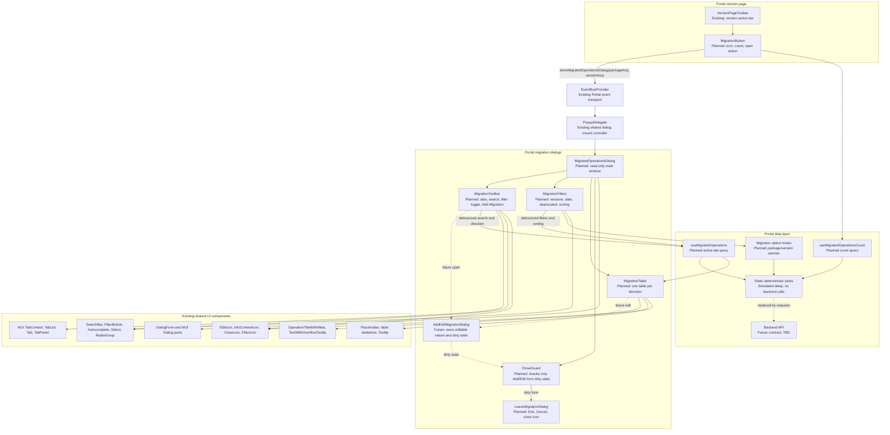

# Migrated Operations

| | |
| --- | --- |
| **Design Item ID** | TBD |
| **Design Item Name** | Migrated Operations |
| **Related Design Items** | TBD |
| **Related API** | TBD. For now, query hooks return client-side stubs and do not call backend endpoints. |
| **Revision History** | 18.11.2026: Initial version. 19.11.2026: Applied review decisions, clarified the read-only main dialog, and added the component diagram. |

---

## Summary

Add a `Migration (%amount%)` button to the package version toolbar. The button opens a `Migrated Operations` dialog
with `Migrated From` and `Migrated To` views, search, optional filters, sorting, and a migration table. For now, the
design covers the UI layout with static, delayed stub hooks. Add, edit, and cancel migration actions remain inactive.
The future `Add/Edit Migration` form owns unsaved changes; the main table and filter view stay read-only.

## Assumptions

- The entry point is `VersionPageToolbar`, immediately before `Copy`. Visibility for dashboards, package kinds,
  permissions, and zero migrations requires confirmation in OQ-1 and OQ-2.
- `Migrated From` is the default tab. `Newest first` is the default sort direction.
- The filter sidebar is hidden when the dialog opens. All three filter accordions start expanded.
- One search value, filter form, and sort selection apply to the active tab and remain unchanged when the user switches
  tabs. OQ-5 asks whether each tab needs independent view state instead.
- The main `Migrated Operations` dialog is read-only. Tabs, search, filters, sorting, and sidebar state only recalculate
  the displayed data. They never create a delta to save and never trigger the unsaved-changes confirmation.
- Only the future `Add/Edit Migration` form can be dirty. For now, `Add Migration` and row actions do not open that
  form, so no user action can produce unsaved migration changes.
- All main-dialog dismissal paths use the same close handler: title close button, backdrop click, and `Escape`. The
  handler closes immediately unless a future `Add/Edit Migration` form is dirty. Browser navigation remains in OQ-15.
- The reference `Create Manual Group` dialog does not declare explicit dimensions. It inherits the MUI `Dialog` default
  `sm` maximum width of 600px and content-driven height. The migration dialog starts with the same sizing; OQ-3 asks
  whether the seven-column table requires a wider dialog.
- The calendar uses the accepted Portal pattern: `react-multi-date-picker` in range mode with a MUI `TextField`.
- The UI applies query changes after the shared `DEFAULT_DEBOUNCE` interval of 500ms. Controls update immediately, while
  table recalculation waits for the debounce interval.
- Stub data is static and deterministic, with a simulated delay for skeleton review. Replacing a stub query function
  with a real request must not change the component contracts.
- Each migration row contains exactly one source endpoint and one target endpoint.
- `Last Modified` uses UTC and a two-digit day. The existing `FormattedDate` component is not suitable because it
  converts timestamps to the user's local timezone; the migration cell needs a dedicated UTC formatter.
- No backend endpoint, persistence change, permission rule, or navigation target is defined for now.
- Figma mockups were not supplied. The component references in this document define the initial visual layout.

## Domain Concepts

| Concept / Value | Description |
| --- | --- |
| Current package version | The package and version identified by the `VersionPageToolbar` route parameters. It is the context for the migration count, table requests, and current-version filter options. |
| Migration record | A relationship between one source endpoint and one target endpoint, with source and target package versions, an optional comment, and last-modified metadata. |
| `Migrated From` | The view described by the requested tooltip: operations removed or deprecated in this package and registered as migrated to another package. |
| `Migrated To` | The reverse-direction view for operations registered as migrated into the current package. Exact backend semantics require confirmation in OQ-6. |
| `All` deprecated filter | Includes migrated operations regardless of deprecated status. This is the default. |
| `Yes` deprecated filter | Includes only operations matching the deprecated criterion. The operation set to which the criterion applies is defined in OQ-8. |
| `No` deprecated filter | Includes only operations that do not match the deprecated criterion. |
| `Newest first` | Sorts migration records by last-modified timestamp in descending order. |
| `Oldest first` | Sorts migration records by last-modified timestamp in ascending order. |
| Dirty migration form | The future `Add/Edit Migration` form with values that differ from its initial values. Main-dialog tabs, search, filters, sorting, and accordion state are excluded. |
| Migration count | The number rendered in `Migration (%amount%)`. Its relation to records, operations, tabs, and filters is defined in OQ-2. |

## Component Design

Status: **planned**; existing host mechanisms and future additions are distinguished in the node labels.

The diagram separates existing host mechanisms, components planned for the current UI work, and the future form that
owns unsaved changes. Solid arrows show composition or data flow. Dotted arrows show future interactions. Small shared
controls are grouped under one label, following the existing architecture-document convention.

### Component locations and responsibilities

| Component | Status and host location | Responsibility |
| --- | --- | --- |
| `VersionPageToolbar` | Existing: `frontend/ui/packages/portal/src/routes/root/PortalPage/VersionPage/VersionPageToolbar.tsx` | Hosts the new button immediately before `Copy` and supplies route package/version context. |
| `MigrationButton` | Planned: same `VersionPage` directory | Renders the migration icon and count, then emits the open-dialog event. |
| `EventBusProvider` | Existing: `frontend/ui/packages/portal/src/routes/EventBusProvider.tsx` | Carries `showMigratedOperationsDialog` with `packageKey` and `versionKey`. |
| `PopupDelegate` and `DialogForm` | Existing: `frontend/ui/packages/shared/src/components/` | Mount the dialog after the event and provide modal open/close behavior. |
| `MigratedOperationsDialog` | Planned: `VersionPage/MigratedOperationsDialog/MigratedOperationsDialog.tsx` | Owns read-only view state, composes the toolbar, filters, active table, and close guard. |
| `MigrationToolbar` | Planned: same `MigratedOperationsDialog` directory | Provides direction tabs, search, filter visibility, and the inactive `Add Migration` action. |
| `MigrationFilters` | Planned: same directory | Owns filter controls, dependent target versions, and sort input; emits debounced criteria. |
| `MigrationTable` | Planned: same directory | Renders the active direction's seven columns, skeleton, placeholder, and inactive row actions. |
| `LeaveMigrationDialog` | Planned: same directory | Confirms exit only when the future `Add/Edit Migration` form is dirty. |
| `AddEditMigrationDialog` | Future: same directory | Will own editable values, validation, save/cancel, and dirty state. Its fields and behavior are not defined yet. |
| Migration query hooks | Planned: `MigratedOperationsDialog/api/` | Return count, active-tab rows, and filter options from static delayed stubs; later call backend endpoints. |
| Shared table and form controls | Existing: `frontend/ui/packages/shared/src/components/` and MUI | Supply consistent dialog, tabs, search, filter, operation-cell, overflow, tooltip, and placeholder rendering. |
| `MigrationIcon` and `CancelMigrationIcon` | Planned: `frontend/ui/packages/shared/src/icons/` | Render the supplied SVG assets. Reuse the existing shared `EditIcon` for edit actions. |
| Backend API | Future: `portal-backend`, contract TBD | Will own migration search semantics, filtering, sorting, pagination, and persistence. No calls are made for now. |

## Use Cases

### Use Case 1: Open Migrated Operations from the version toolbar

| Description | UI (Mockup) | API / Logic |
| --- | --- | --- |
| Render an outlined button before `Copy`, using the same `Button` and `startIcon` pattern as the neighboring `CopyPackageVersionButton`. | TBD | Update the action group in `VersionPageToolbar.tsx` without changing the order of the existing buttons. |
| Render the supplied 14x14 migration SVG at the start of the button. Keep the icon as a reusable icon component and preserve its supplied path and default color. | TBD | Use a new migration icon because no matching shared icon exists. |
| Set the button label to `Migration (%amount%)`, replacing `%amount%` with the count returned by the count query hook. For now, display a fixed stub count after the simulated loading delay. | TBD | `useMigratedOperationsCount(packageKey, versionKey)` returns stub data. The count is independent of dialog search and filters unless OQ-2 decides otherwise. |
| Open `Migrated Operations` when the user clicks the button. | TBD | Follow `OperationGroupsCard.onCreateButton`: add a `showMigratedOperationsDialog` event with `packageKey` and `versionKey`, dispatch it through `EventBusProvider`, and receive it with `PopupDelegate`. |
| Mount the dialog only while it is open, matching `PopupDelegate`. A later open starts with default read-only view state. | TBD | `PopupDelegate` owns `open` and event detail. The main dialog owns tabs, search, filters, and table state. Only the future `Add/Edit Migration` form owns dirty state. |

### Use Case 2: Dialog frame and close confirmation

| Description | UI (Mockup) | API / Logic |
| --- | --- | --- |
| Display a modal dialog titled `Migrated Operations`. The body contains the tab/search toolbar and the active tab content. | TBD | Reuse `DialogForm`, `DialogTitle`, `DialogContent`, `DialogActions`, and `CloseIcon` composition. This is a modal dialog, not an anchored MUI `Popover`. |
| Place a close icon button in the top-right corner of the dialog title. | TBD | The button invokes the guarded close handler rather than directly changing `open`. |
| Match the reference dialog sizing mechanism: no explicit width or height, MUI default `sm` maximum width, and content-driven height. Internal regions must prevent the toolbar and title from scrolling away with table content. | TBD | Reuse `DialogForm`. Final dimensions, table scrolling, and sidebar resizing remain subject to OQ-3. |
| Close the main dialog immediately when no future `Add/Edit Migration` form is dirty. Search, filter, sort, tab, and sidebar changes never alter this decision. | TBD | Reset dialog-local view state through unmounting. For now, every main-dialog close follows this path. |
| Open a second, custom confirmation dialog only when a close is requested while the future `Add/Edit Migration` form has unsaved changes. Keep the main dialog and form mounted so their state is preserved. | TBD | The close handler reads dirty state only from `Add/Edit Migration` and sets `leaveConfirmationOpen`. It does not inspect the main table or filters. |
| Use `Leave without saving` as the initial confirmation title and `Are you sure you want to leave without saving? Your changes will be lost.` as the initial question. These strings are provisional. | TBD | Compose the confirmation from the same MUI and `DialogForm` components as the regular dialog. Use `ConfirmationDialog.tsx` as the layout reference, not as a required wrapper. |
| Place a close icon button in the confirmation title, a red contained `Exit without saving` button, and a default outlined `Cancel` button. | TBD | The confirmation close icon and `Cancel` have identical behavior. The exit button uses the error color. |
| Close only the confirmation and return to the unchanged dirty `Add/Edit Migration` form when the user clicks `Cancel`, the confirmation close icon, its backdrop, or presses `Escape`. | TBD | Set `leaveConfirmationOpen` to false. Keep the main dialog, future form, and all form values intact. |
| Close the confirmation, future form, and main dialog and discard unsaved migration changes when the user clicks `Exit without saving`. | TBD | Clear dirty state and close all migration dialogs. A subsequent open uses initial state. |

### Use Case 3: Tabs and migration toolbar

| Description | UI (Mockup) | API / Logic |
| --- | --- | --- |
| Split the migration toolbar into left and right regions. The left region contains `Migrated From` and `Migrated To`; the right region contains search, the filter toggle, and `Add Migration`. | TBD | Use a flex row with left and right groups. Allow the right group to remain aligned right within the available dialog width. |
| Implement tabs with MUI `TabContext`, `TabList`, `Tab`, and `TabPanel`, following `GlobalSearchPanel/SearchResults.tsx`. | TBD | Store the active direction locally. Tab selection does not change the route. |
| Display the `Migrated From` tab first and select it initially. Display `Migrated To` second. | TBD | Each tab selects its own migration dataset and table instance. Both tables use the same column definitions. |
| Add an info icon button immediately after the `Migrated From` title. On hover, show exactly: `Operations that were removed or deprecated in this package and registered as migrated to another package.` | TBD | Reuse `InfoContextIcon`, MUI `Tooltip`, and `IconButton`. Keep the icon visible in the `Migrated From` tab label even while `Migrated To` is active. |
| Show a `SearchBar` with placeholder `Search by Endpoints or Comment`. | TBD | Reuse the shared `SearchBar`. Debounce the effective search value by 500ms and pass it unchanged to the active table query hook. |
| Recalculate the active table after the effective search value changes, including when the user clears search. Preserve the current tab and other filters. | TBD | Reset pagination and rerun the stub query for now. Later, pass the search query to the backend; the backend owns all matching semantics. |
| Render a filter icon button with the shared `FilterIcon`. The button toggles the filter sidebar for the active tab. | TBD | Reuse the shared `FilterButton` pattern and its `Show/hide filter panel` tooltip. Show the selected state while the sidebar is visible. |
| Render `Add Migration` after the filter button. It has no action for now. | TBD | Do not open the future `Add/Edit Migration` form and do not create dirty state. Permission behavior is covered by OQ-1. |

### Use Case 4: Migration tables

The active tab contains a table with seven columns. The technical controls column has an empty header. Column widths
follow the existing resizable-table approach where practical, subject to the dialog-width decision in OQ-3.

| Description | UI (Mockup) | API / Logic |
| --- | --- | --- |
| `Endpoints`: render exactly one source operation. Show its title on the first line and its type chip with path, method, or channel metadata on the second line. Show the deprecated badge when applicable. | TBD | Reuse `OperationTitleWithMeta`, as `OperationListItem.tsx` does. Supply one normalized `Operation` object and an operation link. Link destination remains in OQ-7. |
| `Migrated From`: render the source package version as a link. | TBD | Use the source package and version identifiers from the migration record. Display text and destination require OQ-6. |
| `Migrated To`: render the target package version as a link. | TBD | Use the target package and version identifiers from the migration record. Display text and destination require OQ-6. |
| `Target Endpoints`: render exactly one target operation with the same title, metadata, tooltip, link, and deprecated-badge treatment as `Endpoints`. | TBD | Reuse `OperationTitleWithMeta`. Supply one normalized target `Operation` object and its link. |
| `Comment`: render comment text with ellipsis when the cell overflows and expose the full text through a tooltip. An absent comment renders an empty cell. | TBD | Reuse `TextWithOverflowTooltip` with the comment as both content and tooltip text. |
| `Last Modified`: render two lines. The first line uses primary text and UTC `MMM DD, YYYY` format with a two-digit day. The second uses secondary text and the modifying user's display name, for example `User Userovich`. Render `-` on either line when its value is absent. | TBD | Use a dedicated `dayjs.utc(lastModifiedAt).format('MMM DD, YYYY')` formatter. Do not reuse `FormattedDate`, which converts to the user's timezone. |
| Technical controls: render `Edit Migration` and `Cancel Migration` icon buttons with those tooltip labels. | TBD | Reuse the shared pen-shaped `EditIcon`, sized to match the row controls. Add the supplied cancel-migration SVG as a new icon because no matching shared icon exists. |
| Do nothing when the user clicks either row action for now. | TBD | Do not open the future form, remove a row, send a request, or create dirty state. |
| Show skeleton rows during initial loading, including the simulated stub delay. | TBD | Follow `OperationGroupTable` skeleton conventions. |
| When the latest reload returns no migration records, hide the table completely and show the shared `Placeholder` with title `No migrations` and secondary comment `Use Add Migration to register an endpoint that moved to another package.` | TBD | Pass a composed React node as `Placeholder.message`: one typography node for the title and a secondary typography node for the comment. |
| Define the no-search-results and query-error presentation separately. | TBD | These states remain in OQ-11 and must not replace the confirmed no-migrations message. |
| Recalculate only the active tab when its query inputs change. Switching tabs selects the other dataset and displays its own loading, empty, error, and loaded state. | TBD | Keep `direction` in the query key. Avoid sharing filtered rows between the two query results. |
| Build the table with the established MUI and TanStack Table pattern used by `OperationGroupTable`. | TBD | Reuse `CustomTableHeadCell`, `ColumnDelimiter`, and `useColumnsSizing` if the final dialog dimensions support resizable columns. |

### Use Case 5: Filter sidebar and sorting

The filter sidebar appears between the left edge of the active tab content and the table only after the user clicks the
toolbar filter button. The table occupies the remaining width. Reuse the visual sidebar patterns from
`OperationsNavigation`, `VersionContractsSubPage`, `SidebarPanel`, and `LayoutWithSidebar`; do not embed the complete
`VersionContractsPanel`, because it would duplicate the toolbar and unrelated view controls.

| Description | UI (Mockup) | API / Logic |
| --- | --- | --- |
| Show the `Migrated From` accordion with an `Autocomplete` labeled `Filter by This Package Version`. | TBD | Load versions of the current package through a stub hook. Selection is optional and clearable. The revision and status scope requires OQ-10. |
| Show the `Migrated To` accordion with `Filter by Target Package` and `Filter by Target Version` Autocompletes. | TBD | Load target packages and target versions through separate stub hooks. |
| Disable `Filter by Target Version` until a target package is selected. When the target package changes or clears, clear the selected target version and reload or clear its options. | TBD | Enable the target-version query only when `targetPackageKey` exists. Include that key in its query key. |
| Show the `General Filters` accordion with an input calendar labeled `Filter by Last Modified`. | TBD | Reuse the accepted Portal `DatePicker` range pattern with MUI `TextField` and `CalendarIcon`. A single selected date becomes an equal start and end boundary; a range becomes two boundaries. |
| Allow the user to select either one date or a date range and to clear the calendar value. | TBD | Convert selected dates to the future request's date-range fields. Inclusive boundaries and request timezone require OQ-12. Display formatting for the table is separately fixed to UTC. |
| Add a MUI `Select` labeled `Filter by Deprecated` under the calendar, with exactly `All`, `Yes`, and `No`. | TBD | Default to `All`. Map the selection to the future deprecated query parameter; its operation scope requires OQ-8. |
| Show a final `Sort By` section without an accordion. Place `Newest first` and `Oldest first` in one radio group. | TBD | Follow the `RadioGroup` and `FormControlLabel` pattern from `ExportSettingsForm.tsx`. Default to `Newest first`. |
| Apply a field change without an Apply button. The selected value is visible immediately; the table query updates after 500ms without another relevant change. | TBD | Use `react-hook-form` watchers with `useDebounce`, following `GlobalSearchPanel/SearchFilters.tsx`. Include every effective filter and sort value in the migration query key. |
| Reset pagination whenever search, a filter, or sort changes. A target-package change produces one effective query state after it also clears the dependent target version. | TBD | Combine dependent form updates before running the debounced query update to avoid an intermediate request with a stale target version. |
| Changing sidebar visibility, expanding an accordion, modifying a filter, or switching tabs never marks any migration form dirty. | TBD | Keep read-only main view state separate from the future `Add/Edit Migration` form state. |
| Hide the sidebar when the user clicks the filter button again. Preserve its field values and continue applying them to the table while hidden. | TBD | Visibility is not a filter reset. OQ-5 confirms whether visibility and values are shared across tabs. |

### Use Case 6: Stub query hooks and client data model

Use TanStack Query hooks with stable query keys, following `useOperations` and the package/version hooks used by
`SearchFilters`. For now, `queryFn` returns static deterministic stubs after a simulated delay and does not call
`portalRequestJson`.

| Hook | Inputs | Current stub behavior | Future replacement |
| --- | --- | --- | --- |
| `useMigratedOperationsCount` | Current package and version | Returns a fixed numeric stub and loading state after a simulated delay. | Replace only the query function with the count endpoint defined by OQ-2. |
| `useMigratedOperations` | Current package and version, direction, debounced search, filters, sort, and pagination | Returns direction-specific static rows after a simulated delay. Query-key changes recalculate the displayed result. Any fixture matching exists only inside the stub and is not product search behavior. | Send all criteria to the list endpoint. The backend owns search semantics, filtering, sorting, and pagination. |
| `useMigrationSourceVersions` | Current package | Returns static current-package versions after a simulated delay. | Call the existing or new package-versions endpoint confirmed by OQ-10. |
| `useMigrationTargetPackages` | Current package and version, optional autocomplete text | Returns static target packages after a simulated delay. | Call the target-package options endpoint with the same inputs. |
| `useMigrationTargetVersions` | Selected target package, optional autocomplete text | Returns no options until a package is selected, then returns its static versions after a simulated delay. | Call the target-version options endpoint for the selected package. |

The client-side migration record needs the following logical data. These names describe UI needs and are not an agreed
backend contract.

| Field | Contents |
| --- | --- |
| `id` | Stable migration record identifier used as the table row key. |
| `sourcePackage` | Source package key, display name, and version key or display label. |
| `targetPackage` | Target package key, display name, and version key or display label. |
| `sourceOperation` | One normalized source `Operation`, including identifiers required for links. |
| `targetOperation` | One normalized target `Operation`, including identifiers required for links. |
| `comment` | Optional comment text. |
| `lastModifiedAt` | Timestamp used for UTC display, date filtering, and sorting. |
| `lastModifiedBy` | Optional user identifier and display name; a missing display name renders `-`. |

### Current acceptance criteria

- The new button appears immediately before `Copy` and displays the supplied icon and a numeric stub count.
- Clicking the button opens a modal titled `Migrated Operations` with a top-right close button.
- `Migrated From` is selected initially, and its info icon remains visible when either tab is active.
- Both tabs render distinct static stub datasets with all seven columns in the requested order after a simulated delay.
- Each row has one source endpoint and one target endpoint, both rendered with `OperationTitleWithMeta`.
- Comments use `TextWithOverflowTooltip`. Last-modified cells use UTC, a two-digit day, two lines, and `-` for missing
  values.
- Edit and cancel row controls show their tooltips and have no other effect. `Add Migration` also has no effect.
- Search recalculates the active stub table after 500ms, including when cleared. UI components do not define search
  matching semantics.
- The filter button shows and hides the sidebar without clearing filter values.
- All specified accordions, labels, options, radio buttons, and dependent target-version behavior are present.
- Search, filter, and sort changes reset the active table's pagination and recalculate its stub data after debouncing.
- The no-migrations state hides the table and shows the confirmed two-line `Placeholder` content.
- Main-dialog table and filter interactions never open the unsaved-changes confirmation.
- The future dirty `Add/Edit Migration` close path opens the custom confirmation, preserves state on cancel, and
  discards state on exit. This path is inactive until that form is implemented.
- No current control sends a backend request or mutates a migration.

## Backend

### API Contract Changes

No backend contract changes are defined for now. The following capabilities must be defined before replacing stubs;
exact methods, paths, request parameter names, and response schemas remain TBD.

| Capability | Required behavior |
| --- | --- |
| Migration count | Return the count for the current package version with the semantics decided in OQ-2. |
| Migration list | Accept the debounced search query and own all search matching. Support direction, sidebar filters, last-modified sorting, and the pagination model decided in OQ-13. Return enough operation and package data to render links without per-row requests. |
| Source version options | Return versions of the current package with the scope decided in OQ-10. |
| Target package options | Return packages available as migration targets for the current context and autocomplete search text. |
| Target version options | Return versions for the selected target package with the scope decided in OQ-10. |

### Component: portal-backend

No `portal-backend` change is defined for now. The future implementation must define direction semantics, search
matching, deprecated filtering, inclusive date boundaries, stable last-modified sorting, pagination totals, and
permission checks. It must also define whether migration count and list results come from one endpoint or separate
endpoints.

## Mockups

Figma mockups: TBD. The current layout uses these repository references:

| Reference | Design relevance |
| --- | --- |
| [Version toolbar](../../packages/portal/src/routes/root/PortalPage/VersionPage/VersionPageToolbar.tsx) | Action placement and neighboring buttons. |
| [Copy version button](../../packages/portal/src/routes/root/PortalPage/VersionPage/CopyPackageVersionButton.tsx) | Outlined button and `startIcon` pattern. |
| [Operation groups card](../../packages/portal/src/routes/root/PortalPage/VersionPage/VersionOverviewSubPage/OperationGroupsCard/OperationGroupsCard.tsx) | Event-bus entry point. |
| [Operation group parameters popup](../../packages/portal/src/routes/root/PortalPage/VersionPage/VersionOverviewSubPage/OperationGroupsCard/OperationGroupParametersPopup.tsx) | `PopupDelegate` consumer and default dialog dimensions. |
| [Dialog form](../../packages/shared/src/components/DialogForm.tsx) | Modal composition and sizing behavior. |
| [Confirmation dialog](../../packages/shared/src/components/ConfirmationDialog/ConfirmationDialog.tsx) | Title close button, content, error action, and cancel action layout. |
| [Global search results](../../packages/portal/src/routes/root/BasePage/GlobalSearchPanel/SearchResults.tsx) | MUI tabs. |
| [Global search filters](../../packages/portal/src/routes/root/BasePage/GlobalSearchPanel/SearchFilters.tsx) | Autocompletes, dependent options, date range, and debounced form application. |
| [Rich filters layout](../../packages/shared/src/components/PageLayouts/RichFiltersLayout.tsx) and [layout with sidebar](../../packages/shared/src/components/PageLayouts/LayoutWithSidebar.tsx) | Filter toggle and sidebar positioning. |
| [Operation list item](../../packages/portal/src/routes/root/PortalPage/VersionPage/VersionOverviewSubPage/EditOperationGroupContentDialog/internal/components/OperationListItem.tsx) | `OperationTitleWithMeta` usage. |
| [Operation group table](../../packages/portal/src/routes/root/PortalPage/VersionPage/VersionOverviewSubPage/OperationGroupsCard/OperationGroupTable.tsx) | TanStack Table, skeletons, overflow text, and resizable columns. |
| [Formatted date](../../packages/shared/src/components/FormattedDate.tsx) and [date utilities](../../packages/shared/src/utils/date.ts) | Verified existing timezone behavior. `FormattedDate` converts to the user's timezone, so `Last Modified` needs a dedicated UTC formatter. |
| [Placeholder](../../packages/shared/src/components/Placeholder/Placeholder.tsx) | Confirmed empty-state component; its `message` accepts a composed title and secondary comment. |

## Resolved Review Decisions

- **OQ-4: Calendar library.** Use `react-multi-date-picker` with MUI `TextField`, consistent with the existing Portal
  filters. MUI X Date Pickers are not required.
- **OQ-7: Endpoint cardinality.** Each migration row contains exactly one source endpoint and one target endpoint.
  Endpoint navigation remains open below.
- **OQ-9: Last-modified formatting.** Use UTC and `MMM DD, YYYY` with a two-digit day. Render `-` when the timestamp
  or user name is absent. The existing `FormattedDate` converts to the user's timezone, so use a dedicated UTC
  formatter.
- **OQ-11: No-migrations state.** When the latest reload returns no migration records, hide the table and show
  `Placeholder` with title `No migrations` and secondary comment `Use Add Migration to register an endpoint that moved
  to another package.` Other table states remain open below.
- **OQ-14: Info icon visibility.** Keep the info icon in the `Migrated From` tab label visible when either tab is
  active.
- **OQ-16: Search ownership.** Pass the debounced search query to the backend. Backend owns matching fields, case
  handling, and other search semantics; UI components do not define them.
- **OQ-17: Stub presentation.** Use static deterministic stubs with a simulated delay for skeleton review.

## Open Questions

Question IDs remain stable across reviews. Resolved entries stay in the previous section for traceability.

1. **OQ-1: Entry-point visibility and permissions.** Is `Migration` available for packages only or also for dashboards?
   Which package versions, revisions, API types, and user roles can see it? Should read-only users see `Add Migration`,
   `Edit Migration`, and `Cancel Migration`, and should those controls be hidden or disabled when mutation is forbidden?
2. **OQ-2: Count semantics and zero state.** Does `%amount%` count migration records or individual operations? Is it the
   combined count for both directions, the active direction only, or another total? Is it affected by filters? Should
   the button appear for zero, and what should it display while loading or after a count error?
3. **OQ-3: Dialog dimensions.** For now, should the dialog retain the reference's default 600px maximum width, or does
   the seven-column table require an explicit wider width and height? Should the table scroll horizontally, should the
   sidebar be resizable, and should columns be user-resizable inside the dialog?
4. **OQ-5: Tab view state.** Should search, filters, sort, sidebar visibility, and accordion expansion be shared across
   tabs, as assumed here, or preserved independently for each tab? Should switching tabs trigger a fresh request even
   when the other tab's query is cached?
5. **OQ-6: Direction and link semantics.** What exact records belong to `Migrated From` and `Migrated To`? What display
   text should the `Migrated From` and `Migrated To` links show: package name, version, both, or a full package/version
   path? Should links navigate in the current tab and close the dialog, or open a new browser tab?
6. **OQ-7: Endpoint navigation.** Should operation titles link to API Contracts? Which package, version, API type, and
   operation key identify each endpoint link, and should navigation close the dialog or open a new browser tab?
7. **OQ-8: Deprecated filter scope.** Does `Filter by Deprecated` apply to the source endpoint, target endpoint, either
   endpoint, or a direction-dependent endpoint? How does it interact with removed operations that have no current
   deprecated flag?
8. **OQ-10: Version and package option scope.** Should source and target version options include drafts, releases,
   archived versions, and all revisions? Can the current package also be a target? Are target packages limited by
   workspace, user access, or existing migration relationships?
9. **OQ-11: Other table states.** What should the table show when search or filters return no records? Should query
   errors appear inside the table, in a global notification, or both, and is a retry control required?
10. **OQ-12: Date filtering.** Are start and end dates inclusive? Which timezone converts calendar selections into
    backend boundaries? Does selecting one date filter the entire corresponding day?
11. **OQ-13: Pagination.** Should each table use numbered pagination, infinite scrolling, or a fixed page size? What
    page size is required, and does the backend return a total record count for each direction?
12. **OQ-15: Unsaved-changes scope.** Must the guard intercept closing `Add/Edit Migration` itself, closing the main
    dialog while that form is dirty, route navigation, browser refresh, and returning from the form to the table? Which
    future actions count as saved and reset dirty state?
13. **OQ-18: Add/Edit Migration form.** What fields, defaults, validation, save behavior, cancel behavior, and backend
    contracts does the future form need? Until these details are provided, its controls remain inactive and no main
    dialog interaction can make it dirty.
