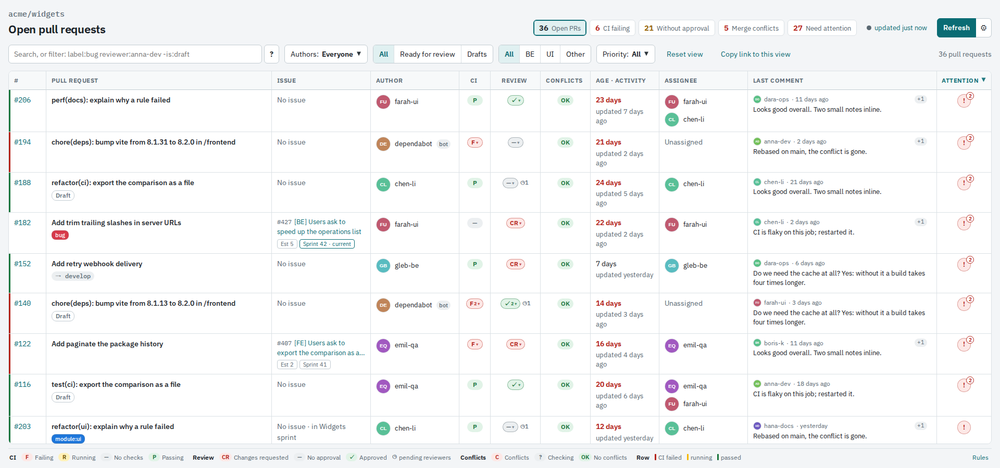

# APIHub PR board

The contributor board shows open pull requests across GitHub repositories, including CI results, reviews,
merge conflicts, linked issues, and attention rules. Each viewer loads live data with a personal GitHub token.



## Use the board

The default view shows human authors and non-draft PRs from the Netcracker Monorepo & Co group.
Choose repositories and authors from the menus, or configure repository groups in Settings.
The Authors menu includes Humans, NetcrackerCLPLCI, Dependabot, Renovate, and Other bots categories.
The **Me** author shortcut and **Review requested** tile become available after a token identifies you.

- Click a summary tile to filter PRs that need attention.
- Search with words or qualifiers such as `label:bug`, `author:anna-dev`, `ci:failing`, or `-is:draft`.
  The **?** button lists supported syntax.
- Click CI or review status to see checks and reviewers. Click the last comment to read the conversation.
- Use the note icon beside a title to keep a Markdown note in this browser.
- Adjust themes, columns, density, attention rules, and refresh intervals in Settings.
- Use Settings → Filter settings to configure BE and UI classification by labels, title patterns, and repository names.

Shared links carry the selected repositories, groups, filters, and classification criteria.
Tokens, notes, appearance, and attention preferences stay in your browser. Shared settings override saved settings
without replacing them. Reset to defaults restores the active build's repository groups and extra bots.

## Build configuration

Official repository groups live in `src/defaults.ts`; classification defaults live in `src/model/areas.ts`.
For another team, set these public build variables:

| Variable | Format | Default |
| --- | --- | --- |
| `PR_BOARD_GROUPS` | One `Name: owner/repo` group per line; prefix selected groups with `*` | Netcracker groups |
| `PR_BOARD_BOTS` | Extra bot logins separated by commas or spaces, up to 50 | No extra bots |
| `PR_BOARD_REPO` | Repository list used when neither groups nor URL selections supply repositories | No fallback |

Empty group and bot values clear their defaults. Invalid values fail before Vite builds the page.
Nx includes these variables in the build cache key. Saved groups take precedence over build defaults.
Mock development uses fictional repositories and ignores group and bot variables.

Run from the repository root in Bash:

```bash
PR_BOARD_GROUPS='*Core: acme/widgets' PR_BOARD_BOTS='ci-bot' pnpm exec nx run pr-board:build
```

In PowerShell:

```powershell
$env:PR_BOARD_GROUPS = '*Core: acme/widgets'
$env:PR_BOARD_BOTS = 'ci-bot'
pnpm exec nx run pr-board:build
Remove-Item Env:PR_BOARD_GROUPS, Env:PR_BOARD_BOTS
```

Use the same variables with `pr-board:dev:live` to try the configuration locally.
Viewers enter their personal tokens in the browser; builds need no credential or PR snapshot.

## Run and test locally

The [test stack ADR](../../docs/internal/adr/0011-pr-board-test-stack.md) records the testing choices.

Use Node.js 24.15 or later on the repository's Node.js 24 LTS line and the pnpm version in root `package.json`.
Run these commands from the repository root:

```sh
pnpm install
pnpm exec nx run pr-board:dev       # fictional data at http://localhost:5173
pnpm exec nx run pr-board:dev:live  # live GitHub data; enter a personal token in the browser
pnpm exec nx run pr-board:build     # static output in sites/pr-board/dist
pnpm exec nx run pr-board:test      # type checks and unit coverage
pnpm exec nx run pr-board:test:e2e  # Chromium browser tests
```

CI runs type checks, unit tests, and the build. Browser and screenshot tests are local tools; run them before a
pull request that changes the UI.

Install Chromium with `pnpm --filter @netcracker/qubership-apihub-pr-board exec playwright install chromium`
before running browser tests locally.

Mock mode adds a **DEV** panel to switch between fictional boards and GitHub response scenarios, including
pagination, slow loads, and failures. Any token works in mock mode. Fixtures in `dev/fixtures/` are generated
GraphQL nodes that pass through the same normalization as real data.

## Screenshots

Screenshot tests run only on Linux and use the `e2e/__screenshots__/*-linux.png` baselines.
For reproducible screenshots on Linux or Windows, run the pinned Playwright container from the repository root:

```sh
pnpm exec nx run pr-board:screenshot-test
```

The runner uses Docker on Linux and Podman on Windows. Set `DOCKER_BINARY` to choose another engine.
It installs dependencies in a temporary workspace and saves failure reports under `sites/pr-board/.logs/linux/`.
The image version follows the module's exact Playwright dependency.

After an intended visual change, update the Linux baselines and inspect the changed images:

```sh
pnpm exec nx run pr-board:regenerate-screenshots
```

Browser and screenshot tests stay local; CI runs only type checks, unit tests, and the build.

## Deploy

The shared [Pages workflow](../../.github/workflows/pages.yml) builds and publishes `dist/` at
`/qubership-apihub/pr-board/`, following its `develop` and `SITE_REF` policy.
The artifact includes the other monorepo sites. The build uses relative asset paths, so the output also works
under another static hosting path. Serve `sites/pr-board/dist/` as static files.

The published board queries GitHub directly from each viewer's browser. Personal tokens go only to GitHub
and never enter a build or shared link.
