# Qubership APIHUB — C4 Architecture Model

Generated: 2026-09-11 · Source of truth: the monorepo (code, Helm chart, nginx config, module cards)
· Notation: [C4 model](https://c4model.com) (Levels 1–4 + deployment + dynamic views) rendered with Mermaid.

> This document supersedes `diagrams/APIHUB_C4_mermaid.md` (April 2026). See
> [Appendix B](#appendix-b--what-changed-since-the-april-2026-diagrams) for the list of corrections made after
> re-reading the current code.

## Table of contents

1. [Scope, conventions and legend](#1-scope-conventions-and-legend)
2. [Level 1 — System Context](#2-level-1--system-context)
3. [Level 2 — Containers](#3-level-2--containers)
4. [Level 3 — Components](#4-level-3--components)
   - 4.1 [APIHUB Backend](#41-apihub-backend-backendportal-backend)
   - 4.2 [APIHUB UI](#42-apihub-ui-frontendui)
   - 4.3 [Build Task Consumer](#43-build-task-consumer-frontendbuild-task-consumer)
   - 4.4 [API Linter Service](#44-api-linter-service-backendapi-linter-service)
   - 4.5 [Agents Backend](#45-agents-backend-backendagents-backend)
   - 4.6 [APIHUB Agent](#46-apihub-agent-backendagent)
   - 4.7 [Java Task Consumer](#47-java-task-consumer-backendjava-task-consumer--new-integration-pending)
5. [Level 4 — Code](#5-level-4--code)
   - 5.1 [Backend: layers, security strategies, cleanup jobs](#51-backend--request-pipeline-security-strategies-and-scheduled-jobs)
   - 5.2 [TypeScript processing stack: SpecType registries](#52-typescript-processing-stack--registries-keyed-by-spectype)
   - 5.3 [api-processor: PackageVersionBuilder](#53-api-processor--packageversionbuilder-apibuilders-and-strategies)
   - 5.4 [Build Task Consumer: NestJS modules](#54-build-task-consumer--nestjs-modules-and-job-loop)
   - 5.5 [Linter: task processors and engines](#55-api-linter-service--task-processors-and-lint-engines)
   - 5.6 [Agents Backend: services](#56-agents-backend--services-and-clients)
   - 5.7 [Agent: DiscoveryRunner plug-ins](#57-apihub-agent--discoveryrunner-plug-ins)
   - 5.8 [UI: monorepo packages and rendering libraries](#58-apihub-ui--monorepo-packages-and-rendering-libraries)
   - 5.9 [Java Task Consumer: classes](#59-java-task-consumer--worker-classes-and-jdiff-engine)
6. [Deployment views](#6-deployment-views)
7. [Dynamic views](#7-dynamic-views)
8. [Cross-cutting: API/contract type support matrix](#8-cross-cutting--apicontract-type-support-matrix)
- [Appendix A — Module → container map](#appendix-a--module--container-map)
- [Appendix B — What changed since the April 2026 diagrams](#appendix-b--what-changed-since-the-april-2026-diagrams)
- [Appendix C — Verification sources](#appendix-c--verification-sources)

---

## 1. Scope, conventions and legend

**System in scope:** Qubership APIHUB — an API registry and API management platform that stores, builds, normalizes,
compares, documents, lints and scores API specifications (OpenAPI/Swagger, GraphQL, AsyncAPI, JSON Schema, Markdown,
Protobuf stubs) and contracts (DDLAPI database contracts, MCP server catalogs), exposes the catalog to AI tools through
an MCP server and an AI chat, and discovers running APIs in Kubernetes clusters through agents.

**Out of scope:** workspace add-ons that are not deployable services (`specs-samples/`, `generation_plans/`,
`netcracker.github.io/`, `qubership-apihub.wiki/`), and the design-only `qubership-apihub-tyk-adapter` repository.

### Legend (all diagrams)

| Shape / colour | Meaning |
|---|---|
| Purple box | Person / role |
| Dark-blue box, thick border | **The** software system (APIHUB) |
| Blue box | Core container (Backend, UI, Build Task Consumer) |
| Green box | Extension container (Linter, Agents Backend) |
| Orange box | Remote / agent side (Agent, remote Kubernetes) |
| Amber box, dashed | New container whose backend integration is **pending** (Java Task Consumer) |
| Slate cylinder | Data store / infrastructure (PostgreSQL, S3, Olric) |
| Grey box | External system |
| `==>` thick edge | Primary business flow |
| `-->` edge | Regular dependency / call |
| `-.->` dashed edge | Optional or planned dependency |

Every container/component label follows the C4 convention `Name — [Type: technology] — responsibility`.

---

## 2. Level 1 — System Context

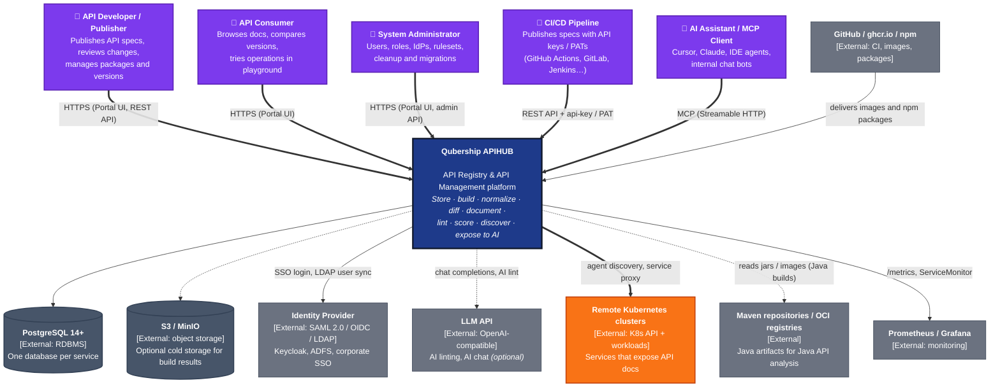

### Context notes

- **Who publishes:** people through the Portal, CI/CD pipelines through `POST /api/v2/packages/{id}/publish` with
  `api-key` or PAT authentication, and Agents Backend when a discovery snapshot is promoted to the Portal.
- **AI surface:** the Backend exposes an MCP server (`/api/v1/mcp/`, Streamable HTTP transport, `mark3labs/mcp-go`)
  with tools `search_api_operations`, `get_api_operation_specification`, `get_api_operation_diff`, `get_document`
  (plus legacy `*_rest_*` aliases), an `mcp://api-packages-list` resource and an IDS authoring prompt. The Linter
  Service exposes its own MCP endpoint with `list_linter_issues_for_package_version`. The built-in AI chat (optional,
  `ai.chat.enabled`) uses the same MCP tools through an OpenAI-compatible LLM client.
- **Identity:** local accounts (non-production), SAML 2.0 (`crewjam/saml`), OIDC (`coreos/go-oidc`), LDAP user lookup
  (`go-ldap`), API keys, personal access tokens, JWT cookies with refresh tokens.

---

## 3. Level 2 — Containers

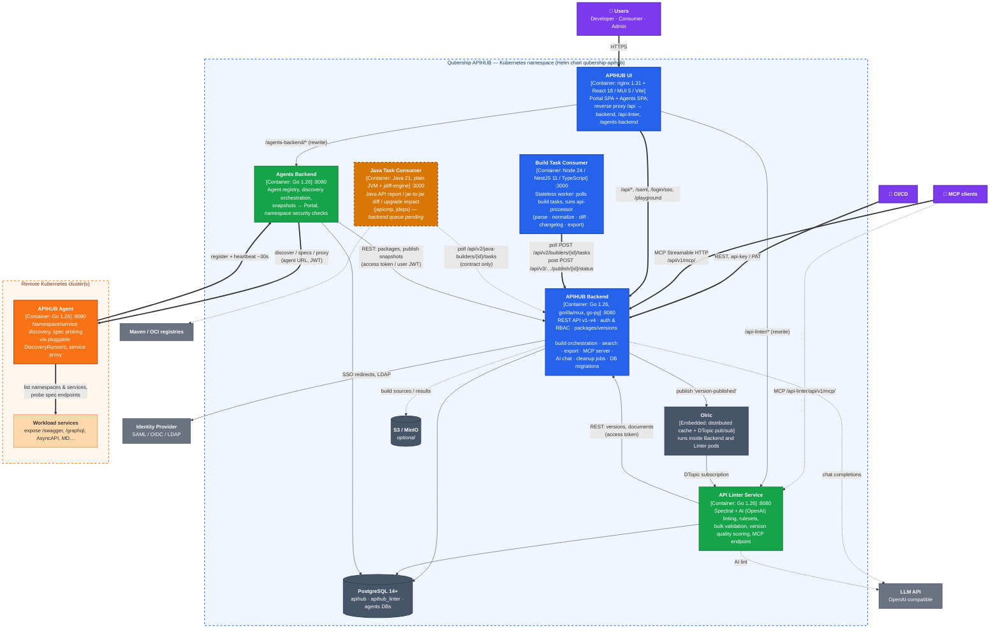

### Container catalogue

| Container | Module | Technology | Port | Persistent state | Responsibilities |
|---|---|---|---|---|---|
| **APIHUB Backend** | `backend/portal-backend` | Go 1.26.6, gorilla/mux, go-pg v10, go-guardian, robfig/cron, mcp-go 0.56, openai-go v3, excelize, minio-go | 8080 | `apihub` DB, optional S3 | REST API (39 controllers), auth/RBAC, packages/versions/operations, build task queue, search, Excel/ZIP export, DDL & MCP contracts, MCP server, AI chat, cleanup jobs, operations migration, Prometheus metrics |
| **APIHUB UI** | `frontend/ui` | React 18.3, MUI 5.11, Vite 8, pnpm workspace under Nx, nginx 1.31 | 8080 | — | Portal SPA (`/portal`), Agents SPA (`/agents`), nginx reverse proxy to Backend / Linter / Agents Backend / optional `apihub-nc` |
| **Build Task Consumer** | `frontend/build-task-consumer` | Node 24, NestJS 11, TypeScript; `@netcracker/qubership-apihub-api-processor` | 3000 | — (stateless) | Polls Backend for build tasks, runs `PackageVersionBuilder`, uploads result ZIP; scalable to N replicas |
| **API Linter Service** | `backend/api-linter-service` | Go 1.26.6, Spectral CLI (bundled), Vacuum (bundled, inactive), OpenAI client, Olric | 8080 | `apihub_linter` DB | Document/version lint tasks, rulesets, bulk validation, version scoring, MCP endpoint |
| **Agents Backend** | `backend/agents-backend` | Go 1.26.6 | 8080 | agents DB | Agent registration/heartbeat registry, discovery orchestration, snapshot publishing to Portal, namespace security auth-check reports, service proxy |
| **APIHUB Agent** | `backend/agent` | Go 1.26.6, client-go | 8080 | — | Deployed per remote cluster/namespace; lists K8s services, probes spec endpoints with `DiscoveryRunner`s, proxies to services |
| **Java Task Consumer** *(new)* | `backend/java-task-consumer` | Java 21 (Corretto), plain JVM, japicmp 0.26, jdeps, Maven resolver, OCI registry client | 3000 (`/live`) | — | Java API report / diff / upgrade-impact builds; backend endpoints `java-builders` are specified but not yet implemented |
| **Olric** | embedded (`buraksezer/olric`) | in-process, K8s LAN discovery via `olric-cloud-plugin` | — | in-memory | Distributed cache, locks, `version-published` DTopic from Backend to Linter |

---

## 4. Level 3 — Components

### 4.1 APIHUB Backend (`backend/portal-backend`)

```mermaid
flowchart TB
    ui["🌐 APIHUB UI / CI / MCP clients"]:::ext

    subgraph be ["APIHUB Backend — Go 1.26 · gorilla/mux · one process, layered micro-monolith"]
        direction TB

        subgraph edge ["HTTP edge"]
            direction LR
            router["<b>Router &amp; middleware</b><br/>[gorilla/mux]<br/>Prometheus, write-deadline,<br/>CORS, security headers"]:::comp
            health["<b>Health / SystemInfo</b><br/>/live /ready /api/v1/system/*"]:::comp
        end

        subgraph sec ["Security"]
            direction LR
            auth["<b>Auth strategies</b><br/>[go-guardian]<br/>Cookie JWT · Bearer JWT · Refresh ·<br/>api-key · PAT · ephemeral-file token"]:::comp_red
            idpm["<b>IDP Manager</b><br/>SAML (crewjam) · OIDC (go-oidc) ·<br/>LDAP lookup · local auth"]:::comp_red
            rbac["<b>RoleService / permissions</b><br/>System roles, package roles,<br/>custom roles, API-key scopes"]:::comp_red
        end

        subgraph catalog ["Catalog domain"]
            direction LR
            pkg["<b>PackageService</b><br/>Workspaces · groups · packages ·<br/>dashboards · favorites"]:::comp
            ver["<b>VersionService / PublishedService</b><br/>Versions · revisions · references ·<br/>documents · shareability"]:::comp
            ops["<b>OperationService / OperationGroupService</b><br/>Operations · tags · groups ·<br/>deprecated items · model usages"]:::comp
            cmp["<b>ComparisonService</b><br/>Version &amp; operation changes,<br/>changelog summaries"]:::comp
            contracts["<b>DDL / MCP Contract services</b><br/>DDL entities &amp; changes,<br/>MCP tools/prompts/resources"]:::comp
            search["<b>SearchController (v3/v4)</b><br/>Full-text search over<br/>packages, versions, operations, docs"]:::comp
        end

        subgraph build ["Build &amp; export"]
            direction LR
            buildsvc["<b>BuildService / BuildProcessor</b><br/>Task queue in DB, GetFreeBuild,<br/>ownership, statuses"]:::comp
            result["<b>BuildResultService</b><br/>Unpacks result ZIP,<br/>stores operations/docs/changes"]:::comp
            export["<b>ExportService / ExcelService</b><br/>Async exports, xlsx (excelize),<br/>shareability reports"]:::comp
            transform["<b>TransformationService</b><br/>Merged / reduced specs,<br/>document groups"]:::comp
            notify["<b>PublishNotificationService</b><br/>Olric DTopic 'version-published'"]:::comp
        end

        subgraph ai ["AI &amp; integration"]
            direction LR
            mcp["<b>MCPService + MCPController</b><br/>[mcp-go Streamable HTTP] /api/v1/mcp/<br/>tools · api-packages resource · IDS prompt"]:::comp_purple
            chat["<b>AiChatTurnService / AiChatsService</b><br/>[openai-go] SSE streaming, tool loop (≤10),<br/>ephemeral files, chat cleanup"]:::comp_purple
            playground["<b>PlaygroundProxyController</b><br/>/playground/proxy to allowed hosts"]:::comp_purple
        end

        subgraph ops_layer ["Operations &amp; maintenance"]
            direction LR
            cleanup["<b>CleanupService</b><br/>[robfig/cron] revisions · comparisons ·<br/>soft-deleted · unreferenced · builds ·<br/>ephemeral files · maintenance VACUUM"]:::comp_gray
            migration["<b>Migration framework</b><br/>DB schema + operations migration FSM<br/>/api/internal/migrate/*"]:::comp_gray
            activity["<b>ActivityTracking / BusinessMetrics</b><br/>Audit trail, Prometheus counters"]:::comp_gray
            minio["<b>MinioStorageService</b><br/>[minio-go] build sources/results"]:::comp_gray
        end

        subgraph data ["Data access"]
            repo["<b>Repositories</b><br/>[go-pg ORM] ~26 repositories,<br/>entity structs, LockService"]:::comp
        end
    end

    pg[("PostgreSQL apihub")]:::datastore
    s3[("S3 / MinIO")]:::datastore
    olric["Olric"]:::datastore
    btc["Build Task Consumer"]:::core
    linter["API Linter Service"]:::extension
    idp["Identity Provider"]:::ext
    llm["LLM API"]:::ext

    ui ==> router ==> auth ==> rbac
    auth --> idpm --> idp
    router --> pkg & ver & ops & cmp & contracts & search & export & buildsvc & mcp & chat & playground
    pkg & ver & ops & cmp & contracts & search & export & buildsvc & result --> repo --> pg
    buildsvc == "task ZIP / status" ==> btc
    btc == "result ZIP" ==> result
    result --> notify --> olric --> linter
    result -.-> minio -.-> s3
    chat --> mcp --> ops & search
    chat -.-> llm
    cleanup --> repo
    migration --> repo

    classDef ext fill:#6b7280,stroke:#374151,color:#fff
    classDef core fill:#2563eb,stroke:#1e40af,color:#fff
    classDef extension fill:#16a34a,stroke:#15803d,color:#fff
    classDef comp fill:#3b82f6,stroke:#1e40af,color:#fff,stroke-width:1px
    classDef comp_red fill:#dc2626,stroke:#991b1b,color:#fff,stroke-width:1px
    classDef comp_purple fill:#7c3aed,stroke:#5b21b6,color:#fff,stroke-width:1px
    classDef comp_gray fill:#64748b,stroke:#334155,color:#fff,stroke-width:1px
    classDef datastore fill:#475569,stroke:#334155,color:#fff

    style be fill:#eff6ff,stroke:#2563eb,stroke-width:2px,color:#1e3a5f
    style edge fill:#dbeafe,stroke:#93c5fd
    style sec fill:#fef2f2,stroke:#fca5a5
    style catalog fill:#dbeafe,stroke:#93c5fd
    style build fill:#dbeafe,stroke:#93c5fd
    style ai fill:#f5f3ff,stroke:#c4b5fd
    style ops_layer fill:#f1f5f9,stroke:#94a3b8
    style data fill:#dbeafe,stroke:#93c5fd
```

**Public API surface (from `Service.go`):** `/api/v1..v4/*` (packages, versions, operations, changes, documents,
export, search, roles, users, API keys, PATs, activity, DDL and MCP contracts, ephemeral files, AI chat), `/api/v2/builders/{id}/tasks`
(worker queue), `/api/v1/mcp/`, `/api/v1/saml/*`, `/api/v1/oidc/*`, `/api/v1/login/sso/{idpId}`, `/playground/proxy`,
`/api/internal/*` (migrations, MinIO, test cleanup), `/live`, `/ready`, `/debug/`.

### 4.2 APIHUB UI (`frontend/ui`)

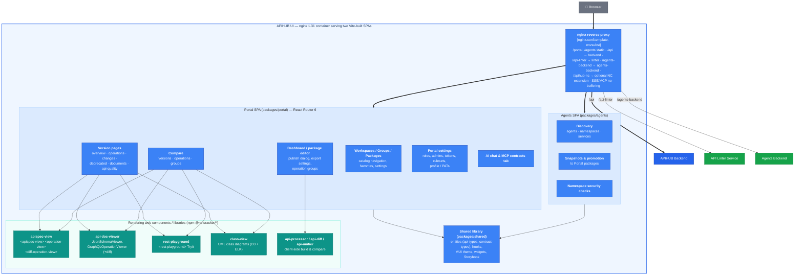

### 4.3 Build Task Consumer (`frontend/build-task-consumer`)

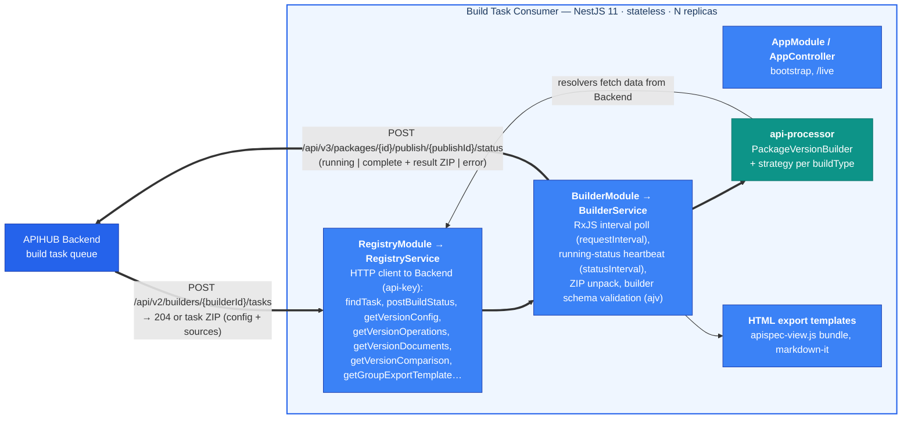

Supported `buildType` values (from `api-processor/src/consts.ts`): `build`, `changelog`, `prefix-groups-changelog`,
`exportVersion`, `exportRestDocument`, `exportRestOperationsGroup`, `exportGraphqlOperationsGroup`,
`exportAsyncapiOperationsGroup`; deprecated: `documentGroup`, `reducedSourceSpecifications`, `mergedSpecification`.

### 4.4 API Linter Service (`backend/api-linter-service`)

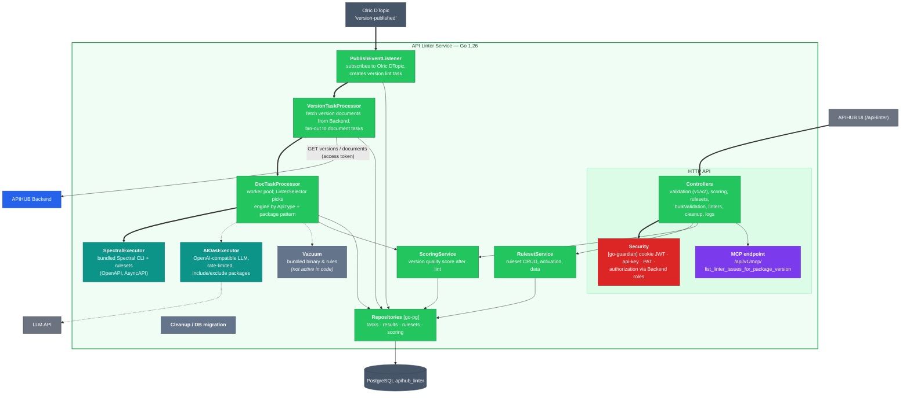

### 4.5 Agents Backend (`backend/agents-backend`)

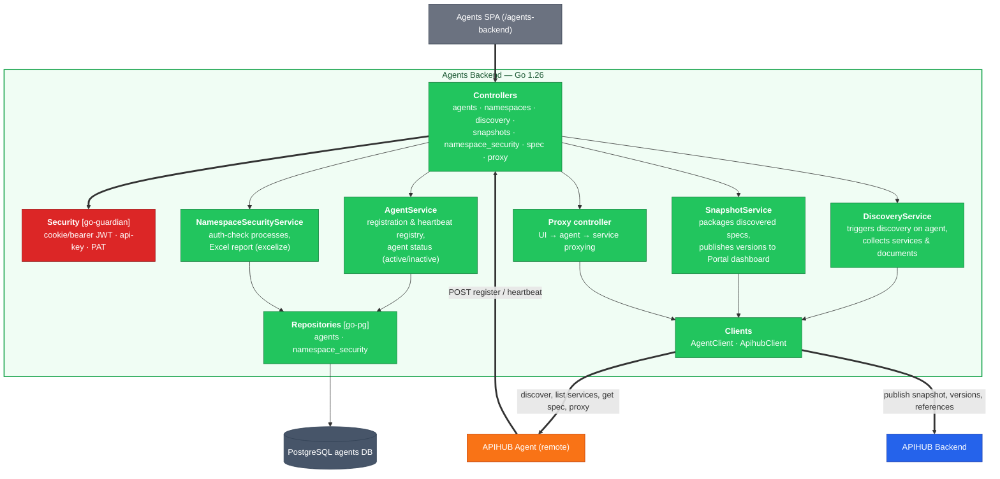

### 4.6 APIHUB Agent (`backend/agent`)

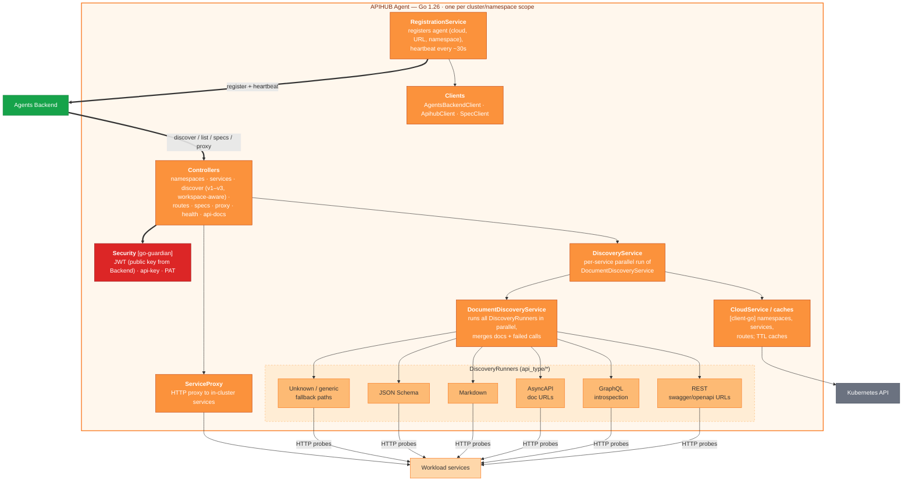

### 4.7 Java Task Consumer (`backend/java-task-consumer`) — new, integration pending

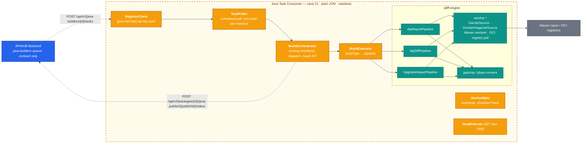

---

## 5. Level 4 — Code

Level 4 shows the code structures that matter for extension and maintenance: layering, plug-in registries and the
central types. Class names are real identifiers from the repositories.

### 5.1 Backend — request pipeline, security strategies and scheduled jobs

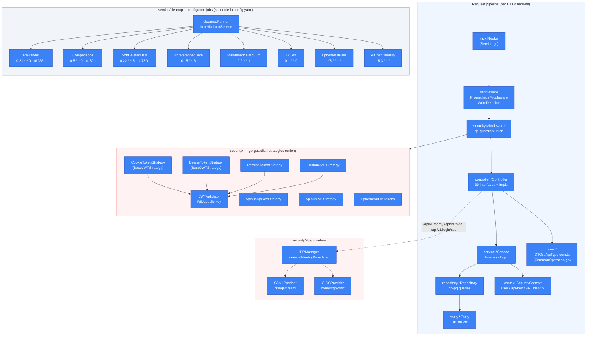

Package layout of `backend/portal-backend/`: `controller/` (HTTP), `service/` (+ `cleanup/`, `validation/`),
`repository/`, `entity/`, `view/`, `security/` (+ `idp/providers/`), `migration/` (schema + operations migration FSM
with `stages/`), `cache/` (Olric provider), `client/` (OpenAI LLM client), `archive/`, `crypto/`, `metrics/`,
`middleware/`, `db/`, `config/`, `utils/`.

### 5.2 TypeScript processing stack — registries keyed by `SpecType`

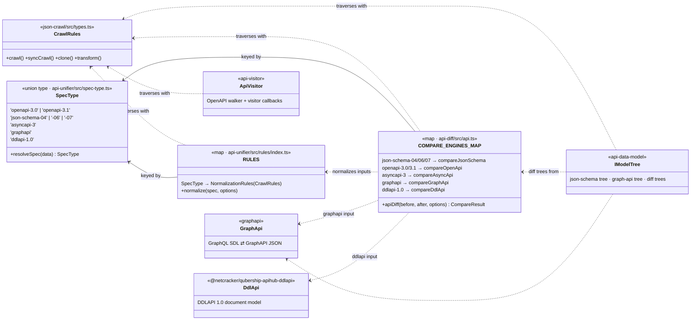

Library dependency graph (npm `@netcracker/qubership-apihub-*`):

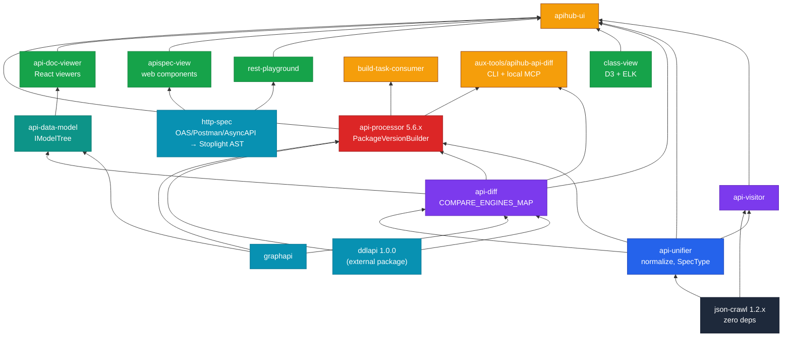

### 5.3 api-processor — `PackageVersionBuilder`, `ApiBuilder`s and strategies

**Builders registry** (`src/builder.ts`, constructor pushes seven builders):

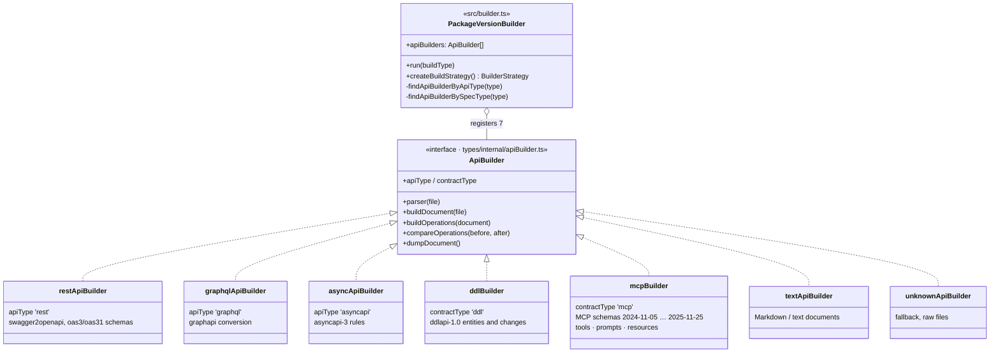

**Strategies** (`src/strategies/*`, selected by `buildType`):

```mermaid
classDiagram
    direction TB

    class BuilderStrategy {
        <<interface · builder-strategy.ts>>
        +execute(context)
    }
    class BuildStrategy {
        'build'
    }
    class ChangelogStrategy {
        'changelog'
    }
    class PrefixGroupsChangelogStrategy {
        'prefix-groups-changelog'
    }
    class DocumentGroupStrategy {
        'documentGroup' (deprecated)
    }
    class MergedDocumentGroupStrategy {
        'mergedSpecification' (deprecated)
    }
    class ExportVersionStrategy {
        'exportVersion'
    }
    class ExportRestDocumentStrategy {
        'exportRestDocument'
    }
    class ExportRestOperationsGroupStrategy {
        'exportRestOperationsGroup'
    }
    class ExportGraphQlOperationsGroupStrategy {
        'exportGraphqlOperationsGroup'
    }
    class ExportAsyncApiOperationsGroupStrategy {
        'exportAsyncapiOperationsGroup'
    }
    class components {
        <<src/components>>
        compare/ (rest · graphql · async · ddl BWC validation)
        document · operations · package · files
        build-result-index · deprecated · mcp · ddl
        zip tools (adm-zip, jszip)
    }

    BuilderStrategy <|.. BuildStrategy
    BuilderStrategy <|.. ChangelogStrategy
    BuilderStrategy <|.. PrefixGroupsChangelogStrategy
    BuilderStrategy <|.. DocumentGroupStrategy
    BuilderStrategy <|.. MergedDocumentGroupStrategy
    BuilderStrategy <|.. ExportVersionStrategy
    BuilderStrategy <|.. ExportRestDocumentStrategy
    BuilderStrategy <|.. ExportRestOperationsGroupStrategy
    BuilderStrategy <|.. ExportGraphQlOperationsGroupStrategy
    BuilderStrategy <|.. ExportAsyncApiOperationsGroupStrategy
    BuildStrategy --> components : uses
    ChangelogStrategy --> components : uses
```

Build pipeline inside `BuildStrategy` (per document): parse & detect type → `buildDocument` → `buildOperations` →
normalize (`api-unifier`) → compare with previous version (`api-diff`, resolvers fetch previous operations from
Backend) → classify changes (breaking / risky / non-breaking / semi-breaking / annotation / deprecated) → BWC
validation → package `result ZIP` (`build-result-index`).

### 5.4 Build Task Consumer — NestJS modules and job loop

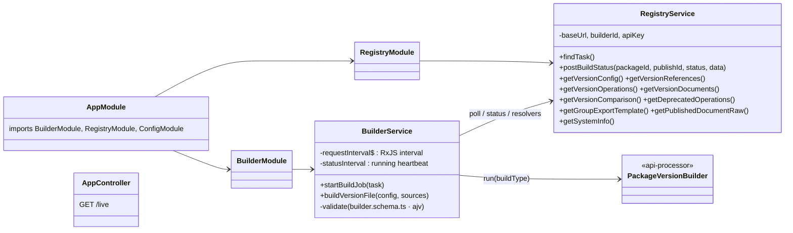

### 5.5 API Linter Service — task processors and lint engines

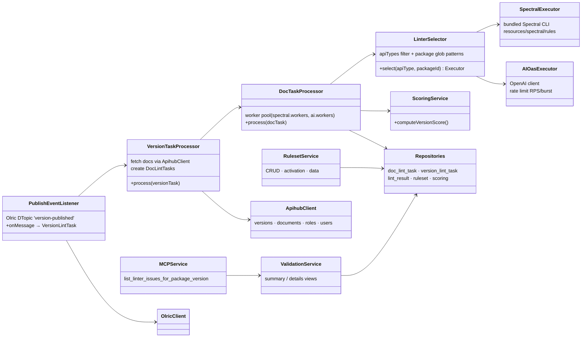

### 5.6 Agents Backend — services and clients

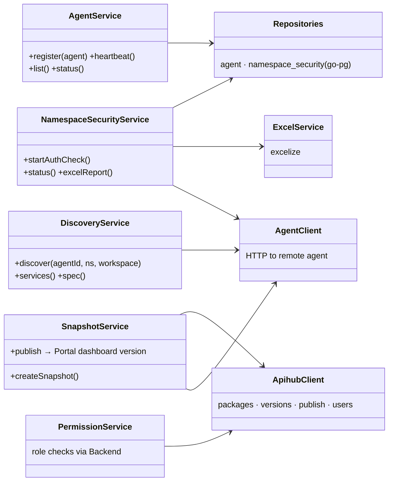

### 5.7 APIHUB Agent — `DiscoveryRunner` plug-ins

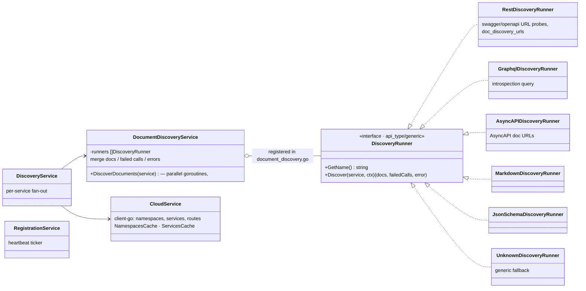

### 5.8 APIHUB UI — monorepo packages and rendering libraries

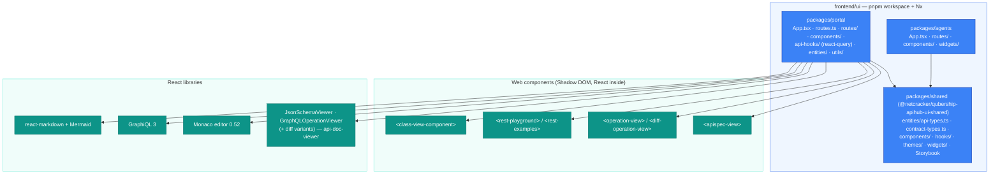

### 5.9 Java Task Consumer — worker classes and jdiff-engine

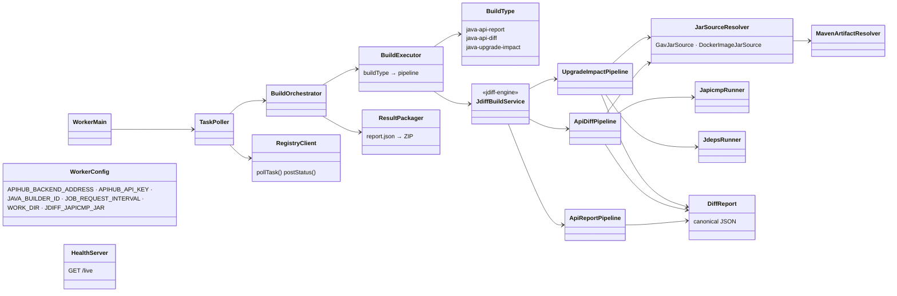

---

## 6. Deployment views

### 6.1 Kubernetes (Helm chart `deploy/helm-templates/qubership-apihub`)

```mermaid
flowchart TB
    internet(("Internet / corporate network")):::ext

    subgraph k8s ["Kubernetes cluster — APIHUB namespace"]
        direction TB
        ingress["<b>Ingress</b> (http / https + TLS secret)<br/>→ Service qubership-apihub-ui:8080"]:::infra

        subgraph ui_d ["Deployment qubership-apihub-ui"]
            ui["nginx + SPAs<br/>replicas: 1 (scalable)"]:::core
        end
        subgraph be_d ["Deployment qubership-apihub-backend"]
            be["Backend :8080<br/>replicas: 1 · ServiceAccount + RoleBinding<br/>(Olric K8s discovery) · ServiceMonitor · Grafana dashboards"]:::core
        end
        subgraph btc_d ["Deployment qubership-apihub-build-task-consumer"]
            btc["Consumer :3000<br/>replicas: 1 → 3–6 in production<br/>api-key secret"]:::core
        end
        subgraph lint_d ["Deployment qubership-api-linter-service"]
            lint["Linter :8080<br/>ServiceAccount + RoleBinding (Olric)<br/>Spectral binaries bundled"]:::extension
        end
        subgraph abe_d ["Deployment qubership-apihub-agents-backend"]
            abe["Agents Backend :8080"]:::extension
        end
        subgraph jtc_d ["Deployment java-task-consumer (separate chart)"]
            jtc["JTC :3000 /live<br/>optional registryAuth secret"]:::planned
        end
        secrets["ConfigMaps / Secrets<br/>config.yaml per service, JWT private key,<br/>DB credentials, access tokens, TLS"]:::infra
        olric["Olric LAN cluster<br/>(embedded in backend + linter pods)"]:::datastore
    end

    pg[("PostgreSQL 14+<br/>external or local-k8s-quickstart/postgres-db<br/>3 databases")]:::datastore
    s3[("S3 / MinIO (optional)")]:::datastore
    idp["Identity Provider<br/>(Keycloak in quickstart)"]:::ext
    llm["LLM API"]:::ext
    prom["Prometheus / Grafana"]:::ext
    superset["Apache Superset<br/>(optional quickstart subchart)"]:::ext

    subgraph remote ["Remote Kubernetes cluster"]
        agent["Deployment qubership-apihub-agent :8080<br/>ServiceAccount with list namespaces/services"]:::agent
        wl["Workloads"]:::k8s_svc
    end

    internet ==> ingress ==> ui
    ui ==> be
    ui --> lint & abe
    be <==> btc
    be <-.-> jtc
    be & lint & abe --> pg
    be -.-> s3
    be <--> olric <--> lint
    be --> idp
    be & lint -.-> llm
    prom --> be
    superset -.-> pg
    abe <==> agent --> wl
    lint -- "REST" --> be
    abe -- "REST" --> be

    classDef ext fill:#6b7280,stroke:#374151,color:#fff
    classDef infra fill:#64748b,stroke:#334155,color:#fff
    classDef core fill:#2563eb,stroke:#1e40af,color:#fff
    classDef extension fill:#16a34a,stroke:#15803d,color:#fff
    classDef planned fill:#d97706,stroke:#92400e,color:#fff,stroke-dasharray:6
    classDef agent fill:#f97316,stroke:#c2410c,color:#fff
    classDef datastore fill:#475569,stroke:#334155,color:#fff
    classDef k8s_svc fill:#fed7aa,stroke:#f97316,color:#333
    style k8s fill:#eff6ff,stroke:#2563eb,stroke-width:2px,stroke-dasharray:6,color:#1e3a5f
    style remote fill:#fff7ed,stroke:#f97316,stroke-width:2px,stroke-dasharray:6,color:#7c2d12
```

Sizing guidance from `values.yaml`: Backend CPU 3 / 3 Gi in production (`GOMEMLIMIT` ≈ 80 % of the limit),
Build Task Consumer 3–6 replicas, Linter 1000 Mi default, Agents Backend 256 Mi default. Health probes: `/live`,
`/ready` on Go services; `/live` on consumers; nginx `/probes/live`, `/probes/ready`.

### 6.2 Docker Compose (`deploy/docker-compose/apihub-generic`)

```mermaid
flowchart LR
    subgraph compose ["podman compose · apihub-generic"]
        direction LR
        ui["qubership-apihub-ui:dev"]:::core
        be["qubership-apihub-backend:dev"]:::core
        btc["qubership-apihub-build-task-consumer:dev"]:::core
        lint["qubership-api-linter-service:dev"]:::extension
        abe["qubership-apihub-agents-backend:dev"]:::extension
        pg[("postgres")]:::datastore
    end
    ui --> be & lint & abe
    be <--> btc
    be & lint & abe --> pg
    lint & abe --> be
    classDef core fill:#2563eb,stroke:#1e40af,color:#fff
    classDef extension fill:#16a34a,stroke:#15803d,color:#fff
    classDef datastore fill:#475569,stroke:#334155,color:#fff
    style compose fill:#f8fafc,stroke:#94a3b8
```

Variants: `with-keycloak` (OIDC SSO testing), `with-gitlab` (backend config sample);
`java-task-consumer/docker-compose.yml` runs JTC standalone (host port 3001 → 3000).

---

## 7. Dynamic views

### 7.1 Publish a package version

```mermaid
sequenceDiagram
    autonumber
    actor User
    participant UI as Portal UI
    participant BE as Backend
    participant PG as PostgreSQL
    participant BTC as Build Task Consumer
    participant OL as Olric DTopic
    participant LS as Linter Service
    participant LLM as LLM API

    User->>UI: Upload sources / configure version
    UI->>BE: POST /api/v2/packages/{id}/publish (multipart config + sources)
    BE->>PG: insert build task (status: none), store sources (or S3)
    BE-->>UI: publishId
    loop every requestInterval
        BTC->>BE: POST /api/v2/builders/{builderId}/tasks
    end
    BE-->>BTC: 200 task ZIP (config.json + sources)
    BTC->>BE: status=running (heartbeat every statusInterval)
    rect rgb(239,246,255)
        note over BTC: PackageVersionBuilder.run('build')
        BTC->>BTC: parse & detect SpecType / contract type
        BTC->>BTC: buildDocument · buildOperations
        BTC->>BTC: normalize (api-unifier)
        BTC->>BE: GET previous version operations / references (resolvers)
        BTC->>BTC: apiDiff (api-diff) · classify · BWC validation
        BTC->>BTC: pack result ZIP (build-result-index)
    end
    BTC->>BE: POST /api/v3/packages/{id}/publish/{publishId}/status (complete + ZIP)
    BE->>PG: BuildResultService stores documents, operations, changes, contracts
    BE->>OL: publish "version-published"
    OL-->>LS: PublishEventListener
    LS->>BE: GET version documents (access token)
    LS->>LS: LinterSelector → SpectralExecutor
    LS-->>LLM: AIOasExecutor (optional)
    LS->>LS: ScoringService → version score
    LS->>PG: store lint results + score (apihub_linter)
    UI->>BE: poll GET /publish/{publishId}/status
    UI->>LS: GET /api-linter/api/v1/…/validation/summary, /scoring
```

### 7.2 Agent discovery and snapshot promotion

```mermaid
sequenceDiagram
    autonumber
    participant AG as Agent (remote cluster)
    participant ABE as Agents Backend
    participant K8s as Kubernetes API
    participant SVC as Workload services
    actor User
    participant UI as Agents SPA
    participant BE as Backend

    rect rgb(255,247,237)
        note over AG,ABE: Registration
        AG->>ABE: POST /api/v2/agents (cloud, URL, namespace, version)
        loop every ~30 s
            AG->>ABE: heartbeat
        end
    end
    User->>UI: select agent → namespace → workspace, run discovery
    UI->>ABE: POST /api/v2/agents/{id}/namespaces/{ns}/workspaces/{ws}/discover
    ABE->>AG: POST /api/v2/namespaces/{ns}/workspaces/{ws}/discover
    AG->>K8s: list services (cached)
    par per service, all DiscoveryRunners in parallel
        AG->>SVC: REST: probe swagger / openapi URLs
        AG->>SVC: GraphQL: introspection
        AG->>SVC: AsyncAPI / Markdown / JSON Schema / generic probes
    end
    AG-->>ABE: services + documents + failed calls
    ABE-->>UI: discovery result
    User->>UI: create snapshot
    UI->>ABE: POST …/snapshots
    ABE->>AG: GET specs
    ABE->>BE: publish package versions (dashboard + references)
    BE-->>ABE: publishIds
    ABE-->>UI: snapshot status
```

### 7.3 MCP client and AI chat

```mermaid
sequenceDiagram
    autonumber
    actor Dev as Developer
    participant IDE as MCP client (Cursor / Claude)
    participant BE as Backend MCP server (/api/v1/mcp/)
    participant OPS as OperationService / Search
    participant CHAT as AiChatTurnService
    participant LLM as LLM API

    rect rgb(245,243,255)
        note over IDE,BE: External MCP client (Streamable HTTP, api-key / PAT)
        IDE->>BE: initialize (session idle TTL 15 min)
        IDE->>BE: tools/call search_api_operations
        BE->>OPS: search (RBAC via security context)
        OPS-->>BE: operations
        BE-->>IDE: result
        IDE->>BE: tools/call get_api_operation_specification / get_api_operation_diff / get_document
        IDE->>BE: resources/read mcp://api-packages-list · prompts/get IDS authoring kit
    end

    rect rgb(240,253,244)
        note over Dev,LLM: Built-in AI chat (ai.chat.enabled)
        Dev->>BE: POST /api/v1/ai-chat/chats/{id}/messages/stream
        BE->>CHAT: run turn
        loop tool loop, max 10 iterations
            CHAT->>LLM: chat completion with MCP tools + ask_clarification
            LLM-->>CHAT: tool call
            CHAT->>OPS: execute tool via MCPService
        end
        CHAT-->>Dev: SSE stream (tokens, tool events, ephemeral files)
    end
```

### 7.4 Authentication paths

```mermaid
flowchart LR
    browser["Browser"]:::person
    ci["CI / scripts"]:::person
    mcp["MCP client"]:::person
    local["POST /api/v3/auth/local<br/>(non-production)"]:::comp
    sso["GET /api/v1/login/sso/{idpId}<br/>→ SAML ACS / OIDC callback"]:::comp
    idp["Identity Provider"]:::ext
    jwt["JWT access + refresh<br/>cookie / bearer"]:::comp_red
    apikey["api-key header<br/>(package / system keys)"]:::comp_red
    pat["PAT (personal access token)"]:::comp_red
    guardian["go-guardian union strategy<br/>→ SecurityContext → RBAC"]:::comp_red

    browser --> local & sso
    sso <--> idp
    local & sso --> jwt --> guardian
    ci --> apikey & pat --> guardian
    mcp --> apikey & pat

    classDef person fill:#7c3aed,stroke:#5b21b6,color:#fff
    classDef comp fill:#3b82f6,stroke:#1e40af,color:#fff
    classDef comp_red fill:#dc2626,stroke:#991b1b,color:#fff
    classDef ext fill:#6b7280,stroke:#374151,color:#fff
```

---

## 8. Cross-cutting — API/contract type support matrix

| Type | Backend `ApiType` / contract | api-processor builder | `SpecType` (unifier/diff) | Agent runner | Linter | UI rendering |
|---|---|---|---|---|---|---|
| OpenAPI 3.0 / 3.1 | `rest` | `restApiBuilder` | `openapi-3.0`, `openapi-3.1` | REST | Spectral + AI | apispec-view, playground, class-view |
| Swagger 2.0 | `rest` (converted) | `restApiBuilder` (swagger2openapi) | → OAS 3 | REST | Spectral + AI | same as OAS |
| GraphQL | `graphql` | `graphqlApiBuilder` | `graphapi` | GraphQL | — | GraphQLOperationViewer, GraphiQL |
| AsyncAPI 3 (2.x converted) | `asyncapi` | `asyncApiBuilder` | `asyncapi-3` | AsyncAPI | Spectral | apispec-view |
| JSON Schema 04/06/07 | document | via REST/unknown | `json-schema-0x` | JSON Schema | — | JsonSchemaViewer |
| Markdown / text | document | `textApiBuilder` | — | Markdown | — | MarkdownViewer (+ Mermaid) |
| Protobuf / gRPC | `protobuf` (stub) | — | — | — | — | raw |
| DDLAPI 1.0 | contract `ddl` | `ddlBuilder` | `ddlapi-1.0` | — | — | Contracts tab (entities, changes, export) |
| MCP server catalog | contract `mcp` | `mcpBuilder` (schemas 2024-11-05 … 2025-11-25) | — | — | — | Contracts tab (tools, prompts, resources) |
| Java API (jar) | *pending* `java-builders` | JTC pipelines | — | — | — | *pending* |

---

## Appendix A — Module → container map

| Module | C4 element | Notes |
|---|---|---|
| `deploy/helm-templates`, `deploy/docker-compose`, `docs/` | Deployment (Helm chart, docker-compose, docs) | umbrella chart, `local-k8s-quickstart` (Postgres, Keycloak, Superset) |
| `backend/portal-backend` | Container: Backend | Go micro-monolith |
| `frontend/ui` | Container: UI | Portal + Agents SPAs, nginx |
| `frontend/build-task-consumer` | Container: Build Task Consumer | NestJS worker |
| `backend/api-linter-service` | Container: API Linter Service | Go |
| `backend/agents-backend` | Container: Agents Backend | Go |
| `backend/agent` | Container: Agent (remote) | Go |
| `backend/java-task-consumer` | Container: Java Task Consumer (new) | Java 21, `jdiff-engine` module |
| `frontend/json-crawl`, `api-unifier`, `api-diff`, `api-visitor`, `api-processor`, `graphapi`, `http-spec`, `ddlapi` | Code: TypeScript processing libraries | published to the GitHub npm registry |
| `frontend/api-doc-viewer` (with its data model), `apispec-view`, `rest-playground`, `class-view` | Code: UI rendering libraries / web components | |
| `backend/commons-go` | Code: shared Go module (`api-spec-exposer`) | used by Go services |
| `tests/postman-collections`, `tests/ui-tests` | E2E tests (Newman, Playwright) | |
| `tools/`, `.github/` | CI/CD: release scripts, Nx plugins, workflows; `agent-packages/` (APM) | |
| `qubership-apihub-aux-tools` (separate repository) | Satellite tools: `apihub-api-diff` CLI + local MCP, `apihub-portal-package-copy` | outside runtime boundary |
| `qubership-apihub-tyk-adapter` (separate repository) | Design only (APIHUB → Tyk GitOps bridge) | no code |

## Appendix B — What changed since the April 2026 diagrams

| Area | April 2026 diagrams (`diagrams/APIHUB_C4_mermaid.md`) | Current code (September 2026) |
|---|---|---|
| Go toolchain | Go 1.25 | Go 1.26.6 in all Go services |
| MCP transport | "SSE transport" | **Streamable HTTP** (`mcpserver.NewStreamableHTTPServer`, session idle TTL 15 min); tools renamed to `search_api_operations`, `get_api_operation_specification`, `get_api_operation_diff`, new `get_document`; legacy `*_rest_*` names kept; `mcp://api-packages-list` resource; IDS authoring prompt |
| AI chat | single `/api/v1/ai-chat` + `/stream` | chat sessions `/api/v1/ai-chat/chats/{chatId}` with `/messages` and `/messages/stream`, tool loop over MCP tools + `ask_clarification`, ephemeral files, chat retention cleanup |
| Linter MCP | not shown | Linter exposes `/api/v1/mcp/` with `list_linter_issues_for_package_version`; Vacuum binaries bundled but inactive |
| Contract types | not shown | DDLAPI (`ddlapi-1.0` SpecType, `ddl` contract, `DDLContractController`) and MCP catalog contracts (`mcp`, `MCPContractController`, MCP schema versions up to 2025-11-25) |
| Cleanup jobs | "scheduled goroutines" | `robfig/cron` jobs: revisions, comparisons, soft-deleted, unreferenced, builds, ephemeral files, maintenance VACUUM, AI-chat cleanup |
| Build types | build · changelog · export · document-group | + `prefix-groups-changelog`, `exportVersion`, `exportRestDocument`, `exportRest/Graphql/AsyncapiOperationsGroup`; `documentGroup`, `reducedSourceSpecifications`, `mergedSpecification` deprecated |
| UI proxy | `/api`, `/api-linter`, `/agents-backend` | + `/apihub-nc` optional extension upstream, `/playground`, `/saml`, `/login/sso`, dedicated no-buffering location for MCP and chat SSE |
| Agent API | v1 only | v1–v3 endpoints, workspace-scoped discovery (`/api/v2/workspaces/{id}/discover`) |
| Java analysis | absent | new `backend/java-task-consumer` (jdiff-engine, japicmp, jdeps, OCI image jar extraction); backend `java-builders` queue is specified in `docs/backend-api.md` but not implemented in `Service.go` |
| Auth | SAML/OIDC/LDAP/local | + refresh tokens (`/api/v3/auth/local/refresh`), ephemeral-file tokens, `legacySaml` flag |
| Observability | Prometheus mentioned | ServiceMonitor + two Grafana dashboards shipped in chart; business metrics counters (MCP sessions, etc.) |

## Appendix C — Verification sources

Facts in this document were checked against these files on 2026-09-11:

- `backend/portal-backend/Service.go` (routes, DI wiring), `go.mod`, `config.template.yaml`,
  `controller/MCPController.go`, `service/MCPService.go`, `service/AiChatTurnService.go`, `service/BuildService.go`,
  `service/PublishNotificationService.go`, `service/cleanup/*`, `security/*`
- `frontend/ui/nginx/nginx.conf.template`, `package.json`
- `frontend/build-task-consumer/src/modules/**`, `package.json`
- `backend/api-linter-service/service.go`, `service/*`, `config.template.yaml`
- `backend/agents-backend/service.go`, `service/*`
- `backend/agent/service.go`, `service/document_discovery.go`, `api_type/*`
- `frontend/api-processor/src/{builder.ts,consts.ts,apitypes,strategies}`, `package.json`
- `frontend/api-unifier/src/spec-type.ts`, `frontend/api-diff/src/api.ts`
- `backend/java-task-consumer/{README.md,docs/DESIGN.md,docs/backend-api.md,src}`
- `deploy/helm-templates/qubership-apihub/{values.yaml,templates}`, `deploy/docker-compose/apihub-generic/docker-compose.yml`
- Workspace cards: `documents/overall/*.md`, `LLM/*.md`
